# BRASAS OS v2 — II. PRUEBAS DEL SOFTWARE

| | |
|---|---|
| **Asignatura** | Software II |
| **Proyecto** | Brasas OS v2: sistema web de gestión para restaurantes de parrilla |
| **Documento** | Segunda parte de la plantilla del proyecto final: Pruebas del software |
| **Sistema bajo prueba** | React 19 + Vite 8 (`apps/web`) · Node.js + Express 5 (`apps/api`) · PostgreSQL en Supabase · JWT |
| **Integrantes** | [Nombres del equipo] |
| **Fecha** | [dd/mm/aaaa] |

## Guía de uso del documento

El documento sigue la estructura y la numeración del documento de ejemplo de la plantilla (2.1 a 2.7). A diferencia del ejemplo, que prueba todos los módulos del proyecto, aquí se trabajan **cinco módulos**, los más relevantes para el negocio: Gestión de Pedidos, Inventario, Menú y costeo, Dashboard financiero e Historial de auditoría. Se excluyen Inicio de sesión y Registro por ser los módulos más simples; solo se usan como precondición.

**Herramientas y nivel de prueba en que se aplican**

| Herramienta | Nivel / tipo de prueba | Sección |
|---|---|---|
| Cypress 16 (*Component Testing* y *E2E*) | Pruebas unitarias e integración de la capa de presentación | 2.3 y 2.4 |
| Jest 30 + Supertest 7 | Pruebas de integración (incremental y basada en hilos) y fiabilidad | 2.4 y 2.5.5 |
| OWASP ZAP 2.17 | Sistema: seguridad | 2.5.1 |
| Apache JMeter 5.6.3 | Sistema: rendimiento y fiabilidad | 2.5.2 y 2.5.5 |
| Google Lighthouse 13 | Sistema: usabilidad | 2.5.3 |
| Selenium WebDriver 4 | Sistema: portabilidad y compatibilidad; pruebas de aceptación | 2.5.4 y 2.6 |
| SonarQube Community Build | Sistema: mantenibilidad | 2.5.6 |

**Convención de identificadores**

| Prefijo | Significado |
|---|---|
| `CP-xx` / `Cn` | Caso de prueba unitario del módulo / camino básico n |
| `CI-Axx`, `CI-DPx`, `CI-DAx` | Integración incremental ascendente, descendente por profundidad y descendente por anchura |
| `CI-H0x-0y` | Caso y de la integración basada en el hilo H0x |
| `P1-xx`, `N1-xx`, `T1-xx`, `G1-xx`, `D1-xx`, `SN-xx`, `SIS-xx` | Prueba automatizada del módulo del árbol de integración (2.4.1.1.2) |
| `SG`, `RP`, `US`, `PT`, `FI`, `MT` | Sistema: seguridad, rendimiento, usabilidad, portabilidad, fiabilidad y mantenibilidad |
| `CA0xx` | Caso de prueba de aceptación |
| `DEF-xx` | Defecto registrado en el Anexo C |

**Estado de la evidencia.** Los análisis, diseños y scripts de este documento están hechos sobre el código real del repositorio. Durante su elaboración se hizo una **ejecución de referencia** el 19/10/2026 para validar los scripts:

- La suite de integración de componentes (Jest + Supertest, sin base de datos) se ejecutó completa: **83 de 92 pruebas aprobadas**. Los 9 fallos corresponden a defectos reales del código, no a errores del script, y sus resultados se reportan en 2.4.
- Las suites que necesitan base de datos (persistencia, sistema e hilos) se ensayaron contra un **esquema reconstruido** a partir del código, en un PostgreSQL 16 local. Ese ensayo sirvió para depurar los scripts, pero **no es evidencia oficial**: hay que ejecutarlas contra el proyecto de pruebas `brasas-test`, que es copia del esquema real (2.2.4).
- Los scripts de Cypress y Selenium tienen la sintaxis verificada, y los comportamientos que comprueban (redirecciones, menú lateral, columnas visibles, selectores XPath) se revisaron en un navegador automatizado sobre el *build* de producción. Se ejecutan en el equipo del equipo de trabajo.

Lo que se diligencia después de ejecutar queda marcado como `[PANTALLAZO: …]`, **Resultado obtenido**, **¿OK?** y **Concepto final**. Si un caso detecta un defecto conocido, el documento lo indica: ese caso **debe fallar** mientras el defecto exista, y eso es un resultado válido de la prueba.

---

# II. PRUEBAS DEL SOFTWARE

## 2.1. INTRODUCCIÓN

Esta unidad presenta el proceso de pruebas aplicado a Brasas OS v2, una aplicación web para restaurantes de parrilla. La aplicación integra la toma de pedidos, el inventario de insumos y carnes por kilogramo, el costeo de los platos, las métricas de rentabilidad y un historial de auditoría, con tres roles: Administrador, Jefe y Empleado. En este dominio un defecto no es solo un error técnico. Un descuento de inventario mal aplicado o un margen mal calculado lleva al Jefe a comprar de más, a vender platos con pérdida o a no detectar faltantes de carne durante el servicio.

Las pruebas de software son el proceso de ejecutar un programa con la intención de encontrar defectos y de obtener evidencia objetiva de que cumple sus requisitos (Myers et al., 2011). Su propósito es detectar los defectos de forma temprana, reducir el riesgo de fallos en producción y demostrar con evidencia que la aplicación se comporta como se espera (Pressman y Maxim, 2021).

A lo largo de la unidad se describe la planificación de las pruebas (objetivos, alcance, estrategias y ambiente) y su ejecución en cuatro niveles:

- pruebas unitarias sobre cinco módulos del frontend;
- pruebas de integración entre los componentes, con las estrategias incremental y basada en hilos;
- pruebas de sistemas: seguridad, rendimiento, usabilidad, portabilidad, fiabilidad y mantenibilidad;
- pruebas de aceptación basadas en escenarios de negocio de los roles Jefe y Empleado.

Al final se presentan las conclusiones por cada nivel de prueba.

## 2.2. PLANIFICACIÓN DE LAS PRUEBAS

### 2.2.1. OBJETIVOS

**Objetivo general (referente a todo el proceso de las pruebas)**

Verificar y validar que Brasas OS v2 cumple sus requisitos funcionales y no funcionales en los módulos de Pedidos, Inventario, Menú y costeo, Dashboard financiero e Historial de auditoría. Para ello se aplican pruebas unitarias, de integración, de sistemas y de aceptación con herramientas automatizadas, con el fin de detectar defectos y asegurar la calidad del producto antes de su puesta en producción.

**Objetivos específicos**

- Verificar que los componentes de interfaz de los cinco módulos aceptan las clases de equivalencia válidas, rechazan las no válidas y se comportan correctamente en los valores límite. Las pruebas también deben recorrer al menos una vez cada camino independiente de los métodos críticos (Cypress).
- Validar que las rutas, el middleware de autenticación y auditoría, los controladores, los servicios y la base de datos se integran correctamente, en orden ascendente y descendente. También se valida que los cinco flujos principales del negocio funcionan de extremo a extremo; el más crítico es completar un pedido con descuento automático de inventario (Jest + Supertest y Cypress).
- Comprobar que el sistema no presenta vulnerabilidades de riesgo alto (OWASP ZAP) y que la API responde en menos de 3 s con usuarios concurrentes (JMeter). También se comprueba la calidad de las pantallas y su uso a 768 px (Lighthouse), el funcionamiento en Chrome, Firefox y Edge (Selenium), la estabilidad bajo carga y la recuperación ante fallas (JMeter), y el *Quality Gate* de SonarQube.
- Validar que el sistema satisface los escenarios de negocio de los roles Jefe y Empleado, asociados a los requisitos RF-03, RF-07, RF-09, RF-13 a RF-17, RF-20 y RF-23 (Selenium).

### 2.2.2. ALCANCE

El plan cubre cinco módulos de la aplicación y los siguientes tipos de prueba: unitarias, de integración, de sistemas (seguridad, rendimiento, usabilidad, portabilidad con compatibilidad, fiabilidad con disponibilidad, y mantenibilidad) y de aceptación.

**Tabla 1**

*Módulos a probar y objetivos de las pruebas*

| **Nombre de la aplicación a probar** | **Brasas OS v2** |
|---|---|
| **Módulos a ser probados** | **Objetivos de las pruebas** |
| Módulo 1: Gestión de Pedidos (`features/orders`, `api/features/pedidos`) | Verificar el cálculo automático del total (RF-17), el flujo unidireccional pendiente → preparando → completado (RF-16), el registro del método de pago, el descuento automático de inventario al completar (RF-13) y que cada empleado gestione solo sus pedidos (RF-18). |
| Módulo 2: Inventario y movimientos de stock (`features/inventory`, `api/features/inventario`) | Verificar el registro de insumos y carnes por kg (RF-11, RF-12), las entradas y salidas de stock, el rechazo de stock negativo (RNF-10), la trazabilidad por usuario y fecha (RNF-11) y el semáforo y la alerta de stock mínimo (RF-14, RF-15). |
| Módulo 3: Menú y costeo de productos (`features/menu`, `api/features/productos`) | Verificar la creación y edición de productos con receta, el cálculo del costo de producción (RF-07), la alerta cuando el costo iguala o supera el precio (RF-10), la desactivación sin borrado (RF-08) y que el Empleado no vea costos ni márgenes (RF-09). |
| Módulo 4: Dashboard y reportes financieros (`features/dashboard`, `api/features/reportes`) | Verificar la fórmula Utilidad = Ingresos − Costos totales, el margen, la comparación con el período anterior y el filtro de período (RF-20, RF-22), y que el Empleado no acceda a datos financieros (RF-21). |
| Módulo 5: Historial de auditoría (`features/history`, `api/features/historial`, `audit.middleware`) | Verificar el registro automático de las acciones (RF-23), los filtros por acción, entidad y fechas, la paginación y el alcance por rol: Administrador todo, Jefe entidades de negocio de su local, Empleado solo sus acciones. |

*Nota.* Fuente: elaboración propia.

**Fuera de alcance**

- Inicio de sesión y registro: son los módulos más simples y se usan solo como precondición de los demás casos.
- Asistente de inteligencia artificial (RF-24, RF-25): no está implementado en la versión 2 del repositorio.
- CRUD administrativo de usuarios: se usa únicamente para preparar datos de prueba.

**Tabla 2**

*Diferencias entre la documentación y la implementación consideradas en las pruebas*

| Requisito documentado | Implementación encontrada en el código | Tratamiento en las pruebas |
|---|---|---|
| RF-16: estados Pendiente → En Proceso → Completado | Valores `pendiente → preparando → completado` (la interfaz muestra "En Proceso"); se permite completar desde `pendiente` | Se prueba el flujo real y que no se pueda retroceder |
| RNF-02: la sesión expira a los 30 min de inactividad | El JWT expira a las 8 h (`expiresIn: '8h'`) | Se reporta en seguridad (DEF-09) |
| RF-06: solo el Administrador gestiona productos | Las rutas permiten `JEFE` y `ADMIN` | Se prueba que el Empleado reciba 403 |
| RF-11: entradas y salidas de inventario desde la interfaz | Los endpoints `/inventario/entrada` y `/salida` existen, pero la interfaz no los usa | Se prueban por API en integración (hilo H02) |

*Nota.* Fuente: elaboración propia a partir del código del repositorio.

### 2.2.3. ESTRATEGIAS DE PRUEBAS

**Tabla 3**

*Niveles, tipos y métodos de prueba*

| Niveles de pruebas | Técnicas de pruebas | Modelos / estrategias / tipos | Herramientas de pruebas |
|---|---|---|---|
| Pruebas unitarias | Caja negra, caja blanca | Clases de equivalencia · Valores límite · Camino básico | Cypress 16 (*Component Testing*) |
| Pruebas de integración | Caja negra | Incremental ascendente / descendente (por profundidad y por anchura) · Pruebas basadas en hilos | Jest 30 + Supertest 7 · Cypress 16 (*E2E*) |
| Pruebas de sistemas | Caja negra | Pruebas de seguridad | OWASP ZAP 2.17 |
| | | Pruebas de rendimiento | Apache JMeter 5.6.3 |
| | | Pruebas de usabilidad (interfaz de usuario) | Google Lighthouse 13 |
| | | Pruebas de portabilidad (incluye compatibilidad) | Selenium WebDriver 4 |
| | | Pruebas de fiabilidad (incluye disponibilidad) | Apache JMeter · Jest + Supertest · UptimeRobot |
| | | Pruebas de mantenibilidad | SonarQube Community Build |
| Pruebas de aceptación | Caja negra | Pruebas de usuario final (escenarios de negocio y requisitos funcionales) | Selenium WebDriver 4 |

*Nota.* Fuente: elaboración propia.

**Criterios de aprobación**

| Nivel | Criterio de aprobación |
|---|---|
| Unitarias | Cada camino básico tiene al menos un caso ejecutado. Los casos válidos se aprueban y los no válidos son rechazados por la interfaz. |
| Integración | Todos los casos CI se ejecutan y ninguna respuesta es un error 500 no controlado. Un caso es *Aprobado* si todos sus pasos son conformes, *Aprobado con observaciones* si las diferencias no impiden el flujo, y *No aprobado* si el flujo falla. |
| Sistemas | Seguridad: 0 alertas de riesgo alto y alertas medias corregidas o justificadas (ZAP). Rendimiento: p95 < 3 s y error < 1 % (JMeter). Usabilidad: Accesibilidad y Prácticas recomendadas ≥ 90 (Lighthouse). Portabilidad: 100 % de casos aprobados en los 3 navegadores. Fiabilidad: error < 1 % en carga sostenida. Mantenibilidad: *Quality Gate* "Passed" (SonarQube). |
| Aceptación | En todos los casos CA el resultado obtenido coincide con el esperado. |

**Gestión de defectos.** Cada caso fallido se registra en el Anexo C con un identificador `DEF-xx`, su severidad (Crítica, Alta, Media o Baja), el caso que lo detectó y la corrección sugerida. Después de corregir, se repite el caso (*re-test*) y la suite completa del nivel (regresión).

### 2.2.4. AMBIENTE DE PRUEBAS

Hardware y software utilizados por el equipo de pruebas.

**Tabla 4**

*Configuración base de hardware*

| EQUIPO | ESPECIFICACIONES TÉCNICAS |
|---|---|
| Computador de pruebas 1 | Procesador: [completar] · Memoria RAM: [completar] (mínimo 8 GB; 16 GB si se ejecutan SonarQube y ZAP a la vez) · Almacenamiento: SSD con al menos 10 GB libres · Sistema operativo: Windows 11 x64 |
| Computador de pruebas 2 (portabilidad) | Otro equipo u otro sistema operativo con al menos un navegador distinto: [completar] |
| Tablet o emulación | Ventana de 768 × 1024 px (Selenium / DevTools) para RNF-09 |
| Servidor de base de datos | Supabase (PostgreSQL gestionado), proyecto independiente de pruebas `brasas-test` |

*Nota.* Fuente: elaboración propia.

**Tabla 5**

*Software para el ambiente de pruebas*

| SOFTWARE | VERSIÓN |
|---|---|
| Node.js (Cypress 16 exige Node 22 o 24) | 22 LTS o 24 LTS |
| React / Vite / Express | 19.2 / 8.0 / 5.2 |
| Motor de base de datos de pruebas: Supabase | PostgreSQL 15 o superior |
| Cypress | 16.x |
| Jest / Supertest | 30.5 / 7.3 |
| selenium-webdriver (incluye Selenium Manager) | 4.51 o superior |
| Apache JMeter (requiere Java 17) | 5.6.3 |
| OWASP ZAP (ZAP by Checkmarx) | 2.17.x |
| Google Lighthouse (Chrome DevTools) | 13.x |
| SonarQube Community Build (Docker) + `@sonar/scan` | imagen `sonarqube:community` / última versión |
| Docker Desktop | Última versión estable |
| Google Chrome / Mozilla Firefox / Microsoft Edge | Última versión estable |
| Git for Windows | Última versión estable |

*Nota.* Fuente: elaboración propia. Las versiones exactas se completan con `node -v`, `npx cypress -v`, `java -version` y la ventana *Acerca de* de cada herramienta.

**Base de datos de pruebas.** Nunca se prueba contra la base de datos de producción: las pruebas crean, modifican y borran registros, y el escaneo activo de ZAP envía cargas maliciosas. Se crea en Supabase un segundo proyecto, `brasas-test`, con el **mismo esquema** de producción (tablas, triggers como `fn_completar_pedido` y datos de la tabla `roles`), y la API se conecta a él mediante `apps/api/.env.test`. Los guardas de los scripts impiden ejecutar las suites con base de datos si ese archivo no declara `DB_ENTORNO=pruebas`. El procedimiento completo está en el Anexo A.4.

## 2.3. PRUEBAS UNITARIAS

Las pruebas unitarias se realizan con **Cypress 16 en modo *Component Testing***. Cada componente o función de React se monta **aislado** en un navegador real y sus dependencias se reemplazan por dobles de prueba:

- `cy.stub()` para los *callbacks*;
- `cy.intercept()` para las peticiones HTTP;
- `cy.clock()` para el tiempo;
- `setState()` de Zustand para el estado global.

De esta forma la prueba es unitaria: si falla, el defecto está en el componente y no en el backend. La instalación y la configuración de Cypress están en el Anexo A.1, y los scripts completos en el Anexo B.1.

Por cada módulo se realiza el análisis (clases de equivalencia, valores límite y camino básico), el diseño de los casos de prueba y su ejecución y evaluación. Los casos se identifican como `CP-xx` y los caminos independientes como `Cn`. En la ejecución, cada caso indica el camino que recorre, por ejemplo **CP-03 / C5**.

**Buenas prácticas aplicadas**

- Patrón *Arrange–Act–Assert* y un solo comportamiento por caso (`it`).
- Ninguna prueba depende del backend ni de otra prueba.
- Selectores por texto visible y etiqueta, es decir, lo que ve el usuario. Como mejora se recomienda agregar `data-cy` y `aria-label` a los botones que solo tienen ícono (+, −, ×, papelera).
- Evidencias: `npx cypress open --component` muestra el *Command Log* paso a paso (*time travel*) y `npm run test:unit` muestra la tabla resumen (Tests / Passing / Failing).

### 2.3.1. Módulo 1: Gestión de Pedidos

**NOMBRE DEL MÓDULO: GESTIÓN DE PEDIDOS (NUEVO PEDIDO Y MÉTODO DE PAGO)**

Componentes bajo prueba: `OrderCreateModal.jsx` (modal "Nuevo Pedido") y `PaymentModal.jsx` (modal "Método de pago" que se abre al completar un pedido). Entradas de la interfaz:

- plato (selector con buscador), cantidad (botones − / +) y líneas adicionales ("Agregar otro plato");
- método de pago (Efectivo / Transferencia / Ambos), monto en efectivo y monto por transferencia.

El total del pedido llega al modal de pago como dato (`total`).

#### 2.3.1.1. Análisis de las pruebas

##### 2.3.1.1.1. Análisis de pruebas clases de equivalencias

**Figura 1**

*Interfaz de los modales "Nuevo Pedido" y "Método de pago" de Brasas OS*

`[PANTALLAZO: /empleado/pedidos → modal "Nuevo Pedido" con un plato seleccionado y el total estimado]`
`[PANTALLAZO: modal "Método de pago" con la opción "Ambos" y los montos de efectivo y transferencia]`

*Nota.* Fuente: elaboración propia.

**Tabla 6**

*Clases de equivalencia del módulo Gestión de Pedidos*

| Condiciones de entrada | Clases de equivalencia válida | Clases de equivalencia no válida |
|---|---|---|
| Plato del pedido | 1. Al menos un plato activo seleccionado | 2. Ningún plato seleccionado |
| Plato por línea | 3. Platos distintos en cada línea | 4. El mismo plato en dos líneas |
| Cantidad por línea | 5. Entero ≥ 1 | 6. Cantidad < 1 |
| Método de pago | 7. Efectivo · 8. Transferencia · 9. Ambos | 10. Ningún método seleccionado |
| Montos con "Ambos" (total = $90.000) | 11. Suma > 0 y \|total − suma\| < 1 | 12. Faltante (suma ≤ total − 1) · 13. Excedente (suma ≥ total + 1) · 14. Suma = 0 |

*Nota.* Fuente: elaboración propia.

##### 2.3.1.1.2. Casos de pruebas

**Tabla 7**

*Casos de prueba por clases de equivalencia del módulo Gestión de Pedidos*

| Caso | Plato / cantidad | Método | Efectivo | Transferencia | Clases cubiertas | Resultado esperado |
|---|---|---|---|---|---|---|
| CP-01 | — | (ninguno) | — | — | 10 | Botón "Confirmar" deshabilitado |
| CP-02 | — | Efectivo | — | — | 7 | `onConfirm({ metodo: "efectivo" })` |
| CP-03 | — | Ambos | 50.000 | 40.000 | 9, 11 | `onConfirm({ metodo: "ambos", efectivo: 50000, transferencia: 40000 })` |
| CP-04 | — | Ambos | 50.000 | 30.000 | 12 | "Faltan $10.000" y botón deshabilitado |
| CP-05 | — | Ambos | 60.000 | 40.000 | 13 | "Excede $10.000" y botón deshabilitado |
| CP-06 | — | Ambos | 89.999 / 89.999,5 | 0 | límite de 11 | Bloquea con diferencia 1; permite con 0,5 |
| CP-07 | — | Ambos | 0 | 0 | 14 | Botón deshabilitado |
| CP-08 | (ninguno) | — | — | — | 2 | Botón "Crear pedido" deshabilitado |
| CP-09 | cantidad 1 y clic en "−" | — | — | — | 6 | La cantidad se mantiene en 1 |
| CP-10 | Churrasco 400 g × 2 | — | — | — | 1, 5 | Total "$90.000" y `onSubmit([{ producto_id, cantidad: 2 }])` |
| CP-11 | Churrasco en la línea 1 | — | — | — | 3, 4 | En la línea 2 solo se ofrece "Limonada de coco" |
| CP-12 | — | Transferencia | — | — | 8 | `onConfirm({ metodo: "transferencia" })` |

*Nota.* Fuente: elaboración propia.

##### 2.3.1.1.3. Casos de pruebas por Valores Límites

Aplican a la cantidad (límite inferior 1) y a la diferencia entre el total y la suma de montos, cuyo límite es estricto (`< 1`).

**Tabla 8**

*Casos de prueba por valores límite del módulo Gestión de Pedidos*

| CAMPO | Datos de entrada | Escenario | Resultado |
|---|---|---|---|
| Cantidad | 1 y clic en "−" | Límite inferior | Permanece en 1 (CP-09) |
| Cantidad | 1 y clic en "+" | Límite + 1 | Pasa a 2 y el total a $90.000 (CP-10) |
| Diferencia (Ambos) | 89.999 + 0 → diferencia = 1 | Justo en el límite | Bloquea (CP-06) |
| Diferencia (Ambos) | 89.999,5 + 0 → diferencia = 0,5 | Justo dentro del límite | Permite (CP-06) |
| Diferencia (Ambos) | 50.000 + 40.000 → diferencia = 0 | Valor nominal | Permite (CP-03) |
| Suma (Ambos) | 0 + 0 | Límite inferior de la suma | Bloquea (CP-07) |

*Nota.* Fuente: elaboración propia.

##### 2.3.1.1.4. Pruebas del Camino básico

Caso de uso a validar: CU-PE2, *Actualizar estado de pedido* (registro del pago al completar). Fragmento del método relacionado con esta interfaz (`PaymentModal.jsx`):

**Figura 2**

*Fragmento de código de la lógica de confirmación del pago (`canConfirm` y `handleConfirm`)*

```js
const totalAmbos = Number(efectivo || 0) + Number(transferencia || 0);   // (1)
const diferencia = total - totalAmbos;
const ambosOk = metodo === "ambos"                                        // (3)
  ? totalAmbos > 0 && Math.abs(diferencia) < 1                            // (4) (5)
  : true;
const canConfirm = metodo && (metodo !== "ambos" || ambosOk);             // (2)

const handleConfirm = () => {                                             // (6) botón habilitado
  const pago = metodo === "ambos"
    ? { metodo: "ambos", efectivo: Number(efectivo), transferencia: Number(transferencia) }
    : { metodo };
  onConfirm(pago);
};                                                                        // (7) deshabilitado · (8) fin
```

*Nota.* Fuente: `apps/web/src/features/orders/components/PaymentModal.jsx`.

**Figura 3**

*Grafo de flujo de la confirmación del pago*

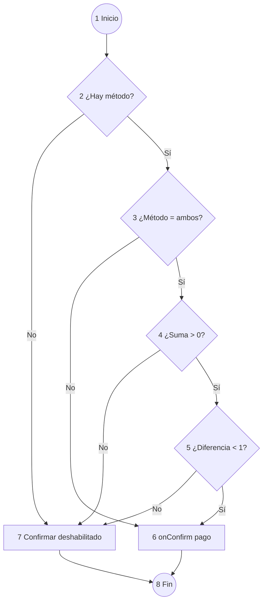

*Nota.* Fuente: elaboración propia.

$$V(G) = A - N + 2 = 11 - 8 + 2 = 5 \text{ de complejidad}$$

$$V(G) = 4 \text{ decisiones} + 1 = 5 \text{ caminos independientes}$$

- C1 = Inicio -> ¿Hay método seleccionado? (No) -> Botón "Confirmar" deshabilitado -> Fin
- C2 = Inicio -> ¿Hay método seleccionado? (Sí) -> ¿Método = ambos? (No) -> onConfirm({ metodo }) -> Fin
- C3 = Inicio -> ¿Hay método seleccionado? (Sí) -> ¿Método = ambos? (Sí) -> ¿Suma > 0? (No) -> Botón deshabilitado -> Fin
- C4 = Inicio -> ¿Hay método seleccionado? (Sí) -> ¿Método = ambos? (Sí) -> ¿Suma > 0? (Sí) -> ¿Diferencia < 1? (No) -> Botón deshabilitado -> Fin
- C5 = Inicio -> ¿Hay método seleccionado? (Sí) -> ¿Método = ambos? (Sí) -> ¿Suma > 0? (Sí) -> ¿Diferencia < 1? (Sí) -> onConfirm(pago dividido) -> Fin

**Tabla 9**

*Caminos independientes y datos de entrada del módulo Gestión de Pedidos*

| CAMINO | metodo | efectivo | transferencia | total | ESCENARIO |
|---|---|---|---|---|---|
| C1 | "" | — | — | 90.000 | Sin método: botón deshabilitado (CP-01) |
| C2 | "efectivo" | — | — | 90.000 | Confirma `{ metodo: "efectivo" }` (CP-02, CP-12) |
| C3 | "ambos" | 0 | 0 | 90.000 | Suma 0: botón deshabilitado (CP-07) |
| C4 | "ambos" | 50.000 | 30.000 | 90.000 | Faltan $10.000: botón deshabilitado (CP-04, CP-05, CP-06a) |
| C5 | "ambos" | 50.000 | 40.000 | 90.000 | Confirma el pago dividido (CP-03, CP-06b) |

*Nota.* Fuente: elaboración propia.

#### 2.3.1.2. Diseño de casos de prueba

Casos de prueba consolidados, uno por cada camino del grafo de flujo, combinando la técnica de caja negra (clases de equivalencia y valores límite) con la de caja blanca. Todos los casos montan `PaymentModal` con `isOpen`, `total = 90000` y `onConfirm` y `onClose` reemplazados por `cy.stub()`.

**Tabla 10**

*Diseño del caso de prueba CP-01 (camino C1) del módulo Gestión de Pedidos*

| **Caso de prueba ID** | CP-01 | **No. del caso de prueba** | 001 |
|---|---|---|---|
| **Descripción del caso de prueba** | Verificar que el pago no se pueda confirmar si no se ha seleccionado un método de pago | **Nombre del módulo** | Gestión de Pedidos – Método de pago (`PaymentModal`) |
| **Responsable** | [Responsable] | **Versión** | 1.0 |
| **Fecha de prueba** | [dd/mm/aaaa] | **Estado del caso de prueba** | No ejecutado |

| S# | Prerrequisitos | S# | Datos de pruebas |
|---|---|---|---|
| 1 | Cypress configurado para *Component Testing* | 1 | total = 90000 |
| 2 | `PaymentModal` montado y abierto | 2 | método = ninguno |

| Paso # | Detalles del paso | Resultados esperados | Resultados actuales | Estado |
|---|---|---|---|---|
| 1 | Montar el modal sin seleccionar método | Se muestran las opciones Efectivo, Transferencia y Ambos | | |
| 2 | Verificar el botón "Confirmar" | Deshabilitado; `onConfirm` no se invoca | | |

*Nota.* Fuente: elaboración propia.

**Tabla 11**

*Diseño del caso de prueba CP-02 (camino C2) del módulo Gestión de Pedidos*

| **Caso de prueba ID** | CP-02 | **No. del caso de prueba** | 002 |
|---|---|---|---|
| **Descripción del caso de prueba** | Verificar que un pago en efectivo se confirme con el método seleccionado | **Nombre del módulo** | Gestión de Pedidos – Método de pago (`PaymentModal`) |
| **Responsable** | [Responsable] | **Versión** | 1.0 |
| **Fecha de prueba** | [dd/mm/aaaa] | **Estado del caso de prueba** | No ejecutado |

| S# | Prerrequisitos | S# | Datos de pruebas |
|---|---|---|---|
| 1 | `PaymentModal` montado y abierto | 1 | total = 90000 |
| 2 | `onConfirm` = `cy.stub()` | 2 | método = "Efectivo" |

| Paso # | Detalles del paso | Resultados esperados | Resultados actuales | Estado |
|---|---|---|---|---|
| 1 | Clic en "Efectivo" | La opción queda resaltada y "Confirmar" se habilita | | |
| 2 | Clic en "Confirmar" | `onConfirm` se invoca una vez con `{ metodo: "efectivo" }` | | |

*Nota.* Fuente: elaboración propia.

**Tabla 12**

*Diseño del caso de prueba CP-07 (camino C3) del módulo Gestión de Pedidos*

| **Caso de prueba ID** | CP-07 | **No. del caso de prueba** | 003 |
|---|---|---|---|
| **Descripción del caso de prueba** | Verificar que un pago dividido con ambos montos en cero no se pueda confirmar | **Nombre del módulo** | Gestión de Pedidos – Método de pago (`PaymentModal`) |
| **Responsable** | [Responsable] | **Versión** | 1.0 |
| **Fecha de prueba** | [dd/mm/aaaa] | **Estado del caso de prueba** | No ejecutado |

| S# | Prerrequisitos | S# | Datos de pruebas |
|---|---|---|---|
| 1 | `PaymentModal` montado y abierto | 1 | método = "Ambos" |
| 2 | `onConfirm` = `cy.stub()` | 2 | efectivo = 0 · transferencia = 0 |

| Paso # | Detalles del paso | Resultados esperados | Resultados actuales | Estado |
|---|---|---|---|---|
| 1 | Clic en "Ambos" | Aparecen los campos Efectivo y Transferencia | | |
| 2 | Escribir 0 en ambos campos | "Total ingresado" muestra $0 | | |
| 3 | Verificar "Confirmar" | Deshabilitado; `onConfirm` no se invoca | | |

*Nota.* Fuente: elaboración propia.

**Tabla 13**

*Diseño del caso de prueba CP-04 (camino C4) del módulo Gestión de Pedidos*

| **Caso de prueba ID** | CP-04 | **No. del caso de prueba** | 004 |
|---|---|---|---|
| **Descripción del caso de prueba** | Verificar que un pago dividido cuya suma es menor que el total muestre el faltante y no se pueda confirmar | **Nombre del módulo** | Gestión de Pedidos – Método de pago (`PaymentModal`) |
| **Responsable** | [Responsable] | **Versión** | 1.0 |
| **Fecha de prueba** | [dd/mm/aaaa] | **Estado del caso de prueba** | No ejecutado |

| S# | Prerrequisitos | S# | Datos de pruebas |
|---|---|---|---|
| 1 | `PaymentModal` montado con `total = 90000` | 1 | método = "Ambos" |
| 2 | `onConfirm` = `cy.stub()` | 2 | efectivo = 50000 · transferencia = 30000 |

| Paso # | Detalles del paso | Resultados esperados | Resultados actuales | Estado |
|---|---|---|---|---|
| 1 | Clic en "Ambos" | Aparecen los campos de montos | | |
| 2 | Escribir 50000 y 30000 | Aparece "Faltan $10.000" en ámbar | | |
| 3 | Verificar "Confirmar" | Deshabilitado; `onConfirm` no se invoca | | |

*Nota.* Fuente: elaboración propia.

**Tabla 14**

*Diseño del caso de prueba CP-03 (camino C5) del módulo Gestión de Pedidos*

| **Caso de prueba ID** | CP-03 | **No. del caso de prueba** | 005 |
|---|---|---|---|
| **Descripción del caso de prueba** | Verificar que un pago dividido (efectivo + transferencia) cuya suma es igual al total se confirme con ambos montos | **Nombre del módulo** | Gestión de Pedidos – Método de pago (`PaymentModal`) |
| **Responsable** | [Responsable] | **Versión** | 1.0 |
| **Fecha de prueba** | [dd/mm/aaaa] | **Estado del caso de prueba** | No ejecutado |

| S# | Prerrequisitos | S# | Datos de pruebas |
|---|---|---|---|
| 1 | `PaymentModal` montado con `total = 90000` | 1 | método = "Ambos" |
| 2 | `onConfirm` = `cy.stub()` | 2 | efectivo = 50000 · transferencia = 40000 |

| Paso # | Detalles del paso | Resultados esperados | Resultados actuales | Estado |
|---|---|---|---|---|
| 1 | Clic en "Ambos" | Aparecen los campos Efectivo y Transferencia | | |
| 2 | Escribir 50000 en Efectivo y 40000 en Transferencia | "Total ingresado" muestra $90.000 en verde | | |
| 3 | Verificar "Confirmar" | Habilitado | | |
| 4 | Clic en "Confirmar" | `onConfirm` recibe `{ metodo: "ambos", efectivo: 50000, transferencia: 40000 }` | | |

*Nota.* Fuente: elaboración propia.

#### 2.3.1.3. Ejecución y evaluación de las pruebas

Ejecución automatizada de los casos con Cypress *Component Testing* sobre los componentes reales de `apps/web`, sin backend:

```bash
cd apps/web
npx cypress run --component --spec "src/features/orders/**/*.cy.jsx"
```

La evidencia de cada caso es el pantallazo del *runner* de Cypress con el caso en verde o rojo y el componente montado. Scripts: `PaymentModal.cy.jsx` y `OrderCreateModal.cy.jsx` (Anexo B.1).

**Tabla 15**

*Evidencia de ejecución de la prueba CP-01 / C1 del módulo Gestión de Pedidos*

| **Prueba** | **Módulo 1 – Gestión de Pedidos** | |
|---|---|---|
| **Caso de prueba** | **Imagen de la prueba** | **Resultado** |
| CP-01 / C1<br>Tipo: No válido<br>Técnica: Caja negra + caja blanca<br>Condición: sin método de pago | `[PANTALLAZO: Cypress – CP-01]` | Resultado esperado: botón "Confirmar" deshabilitado<br>Resultado obtenido: [completar]<br>Estado: [PASS / FAIL] |
| **Observaciones técnicas/funcionales** | [Completar tras ejecutar] | |
| **Concepto final** | [APROBADA / NO APROBADA] | |

*Nota.* Fuente: elaboración propia.

**Tabla 16**

*Evidencia de ejecución de la prueba CP-02 / C2 del módulo Gestión de Pedidos*

| **Prueba** | **Módulo 1 – Gestión de Pedidos** | |
|---|---|---|
| **Caso de prueba** | **Imagen de la prueba** | **Resultado** |
| CP-02 / C2<br>Tipo: Válido<br>Técnica: Caja negra + caja blanca<br>Condición: pago en efectivo | `[PANTALLAZO: Cypress – CP-02]` | Resultado esperado: `onConfirm({ metodo: "efectivo" })`<br>Resultado obtenido: [completar]<br>Estado: [PASS / FAIL] |
| **Observaciones técnicas/funcionales** | El backend (`updateEstado`) no valida el método ni los montos del pago; la validación existe solo en la interfaz (DEF-07). | |
| **Concepto final** | [APROBADA / NO APROBADA] | |

*Nota.* Fuente: elaboración propia.

**Tabla 17**

*Evidencia de ejecución de la prueba CP-03 / C5 del módulo Gestión de Pedidos*

| **Prueba** | **Módulo 1 – Gestión de Pedidos** | |
|---|---|---|
| **Caso de prueba** | **Imagen de la prueba** | **Resultado** |
| CP-03 / C5<br>Tipo: Válido<br>Técnica: Caja negra + caja blanca<br>Condición: pago dividido exacto | `[PANTALLAZO: Cypress – CP-03]` | Resultado esperado: `onConfirm({ metodo: "ambos", efectivo: 50000, transferencia: 40000 })`<br>Resultado obtenido: [completar]<br>Estado: [PASS / FAIL] |
| **Observaciones técnicas/funcionales** | [Completar tras ejecutar] | |
| **Concepto final** | [APROBADA / NO APROBADA] | |

*Nota.* Fuente: elaboración propia.

**Tabla 18**

*Evidencia de ejecución de la prueba CP-04 / C4 del módulo Gestión de Pedidos*

| **Prueba** | **Módulo 1 – Gestión de Pedidos** | |
|---|---|---|
| **Caso de prueba** | **Imagen de la prueba** | **Resultado** |
| CP-04 / C4<br>Tipo: No válido<br>Técnica: Caja negra + caja blanca<br>Condición: pago dividido con faltante | `[PANTALLAZO: Cypress – CP-04]` | Resultado esperado: "Faltan $10.000" y botón deshabilitado<br>Resultado obtenido: [completar]<br>Estado: [PASS / FAIL] |
| **Observaciones técnicas/funcionales** | [Completar tras ejecutar] | |
| **Concepto final** | [APROBADA / NO APROBADA] | |

*Nota.* Fuente: elaboración propia.

**Tabla 19**

*Evidencia de ejecución de la prueba CP-05 / C4 del módulo Gestión de Pedidos*

| **Prueba** | **Módulo 1 – Gestión de Pedidos** | |
|---|---|---|
| **Caso de prueba** | **Imagen de la prueba** | **Resultado** |
| CP-05 / C4<br>Tipo: No válido<br>Técnica: Caja negra + caja blanca<br>Condición: pago dividido con excedente | `[PANTALLAZO: Cypress – CP-05]` | Resultado esperado: "Excede $10.000" y botón deshabilitado<br>Resultado obtenido: [completar]<br>Estado: [PASS / FAIL] |
| **Observaciones técnicas/funcionales** | [Completar tras ejecutar] | |
| **Concepto final** | [APROBADA / NO APROBADA] | |

*Nota.* Fuente: elaboración propia.

**Tabla 20**

*Evidencia de ejecución de la prueba CP-06 / C4–C5 del módulo Gestión de Pedidos*

| **Prueba** | **Módulo 1 – Gestión de Pedidos** | |
|---|---|---|
| **Caso de prueba** | **Imagen de la prueba** | **Resultado** |
| CP-06 / C4–C5<br>Tipo: Valor límite<br>Técnica: Caja negra<br>Condición: diferencia 1 y 0,5 | `[PANTALLAZO: Cypress – CP-06]` | Resultado esperado: con diferencia 1 bloquea y con 0,5 permite<br>Resultado obtenido: [completar]<br>Estado: [PASS / FAIL] |
| **Observaciones técnicas/funcionales** | El límite es estricto (`< 1`): una diferencia de exactamente $1 se considera faltante. | |
| **Concepto final** | [APROBADA / NO APROBADA] | |

*Nota.* Fuente: elaboración propia.

**Tabla 21**

*Evidencia de ejecución de la prueba CP-07 / C3 del módulo Gestión de Pedidos*

| **Prueba** | **Módulo 1 – Gestión de Pedidos** | |
|---|---|---|
| **Caso de prueba** | **Imagen de la prueba** | **Resultado** |
| CP-07 / C3<br>Tipo: Valor límite<br>Técnica: Caja negra + caja blanca<br>Condición: montos en cero | `[PANTALLAZO: Cypress – CP-07]` | Resultado esperado: botón deshabilitado<br>Resultado obtenido: [completar]<br>Estado: [PASS / FAIL] |
| **Observaciones técnicas/funcionales** | [Completar tras ejecutar] | |
| **Concepto final** | [APROBADA / NO APROBADA] | |

*Nota.* Fuente: elaboración propia.

**Tabla 22**

*Evidencia de ejecución de la prueba CP-08 del módulo Gestión de Pedidos*

| **Prueba** | **Módulo 1 – Gestión de Pedidos** | |
|---|---|---|
| **Caso de prueba** | **Imagen de la prueba** | **Resultado** |
| CP-08<br>Tipo: No válido<br>Técnica: Caja negra<br>Condición: pedido sin plato | `[PANTALLAZO: Cypress – CP-08]` | Resultado esperado: botón "Crear pedido" deshabilitado<br>Resultado obtenido: [completar]<br>Estado: [PASS / FAIL] |
| **Observaciones técnicas/funcionales** | [Completar tras ejecutar] | |
| **Concepto final** | [APROBADA / NO APROBADA] | |

*Nota.* Fuente: elaboración propia.

**Tabla 23**

*Evidencia de ejecución de la prueba CP-09 del módulo Gestión de Pedidos*

| **Prueba** | **Módulo 1 – Gestión de Pedidos** | |
|---|---|---|
| **Caso de prueba** | **Imagen de la prueba** | **Resultado** |
| CP-09<br>Tipo: Valor límite<br>Técnica: Caja negra<br>Condición: cantidad mínima | `[PANTALLAZO: Cypress – CP-09]` | Resultado esperado: la cantidad se mantiene en 1<br>Resultado obtenido: [completar]<br>Estado: [PASS / FAIL] |
| **Observaciones técnicas/funcionales** | Los botones − / + no tienen nombre accesible y obligan a usar un selector por posición (`span.w-8`); se recomienda `aria-label` y `data-cy`. | |
| **Concepto final** | [APROBADA / NO APROBADA] | |

*Nota.* Fuente: elaboración propia.

**Tabla 24**

*Evidencia de ejecución de la prueba CP-10 del módulo Gestión de Pedidos*

| **Prueba** | **Módulo 1 – Gestión de Pedidos** | |
|---|---|---|
| **Caso de prueba** | **Imagen de la prueba** | **Resultado** |
| CP-10<br>Tipo: Válido<br>Técnica: Caja negra<br>Condición: total automático (RF-17) | `[PANTALLAZO: Cypress – CP-10]` | Resultado esperado: total "$90.000" y `onSubmit([{ producto_id: "p-churrasco", cantidad: 2 }])`<br>Resultado obtenido: [completar]<br>Estado: [PASS / FAIL] |
| **Observaciones técnicas/funcionales** | El total que muestra la interfaz es estimado: el backend lo recalcula con los precios de la base de datos (N1-09). | |
| **Concepto final** | [APROBADA / NO APROBADA] | |

*Nota.* Fuente: elaboración propia.

**Tabla 25**

*Evidencia de ejecución de la prueba CP-11 del módulo Gestión de Pedidos*

| **Prueba** | **Módulo 1 – Gestión de Pedidos** | |
|---|---|---|
| **Caso de prueba** | **Imagen de la prueba** | **Resultado** |
| CP-11<br>Tipo: Válido<br>Técnica: Caja negra<br>Condición: platos no repetidos | `[PANTALLAZO: Cypress – CP-11]` | Resultado esperado: en la línea 2 no aparece "Churrasco 400 g"<br>Resultado obtenido: [completar]<br>Estado: [PASS / FAIL] |
| **Observaciones técnicas/funcionales** | El modal no verifica el stock al elegir el plato (flujo alterno A1 de CU-PE1 sin implementar): la falta de insumos solo se detecta al completar el pedido (CI-H01-02). | |
| **Concepto final** | [APROBADA / NO APROBADA] | |

*Nota.* Fuente: elaboración propia.

**Tabla 26**

*Evidencia de ejecución de la prueba CP-12 / C2 del módulo Gestión de Pedidos*

| **Prueba** | **Módulo 1 – Gestión de Pedidos** | |
|---|---|---|
| **Caso de prueba** | **Imagen de la prueba** | **Resultado** |
| CP-12 / C2<br>Tipo: Válido<br>Técnica: Caja negra + caja blanca<br>Condición: pago por transferencia | `[PANTALLAZO: Cypress – CP-12]` | Resultado esperado: `onConfirm({ metodo: "transferencia" })`<br>Resultado obtenido: [completar]<br>Estado: [PASS / FAIL] |
| **Observaciones técnicas/funcionales** | [Completar tras ejecutar] | |
| **Concepto final** | [APROBADA / NO APROBADA] | |

*Nota.* Fuente: elaboración propia.

### 2.3.2. Módulo 2: Inventario y movimientos de stock

**NOMBRE DEL MÓDULO: INVENTARIO (REGISTRO DE INSUMOS Y SEMÁFORO DE STOCK)**

Componentes bajo prueba: `InventoryModal.jsx` (modal "Nuevo / Editar insumo") y las utilidades del semáforo `inventoryUtils.js` (`getStockStatus`, `getStockPercentage`). Entradas de la interfaz:

- Nombre\* y Tipo\* (Insumo general, Ingrediente, Carne, Bebida, Preparado);
- Unidad\* (kg, g, litro, ml, unidad);
- Stock actual y Stock mínimo (número ≥ 0, paso 0,01) y Costo unitario (número ≥ 0).

#### 2.3.2.1. Análisis de las pruebas

##### 2.3.2.1.1. Análisis de pruebas clases de equivalencias

**Figura 4**

*Interfaz del módulo Inventario de Brasas OS*

`[PANTALLAZO: /inventory → botón "Agregar Insumo" → modal "Nuevo Insumo"]`
`[PANTALLAZO: tarjetas de insumos con los estados "Crítico", "Bajo" y "OK"]`

*Nota.* Fuente: elaboración propia.

**Tabla 27**

*Clases de equivalencia del módulo Inventario*

| Condiciones de entrada | Clases de equivalencia válida | Clases de equivalencia no válida |
|---|---|---|
| Nombre | 1. Al menos un carácter no blanco | 2. Vacío o solo espacios |
| Tipo / Unidad | 3. Opción de la lista (p. ej. carne + kg) | — (la lista no admite otros valores) |
| Stock actual | 4. Número ≥ 0 con máximo 2 decimales · 5. Vacío (se envía 0) | 6. Negativo |
| Stock mínimo | 7. Número ≥ 0 con máximo 2 decimales | 8. Más de 2 decimales (0,001) |
| Costo unitario | 9. Entero ≥ 0 | 10. Con decimales (1.500,5) |
| Modo del formulario | 11. Creación · 12. Edición (normaliza "2.0000" → 2) | — |
| Respuesta del servidor | 13. Éxito (cierra el modal) | 14. Error con mensaje · 15. Error sin mensaje |
| Semáforo (actual vs. mínimo) | 16. actual > 1,5 × mínimo → OK · 17. mínimo < actual ≤ 1,5 × mínimo → Bajo · 18. actual ≤ mínimo → Crítico | — |

*Nota.* Fuente: elaboración propia.

##### 2.3.2.1.2. Casos de pruebas

**Tabla 28**

*Casos de prueba por clases de equivalencia del módulo Inventario*

| Caso | Nombre | Tipo / Unidad | Stock actual | Stock mínimo | Costo unit. | Clases cubiertas | Resultado esperado |
|---|---|---|---|---|---|---|---|
| CP-01 | "␣␣␣" | — | — | — | — | 2 | "El nombre es requerido"; no se envía |
| CP-02 | Punta de anca | carne / kg | 10 | 2 | 30000 | 1, 3, 4, 7, 9, 11, 13 | `onAdd` con valores numéricos y cierre del modal |
| CP-03 | Sal gruesa | insumo / unidad | (vacío) | (vacío) | (vacío) | 1, 5 | Se envían en 0 |
| CP-04 | Carbón | — | −1 | — | — | 6 | Campo inválido (HTML5); no se envía |
| CP-05 | — | — | — | 0,01 / 0,001 | — | 7 / 8 | Válido / inválido |
| CP-06 | — | — | — | — | 1500,5 | 10 | Campo inválido por `step` = 1 |
| CP-07 | Sal (edición) | insumo / kg | "2.0000" | "1.0000" | "800.00" | 12, 13 | Muestra 2 y llama a `onEdit("ins-1", …)` |
| CP-08 | Sal (servidor rechaza) | — | — | — | — | 14 | Muestra el mensaje y el modal sigue abierto |
| CP-09 | Sal (edición falla sin mensaje) | — | — | — | — | 15 | "Error al editar el insumo" |
| CP-10 | semáforo con mínimo 4 | — | 4 / 4,01 / 6 / 6,01 | 4 | — | 16, 17, 18 | Crítico / Bajo / Bajo / OK |
| CP-11 | semáforo con texto | — | "2.000" | "4.000" | — | 18 | Crítico (NUMERIC llega como texto) |
| CP-12 | barra de stock | — | 50 / 0 | 4 / 0 | — | — | 100 % y 0 % |

*Nota.* Fuente: elaboración propia.

##### 2.3.2.1.3. Casos de pruebas por Valores Límites

**Tabla 29**

*Casos de prueba por valores límite del módulo Inventario*

| CAMPO | Datos de entrada | Escenario | Resultado |
|---|---|---|---|
| Stock actual | −1 | Debajo de `min="0"` | Inválido, no se envía (CP-04) |
| Stock actual | (vacío) | Límite inferior válido | Se envía 0 (CP-03) |
| Stock mínimo | 0,01 | Menor incremento de `step="0.01"` | Válido (CP-05) |
| Stock mínimo | 0,001 | Por debajo del incremento | Inválido (CP-05) |
| Costo unitario | 1500,5 | Decimal con `step` = 1 | Inválido (CP-06, DEF-06) |
| Semáforo (mínimo 4) | actual 4 | actual = mínimo | Crítico (CP-10) |
| Semáforo (mínimo 4) | actual 4,01 | Justo sobre el mínimo | Bajo (CP-10) |
| Semáforo (mínimo 4) | actual 6 | actual = 1,5 × mínimo | Bajo (CP-10) |
| Semáforo (mínimo 4) | actual 6,01 | Justo sobre 1,5 × mínimo | OK (CP-10) |
| Barra de stock | 0 / 0 y 50 / 4 | Extremos del porcentaje | 0 % y 100 % (CP-12) |

*Nota.* Fuente: elaboración propia.

##### 2.3.2.1.4. Pruebas del Camino básico

Caso de uso a validar: CU-I1, *Registrar movimiento de inventario*, y CU-I2, *Registrar compra de carne* (RF-11, RF-12). Fragmento del método relacionado con esta interfaz (`InventoryModal.jsx`):

**Figura 5**

*Fragmento de código del método `handleSubmit` del modal de insumos*

```js
const handleSubmit = async (e) => {
  e.preventDefault(); setError("");                                   // (1)
  if (!form.nombre.trim()) return setError("El nombre es requerido"); // (2) → (3)
  setSub(true);                                                       // (4)
  try {
    const payload = { /* números con Number(x) || 0 */ };
    if (editing) {                                                    // (5)
      await onEdit(editing.id, payload);                              // (6)
    } else {
      await onAdd(payload);                                           // (7)
    }
    setForm(initial); onClose();                                      // (8)
  } catch (err) {
    setError(err?.response?.data?.message ||
      `Error al ${editing ? "editar" : "crear"} el insumo`);          // (9)
  } finally {
    setSub(false);                                                    // (10)
  }
};                                                                    // (11)
```

*Nota.* Fuente: `apps/web/src/features/inventory/components/InventoryModal.jsx`.

**Figura 6**

*Grafo de flujo del método `handleSubmit` del modal de insumos*

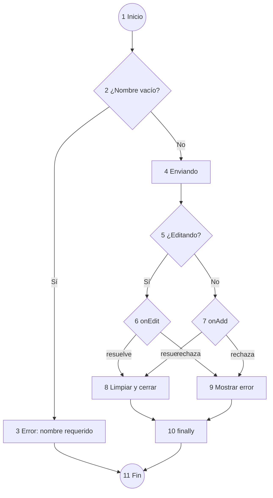

*Nota.* Fuente: elaboración propia.

$$V(G) = A - N + 2 = 14 - 11 + 2 = 5 \text{ de complejidad}$$

$$V(G) = 4 \text{ decisiones} + 1 = 5 \text{ caminos independientes}$$

- C1 = Inicio -> ¿Nombre vacío? (Sí) -> "El nombre es requerido" -> Fin
- C2 = Inicio -> ¿Nombre vacío? (No) -> ¿Editando? (No) -> onAdd (resuelve) -> Limpiar y cerrar -> finally -> Fin
- C3 = Inicio -> ¿Nombre vacío? (No) -> ¿Editando? (Sí) -> onEdit (resuelve) -> Limpiar y cerrar -> finally -> Fin
- C4 = Inicio -> ¿Nombre vacío? (No) -> ¿Editando? (No) -> onAdd (rechaza) -> Mostrar error -> finally -> Fin
- C5 = Inicio -> ¿Nombre vacío? (No) -> ¿Editando? (Sí) -> onEdit (rechaza) -> Mostrar error -> finally -> Fin

**Tabla 30**

*Caminos independientes y datos de entrada del módulo Inventario*

| CAMINO | nombre | editing | respuesta de onAdd / onEdit | ESCENARIO |
|---|---|---|---|---|
| C1 | "␣␣␣" | null | — | "El nombre es requerido" (CP-01) |
| C2 | "Punta de anca" | null | resuelve | Crea y cierra el modal (CP-02, CP-03) |
| C3 | "Sal" | `{ id: "ins-1" }` | resuelve | Edita y cierra el modal (CP-07) |
| C4 | "Sal" | null | rechaza con mensaje | Muestra el mensaje del servidor (CP-08) |
| C5 | "Sal" | `{ id: "ins-1" }` | rechaza sin mensaje | "Error al editar el insumo" (CP-09) |

*Nota.* Fuente: elaboración propia.

#### 2.3.2.2. Diseño de casos de prueba

Casos de prueba consolidados, uno por camino. El modal se monta con `isOpen`, y `onAdd`, `onEdit` y `onClose` se reemplazan por `cy.stub()`. Según el camino, los *stubs* resuelven o rechazan la promesa.

**Tabla 31**

*Diseño del caso de prueba CP-01 (camino C1) del módulo Inventario*

| **Caso de prueba ID** | CP-01 | **No. del caso de prueba** | 001 |
|---|---|---|---|
| **Descripción del caso de prueba** | Verificar que no se registre un insumo cuyo nombre está vacío o solo tiene espacios | **Nombre del módulo** | Inventario – Nuevo / editar insumo (`InventoryModal`) |
| **Responsable** | [Responsable] | **Versión** | 1.0 |
| **Fecha de prueba** | [dd/mm/aaaa] | **Estado del caso de prueba** | No ejecutado |

| S# | Prerrequisitos | S# | Datos de pruebas |
|---|---|---|---|
| 1 | `InventoryModal` montado en modo creación (`editing = null`) | 1 | Nombre = "␣␣␣" |
| 2 | `onAdd` = `cy.stub()` | 2 | — |

| Paso # | Detalles del paso | Resultados esperados | Resultados actuales | Estado |
|---|---|---|---|---|
| 1 | Escribir tres espacios en el nombre | El campo queda con espacios | | |
| 2 | Clic en "Crear insumo" | Se muestra "El nombre es requerido"; `onAdd` no se invoca | | |

*Nota.* Fuente: elaboración propia.

**Tabla 32**

*Diseño del caso de prueba CP-02 (camino C2) del módulo Inventario*

| **Caso de prueba ID** | CP-02 | **No. del caso de prueba** | 002 |
|---|---|---|---|
| **Descripción del caso de prueba** | Verificar que se registre un insumo de tipo carne medido en kg y que el modal se cierre | **Nombre del módulo** | Inventario – Nuevo / editar insumo (`InventoryModal`) |
| **Responsable** | [Responsable] | **Versión** | 1.0 |
| **Fecha de prueba** | [dd/mm/aaaa] | **Estado del caso de prueba** | No ejecutado |

| S# | Prerrequisitos | S# | Datos de pruebas |
|---|---|---|---|
| 1 | `InventoryModal` montado en modo creación (`editing = null`) | 1 | Nombre = "Punta de anca" |
| 2 | `onAdd` = `cy.stub().resolves()` | 2 | Tipo = carne · Unidad = kg |
| 3 | `onClose` = `cy.stub()` | 3 | Stock actual = 10 · Stock mínimo = 2 · Costo = 30000 |

| Paso # | Detalles del paso | Resultados esperados | Resultados actuales | Estado |
|---|---|---|---|---|
| 1 | Escribir el nombre y seleccionar Tipo = Carne y Unidad = kg | Opciones seleccionadas | | |
| 2 | Escribir stock 10, mínimo 2 y costo 30000 | Campos válidos | | |
| 3 | Clic en "Crear insumo" | `onAdd` recibe `{ nombre, tipo: "carne", unidad_medida: "kg", stock_actual: 10, stock_minimo: 2, costo_unitario_prom: 30000 }` | | |
| 4 | Verificar el cierre | `onClose` se invoca una vez | | |

*Nota.* Fuente: elaboración propia.

**Tabla 33**

*Diseño del caso de prueba CP-07 (camino C3) del módulo Inventario*

| **Caso de prueba ID** | CP-07 | **No. del caso de prueba** | 003 |
|---|---|---|---|
| **Descripción del caso de prueba** | Verificar que la edición limpie los ceros de los NUMERIC y llame a `onEdit` con el id del insumo | **Nombre del módulo** | Inventario – Nuevo / editar insumo (`InventoryModal`) |
| **Responsable** | [Responsable] | **Versión** | 1.0 |
| **Fecha de prueba** | [dd/mm/aaaa] | **Estado del caso de prueba** | No ejecutado |

| S# | Prerrequisitos | S# | Datos de pruebas |
|---|---|---|---|
| 1 | Modal montado con `editing = { id: "ins-1", stock_actual: "2.0000", … }` | 1 | Stock actual = "2.0000" · Stock mínimo = "1.0000" |
| 2 | `onEdit` = `cy.stub().resolves()` | 2 | Costo = "800.00" |

| Paso # | Detalles del paso | Resultados esperados | Resultados actuales | Estado |
|---|---|---|---|---|
| 1 | Abrir el modal en modo edición | El campo Stock actual muestra 2 | | |
| 2 | Clic en "Guardar cambios" | `onEdit("ins-1", { …, stock_actual: 2, stock_minimo: 1, costo_unitario_prom: 800 })` | | |

*Nota.* Fuente: elaboración propia.

**Tabla 34**

*Diseño del caso de prueba CP-08 (camino C4) del módulo Inventario*

| **Caso de prueba ID** | CP-08 | **No. del caso de prueba** | 004 |
|---|---|---|---|
| **Descripción del caso de prueba** | Verificar que, si el servidor rechaza la creación, se muestre su mensaje y el modal no se cierre | **Nombre del módulo** | Inventario – Nuevo / editar insumo (`InventoryModal`) |
| **Responsable** | [Responsable] | **Versión** | 1.0 |
| **Fecha de prueba** | [dd/mm/aaaa] | **Estado del caso de prueba** | No ejecutado |

| S# | Prerrequisitos | S# | Datos de pruebas |
|---|---|---|---|
| 1 | `InventoryModal` montado en modo creación (`editing = null`) | 1 | Nombre = "Sal" |
| 2 | `onAdd` rechaza con `{ response: { data: { message } } }` | 2 | message = "Ya existe un insumo con ese nombre" |

| Paso # | Detalles del paso | Resultados esperados | Resultados actuales | Estado |
|---|---|---|---|---|
| 1 | Escribir el nombre y clic en "Crear insumo" | `onAdd` se invoca | | |
| 2 | Verificar el mensaje | Se muestra "Ya existe un insumo con ese nombre" | | |
| 3 | Verificar el modal | `onClose` no se invoca | | |

*Nota.* Fuente: elaboración propia.

**Tabla 35**

*Diseño del caso de prueba CP-09 (camino C5) del módulo Inventario*

| **Caso de prueba ID** | CP-09 | **No. del caso de prueba** | 005 |
|---|---|---|---|
| **Descripción del caso de prueba** | Verificar que una edición que falla sin mensaje del servidor muestre el texto por defecto | **Nombre del módulo** | Inventario – Nuevo / editar insumo (`InventoryModal`) |
| **Responsable** | [Responsable] | **Versión** | 1.0 |
| **Fecha de prueba** | [dd/mm/aaaa] | **Estado del caso de prueba** | No ejecutado |

| S# | Prerrequisitos | S# | Datos de pruebas |
|---|---|---|---|
| 1 | Modal montado en modo edición | 1 | Nombre = "Sal" |
| 2 | `onEdit` rechaza con `Error("Network Error")` | 2 | — |

| Paso # | Detalles del paso | Resultados esperados | Resultados actuales | Estado |
|---|---|---|---|---|
| 1 | Clic en "Guardar cambios" | `onEdit` se invoca y rechaza | | |
| 2 | Verificar el mensaje | Se muestra "Error al editar el insumo" | | |

*Nota.* Fuente: elaboración propia.

#### 2.3.2.3. Ejecución y evaluación de las pruebas

```bash
npx cypress run --component --spec "src/features/inventory/**/*.cy.{js,jsx}"
```

Scripts: `InventoryModal.cy.jsx` e `inventoryUtils.cy.js` (Anexo B.1).

**Tabla 36**

*Evidencia de ejecución de la prueba CP-01 / C1 del módulo Inventario*

| **Prueba** | **Módulo 2 – Inventario** | |
|---|---|---|
| **Caso de prueba** | **Imagen de la prueba** | **Resultado** |
| CP-01 / C1<br>Tipo: No válido<br>Técnica: Caja negra + caja blanca<br>Condición: nombre solo con espacios | `[PANTALLAZO: Cypress – CP-01]` | Resultado esperado: "El nombre es requerido"; `onAdd` no se invoca<br>Resultado obtenido: [completar]<br>Estado: [PASS / FAIL] |
| **Observaciones técnicas/funcionales** | [Completar tras ejecutar] | |
| **Concepto final** | [APROBADA / NO APROBADA] | |

*Nota.* Fuente: elaboración propia.

**Tabla 37**

*Evidencia de ejecución de la prueba CP-02 / C2 del módulo Inventario*

| **Prueba** | **Módulo 2 – Inventario** | |
|---|---|---|
| **Caso de prueba** | **Imagen de la prueba** | **Resultado** |
| CP-02 / C2<br>Tipo: Válido<br>Técnica: Caja negra + caja blanca<br>Condición: carne en kg con todos los campos | `[PANTALLAZO: Cypress – CP-02]` | Resultado esperado: `onAdd` con 10, 2 y 30000 numéricos y cierre del modal<br>Resultado obtenido: [completar]<br>Estado: [PASS / FAIL] |
| **Observaciones técnicas/funcionales** | [Completar tras ejecutar] | |
| **Concepto final** | [APROBADA / NO APROBADA] | |

*Nota.* Fuente: elaboración propia.

**Tabla 38**

*Evidencia de ejecución de la prueba CP-03 / C2 del módulo Inventario*

| **Prueba** | **Módulo 2 – Inventario** | |
|---|---|---|
| **Caso de prueba** | **Imagen de la prueba** | **Resultado** |
| CP-03 / C2<br>Tipo: Válido<br>Técnica: Caja negra<br>Condición: campos numéricos vacíos | `[PANTALLAZO: Cypress – CP-03]` | Resultado esperado: `stock_actual`, `stock_minimo` y `costo_unitario_prom` en 0<br>Resultado obtenido: [completar]<br>Estado: [PASS / FAIL] |
| **Observaciones técnicas/funcionales** | [Completar tras ejecutar] | |
| **Concepto final** | [APROBADA / NO APROBADA] | |

*Nota.* Fuente: elaboración propia.

**Tabla 39**

*Evidencia de ejecución de la prueba CP-04 del módulo Inventario*

| **Prueba** | **Módulo 2 – Inventario** | |
|---|---|---|
| **Caso de prueba** | **Imagen de la prueba** | **Resultado** |
| CP-04<br>Tipo: No válido<br>Técnica: Caja negra<br>Condición: stock negativo | `[PANTALLAZO: Cypress – CP-04]` | Resultado esperado: `checkValidity()` = false y `onAdd` no se invoca<br>Resultado obtenido: [completar]<br>Estado: [PASS / FAIL] |
| **Observaciones técnicas/funcionales** | La validación de rangos la hace el navegador; el backend no rechaza cantidades negativas en `/inventario/entrada` (N2-09, DEF-01). | |
| **Concepto final** | [APROBADA / NO APROBADA] | |

*Nota.* Fuente: elaboración propia.

**Tabla 40**

*Evidencia de ejecución de la prueba CP-05 del módulo Inventario*

| **Prueba** | **Módulo 2 – Inventario** | |
|---|---|---|
| **Caso de prueba** | **Imagen de la prueba** | **Resultado** |
| CP-05<br>Tipo: Valor límite<br>Técnica: Caja negra<br>Condición: paso 0,01 | `[PANTALLAZO: Cypress – CP-05]` | Resultado esperado: 0,01 válido; 0,001 inválido<br>Resultado obtenido: [completar]<br>Estado: [PASS / FAIL] |
| **Observaciones técnicas/funcionales** | [Completar tras ejecutar] | |
| **Concepto final** | [APROBADA / NO APROBADA] | |

*Nota.* Fuente: elaboración propia.

**Tabla 41**

*Evidencia de ejecución de la prueba CP-06 del módulo Inventario*

| **Prueba** | **Módulo 2 – Inventario** | |
|---|---|---|
| **Caso de prueba** | **Imagen de la prueba** | **Resultado** |
| CP-06<br>Tipo: No válido<br>Técnica: Caja negra<br>Condición: costo con decimales | `[PANTALLAZO: Cypress – CP-06]` | Resultado esperado: Campo inválido por `step` = 1<br>Resultado obtenido: [completar]<br>Estado: [PASS / FAIL] |
| **Observaciones técnicas/funcionales** | Hallazgo de usabilidad: el costo unitario no admite centavos (DEF-06); un costo por gramo como 12,5 no se puede registrar. | |
| **Concepto final** | [APROBADA / NO APROBADA] | |

*Nota.* Fuente: elaboración propia.

**Tabla 42**

*Evidencia de ejecución de la prueba CP-07 / C3 del módulo Inventario*

| **Prueba** | **Módulo 2 – Inventario** | |
|---|---|---|
| **Caso de prueba** | **Imagen de la prueba** | **Resultado** |
| CP-07 / C3<br>Tipo: Válido<br>Técnica: Caja negra + caja blanca<br>Condición: edición con NUMERIC "2.0000" | `[PANTALLAZO: Cypress – CP-07]` | Resultado esperado: Muestra 2 y `onEdit("ins-1", {…})`<br>Resultado obtenido: [completar]<br>Estado: [PASS / FAIL] |
| **Observaciones técnicas/funcionales** | [Completar tras ejecutar] | |
| **Concepto final** | [APROBADA / NO APROBADA] | |

*Nota.* Fuente: elaboración propia.

**Tabla 43**

*Evidencia de ejecución de la prueba CP-08 / C4 del módulo Inventario*

| **Prueba** | **Módulo 2 – Inventario** | |
|---|---|---|
| **Caso de prueba** | **Imagen de la prueba** | **Resultado** |
| CP-08 / C4<br>Tipo: No válido<br>Técnica: Caja negra + caja blanca<br>Condición: el servidor rechaza | `[PANTALLAZO: Cypress – CP-08]` | Resultado esperado: Muestra el mensaje; el modal sigue abierto<br>Resultado obtenido: [completar]<br>Estado: [PASS / FAIL] |
| **Observaciones técnicas/funcionales** | [Completar tras ejecutar] | |
| **Concepto final** | [APROBADA / NO APROBADA] | |

*Nota.* Fuente: elaboración propia.

**Tabla 44**

*Evidencia de ejecución de la prueba CP-09 / C5 del módulo Inventario*

| **Prueba** | **Módulo 2 – Inventario** | |
|---|---|---|
| **Caso de prueba** | **Imagen de la prueba** | **Resultado** |
| CP-09 / C5<br>Tipo: No válido<br>Técnica: Caja negra + caja blanca<br>Condición: edición falla sin mensaje | `[PANTALLAZO: Cypress – CP-09]` | Resultado esperado: "Error al editar el insumo"<br>Resultado obtenido: [completar]<br>Estado: [PASS / FAIL] |
| **Observaciones técnicas/funcionales** | [Completar tras ejecutar] | |
| **Concepto final** | [APROBADA / NO APROBADA] | |

*Nota.* Fuente: elaboración propia.

**Tabla 45**

*Evidencia de ejecución de la prueba CP-10 del módulo Inventario*

| **Prueba** | **Módulo 2 – Inventario** | |
|---|---|---|
| **Caso de prueba** | **Imagen de la prueba** | **Resultado** |
| CP-10<br>Tipo: Valor límite<br>Técnica: Caja negra<br>Condición: semáforo con mínimo 4 (RF-15) | `[PANTALLAZO: Cypress – CP-10]` | Resultado esperado: Crítico / Bajo / Bajo / OK<br>Resultado obtenido: [completar]<br>Estado: [PASS / FAIL] |
| **Observaciones técnicas/funcionales** | El semáforo marca "Crítico" cuando actual ≤ mínimo y "Bajo" hasta 1,5 × mínimo. | |
| **Concepto final** | [APROBADA / NO APROBADA] | |

*Nota.* Fuente: elaboración propia.

**Tabla 46**

*Evidencia de ejecución de la prueba CP-11 del módulo Inventario*

| **Prueba** | **Módulo 2 – Inventario** | |
|---|---|---|
| **Caso de prueba** | **Imagen de la prueba** | **Resultado** |
| CP-11<br>Tipo: Válido<br>Técnica: Caja negra<br>Condición: NUMERIC como texto | `[PANTALLAZO: Cypress – CP-11]` | Resultado esperado: "Crítico"<br>Resultado obtenido: [completar]<br>Estado: [PASS / FAIL] |
| **Observaciones técnicas/funcionales** | PostgreSQL devuelve los NUMERIC como texto; la utilidad los convierte antes de comparar. | |
| **Concepto final** | [APROBADA / NO APROBADA] | |

*Nota.* Fuente: elaboración propia.

**Tabla 47**

*Evidencia de ejecución de la prueba CP-12 del módulo Inventario*

| **Prueba** | **Módulo 2 – Inventario** | |
|---|---|---|
| **Caso de prueba** | **Imagen de la prueba** | **Resultado** |
| CP-12<br>Tipo: Valor límite<br>Técnica: Caja negra<br>Condición: porcentaje de la barra | `[PANTALLAZO: Cypress – CP-12]` | Resultado esperado: 100 y 0<br>Resultado obtenido: [completar]<br>Estado: [PASS / FAIL] |
| **Observaciones técnicas/funcionales** | [Completar tras ejecutar] | |
| **Concepto final** | [APROBADA / NO APROBADA] | |

*Nota.* Fuente: elaboración propia.

### 2.3.3. Módulo 3: Menú y costeo de productos

**NOMBRE DEL MÓDULO: MENÚ Y COSTEO (PRODUCTO CON RECETA DE INSUMOS)**

Componente bajo prueba: `MenuFormModal.jsx` (modal "Nuevo / Editar producto"). Entradas de la interfaz:

- Nombre\*, Categoría (opcional) y Precio de venta\* (número ≥ 0);
- lista de insumos requeridos (selector con buscador) y cantidad por insumo: entero ≥ 1 si la unidad es "unidad", o ≥ 0,01 en kg, g, litro o ml.

En edición, el modal muestra el costo estimado y el margen.

#### 2.3.3.1. Análisis de las pruebas

##### 2.3.3.1.1. Análisis de pruebas clases de equivalencias

**Figura 7**

*Interfaz del módulo Menú y costeo de Brasas OS*

`[PANTALLAZO: /menu → "Nuevo Producto" con un insumo agregado en "Insumos requeridos"]`
`[PANTALLAZO: edición de un producto mostrando "Costo estimado · Margen"]`

*Nota.* Fuente: elaboración propia.

**Tabla 48**

*Clases de equivalencia del módulo Menú y costeo*

| Condiciones de entrada | Clases de equivalencia válida | Clases de equivalencia no válida |
|---|---|---|
| Nombre | 1. Texto no vacío | 2. Vacío |
| Precio de venta | 3. Número > 0 | 4. Vacío |
| Categoría | 5. Categoría existente · 6. Sin categoría (se envía `null`) | — |
| Receta (insumos) | 7. Al menos un insumo seleccionado | 8. Ningún insumo |
| Cantidad de insumo en "unidad" | 9. Entero ≥ 1 | 10. Decimal (1,5) · 11. Cero |
| Cantidad de insumo en kg | 12. ≥ 0,01 (valor inicial 0,1) | — |
| Relación costo / precio (edición) | 13. Costo < precio → margen positivo en verde | 14. Costo ≥ precio → alerta en rojo (RF-10) |

*Nota.* Fuente: elaboración propia.

##### 2.3.3.1.2. Casos de pruebas

**Tabla 49**

*Casos de prueba por clases de equivalencia del módulo Menú y costeo*

| Caso | Nombre | Precio | Categoría | Insumo y cantidad | Clases cubiertas | Resultado esperado |
|---|---|---|---|---|---|---|
| CP-01 | Churrasco 400 g | 45000 | — | (ninguno) | 8 | Mensaje de error; no se envía |
| CP-02 | Churrasco 400 g | 45000 | Carnes | Punta de anca 0,4 kg | 1, 3, 5, 7, 12 | `onSubmit` con datos normalizados |
| CP-03 | (vacío) | 45000 | — | Punta de anca | 2 | No se envía (RNF-08) |
| CP-04 | Churrasco 400 g | (vacío) | — | Punta de anca | 4 | No se envía (RNF-08) |
| CP-05 | — | — | — | Papa criolla 0 / 1,5 / 1 / 2 und | 9, 10, 11 | Inválido / inválido / válido / válido |
| CP-06 | Churrasco (edición) | 45000 | Carnes | costo 15000 | 13 | "Margen: +$30.000 (66.7%)" en verde |
| CP-07 | Plato caro (edición) | 45000 | (ninguna) | costo 50000 | 14 | Margen negativo en rojo |
| CP-08 | Plato justo (edición) | 45000 | (ninguna) | costo 45000 | 14 (límite) | Alerta en rojo (RF-10) |
| CP-09 | Limonada de coco | 9000 | (ninguna) | Papa criolla 1 und | 1, 3, 6, 7, 9 | `categoria_id: null` y `costo_produccion: 0` |

*Nota.* Fuente: elaboración propia.

##### 2.3.3.1.3. Casos de pruebas por Valores Límites

**Tabla 50**

*Casos de prueba por valores límite del módulo Menú y costeo*

| CAMPO | Datos de entrada | Escenario | Resultado |
|---|---|---|---|
| Cantidad (unidad) | 0 | Debajo de `min="1"` | Inválido (CP-05) |
| Cantidad (unidad) | 1 | Valor inicial y mínimo válido | Válido (CP-05) |
| Cantidad (unidad) | 1,5 | No múltiplo de `step="1"` | Inválido (CP-05) |
| Cantidad (kg) | 0,1 | Valor inicial al elegir un insumo en kg | Válido (CP-02) |
| Costo vs. precio | 15.000 vs. 45.000 | Margen +30.000 (66,7 %) | Verde (CP-06) |
| Costo vs. precio | 45.000 vs. 45.000 | Límite de RF-10 ("supere o iguale") | Debe alertar en rojo (CP-08) |
| Costo vs. precio | 50.000 vs. 45.000 | Margen −5.000 | Rojo (CP-07) |
| Insumos | 0 insumos | Receta vacía | "Debés agregar al menos un insumo…" (CP-01) |

*Nota.* Fuente: elaboración propia.

##### 2.3.3.1.4. Pruebas del Camino básico

Caso de uso a validar: CU-P1, *Crear / editar producto* (RF-06, RF-07, RF-10). Fragmento del método relacionado con esta interfaz (`MenuFormModal.jsx`):

**Figura 8**

*Fragmento de código del método `handleSubmit` del modal de productos*

```js
const handleSubmit = (e) => {
  e.preventDefault();                                                  // (1)
  const insumosValidos = insumos.filter(i => i.insumo_id);
  if (insumosValidos.length === 0) {                                   // (2)
    setError("Debés agregar al menos un insumo antes de guardar el producto."); // (3)
    return;
  }
  setError("");                                                        // (4)
  onSubmit({
    nombre:           form.nombre,
    precio_venta:     Number(form.precio_venta),
    costo_produccion: Number(form.costo_produccion) || 0,              // (5) → (6a) / (6b)
    categoria_id:     form.categoria_id || null,                       // (7) → (8a) / (8b)
    insumos:          insumosValidos,
  });                                                                 // (9)
};                                                                     // (10)
```

*Nota.* Fuente: `apps/web/src/features/menu/components/MenuFormModal.jsx`.

**Figura 9**

*Grafo de flujo del método `handleSubmit` del modal de productos*

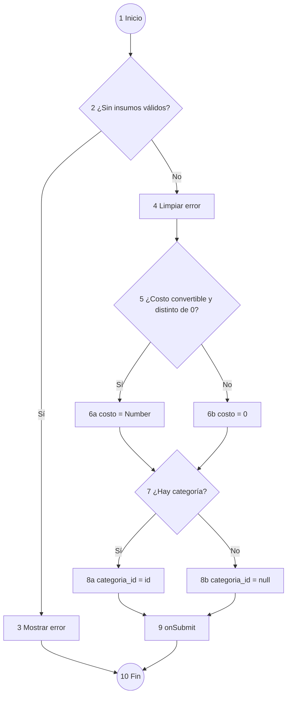

*Nota.* Fuente: elaboración propia.

$$V(G) = A - N + 2 = 14 - 12 + 2 = 4 \text{ de complejidad}$$

$$V(G) = 3 \text{ decisiones} + 1 = 4 \text{ caminos independientes}$$

- C1 = Inicio -> ¿Sin insumos válidos? (Sí) -> Mostrar error -> Fin
- C2 = Inicio -> ¿Sin insumos válidos? (No) -> ¿Costo convertible? (No) -> costo = 0 -> ¿Hay categoría? (No) -> categoria_id = null -> onSubmit -> Fin
- C3 = Inicio -> ¿Sin insumos válidos? (No) -> ¿Costo convertible? (Sí) -> costo = Number -> ¿Hay categoría? (No) -> categoria_id = null -> onSubmit -> Fin
- C4 = Inicio -> ¿Sin insumos válidos? (No) -> ¿Costo convertible? (No) -> costo = 0 -> ¿Hay categoría? (Sí) -> categoria_id = id -> onSubmit -> Fin

**Tabla 51**

*Caminos independientes y datos de entrada del módulo Menú y costeo*

| CAMINO | insumos válidos | costo_produccion | categoria_id | ESCENARIO |
|---|---|---|---|---|
| C1 | 0 | — | — | Muestra el error y no envía (CP-01) |
| C2 | 1 | "" → 0 | "" → null | Envía sin categoría y costo 0 (CP-09) |
| C3 | 1 | 50000 | "" → null | Envía con costo 50000 (CP-07) |
| C4 | 1 | "" → 0 | "c-carnes" | Envía con categoría (CP-02) |

*Nota.* Fuente: elaboración propia.

#### 2.3.3.2. Diseño de casos de prueba

Casos de prueba consolidados, uno por camino. El modal se monta con la lista `allInsumos` (Punta de anca en kg y Papa criolla por unidad), `categorias = [Carnes]` y `onSubmit = cy.stub()`.

**Tabla 52**

*Diseño del caso de prueba CP-01 (camino C1) del módulo Menú y costeo*

| **Caso de prueba ID** | CP-01 | **No. del caso de prueba** | 001 |
|---|---|---|---|
| **Descripción del caso de prueba** | Verificar que no se guarde un producto sin insumos en la receta | **Nombre del módulo** | Menú y costeo – Nuevo / editar producto (`MenuFormModal`) |
| **Responsable** | [Responsable] | **Versión** | 1.0 |
| **Fecha de prueba** | [dd/mm/aaaa] | **Estado del caso de prueba** | No ejecutado |

| S# | Prerrequisitos | S# | Datos de pruebas |
|---|---|---|---|
| 1 | Modal montado en modo creación | 1 | Nombre = "Churrasco 400 g" · Precio = 45000 |
| 2 | `onSubmit` = `cy.stub()` | 2 | Insumos = ninguno |

| Paso # | Detalles del paso | Resultados esperados | Resultados actuales | Estado |
|---|---|---|---|---|
| 1 | Escribir nombre y precio sin agregar insumos | Campos diligenciados | | |
| 2 | Clic en "Crear producto" | Se muestra "Debés agregar al menos un insumo…"; `onSubmit` no se invoca | | |

*Nota.* Fuente: elaboración propia.

**Tabla 53**

*Diseño del caso de prueba CP-09 (camino C2) del módulo Menú y costeo*

| **Caso de prueba ID** | CP-09 | **No. del caso de prueba** | 002 |
|---|---|---|---|
| **Descripción del caso de prueba** | Verificar que un producto sin categoría ni costo se envíe con `categoria_id = null` y costo 0 | **Nombre del módulo** | Menú y costeo – Nuevo / editar producto (`MenuFormModal`) |
| **Responsable** | [Responsable] | **Versión** | 1.0 |
| **Fecha de prueba** | [dd/mm/aaaa] | **Estado del caso de prueba** | No ejecutado |

| S# | Prerrequisitos | S# | Datos de pruebas |
|---|---|---|---|
| 1 | Modal montado en modo creación | 1 | Nombre = "Limonada de coco" · Precio = 9000 |
| 2 | `onSubmit` = `cy.stub()` | 2 | Insumo = Papa criolla × 1 |

| Paso # | Detalles del paso | Resultados esperados | Resultados actuales | Estado |
|---|---|---|---|---|
| 1 | Diligenciar nombre y precio; no elegir categoría | Campos diligenciados | | |
| 2 | Agregar el insumo Papa criolla | Cantidad inicial 1 (unidad) | | |
| 3 | Clic en "Crear producto" | `onSubmit` con `{ categoria_id: null, costo_produccion: 0 }` | | |

*Nota.* Fuente: elaboración propia.

**Tabla 54**

*Diseño del caso de prueba CP-07 (camino C3) del módulo Menú y costeo*

| **Caso de prueba ID** | CP-07 | **No. del caso de prueba** | 003 |
|---|---|---|---|
| **Descripción del caso de prueba** | Verificar que, en edición, un costo mayor que el precio se muestre como margen negativo en rojo y se envíe con el costo | **Nombre del módulo** | Menú y costeo – Nuevo / editar producto (`MenuFormModal`) |
| **Responsable** | [Responsable] | **Versión** | 1.0 |
| **Fecha de prueba** | [dd/mm/aaaa] | **Estado del caso de prueba** | No ejecutado |

| S# | Prerrequisitos | S# | Datos de pruebas |
|---|---|---|---|
| 1 | Modal montado con un producto existente (precio 45000, costo 50000) | 1 | Precio = 45000 · Costo = 50000 |
| 2 | `onSubmit` = `cy.stub()` | 2 | Categoría = ninguna |

| Paso # | Detalles del paso | Resultados esperados | Resultados actuales | Estado |
|---|---|---|---|---|
| 1 | Abrir el modal en modo edición | Se muestra "Margen: $-5.000" en rojo | | |
| 2 | Clic en "Guardar cambios" | `onSubmit` con `costo_produccion: 50000` y `categoria_id: null` | | |

*Nota.* Fuente: elaboración propia.

**Tabla 55**

*Diseño del caso de prueba CP-02 (camino C4) del módulo Menú y costeo*

| **Caso de prueba ID** | CP-02 | **No. del caso de prueba** | 004 |
|---|---|---|---|
| **Descripción del caso de prueba** | Verificar que se cree un producto con receta de 0,4 kg de carne y categoría | **Nombre del módulo** | Menú y costeo – Nuevo / editar producto (`MenuFormModal`) |
| **Responsable** | [Responsable] | **Versión** | 1.0 |
| **Fecha de prueba** | [dd/mm/aaaa] | **Estado del caso de prueba** | No ejecutado |

| S# | Prerrequisitos | S# | Datos de pruebas |
|---|---|---|---|
| 1 | Modal montado con `allInsumos` y `categorias` | 1 | Nombre = "Churrasco 400 g" |
| 2 | `onSubmit` = `cy.stub()` | 2 | Precio = 45000 · Categoría = Carnes |
| 3 | — | 3 | Insumo = Punta de anca · Cantidad = 0,4 |

| Paso # | Detalles del paso | Resultados esperados | Resultados actuales | Estado |
|---|---|---|---|---|
| 1 | Escribir nombre y precio y elegir la categoría | Campos diligenciados | | |
| 2 | Clic en "+ Agregar insumo" y elegir "Punta de anca" | Cantidad inicial 0,1 y unidad "kg" | | |
| 3 | Cambiar la cantidad a 0,4 | El campo muestra 0,4 | | |
| 4 | Clic en "Crear producto" | `onSubmit` con `{ nombre, precio_venta: 45000, costo_produccion: 0, categoria_id: "c-carnes", insumos: [{ insumo_id: "i-carne", cantidad_requerida: 0.4 }] }` | | |

*Nota.* Fuente: elaboración propia.

#### 2.3.3.3. Ejecución y evaluación de las pruebas

```bash
npx cypress run --component --spec "src/features/menu/**/*.cy.jsx"
```

Script: `MenuFormModal.cy.jsx` (Anexo B.1).

**Tabla 56**

*Evidencia de ejecución de la prueba CP-01 / C1 del módulo Menú y costeo*

| **Prueba** | **Módulo 3 – Menú y costeo** | |
|---|---|---|
| **Caso de prueba** | **Imagen de la prueba** | **Resultado** |
| CP-01 / C1<br>Tipo: No válido<br>Técnica: Caja negra + caja blanca<br>Condición: guardar sin insumos | `[PANTALLAZO: Cypress – CP-01]` | Resultado esperado: Mensaje de error; `onSubmit` no se invoca<br>Resultado obtenido: [completar]<br>Estado: [PASS / FAIL] |
| **Observaciones técnicas/funcionales** | [Completar tras ejecutar] | |
| **Concepto final** | [APROBADA / NO APROBADA] | |

*Nota.* Fuente: elaboración propia.

**Tabla 57**

*Evidencia de ejecución de la prueba CP-02 / C4 del módulo Menú y costeo*

| **Prueba** | **Módulo 3 – Menú y costeo** | |
|---|---|---|
| **Caso de prueba** | **Imagen de la prueba** | **Resultado** |
| CP-02 / C4<br>Tipo: Válido<br>Técnica: Caja negra + caja blanca<br>Condición: 0,4 kg de carne y categoría | `[PANTALLAZO: Cypress – CP-02]` | Resultado esperado: `onSubmit` con los datos normalizados<br>Resultado obtenido: [completar]<br>Estado: [PASS / FAIL] |
| **Observaciones técnicas/funcionales** | En creación no hay campo de costo: el costo real lo calcula el backend desde la receta (N3-05). | |
| **Concepto final** | [APROBADA / NO APROBADA] | |

*Nota.* Fuente: elaboración propia.

**Tabla 58**

*Evidencia de ejecución de la prueba CP-03 del módulo Menú y costeo*

| **Prueba** | **Módulo 3 – Menú y costeo** | |
|---|---|---|
| **Caso de prueba** | **Imagen de la prueba** | **Resultado** |
| CP-03<br>Tipo: No válido<br>Técnica: Caja negra<br>Condición: nombre vacío con insumo | `[PANTALLAZO: Cypress – CP-03]` | Resultado esperado: `onSubmit` **no** se invoca (RNF-08)<br>Resultado obtenido: [completar]<br>Estado: [PASS / FAIL] |
| **Observaciones técnicas/funcionales** | Se espera FAIL mientras exista DEF-04: el botón "Crear producto" está fuera del `<form>` y el navegador no aplica los `required`. | |
| **Concepto final** | [APROBADA / NO APROBADA] | |

*Nota.* Fuente: elaboración propia.

**Tabla 59**

*Evidencia de ejecución de la prueba CP-04 del módulo Menú y costeo*

| **Prueba** | **Módulo 3 – Menú y costeo** | |
|---|---|---|
| **Caso de prueba** | **Imagen de la prueba** | **Resultado** |
| CP-04<br>Tipo: No válido<br>Técnica: Caja negra<br>Condición: precio vacío con insumo | `[PANTALLAZO: Cypress – CP-04]` | Resultado esperado: `onSubmit` **no** se invoca (RNF-08)<br>Resultado obtenido: [completar]<br>Estado: [PASS / FAIL] |
| **Observaciones técnicas/funcionales** | Se espera FAIL mientras exista DEF-04 (misma causa que CP-03). | |
| **Concepto final** | [APROBADA / NO APROBADA] | |

*Nota.* Fuente: elaboración propia.

**Tabla 60**

*Evidencia de ejecución de la prueba CP-05 del módulo Menú y costeo*

| **Prueba** | **Módulo 3 – Menú y costeo** | |
|---|---|---|
| **Caso de prueba** | **Imagen de la prueba** | **Resultado** |
| CP-05<br>Tipo: Valor límite<br>Técnica: Caja negra<br>Condición: cantidad en "unidad" 0 / 1,5 / 1 / 2 | `[PANTALLAZO: Cypress – CP-05]` | Resultado esperado: Inválido / inválido / válido / válido<br>Resultado obtenido: [completar]<br>Estado: [PASS / FAIL] |
| **Observaciones técnicas/funcionales** | [Completar tras ejecutar] | |
| **Concepto final** | [APROBADA / NO APROBADA] | |

*Nota.* Fuente: elaboración propia.

**Tabla 61**

*Evidencia de ejecución de la prueba CP-06 del módulo Menú y costeo*

| **Prueba** | **Módulo 3 – Menú y costeo** | |
|---|---|---|
| **Caso de prueba** | **Imagen de la prueba** | **Resultado** |
| CP-06<br>Tipo: Válido<br>Técnica: Caja negra<br>Condición: margen positivo en edición | `[PANTALLAZO: Cypress – CP-06]` | Resultado esperado: "Margen: +$30.000 (66.7%)" en verde<br>Resultado obtenido: [completar]<br>Estado: [PASS / FAIL] |
| **Observaciones técnicas/funcionales** | [Completar tras ejecutar] | |
| **Concepto final** | [APROBADA / NO APROBADA] | |

*Nota.* Fuente: elaboración propia.

**Tabla 62**

*Evidencia de ejecución de la prueba CP-07 / C3 del módulo Menú y costeo*

| **Prueba** | **Módulo 3 – Menú y costeo** | |
|---|---|---|
| **Caso de prueba** | **Imagen de la prueba** | **Resultado** |
| CP-07 / C3<br>Tipo: No válido<br>Técnica: Caja negra + caja blanca<br>Condición: costo mayor que el precio | `[PANTALLAZO: Cypress – CP-07]` | Resultado esperado: "Margen: $-5.000" en rojo y envío con costo 50000<br>Resultado obtenido: [completar]<br>Estado: [PASS / FAIL] |
| **Observaciones técnicas/funcionales** | [Completar tras ejecutar] | |
| **Concepto final** | [APROBADA / NO APROBADA] | |

*Nota.* Fuente: elaboración propia.

**Tabla 63**

*Evidencia de ejecución de la prueba CP-08 del módulo Menú y costeo*

| **Prueba** | **Módulo 3 – Menú y costeo** | |
|---|---|---|
| **Caso de prueba** | **Imagen de la prueba** | **Resultado** |
| CP-08<br>Tipo: Valor límite<br>Técnica: Caja negra<br>Condición: costo = precio (RF-10) | `[PANTALLAZO: Cypress – CP-08]` | Resultado esperado: Alerta en rojo<br>Resultado obtenido: [completar]<br>Estado: [PASS / FAIL] |
| **Observaciones técnicas/funcionales** | Se espera FAIL mientras exista DEF-05: con costo = precio el margen se pinta en verde "+$0"; la condición del color debería ser `margen > 0`. | |
| **Concepto final** | [APROBADA / NO APROBADA] | |

*Nota.* Fuente: elaboración propia.

**Tabla 64**

*Evidencia de ejecución de la prueba CP-09 / C2 del módulo Menú y costeo*

| **Prueba** | **Módulo 3 – Menú y costeo** | |
|---|---|---|
| **Caso de prueba** | **Imagen de la prueba** | **Resultado** |
| CP-09 / C2<br>Tipo: Válido<br>Técnica: Caja negra + caja blanca<br>Condición: sin categoría | `[PANTALLAZO: Cypress – CP-09]` | Resultado esperado: `categoria_id: null`, `costo_produccion: 0`<br>Resultado obtenido: [completar]<br>Estado: [PASS / FAIL] |
| **Observaciones técnicas/funcionales** | [Completar tras ejecutar] | |
| **Concepto final** | [APROBADA / NO APROBADA] | |

*Nota.* Fuente: elaboración propia.

### 2.3.4. Módulo 4: Dashboard y reportes financieros

**NOMBRE DEL MÓDULO: DASHBOARD FINANCIERO (RESUMEN POR PERÍODO)**

Componentes bajo prueba: el servicio `dashboardService.js` (función `fetchFinancialSummary`) y el componente `PeriodFilter.jsx`. La entrada es el período seleccionado (`dia`, `semana` o `mes`). Los datos provienen de `GET /reportes/resumen`. Si esa petición falla, el servicio calcula un **respaldo** con `GET /pedidos/todos` desde la fecha de inicio del período.

#### 2.3.4.1. Análisis de las pruebas

##### 2.3.4.1.1. Análisis de pruebas clases de equivalencias

**Figura 10**

*Interfaz del Dashboard financiero del Jefe*

`[PANTALLAZO: /dashboard con el filtro "Período: Diario / Semanal / Mensual" y las tarjetas Ingresos, Costos, Ganancia Neta y Margen Bruto]`

*Nota.* Fuente: elaboración propia.

**Tabla 65**

*Clases de equivalencia del módulo Dashboard financiero*

| Condiciones de entrada | Clases de equivalencia válida | Clases de equivalencia no válida |
|---|---|---|
| Período | 1. `dia` → diario · 2. `semana` → semanal · 3. `mes` → mensual | 4. Valor no reconocido (`anio`, vacío) → se normaliza a mensual |
| Respuesta de `/reportes/resumen` | 5. 200 con `periodo_anterior` · 6. 200 sin `periodo_anterior` | 7. Error 500 → se usa el respaldo |
| Respuesta de `/pedidos/todos` (respaldo) | 8. 200 con lista de pedidos | 9. Error 500 → todas las métricas en 0 |
| Estado de cada pedido en el respaldo | 10. `completado` (suma al ingreso) | 11. `pendiente` o `cancelado` (no suma) |

*Nota.* Fuente: elaboración propia.

##### 2.3.4.1.2. Casos de pruebas

**Tabla 66**

*Casos de prueba por clases de equivalencia del módulo Dashboard financiero*

| Caso | Período | `/reportes/resumen` | `/pedidos/todos` | Clases cubiertas | Resultado esperado |
|---|---|---|---|---|---|
| CP-01 | mes | 200 con variación 25 | — | 3, 5 | Respuesta mapeada y `periodo=mensual` |
| CP-02 | dia / semana / anio / "" | 200 | — | 1, 2, 4 | diario, semanal, mensual, mensual |
| CP-03 | mes | 200 sin `periodo_anterior` | — | 6 | `variacion_utilidad = null` |
| CP-04 | dia | 500 | 200: 2 completados, 1 pendiente, 1 cancelado | 7, 8, 10, 11 | Ingresos = 75.000,5 (solo completados) |
| CP-05 | dia / semana / mes (reloj fijo) | 500 | 200 vacío | 7, 1–3 | Fechas de inicio del respaldo correctas |
| CP-06 | mes | 500 | 500 | 7, 9 | Todo en 0 y `utilidad_positiva = false` |
| CP-07 | clic en "Semanal" | — | — | 2 (componente) | Botón activo resaltado y `onPeriodoChange("semana")` |

*Nota.* Fuente: elaboración propia.

##### 2.3.4.1.3. Casos de pruebas por Valores Límites

Se fija el reloj del navegador en el **1 de noviembre de 2026 a las 10:30** con `cy.clock` para probar los bordes de calendario de la fecha de inicio del respaldo.

**Tabla 67**

*Casos de prueba por valores límite del módulo Dashboard financiero*

| CAMPO | Datos de entrada | Escenario | Resultado |
|---|---|---|---|
| fecha_inicio (dia) | 01/11/2026 10:30 | Inicio del día | 01/11/2026 00:00:00 (CP-05) |
| fecha_inicio (semana) | 01/11/2026 10:30 | Hoy − 6 días: cruza al mes anterior | 26/10/2026 00:00 (CP-05) |
| fecha_inicio (mes) | 01/11/2026 10:30 | Primer día del mes (coincide con "dia") | 01/11/2026 00:00 (CP-05) |
| Total con decimales | "30000.50" | Suma con precisión | Ingresos = 75.000,5 (CP-04) |
| Ingresos del respaldo | Solo pendientes o cancelados | Ingresos = 0 | `utilidad_positiva = false` (CP-06) |

*Nota.* Fuente: elaboración propia.

##### 2.3.4.1.4. Pruebas del Camino básico

Caso de uso a validar: CU-D1, *Consultar dashboard de rentabilidad* (RF-20, RF-22). Fragmento del método relacionado con esta interfaz (`dashboardService.js`):

**Figura 11**

*Fragmento de código del método `fetchFinancialSummary`*

```js
export const fetchFinancialSummary = async (periodo) => {
  try {
    const mapped = periodoMap[periodo] || "mensual";                       // (2) → (3) / (4)
    const { data } = await api.get(`/reportes/resumen?periodo=${mapped}`); // (5)
    return { ingresos: data.ingresos, costos: data.costo_total, ganancia: data.utilidad,
      margen: data.margen, utilidad_positiva: data.utilidad_positiva,
      variacion_utilidad: data.periodo_anterior?.variacion_utilidad ?? null };  // (6) → (7)/(8) → (9)
  } catch {
    try {
      const fechaInicio = getFechaInicio(periodo);                          // (10) (12) → (11)/(13)/(14)
      const { data: pedidos } = await api.get("/pedidos/todos",
        { params: { fecha_inicio: fechaInicio.toISOString() } });            // (15)
      const completados = (pedidos || []).filter((p) => p.estado === "completado");
      const ingresos = completados.reduce((s, p) => s + (parseFloat(p.total) || 0), 0);
      return { ingresos, costos: 0, ganancia: ingresos, margen: 0,
        utilidad_positiva: ingresos > 0, variacion_utilidad: null };           // (16)
    } catch {
      return { ingresos: 0, costos: 0, ganancia: 0, margen: 0,
        utilidad_positiva: false, variacion_utilidad: null };                  // (17)
    }
  }
};                                                                          // (18)
```

*Nota.* Fuente: `apps/web/src/features/dashboard/services/dashboardService.js`.

**Figura 12**

*Grafo de flujo del método `fetchFinancialSummary`*

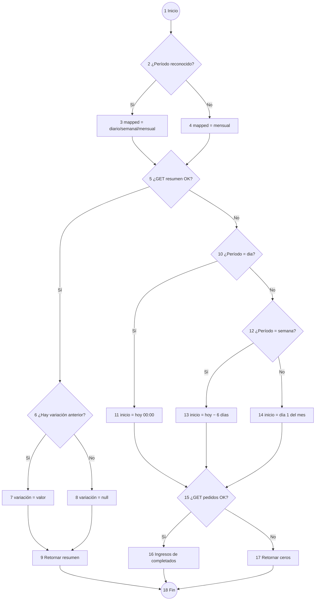

*Nota.* Fuente: elaboración propia.

$$V(G) = A - N + 2 = 23 - 18 + 2 = 7 \text{ de complejidad}$$

$$V(G) = 6 \text{ decisiones} + 1 = 7 \text{ caminos independientes}$$

- C1 = Inicio -> ¿Período reconocido? (Sí) -> ¿GET resumen OK? (Sí) -> ¿Hay variación anterior? (Sí) -> Retornar resumen -> Fin
- C2 = Inicio -> ¿Período reconocido? (No) -> mapped = mensual -> ¿GET resumen OK? (Sí) -> ¿Hay variación anterior? (Sí) -> Retornar resumen -> Fin
- C3 = Inicio -> ¿Período reconocido? (Sí) -> ¿GET resumen OK? (Sí) -> ¿Hay variación anterior? (No) -> variación = null -> Retornar resumen -> Fin
- C4 = Inicio -> ¿Período reconocido? (Sí) -> ¿GET resumen OK? (No) -> ¿Período = dia? (Sí) -> inicio = hoy 00:00 -> ¿GET pedidos OK? (Sí) -> Ingresos de completados -> Fin
- C5 = Inicio -> ¿Período reconocido? (Sí) -> ¿GET resumen OK? (No) -> ¿Período = dia? (No) -> ¿Período = semana? (Sí) -> inicio = hoy − 6 días -> ¿GET pedidos OK? (Sí) -> Ingresos de completados -> Fin
- C6 = Inicio -> ¿Período reconocido? (Sí) -> ¿GET resumen OK? (No) -> ¿Período = dia? (No) -> ¿Período = semana? (No) -> inicio = día 1 del mes -> ¿GET pedidos OK? (Sí) -> Ingresos de completados -> Fin
- C7 = Inicio -> ¿Período reconocido? (Sí) -> ¿GET resumen OK? (No) -> ¿Período = dia? (No) -> ¿Período = semana? (No) -> inicio = día 1 del mes -> ¿GET pedidos OK? (No) -> Retornar ceros -> Fin

**Tabla 68**

*Caminos independientes y datos de entrada del módulo Dashboard financiero*

| CAMINO | periodo | resumen | pedidos | ESCENARIO |
|---|---|---|---|---|
| C1 | "mes" | 200 con variación | — | Mapea la respuesta (CP-01) |
| C2 | "anio" | 200 con variación | — | Consulta `periodo=mensual` (CP-02) |
| C3 | "mes" | 200 sin período anterior | — | `variacion_utilidad = null` (CP-03) |
| C4 | "dia" | 500 | 200 | Ingresos solo de completados (CP-04, CP-05) |
| C5 | "semana" | 500 | 200 | `fecha_inicio` = hoy − 6 días (CP-05) |
| C6 | "mes" | 500 | 200 | `fecha_inicio` = día 1 del mes (CP-05) |
| C7 | "mes" | 500 | 500 | Todo en cero (CP-06) |

*Nota.* Fuente: elaboración propia.

#### 2.3.4.2. Diseño de casos de prueba

Casos de prueba consolidados, uno por camino. Las peticiones se interceptan con `cy.intercept` (`**/api/v1/reportes/resumen*` y `**/api/v1/pedidos/todos*`). Para simular fallas se usa el código 500 y no el 401, porque el interceptor de `services/api.js` redirige a `/login` ante un 401 y reiniciaría la prueba.

**Tabla 69**

*Diseño del caso de prueba CP-01 (camino C1) del módulo Dashboard financiero*

| **Caso de prueba ID** | CP-01 | **No. del caso de prueba** | 001 |
|---|---|---|---|
| **Descripción del caso de prueba** | Verificar que el resumen mensual se consulte con `periodo=mensual` y se mapeen los campos | **Nombre del módulo** | Dashboard financiero – Resumen por período (`dashboardService`) |
| **Responsable** | [Responsable] | **Versión** | 1.0 |
| **Fecha de prueba** | [dd/mm/aaaa] | **Estado del caso de prueba** | No ejecutado |

| S# | Prerrequisitos | S# | Datos de pruebas |
|---|---|---|---|
| 1 | `GET **/reportes/resumen*` interceptado con respuesta simulada | 1 | periodo = "mes" |
| 2 | — | 2 | ingresos 100000 · costo_total 50000 · utilidad 50000 · margen 50 · variación 25 |

| Paso # | Detalles del paso | Resultados esperados | Resultados actuales | Estado |
|---|---|---|---|---|
| 1 | Invocar `fetchFinancialSummary("mes")` | Se envía `GET /reportes/resumen?periodo=mensual` | | |
| 2 | Verificar el objeto retornado | `costos` = costo_total, `ganancia` = utilidad y `variacion_utilidad` = 25 | | |

*Nota.* Fuente: elaboración propia.

**Tabla 70**

*Diseño del caso de prueba CP-02 (camino C2) del módulo Dashboard financiero*

| **Caso de prueba ID** | CP-02 | **No. del caso de prueba** | 002 |
|---|---|---|---|
| **Descripción del caso de prueba** | Verificar que un período no reconocido se normalice a mensual | **Nombre del módulo** | Dashboard financiero – Resumen por período (`dashboardService`) |
| **Responsable** | [Responsable] | **Versión** | 1.0 |
| **Fecha de prueba** | [dd/mm/aaaa] | **Estado del caso de prueba** | No ejecutado |

| S# | Prerrequisitos | S# | Datos de pruebas |
|---|---|---|---|
| 1 | `GET **/reportes/resumen*` interceptado con respuesta simulada | 1 | periodo = "anio" (también "dia", "semana" y "") |

| Paso # | Detalles del paso | Resultados esperados | Resultados actuales | Estado |
|---|---|---|---|---|
| 1 | Invocar `fetchFinancialSummary("anio")` | Se envía `periodo=mensual` | | |
| 2 | Repetir con dia, semana y "" | diario, semanal y mensual | | |

*Nota.* Fuente: elaboración propia.

**Tabla 71**

*Diseño del caso de prueba CP-03 (camino C3) del módulo Dashboard financiero*

| **Caso de prueba ID** | CP-03 | **No. del caso de prueba** | 003 |
|---|---|---|---|
| **Descripción del caso de prueba** | Verificar que, sin período anterior, la variación de la utilidad sea null | **Nombre del módulo** | Dashboard financiero – Resumen por período (`dashboardService`) |
| **Responsable** | [Responsable] | **Versión** | 1.0 |
| **Fecha de prueba** | [dd/mm/aaaa] | **Estado del caso de prueba** | No ejecutado |

| S# | Prerrequisitos | S# | Datos de pruebas |
|---|---|---|---|
| 1 | `GET **/reportes/resumen*` interceptado con respuesta simulada sin `periodo_anterior` | 1 | periodo = "mes" |

| Paso # | Detalles del paso | Resultados esperados | Resultados actuales | Estado |
|---|---|---|---|---|
| 1 | Invocar `fetchFinancialSummary("mes")` | No lanza excepción | | |
| 2 | Verificar `variacion_utilidad` | null | | |

*Nota.* Fuente: elaboración propia.

**Tabla 72**

*Diseño del caso de prueba CP-04 (camino C4) del módulo Dashboard financiero*

| **Caso de prueba ID** | CP-04 | **No. del caso de prueba** | 004 |
|---|---|---|---|
| **Descripción del caso de prueba** | Verificar que, si falla el resumen, el respaldo sume solo los pedidos completados | **Nombre del módulo** | Dashboard financiero – Resumen por período (`dashboardService`) |
| **Responsable** | [Responsable] | **Versión** | 1.0 |
| **Fecha de prueba** | [dd/mm/aaaa] | **Estado del caso de prueba** | No ejecutado |

| S# | Prerrequisitos | S# | Datos de pruebas |
|---|---|---|---|
| 1 | `GET **/reportes/resumen*` responde 500 | 1 | periodo = "dia" |
| 2 | `GET **/pedidos/todos*` responde 4 pedidos | 2 | Completados: "45000" y "30000.50" · Pendiente: "99999" · Cancelado: "10000" |

| Paso # | Detalles del paso | Resultados esperados | Resultados actuales | Estado |
|---|---|---|---|---|
| 1 | Invocar `fetchFinancialSummary("dia")` | Se consulta `/pedidos/todos` con `fecha_inicio` | | |
| 2 | Verificar los ingresos | 75.000,5 (excluye pendiente y cancelado); `costos` = 0 | | |

*Nota.* Fuente: elaboración propia.

**Tabla 73**

*Diseño del caso de prueba CP-05 (camino C5) del módulo Dashboard financiero*

| **Caso de prueba ID** | CP-05 | **No. del caso de prueba** | 005 |
|---|---|---|---|
| **Descripción del caso de prueba** | Verificar las fechas de inicio del respaldo en los bordes del calendario | **Nombre del módulo** | Dashboard financiero – Resumen por período (`dashboardService`) |
| **Responsable** | [Responsable] | **Versión** | 1.0 |
| **Fecha de prueba** | [dd/mm/aaaa] | **Estado del caso de prueba** | No ejecutado |

| S# | Prerrequisitos | S# | Datos de pruebas |
|---|---|---|---|
| 1 | Reloj fijo con `cy.clock` en 01/11/2026 10:30 | 1 | periodo = "dia", "semana" y "mes" |
| 2 | `GET **/reportes/resumen*` responde 500 | 2 | — |
| 3 | `GET **/pedidos/todos*` responde [] | 3 | — |

| Paso # | Detalles del paso | Resultados esperados | Resultados actuales | Estado |
|---|---|---|---|---|
| 1 | Invocar con "dia" | `fecha_inicio` = 01/11/2026 00:00 | | |
| 2 | Invocar con "semana" | `fecha_inicio` = 26/10/2026 00:00 | | |
| 3 | Invocar con "mes" | `fecha_inicio` = 01/11/2026 00:00 | | |

*Nota.* Fuente: elaboración propia.

**Tabla 74**

*Diseño del caso de prueba CP-06 (camino C6–C7) del módulo Dashboard financiero*

| **Caso de prueba ID** | CP-06 | **No. del caso de prueba** | 006 |
|---|---|---|---|
| **Descripción del caso de prueba** | Verificar que, si fallan el resumen y el respaldo, todas las métricas queden en cero | **Nombre del módulo** | Dashboard financiero – Resumen por período (`dashboardService`) |
| **Responsable** | [Responsable] | **Versión** | 1.0 |
| **Fecha de prueba** | [dd/mm/aaaa] | **Estado del caso de prueba** | No ejecutado |

| S# | Prerrequisitos | S# | Datos de pruebas |
|---|---|---|---|
| 1 | `GET **/reportes/resumen*` responde 500 | 1 | periodo = "mes" |
| 2 | `GET **/pedidos/todos*` responde 500 | 2 | — |

| Paso # | Detalles del paso | Resultados esperados | Resultados actuales | Estado |
|---|---|---|---|---|
| 1 | Invocar `fetchFinancialSummary("mes")` | No lanza excepción | | |
| 2 | Verificar el retorno | Todas las métricas en 0 y `utilidad_positiva = false` | | |

*Nota.* Fuente: elaboración propia.

El camino C6 (respaldo mensual con respuesta 200) se recorre en el tercer paso de CP-05; CP-06 recorre C7.

#### 2.3.4.3. Ejecución y evaluación de las pruebas

```bash
npx cypress run --component --spec "src/features/dashboard/**/*.cy.{js,jsx}"
```

Scripts: `dashboardService.cy.js` y `PeriodFilter.cy.jsx` (Anexo B.1). CP-02 se ejecuta como cuatro pruebas, una por cada valor de período.

**Tabla 75**

*Evidencia de ejecución de la prueba CP-01 / C1 del módulo Dashboard financiero*

| **Prueba** | **Módulo 4 – Dashboard financiero** | |
|---|---|---|
| **Caso de prueba** | **Imagen de la prueba** | **Resultado** |
| CP-01 / C1<br>Tipo: Válido<br>Técnica: Caja negra + caja blanca<br>Condición: resumen mensual | `[PANTALLAZO: Cypress – CP-01]` | Resultado esperado: `{ ingresos: 100000, costos: 50000, ganancia: 50000, margen: 50, utilidad_positiva: true, variacion_utilidad: 25 }`<br>Resultado obtenido: [completar]<br>Estado: [PASS / FAIL] |
| **Observaciones técnicas/funcionales** | [Completar tras ejecutar] | |
| **Concepto final** | [APROBADA / NO APROBADA] | |

*Nota.* Fuente: elaboración propia.

**Tabla 76**

*Evidencia de ejecución de la prueba CP-02 / C2 del módulo Dashboard financiero*

| **Prueba** | **Módulo 4 – Dashboard financiero** | |
|---|---|---|
| **Caso de prueba** | **Imagen de la prueba** | **Resultado** |
| CP-02 / C2<br>Tipo: Válido / No válido<br>Técnica: Caja negra + caja blanca<br>Condición: traducción del período | `[PANTALLAZO: Cypress – CP-02]` | Resultado esperado: dia→diario, semana→semanal, anio→mensual, ""→mensual<br>Resultado obtenido: [completar]<br>Estado: [PASS / FAIL] |
| **Observaciones técnicas/funcionales** | [Completar tras ejecutar] | |
| **Concepto final** | [APROBADA / NO APROBADA] | |

*Nota.* Fuente: elaboración propia.

**Tabla 77**

*Evidencia de ejecución de la prueba CP-03 / C3 del módulo Dashboard financiero*

| **Prueba** | **Módulo 4 – Dashboard financiero** | |
|---|---|---|
| **Caso de prueba** | **Imagen de la prueba** | **Resultado** |
| CP-03 / C3<br>Tipo: Válido<br>Técnica: Caja negra + caja blanca<br>Condición: sin período anterior | `[PANTALLAZO: Cypress – CP-03]` | Resultado esperado: `variacion_utilidad = null`<br>Resultado obtenido: [completar]<br>Estado: [PASS / FAIL] |
| **Observaciones técnicas/funcionales** | [Completar tras ejecutar] | |
| **Concepto final** | [APROBADA / NO APROBADA] | |

*Nota.* Fuente: elaboración propia.

**Tabla 78**

*Evidencia de ejecución de la prueba CP-04 / C4 del módulo Dashboard financiero*

| **Prueba** | **Módulo 4 – Dashboard financiero** | |
|---|---|---|
| **Caso de prueba** | **Imagen de la prueba** | **Resultado** |
| CP-04 / C4<br>Tipo: No válido<br>Técnica: Caja negra + caja blanca<br>Condición: falla el resumen → respaldo | `[PANTALLAZO: Cypress – CP-04]` | Resultado esperado: Ingresos = 75.000,5<br>Resultado obtenido: [completar]<br>Estado: [PASS / FAIL] |
| **Observaciones técnicas/funcionales** | El respaldo muestra costos = 0 y ganancia = ingresos: si `/reportes/resumen` falla, el Jefe ve una utilidad inflada sin advertencia. Se recomienda indicar "datos parciales". | |
| **Concepto final** | [APROBADA / NO APROBADA] | |

*Nota.* Fuente: elaboración propia.

**Tabla 79**

*Evidencia de ejecución de la prueba CP-05 / C4–C6 del módulo Dashboard financiero*

| **Prueba** | **Módulo 4 – Dashboard financiero** | |
|---|---|---|
| **Caso de prueba** | **Imagen de la prueba** | **Resultado** |
| CP-05 / C4–C6<br>Tipo: Valor límite<br>Técnica: Caja negra + caja blanca<br>Condición: fechas de inicio del respaldo | `[PANTALLAZO: Cypress – CP-05]` | Resultado esperado: 01/11, 26/10 y 01/11 a las 00:00<br>Resultado obtenido: [completar]<br>Estado: [PASS / FAIL] |
| **Observaciones técnicas/funcionales** | [Completar tras ejecutar] | |
| **Concepto final** | [APROBADA / NO APROBADA] | |

*Nota.* Fuente: elaboración propia.

**Tabla 80**

*Evidencia de ejecución de la prueba CP-06 / C7 del módulo Dashboard financiero*

| **Prueba** | **Módulo 4 – Dashboard financiero** | |
|---|---|---|
| **Caso de prueba** | **Imagen de la prueba** | **Resultado** |
| CP-06 / C7<br>Tipo: No válido<br>Técnica: Caja negra + caja blanca<br>Condición: ambas peticiones fallan | `[PANTALLAZO: Cypress – CP-06]` | Resultado esperado: Todo en 0 y `utilidad_positiva = false`<br>Resultado obtenido: [completar]<br>Estado: [PASS / FAIL] |
| **Observaciones técnicas/funcionales** | [Completar tras ejecutar] | |
| **Concepto final** | [APROBADA / NO APROBADA] | |

*Nota.* Fuente: elaboración propia.

**Tabla 81**

*Evidencia de ejecución de la prueba CP-07 del módulo Dashboard financiero*

| **Prueba** | **Módulo 4 – Dashboard financiero** | |
|---|---|---|
| **Caso de prueba** | **Imagen de la prueba** | **Resultado** |
| CP-07<br>Tipo: Válido<br>Técnica: Caja negra<br>Condición: selector de período | `[PANTALLAZO: Cypress – CP-07]` | Resultado esperado: "Mensual" resaltado y `onPeriodoChange("semana")`<br>Resultado obtenido: [completar]<br>Estado: [PASS / FAIL] |
| **Observaciones técnicas/funcionales** | `FinancialHighlightCards` usa `toLocaleString()` sin configuración regional: el formato de moneda cambia según el idioma del navegador (ver 2.5.4). | |
| **Concepto final** | [APROBADA / NO APROBADA] | |

*Nota.* Fuente: elaboración propia.

### 2.3.5. Módulo 5: Historial de auditoría

**NOMBRE DEL MÓDULO: HISTORIAL DE AUDITORÍA (CONSULTA Y FILTROS POR ROL)**

Componentes bajo prueba: el store `useHistoryStore.js` (`fetchHistorial`, `setFiltros`) y el componente `HistoryFilters.jsx`. Entradas de la interfaz:

- usuario (solo Administrador);
- acción (CREAR, EDITAR, ELIMINAR, LOGIN, LOGOUT, COMPLETAR, CANCELAR);
- entidad (Administrador: 7; Jefe: 5 de negocio), fecha inicio y fecha fin.

Cada cambio de filtro reinicia la página a 1 y consulta el backend tras **400 ms** sin nuevos cambios (*debounce*).

#### 2.3.5.1. Análisis de las pruebas

##### 2.3.5.1.1. Análisis de pruebas clases de equivalencias

**Figura 13**

*Interfaz del módulo Historial de auditoría*

`[PANTALLAZO: /historial del Jefe con los filtros Acción, Entidad, Fecha inicio y Fecha fin y la tabla de registros]`

*Nota.* Fuente: elaboración propia.

**Tabla 82**

*Clases de equivalencia del módulo Historial de auditoría*

| Condiciones de entrada | Clases de equivalencia válida | Clases de equivalencia no válida |
|---|---|---|
| Rol que consulta | 1. ADMIN (5 filtros) · 2. JEFE (4 filtros, 5 entidades) · 3. EMPLEADO (acción y fechas) | — |
| Lista de usuarios (ADMIN) | 4. Vacía → campo "ID de usuario" · 5. Con usuarios → selector | — |
| Acción | 6. Una de las 7 acciones de la lista | — (el backend rechaza otras: N5-06) |
| Filtros vacíos | 7. "", `null` y `undefined` no se envían | — |
| Respuesta del servidor | 8. `{ data, total }` · 9. `{}` · 10. `data` sin `total` | 11. Error con mensaje · 12. Error sin mensaje |
| Tiempo entre cambios de filtro | 13. ≥ 400 ms → se consulta | 14. < 400 ms → todavía no se consulta |

*Nota.* Fuente: elaboración propia.

##### 2.3.5.1.2. Casos de pruebas

**Tabla 83**

*Casos de prueba por clases de equivalencia del módulo Historial de auditoría*

| Caso | Rol / filtros | Respuesta | Tiempo | Clases cubiertas | Resultado esperado |
|---|---|---|---|---|---|
| CP-01 | — | 200 `{ data: [1], total: 1 }` | — | 8 | items = 1, total = 1 |
| CP-02 | — | 200 `{}` | — | 9 | items = [], total = 0 |
| CP-03 | — | 200 `{ data: [1] }` | — | 10 | total = 0 |
| CP-04 | — | 400 `{ message }` | — | 11 | `error` = mensaje del servidor |
| CP-05 | — | 500 sin cuerpo | — | 12 | `error` = "Error al cargar historial" |
| CP-06 | acción = CREAR, página 3 | 200 | 399 ms / 400 ms | 6, 13, 14 | 0 y luego 1 petición; página = 1 |
| CP-07 | acción y luego fecha_inicio | 200 | 200 ms + 400 ms | 13, 14 | Una sola petición con ambos filtros |
| CP-08 | acción "", entidad null, fecha_fin | 200 | — | 7 | Solo se envía `fecha_fin` |
| CP-09 | ADMIN sin usuarios | — | — | 1, 4 | Campo "ID de usuario" |
| CP-10 | ADMIN con usuarios | — | — | 1, 5 | Selector "Todos los usuarios" |
| CP-11 | JEFE | — | — | 2 | Sin filtro de usuario y 5 entidades |
| CP-12 | EMPLEADO | — | — | 3 | Sin entidad; acción y 2 fechas |
| CP-13 | JEFE elige COMPLETAR | — | — | 6 | `onChange({ accion: "COMPLETAR" })` |

*Nota.* Fuente: elaboración propia.

##### 2.3.5.1.3. Casos de pruebas por Valores Límites

**Tabla 84**

*Casos de prueba por valores límite del módulo Historial de auditoría*

| CAMPO | Datos de entrada | Escenario | Resultado |
|---|---|---|---|
| Tiempo de espera (*debounce*) | 399 ms | Un milisegundo antes del límite | 0 peticiones (CP-06) |
| Tiempo de espera (*debounce*) | 400 ms | En el límite | 1 petición con `page=1&limit=20` (CP-06) |
| Cambios consecutivos | 2 cambios separados 200 ms | Dentro de la ventana | Una sola petición (CP-07) |
| Página | página 3 → cambio de filtro | Reinicio de la paginación | Vuelve a la página 1 (CP-06) |
| Fecha inicio = fecha fin | hoy (AAAA-MM-DD) | Rango de un solo día | Debe incluir los registros de hoy; se verifica con BD real (CI-H05-03, DEF-11) |

*Nota.* Fuente: elaboración propia.

##### 2.3.5.1.4. Pruebas del Camino básico

Caso de uso a validar: RF-23, *Consultar historial de acciones con visibilidad por rol*. Fragmento del método relacionado con esta interfaz (`useHistoryStore.js`):

**Figura 14**

*Fragmento de código del método `fetchHistorial`*

```js
fetchHistorial: async () => {
  const { page, limit, filtros } = get();                                   // (1)
  set({ isLoading: true, error: null });
  try {
    const data = await historyService.getHistorial({ ...filtros, page, limit });  // (2)
    set({ items: data.data ?? [],                                           // (3) → (4a)/(4b)
          total: data.total ?? 0,                                           // (5) → (6a)/(6b)
          isLoading: false });                                              // (7)
  } catch (err) {
    set({ error: err.response?.data?.message || "Error al cargar historial", // (8) → (9a)/(9b)
          isLoading: false });                                              // (10)
  }
},                                                                          // (11)
```

*Nota.* Fuente: `apps/web/src/features/history/stores/useHistoryStore.js`.

**Figura 15**

*Grafo de flujo del método `fetchHistorial`*

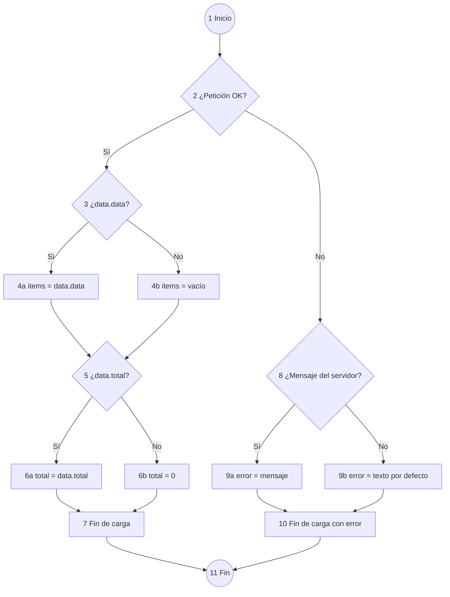

*Nota.* Fuente: elaboración propia.

$$V(G) = A - N + 2 = 17 - 14 + 2 = 5 \text{ de complejidad}$$

$$V(G) = 4 \text{ decisiones} + 1 = 5 \text{ caminos independientes}$$

- C1 = Inicio -> ¿Petición OK? (Sí) -> ¿data.data? (Sí) -> ¿data.total? (Sí) -> Fin de carga -> Fin
- C2 = Inicio -> ¿Petición OK? (Sí) -> ¿data.data? (No) -> items = [] -> ¿data.total? (No) -> total = 0 -> Fin de carga -> Fin
- C3 = Inicio -> ¿Petición OK? (Sí) -> ¿data.data? (Sí) -> ¿data.total? (No) -> total = 0 -> Fin de carga -> Fin
- C4 = Inicio -> ¿Petición OK? (No) -> ¿Mensaje del servidor? (Sí) -> error = mensaje -> Fin
- C5 = Inicio -> ¿Petición OK? (No) -> ¿Mensaje del servidor? (No) -> error = "Error al cargar historial" -> Fin

**Tabla 85**

*Caminos independientes y datos de entrada del módulo Historial de auditoría*

| CAMINO | respuesta | data.data | data.total | ESCENARIO |
|---|---|---|---|---|
| C1 | 200 | [1 registro] | 1 | items = 1, total = 1 (CP-01) |
| C2 | 200 | — | — | items = [], total = 0 (CP-02) |
| C3 | 200 | [1 registro] | — | total = 0 (CP-03) |
| C4 | 400 | — | — | error = "tipo_accion inválido" (CP-04) |
| C5 | 500 | — | — | error = "Error al cargar historial" (CP-05) |

*Nota.* Fuente: elaboración propia.

#### 2.3.5.2. Diseño de casos de prueba

Casos de prueba consolidados, uno por camino. Antes de cada caso se reinicia el store con `reset()` y se intercepta `GET **/api/v1/historial*`.

**Tabla 86**

*Diseño del caso de prueba CP-01 (camino C1) del módulo Historial de auditoría*

| **Caso de prueba ID** | CP-01 | **No. del caso de prueba** | 001 |
|---|---|---|---|
| **Descripción del caso de prueba** | Verificar que una respuesta completa cargue los registros y el total | **Nombre del módulo** | Historial – Consulta y filtros (`useHistoryStore`) |
| **Responsable** | [Responsable] | **Versión** | 1.0 |
| **Fecha de prueba** | [dd/mm/aaaa] | **Estado del caso de prueba** | No ejecutado |

| S# | Prerrequisitos | S# | Datos de pruebas |
|---|---|---|---|
| 1 | Store reiniciado con `reset()` | 1 | `{ data: [1 registro], total: 1 }` |
| 2 | `GET **/historial*` responde 200 | 2 | — |

| Paso # | Detalles del paso | Resultados esperados | Resultados actuales | Estado |
|---|---|---|---|---|
| 1 | Invocar `fetchHistorial()` | Se envía `page=1&limit=20` | | |
| 2 | Leer el estado | items = 1, total = 1, isLoading = false | | |

*Nota.* Fuente: elaboración propia.

**Tabla 87**

*Diseño del caso de prueba CP-02 (camino C2) del módulo Historial de auditoría*

| **Caso de prueba ID** | CP-02 | **No. del caso de prueba** | 002 |
|---|---|---|---|
| **Descripción del caso de prueba** | Verificar que una respuesta vacía deje la lista vacía y el total en cero | **Nombre del módulo** | Historial – Consulta y filtros (`useHistoryStore`) |
| **Responsable** | [Responsable] | **Versión** | 1.0 |
| **Fecha de prueba** | [dd/mm/aaaa] | **Estado del caso de prueba** | No ejecutado |

| S# | Prerrequisitos | S# | Datos de pruebas |
|---|---|---|---|
| 1 | Store reiniciado con `reset()` | 1 | `{}` |
| 2 | `GET **/historial*` responde 200 | 2 | — |

| Paso # | Detalles del paso | Resultados esperados | Resultados actuales | Estado |
|---|---|---|---|---|
| 1 | Invocar `fetchHistorial()` | No lanza excepción | | |
| 2 | Leer el estado | items = [], total = 0 | | |

*Nota.* Fuente: elaboración propia.

**Tabla 88**

*Diseño del caso de prueba CP-03 (camino C3) del módulo Historial de auditoría*

| **Caso de prueba ID** | CP-03 | **No. del caso de prueba** | 003 |
|---|---|---|---|
| **Descripción del caso de prueba** | Verificar que una respuesta con datos pero sin total deje el total en cero | **Nombre del módulo** | Historial – Consulta y filtros (`useHistoryStore`) |
| **Responsable** | [Responsable] | **Versión** | 1.0 |
| **Fecha de prueba** | [dd/mm/aaaa] | **Estado del caso de prueba** | No ejecutado |

| S# | Prerrequisitos | S# | Datos de pruebas |
|---|---|---|---|
| 1 | Store reiniciado con `reset()` | 1 | `{ data: [1 registro] }` |
| 2 | `GET **/historial*` responde 200 | 2 | — |

| Paso # | Detalles del paso | Resultados esperados | Resultados actuales | Estado |
|---|---|---|---|---|
| 1 | Invocar `fetchHistorial()` | No lanza excepción | | |
| 2 | Leer el estado | items = 1, total = 0 | | |

*Nota.* Fuente: elaboración propia.

**Tabla 89**

*Diseño del caso de prueba CP-04 (camino C4) del módulo Historial de auditoría*

| **Caso de prueba ID** | CP-04 | **No. del caso de prueba** | 004 |
|---|---|---|---|
| **Descripción del caso de prueba** | Verificar que un error del backend con mensaje se exponga en el estado | **Nombre del módulo** | Historial – Consulta y filtros (`useHistoryStore`) |
| **Responsable** | [Responsable] | **Versión** | 1.0 |
| **Fecha de prueba** | [dd/mm/aaaa] | **Estado del caso de prueba** | No ejecutado |

| S# | Prerrequisitos | S# | Datos de pruebas |
|---|---|---|---|
| 1 | Store reiniciado con `reset()` | 1 | `{ message: "tipo_accion inválido" }` |
| 2 | `GET **/historial*` responde 400 | 2 | — |

| Paso # | Detalles del paso | Resultados esperados | Resultados actuales | Estado |
|---|---|---|---|---|
| 1 | Invocar `fetchHistorial()` | No lanza excepción | | |
| 2 | Leer el estado | error = "tipo_accion inválido", isLoading = false | | |

*Nota.* Fuente: elaboración propia.

**Tabla 90**

*Diseño del caso de prueba CP-05 (camino C5) del módulo Historial de auditoría*

| **Caso de prueba ID** | CP-05 | **No. del caso de prueba** | 005 |
|---|---|---|---|
| **Descripción del caso de prueba** | Verificar que un error sin mensaje use el texto por defecto | **Nombre del módulo** | Historial – Consulta y filtros (`useHistoryStore`) |
| **Responsable** | [Responsable] | **Versión** | 1.0 |
| **Fecha de prueba** | [dd/mm/aaaa] | **Estado del caso de prueba** | No ejecutado |

| S# | Prerrequisitos | S# | Datos de pruebas |
|---|---|---|---|
| 1 | Store reiniciado con `reset()` | 1 | — |
| 2 | `GET **/historial*` responde 500 sin cuerpo | 2 | — |

| Paso # | Detalles del paso | Resultados esperados | Resultados actuales | Estado |
|---|---|---|---|---|
| 1 | Invocar `fetchHistorial()` | No lanza excepción | | |
| 2 | Leer el estado | error = "Error al cargar historial" | | |

*Nota.* Fuente: elaboración propia.

#### 2.3.5.3. Ejecución y evaluación de las pruebas

```bash
npx cypress run --component --spec "src/features/history/**/*.cy.{js,jsx}"
```

Scripts: `useHistoryStore.cy.js` y `HistoryFilters.cy.jsx` (Anexo B.1).

**Tabla 91**

*Evidencia de ejecución de la prueba CP-01 / C1 del módulo Historial de auditoría*

| **Prueba** | **Módulo 5 – Historial de auditoría** | |
|---|---|---|
| **Caso de prueba** | **Imagen de la prueba** | **Resultado** |
| CP-01 / C1<br>Tipo: Válido<br>Técnica: Caja negra + caja blanca<br>Condición: respuesta completa | `[PANTALLAZO: Cypress – CP-01]` | Resultado esperado: items = 1, total = 1, isLoading = false<br>Resultado obtenido: [completar]<br>Estado: [PASS / FAIL] |
| **Observaciones técnicas/funcionales** | [Completar tras ejecutar] | |
| **Concepto final** | [APROBADA / NO APROBADA] | |

*Nota.* Fuente: elaboración propia.

**Tabla 92**

*Evidencia de ejecución de la prueba CP-02 / C2 del módulo Historial de auditoría*

| **Prueba** | **Módulo 5 – Historial de auditoría** | |
|---|---|---|
| **Caso de prueba** | **Imagen de la prueba** | **Resultado** |
| CP-02 / C2<br>Tipo: Válido<br>Técnica: Caja negra + caja blanca<br>Condición: respuesta vacía | `[PANTALLAZO: Cypress – CP-02]` | Resultado esperado: items = [], total = 0<br>Resultado obtenido: [completar]<br>Estado: [PASS / FAIL] |
| **Observaciones técnicas/funcionales** | [Completar tras ejecutar] | |
| **Concepto final** | [APROBADA / NO APROBADA] | |

*Nota.* Fuente: elaboración propia.

**Tabla 93**

*Evidencia de ejecución de la prueba CP-03 / C3 del módulo Historial de auditoría*

| **Prueba** | **Módulo 5 – Historial de auditoría** | |
|---|---|---|
| **Caso de prueba** | **Imagen de la prueba** | **Resultado** |
| CP-03 / C3<br>Tipo: Válido<br>Técnica: Caja negra + caja blanca<br>Condición: respuesta sin total | `[PANTALLAZO: Cypress – CP-03]` | Resultado esperado: total = 0<br>Resultado obtenido: [completar]<br>Estado: [PASS / FAIL] |
| **Observaciones técnicas/funcionales** | [Completar tras ejecutar] | |
| **Concepto final** | [APROBADA / NO APROBADA] | |

*Nota.* Fuente: elaboración propia.

**Tabla 94**

*Evidencia de ejecución de la prueba CP-04 / C4 del módulo Historial de auditoría*

| **Prueba** | **Módulo 5 – Historial de auditoría** | |
|---|---|---|
| **Caso de prueba** | **Imagen de la prueba** | **Resultado** |
| CP-04 / C4<br>Tipo: No válido<br>Técnica: Caja negra + caja blanca<br>Condición: error 400 con mensaje | `[PANTALLAZO: Cypress – CP-04]` | Resultado esperado: `error` = mensaje del servidor<br>Resultado obtenido: [completar]<br>Estado: [PASS / FAIL] |
| **Observaciones técnicas/funcionales** | [Completar tras ejecutar] | |
| **Concepto final** | [APROBADA / NO APROBADA] | |

*Nota.* Fuente: elaboración propia.

**Tabla 95**

*Evidencia de ejecución de la prueba CP-05 / C5 del módulo Historial de auditoría*

| **Prueba** | **Módulo 5 – Historial de auditoría** | |
|---|---|---|
| **Caso de prueba** | **Imagen de la prueba** | **Resultado** |
| CP-05 / C5<br>Tipo: No válido<br>Técnica: Caja negra + caja blanca<br>Condición: error 500 sin mensaje | `[PANTALLAZO: Cypress – CP-05]` | Resultado esperado: `error` = "Error al cargar historial"<br>Resultado obtenido: [completar]<br>Estado: [PASS / FAIL] |
| **Observaciones técnicas/funcionales** | [Completar tras ejecutar] | |
| **Concepto final** | [APROBADA / NO APROBADA] | |

*Nota.* Fuente: elaboración propia.

**Tabla 96**

*Evidencia de ejecución de la prueba CP-06 del módulo Historial de auditoría*

| **Prueba** | **Módulo 5 – Historial de auditoría** | |
|---|---|---|
| **Caso de prueba** | **Imagen de la prueba** | **Resultado** |
| CP-06<br>Tipo: Valor límite<br>Técnica: Caja negra<br>Condición: *debounce* 399 / 400 ms y página | `[PANTALLAZO: Cypress – CP-06]` | Resultado esperado: 0 y luego 1 petición con `accion=CREAR&page=1&limit=20`<br>Resultado obtenido: [completar]<br>Estado: [PASS / FAIL] |
| **Observaciones técnicas/funcionales** | [Completar tras ejecutar] | |
| **Concepto final** | [APROBADA / NO APROBADA] | |

*Nota.* Fuente: elaboración propia.

**Tabla 97**

*Evidencia de ejecución de la prueba CP-07 del módulo Historial de auditoría*

| **Prueba** | **Módulo 5 – Historial de auditoría** | |
|---|---|---|
| **Caso de prueba** | **Imagen de la prueba** | **Resultado** |
| CP-07<br>Tipo: Valor límite<br>Técnica: Caja negra<br>Condición: cambios seguidos | `[PANTALLAZO: Cypress – CP-07]` | Resultado esperado: Una sola petición con los filtros acumulados<br>Resultado obtenido: [completar]<br>Estado: [PASS / FAIL] |
| **Observaciones técnicas/funcionales** | [Completar tras ejecutar] | |
| **Concepto final** | [APROBADA / NO APROBADA] | |

*Nota.* Fuente: elaboración propia.

**Tabla 98**

*Evidencia de ejecución de la prueba CP-08 del módulo Historial de auditoría*

| **Prueba** | **Módulo 5 – Historial de auditoría** | |
|---|---|---|
| **Caso de prueba** | **Imagen de la prueba** | **Resultado** |
| CP-08<br>Tipo: Válido<br>Técnica: Caja negra<br>Condición: limpieza de filtros vacíos | `[PANTALLAZO: Cypress – CP-08]` | Resultado esperado: Solo se envía `fecha_fin`<br>Resultado obtenido: [completar]<br>Estado: [PASS / FAIL] |
| **Observaciones técnicas/funcionales** | [Completar tras ejecutar] | |
| **Concepto final** | [APROBADA / NO APROBADA] | |

*Nota.* Fuente: elaboración propia.

**Tabla 99**

*Evidencia de ejecución de la prueba CP-09 del módulo Historial de auditoría*

| **Prueba** | **Módulo 5 – Historial de auditoría** | |
|---|---|---|
| **Caso de prueba** | **Imagen de la prueba** | **Resultado** |
| CP-09<br>Tipo: Válido<br>Técnica: Caja negra<br>Condición: ADMIN sin lista de usuarios | `[PANTALLAZO: Cypress – CP-09]` | Resultado esperado: Campo "ID de usuario"<br>Resultado obtenido: [completar]<br>Estado: [PASS / FAIL] |
| **Observaciones técnicas/funcionales** | [Completar tras ejecutar] | |
| **Concepto final** | [APROBADA / NO APROBADA] | |

*Nota.* Fuente: elaboración propia.

**Tabla 100**

*Evidencia de ejecución de la prueba CP-10 del módulo Historial de auditoría*

| **Prueba** | **Módulo 5 – Historial de auditoría** | |
|---|---|---|
| **Caso de prueba** | **Imagen de la prueba** | **Resultado** |
| CP-10<br>Tipo: Válido<br>Técnica: Caja negra<br>Condición: ADMIN con usuarios | `[PANTALLAZO: Cypress – CP-10]` | Resultado esperado: Selector "Todos los usuarios"<br>Resultado obtenido: [completar]<br>Estado: [PASS / FAIL] |
| **Observaciones técnicas/funcionales** | [Completar tras ejecutar] | |
| **Concepto final** | [APROBADA / NO APROBADA] | |

*Nota.* Fuente: elaboración propia.

**Tabla 101**

*Evidencia de ejecución de la prueba CP-11 del módulo Historial de auditoría*

| **Prueba** | **Módulo 5 – Historial de auditoría** | |
|---|---|---|
| **Caso de prueba** | **Imagen de la prueba** | **Resultado** |
| CP-11<br>Tipo: Válido<br>Técnica: Caja negra<br>Condición: filtros del JEFE | `[PANTALLAZO: Cypress – CP-11]` | Resultado esperado: Sin usuario; 5 entidades + "Todas"<br>Resultado obtenido: [completar]<br>Estado: [PASS / FAIL] |
| **Observaciones técnicas/funcionales** | [Completar tras ejecutar] | |
| **Concepto final** | [APROBADA / NO APROBADA] | |

*Nota.* Fuente: elaboración propia.

**Tabla 102**

*Evidencia de ejecución de la prueba CP-12 del módulo Historial de auditoría*

| **Prueba** | **Módulo 5 – Historial de auditoría** | |
|---|---|---|
| **Caso de prueba** | **Imagen de la prueba** | **Resultado** |
| CP-12<br>Tipo: Válido<br>Técnica: Caja negra<br>Condición: filtros del EMPLEADO | `[PANTALLAZO: Cypress – CP-12]` | Resultado esperado: Sin entidad; 1 selector y 2 fechas<br>Resultado obtenido: [completar]<br>Estado: [PASS / FAIL] |
| **Observaciones técnicas/funcionales** | [Completar tras ejecutar] | |
| **Concepto final** | [APROBADA / NO APROBADA] | |

*Nota.* Fuente: elaboración propia.

**Tabla 103**

*Evidencia de ejecución de la prueba CP-13 del módulo Historial de auditoría*

| **Prueba** | **Módulo 5 – Historial de auditoría** | |
|---|---|---|
| **Caso de prueba** | **Imagen de la prueba** | **Resultado** |
| CP-13<br>Tipo: Válido<br>Técnica: Caja negra<br>Condición: cambio de acción | `[PANTALLAZO: Cypress – CP-13]` | Resultado esperado: `onChange({ accion: "COMPLETAR" })`<br>Resultado obtenido: [completar]<br>Estado: [PASS / FAIL] |
| **Observaciones técnicas/funcionales** | El frontend envía el parámetro `accion`, pero el backend espera `tipo_accion`: el filtro se pierde en la integración (N5-07, N5-08, DEF-02). La prueba unitaria pasa porque el componente cumple su contrato. | |
| **Concepto final** | [APROBADA / NO APROBADA] | |

*Nota.* Fuente: elaboración propia.

## 2.4. PRUEBAS DE INTEGRACIÓN

Las pruebas de integración verifican que los componentes de Brasas OS v2, ya validados de forma individual en las pruebas unitarias, funcionen correctamente al combinarse a través de sus interfaces: la API REST `/api/v1` con JWT, el *pool* de conexiones `db.js` y los triggers de PostgreSQL. Se aplican dos estrategias complementarias:

- la integración incremental, ascendente y descendente (esta última por profundidad y por anchura);
- las pruebas basadas en hilos, que recorren de extremo a extremo los cinco flujos de negocio de los módulos probados.

La ejecución y evaluación de cada estrategia se presenta junto a su diseño: en el apartado 2.4.1.3 para la integración incremental y dentro de cada hilo en el apartado 2.4.2. El consolidado está en el apartado 2.4.3.

**Herramientas.** El backend se integra con **Jest 30 + Supertest 7**: Supertest envía peticiones HTTP reales a `app.js` sin levantar el servidor. La capa de presentación se integra con **Cypress 16** en sus dos modos: *Component Testing* para montar cada página con su store y su servicio, y *E2E* para la aplicación completa en el navegador. La preparación está en el Anexo A.2 y los scripts en el Anexo B.2.

### 2.4.1. Estrategia de pruebas incrementales

#### 2.4.1.1. Análisis de las pruebas

##### 2.4.1.1.1. Esquema de integración de los componentes de la aplicación

El esquema se construyó a partir de la estructura del repositorio (`apps/web/src/features`, `apps/api/src/features` y `apps/api/src/middlewares`). Se organiza en capas y módulos intermedios (azul), componentes a integrar (verde) e hilos de ejecución H01–H05 (gris). Los hilos se muestran junto a los componentes que atraviesan y se prueban en el apartado 2.4.2.

**Figura 16**

*Esquema de integración de los componentes de Brasas OS v2*

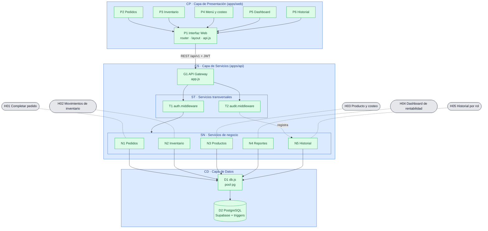

*Nota.* Fuente: elaboración propia.

##### 2.4.1.1.2. Árbol de módulos para la integración incremental

Las integraciones incrementales se aplican sobre el árbol del esquema anterior:

- Brasas OS v2 (SIS) es el módulo principal.
- Las tres capas —Presentación (CP), Servicios (CS) y Datos (CD)— y los módulos con hijos (P1, G1, SN, ST y D1) son módulos intermedios.
- Los módulos sin hijos son las hojas: P2–P6, N1–N5, T1, T2 y D2, es decir, 13 hojas.

El árbol tiene **22 módulos y 21 integraciones** (aristas padre-hijo, por ejemplo (P1-P2)). Los hilos H01–H05 no se tratan aquí como módulos: se prueban de extremo a extremo en el apartado 2.4.2.

**Figura 17**

*Árbol de módulos de Brasas OS v2 para la integración incremental*

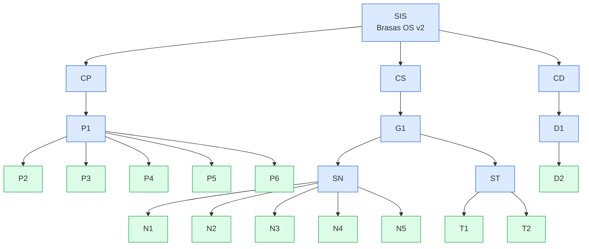

*Nota.* Fuente: elaboración propia.

**Tabla 104**

*Módulos del árbol de integración y archivos del repositorio que los implementan*

| ID | Módulo | Tipo | Implementación en el repositorio |
|---|---|---|---|
| SIS | Brasas OS v2 | Principal | Aplicación completa (frontend + API + BD) |
| CP | Capa de Presentación | Intermedio | `apps/web` (React 19 + Vite) |
| P1 | Interfaz Web | Intermedio | `router.jsx`, `DashboardLayout` / `Sidebar`, `services/api.js` (Axios con JWT), `useAuthStore` |
| P2 | Pedidos | Hoja | `features/orders`: `OrdersPage`, `useOrdersStore`, `ordersService` |
| P3 | Inventario | Hoja | `features/inventory`: `InventoryPage`, `useInventoryStore`, `inventoryService` |
| P4 | Menú y costeo | Hoja | `features/menu`: `MenuPage`, `useMenuStore`, `menuService` |
| P5 | Dashboard | Hoja | `features/dashboard`: `DashboardPage`, `useDashboardStore`, `dashboardService` |
| P6 | Historial | Hoja | `features/history`: `HistoryPage`, `useHistoryStore`, `historyService` |
| CS | Capa de Servicios | Intermedio | `apps/api` (Express 5) |
| G1 | API Gateway | Intermedio | `src/app.js`: helmet, CORS, `express.json`, routers `/api/v1`, Swagger y 404 |
| SN | Servicios de negocio | Intermedio | Routers + controladores + servicios de `src/features` |
| N1 | Pedidos | Hoja | `features/pedidos` |
| N2 | Inventario | Hoja | `features/inventario` |
| N3 | Productos (menú y costeo) | Hoja | `features/productos` |
| N4 | Reportes | Hoja | `features/reportes` |
| N5 | Historial | Hoja | `features/historial` (servicio y repositorio) |
| ST | Servicios transversales | Intermedio | `src/middlewares` |
| T1 | Autenticación y roles | Hoja | `auth.middleware.js`: `verifyToken`, `requireRole`, `requireAnyRole` |
| T2 | Auditoría automática | Hoja | `audit.middleware.js` |
| CD | Capa de Datos | Intermedio | Conexión y base de datos |
| D1 | Pool de conexiones | Intermedio | `src/shared/database/db.js` (`pg.Pool`, máximo 3 conexiones, SSL) |
| D2 | PostgreSQL (Supabase) | Hoja | 11 tablas, trigger de pedidos (`fn_completar_pedido`) y tabla `roles` |

*Nota.* Fuente: elaboración propia.

##### 2.4.1.1.3. Integración incremental ascendente (bottom-up)

Se parte de los módulos hoja y se integra hacia el módulo principal en cuatro pasos: 1) módulos hoja; 2) nivel superior inmediato; 3) módulos intermedios; 4) módulo principal. Como los módulos superiores todavía no están integrados, sus llamadas se simulan con **drivers**.

1. Integración de módulos hoja:
   P2, P3, P4, P5, P6, N1, N2, N3, N4, N5, T1, T2, D2
2. Integración del nivel superior inmediato:
   (P1-P2) (P1-P3) (P1-P4) (P1-P5) (P1-P6)
   (SN-N1) (SN-N2) (SN-N3) (SN-N4) (SN-N5)
   (ST-T1) (ST-T2)
   (D1-D2)
3. Integración de los módulos intermedios:
   (CP-P1)
   (G1-SN) (G1-ST) (CS-G1)
   (CD-D1)
4. Integración del módulo principal:
   (SIS-CP) (SIS-CS) (SIS-CD)

Casos de prueba asociados: CI-A01 a CI-A12.

##### 2.4.1.1.4. Integración incremental descendente (top-down)

Se parte del módulo principal y se integra hacia las hojas. Los módulos todavía no integrados se reemplazan por **stubs** que devuelven respuestas controladas. El árbol se recorre de dos maneras: por profundidad y por anchura.

**Por profundidad**

1. Primera rama (Presentación):
   (SIS-CP) (CP-P1) (P1-P2)
2. Continuación de la primera rama:
   (P1-P3) (P1-P4) (P1-P5) (P1-P6)
3. Segunda rama (Servicios de negocio):
   (SIS-CS) (CS-G1) (G1-SN) (SN-N1)
4. Continuación de la segunda rama:
   (SN-N2) (SN-N3) (SN-N4) (SN-N5)
5. Tercera rama (Servicios transversales):
   (G1-ST) (ST-T1)
6. Continuación de la tercera rama:
   (ST-T2)
7. Cuarta rama (Datos):
   (SIS-CD) (CD-D1) (D1-D2)

Cada rama se completa antes de pasar a la siguiente. Casos de prueba asociados: CI-DP1 a CI-DP7.

**Por anchura**

1. Primer nivel:
   (SIS-CP) (SIS-CS) (SIS-CD)
2. Segundo nivel:
   (CP-P1) (CS-G1) (CD-D1)
3. Tercer nivel:
   (P1-P2) (P1-P3) (P1-P4) (P1-P5) (P1-P6) (G1-SN) (G1-ST) (D1-D2)
4. Cuarto nivel:
   (SN-N1) (SN-N2) (SN-N3) (SN-N4) (SN-N5) (ST-T1) (ST-T2)

En cada paso se integra un nivel completo del árbol antes de pasar al siguiente. Casos de prueba asociados: CI-DA1 a CI-DA4.

#### 2.4.1.2. Diseño de los casos de pruebas

Para el diseño se utiliza la plantilla del proyecto por cada integración:

- una tabla de cabecera con el número del caso, el componente, la descripción de lo que se probará y los prerrequisitos;
- por cada caso, una tabla de pasos con los datos de entrada y la salida esperada.

Las columnas ¿OK? y Observaciones se diligencian al ejecutar. En los casos que ya tuvieron ejecución de referencia, ¿OK? muestra ese resultado (Sí / Parcial / No); `[ ]` indica que el paso todavía no se ha ejecutado. La Tabla Tabla 105 resume los drivers y stubs de la estrategia.

**Tabla 105**

*Drivers y stubs utilizados en la integración incremental*

| Doble de prueba | Tipo | Reemplaza a | Implementación |
|---|---|---|---|
| Sesión precargada | Driver | Login y P1 | `useAuthStore.setState({ user, isAuthenticated })` (Cypress CT) o `localStorage` con `cy.visitarConSesion` (E2E) |
| Montaje de página | Driver | Router (P1) | `cy.mount(<OrdersPage />)` y equivalentes |
| Llamada directa a servicio o middleware | Driver | G1 y routers | Jest invoca `pedidosService.createPedido(…)`, `verifyToken(req, res, next)`, etc. |
| Cliente HTTP | Driver | Navegador | Supertest sobre `app.js` con tokens firmados por `tests/helpers/auth.js` |
| Cliente `pg` independiente | Driver | D1 | `new Client(...)` con `.env.test` (casos de D2) |
| API simulada | Stub | CS (toda la API) | `cy.intercept` y `cy.stubApi()` con *fixtures* JSON |
| Servicio simulado | Stub | N1–N5 | `jest.mock('…/pedidos.service')` y equivalentes |
| `historial.service` simulado | Stub | N5 (al probar T2) | `jest.doMock` dentro de `jest.isolateModules` |
| `fakeDb` | Stub | D1 y D2 | `tests/helpers/fakeDb.js`: imita `pg` (los NUMERIC llegan como texto y falla si el número de parámetros no coincide con los marcadores `$n`) |

*Nota.* Fuente: elaboración propia.

##### 2.4.1.2.1. Integración incremental ascendente

**Paso 1. Integración de módulos hoja**

**Tabla 106**

*Casos de prueba de integración. Paso 1. Integración de módulos hoja*

| Número del Caso de Prueba | Componente | Descripción de lo que se Probará | Prerrequisitos |
|---|---|---|---|
| CI-A01 | P2 P3 P4 P5 P6 | Módulos hoja de P1 (Interfaz Web) aislados, cada uno con su driver | Módulos P2–P6 desarrollados; Cypress CT configurado; API simulada con `cy.intercept` |
| CI-A02 | N1 N2 N3 N4 N5 | Módulos hoja de SN (Servicios de negocio) aislados, cada uno con su driver | Servicios N1–N5 desarrollados; `fakeDb` como stub de la BD |
| CI-A03 | T1 T2 | Módulos hoja de ST (Servicios transversales) aislados, cada uno con su driver | Middlewares T1 y T2 desarrollados; `historial.service` simulado |
| CI-A04 | D2 | Módulo hoja de D1 (base de datos) aislado, con un cliente `pg` como driver | Proyecto `brasas-test` con el esquema de producción; `apps/api/.env.test` |

*Nota.* Fuente: elaboración propia.

**Tabla 107**

*Diseño del caso de prueba CI-A01*

| «CI-A01» | | | | | |
|---|---|---|---|---|---|
| **Paso** | **Descripción de pasos a seguir** | **Datos Entrada** | **Salida Esperada** | **¿OK?** | **Observaciones** |
| 1 | Preparar los drivers de P2, P3, P4, P5 y P6 | Sesión de JEFE en `useAuthStore`; stores limpios | Drivers listos; cada página se monta sola | [ ] | Driver: Cypress CT (`cy.mount`). El backend se reemplaza con `cy.intercept` (por defecto, lista vacía). |
| 2 | P2 Pedidos: montar `OrdersPage`, crear y completar un pedido | 1 pedido pendiente simulado; plato "Churrasco 400 g"; pago en efectivo | GET `/pedidos/todos`; POST `/pedidos` con `{ items: [{ producto_id, cantidad: 1 }] }`; PUT `/pedidos/:id/estado` con el pago normalizado | [ ] | P2-01, P2-02, P2-03 |
| 3 | P3 Inventario: listar insumos y agregar uno | 2 insumos (1,5 kg con mínimo 3 kg y 20 kg con mínimo 2 kg); nuevo "Carbón vegetal" | Tarjeta en "Crítico"; POST `/inventario/insumos` y nueva tarjeta | [ ] | P3-01, P3-02 |
| 4 | P4 Menú: listar productos y crear uno con receta | Producto de $45.000; nuevo "Punta 400 g" con 0,1 kg | Fila con precio, costo y margen; POST `/productos` con `insumos: [{ insumo_id: "i-1", cantidad_requerida: 0.1 }]` | [ ] | P4-01, P4-02 |
| 5 | P5 Dashboard: cargar el período diario, cambiar a semanal y revisar las secciones | Resumen simulado (ingresos 100.000); top de productos; 1 pedido | `periodo=diario` y luego `semanal`; Ingresos $100.000; secciones "Productos más rentables" e "Historial de Acciones" con datos | [ ] | P5-01, P5-02, P5-03. Se prevé que P5-03 falle (DEF-17): las claves de carga y la forma de los datos no coinciden. |
| 6 | P6 Historial: consultar y filtrar por acción | 1 registro CREAR | GET `/historial?page=1&limit=20`; al elegir CREAR se envía `accion=CREAR` | [ ] | P6-01, P6-02 |

*Nota.* Fuente: elaboración propia.

**Tabla 108**

*Diseño del caso de prueba CI-A02*

| «CI-A02» | | | | | |
|---|---|---|---|---|---|
| **Paso** | **Descripción de pasos a seguir** | **Datos Entrada** | **Salida Esperada** | **¿OK?** | **Observaciones** |
| 1 | Preparar los drivers de N1, N2, N3, N4 y N5 | Un driver Jest por servicio | Drivers listos; `fakeDb` registra las sentencias | Sí | Driver: Jest invoca el servicio. Stub: `fakeDb` (imita `pg`). |
| 2 | N1 Pedidos: crear, completar y editar pedidos | 2 × $45.000 + 1 × $9.000; producto inactivo; pedido ya completado; pago "ambos"; edición ADMIN | Total 99.000 con precios de la BD; errores con ROLLBACK; método y montos persistidos; edición con tantos parámetros como marcadores | Parcial | N1-09 a N1-12 conformes. N1-13 no conforme: `updatePedido` envía 5 parámetros para 4 marcadores (DEF-08). |
| 3 | N2 Inventario: entradas, salidas y creación de insumos | Entrada de 5 kg; salidas de 10 y 10,01 sobre 10; insumo de otro local | Stock 15 y COMMIT; salida igual al stock permitida con alerta; STOCK_INSUFICIENTE con ROLLBACK; INSUMO_NO_ENCONTRADO; valores por defecto | Sí | N2-01 a N2-05 |
| 4 | N3 Productos: crear con receta | Receta con insumos repetidos; sin receta; falla un INSERT | Costo = Σ(costo unitario × cantidad) = 18.000; costo 0; ROLLBACK | Sí | N3-01 a N3-03 |
| 5 | N4 Reportes: resumen y proyecciones | Ventas, costos y período anterior simulados | Utilidad = Ingresos − Costos; ceros sin división por cero; variación +25 %; crecimiento acotado al 30 %; tasa 7 % con menos de 2 meses; meses sin ventas sin proyectar | Parcial | N4-01 a N4-05 conformes. N4-06 no conforme: proyecta meses anteriores al primer mes con ventas (DEF-15). |
| 6 | N5 Historial: alcance por rol, paginación y registro | ADMIN, EMPLEADO y JEFE; página 3 con límite 20 | Global para ADMIN; filtro por usuario para EMPLEADO; 5 entidades para JEFE; OFFSET 40; `entidad_id` solo si es UUID | Sí | N5-01 a N5-05 |

*Nota.* Fuente: elaboración propia.

**Tabla 109**

*Diseño del caso de prueba CI-A03*

| «CI-A03» | | | | | |
|---|---|---|---|---|---|
| **Paso** | **Descripción de pasos a seguir** | **Datos Entrada** | **Salida Esperada** | **¿OK?** | **Observaciones** |
| 1 | Preparar los drivers de T1 y T2 | `req`, `res` y `next` simulados; `historial.service` simulado | Drivers listos | Sí | Driver: Jest invoca el middleware directamente. |
| 2 | T1 Autenticación y roles: validar tokens y roles | Sin cabecera; token vencido; firmado con otro secreto; rol en minúscula; JEFE ante `requireRole("ADMIN")` | 401 sin continuar; 401 `TOKEN_EXPIRED`; 401; rol en mayúscula y `next()`; 403 y `next()` con `requireAnyRole` | Sí | T1-01 a T1-05 |
| 3 | T2 Auditoría: registrar solo mutaciones exitosas | POST 201; PUT 200 sobre `/pedidos/:id/estado`; POST 400; GET; POST `/auth/login` | Registra CREAR y EDITAR con usuario y local del token; no registra el 400, el GET ni el login | Sí | T2-01 a T2-05 |

*Nota.* Fuente: elaboración propia.

**Tabla 110**

*Diseño del caso de prueba CI-A04*

| «CI-A04» | | | | | |
|---|---|---|---|---|---|
| **Paso** | **Descripción de pasos a seguir** | **Datos Entrada** | **Salida Esperada** | **¿OK?** | **Observaciones** |
| 1 | Preparar el driver de D2 | Cliente `pg` con `apps/api/.env.test` (`DB_ENTORNO=pruebas`) | Conexión a `brasas-test` | [ ] | El guarda de `fixturesBD.js` impide ejecutar sin `.env.test`. |
| 2 | Verificar las tablas del modelo | `information_schema.tables` | Existen las 11 tablas | [ ] | D2-01 |
| 3 | Verificar funciones y triggers | `pg_proc` y `pg_trigger` | Existe `fn_completar_pedido` y un trigger sobre `pedidos` (RF-13) | [ ] | D2-02, D2-03 |
| 4 | Verificar los roles | Tabla `roles` | admin, jefe y empleado cargados | [ ] | D2-04. Validación previa con el esquema reconstruido (no es evidencia oficial): 4/4. |

*Nota.* Fuente: elaboración propia.


**Paso 2. Integración del nivel superior inmediato**

**Tabla 111**

*Casos de prueba de integración. Paso 2. Integración del nivel superior inmediato*

| Número del Caso de Prueba | Componente | Descripción de lo que se Probará | Prerrequisitos |
|---|---|---|---|
| CI-A05 | (P1-P2) (P1-P3) (P1-P4) (P1-P5) (P1-P6) | Interfaz Web (router, layout y `api.js`) integrada con las 5 páginas, con la API simulada | CI-A01 ejecutado; frontend en `http://localhost:5173`; Cypress E2E |
| CI-A06 | (SN-N1) (SN-N2) (SN-N3) (SN-N4) (SN-N5) | Routers y controladores integrados con los servicios reales; BD simulada | CI-A02 ejecutado; `fakeDb` |
| CI-A07 | (ST-T1) (ST-T2) | Middlewares integrados en los routers y con el servicio real de historial | CI-A03 ejecutado; `fakeDb` |
| CI-A08 | (D1-D2) | Pool `db.js` integrado con la BD de pruebas | CI-A04 ejecutado; `.env.test` |

*Nota.* Fuente: elaboración propia.

**Tabla 112**

*Diseño del caso de prueba CI-A05*

| «CI-A05» | | | | | |
|---|---|---|---|---|---|
| **Paso** | **Descripción de pasos a seguir** | **Datos Entrada** | **Salida Esperada** | **¿OK?** | **Observaciones** |
| 1 | Preparar el driver y el stub | `cy.stubApi()` con *fixtures*; `cy.visitarConSesion(ruta, rol)` | Aplicación cargada con la API simulada | [ ] | Driver: navegador Cypress. Stub: `cy.intercept` sobre `**/api/v1/**`. |
| 2 | Abrir una ruta protegida sin sesión | `/dashboard` sin token | Redirige a `/login` | [ ] | P1-01 |
| 3 | Abrir la aplicación como JEFE y como EMPLEADO | Rol JEFE; rol EMPLEADO en `/dashboard` | JEFE: menú sin "Usuarios" y `/dashboard`. EMPLEADO: `/empleado/pedidos` (RF-03) | [ ] | P1-02, P1-03 |
| 4 | Navegar por el menú lateral a los 5 módulos | Pedidos, Inventario, Menú, Historial, Dashboard | Cada opción cambia la ruta y consulta su endpoint | [ ] | P1-04 |
| 5 | Verificar la cabecera de autorización | Token en `localStorage` | `Authorization: Bearer <token>` en cada petición | [ ] | P1-05 |
| 6 | Recargar un módulo con sesión válida | `/inventory` con token vigente | Permanece en `/inventory` | [ ] | P1-06. Se prevé que falle (DEF-18): `checkAuth` se ejecuta después de que `ProtectedRoute` redirige, y la recarga termina en `/dashboard`. |
| 7 | Responder 401 y usar un token vencido | 401 en `/reportes/resumen`; token con `exp` en el pasado | Se borra la sesión y se redirige a `/login` | [ ] | P1-07, P1-08 |

*Nota.* Fuente: elaboración propia.

**Tabla 113**

*Diseño del caso de prueba CI-A06*

| «CI-A06» | | | | | |
|---|---|---|---|---|---|
| **Paso** | **Descripción de pasos a seguir** | **Datos Entrada** | **Salida Esperada** | **¿OK?** | **Observaciones** |
| 1 | Preparar el driver | Supertest sobre `app.js`; tokens de JEFE, EMPLEADO y ADMIN | Peticiones HTTP a los routers reales | Sí | Stub: `fakeDb` en lugar de `db.js`. |
| 2 | (SN-N1) Pedidos | POST `/pedidos` válido y con producto inactivo; PUT `/estado` con transferencia; PUT `/pedidos/:id` como ADMIN | 201 con total 99.000; 404; 200 completado; 200 con el pedido editado (RF-19) | Parcial | N1-14 a N1-16 conformes. N1-17 no conforme: 500 por DEF-08. |
| 3 | (SN-N2) Inventario | Salidas de 4, 15 y 7 sobre 10 (mínimo 3); entrada de −5; PATCH `stock-minimo` como JEFE | 201 con stock 6; 400; alerta de stock; 400 (RNF-10); 403 | Parcial | N2-06 a N2-08 y N2-10 conformes. N2-09 no conforme: la entrada negativa responde 201 (DEF-01). |
| 4 | (SN-N3) Productos | Costo = precio; receta válida; token de EMPLEADO en POST y en GET; DELETE | 400 (RF-10); 201 con costo calculado; 403 (RF-06); GET sin costo ni margen (RF-09); `activo = false` (RF-08) | Parcial | N3-04 a N3-06 y N3-08 conformes. N3-07 no conforme: el EMPLEADO recibe `costo_produccion` y `margen` (DEF-03). |
| 5 | (SN-N4) Reportes | `periodo=semanal` y `anual`; token de EMPLEADO; `/turno` con otro `empleado_id` | 200 semanal; se normaliza a mensual; 403 (RF-21); el EMPLEADO ve su propio turno | Sí | N4-07 a N4-10 |
| 6 | (SN-N5) Historial | `tipo_accion` inexistente; `tipo_accion=CREAR`; `accion=COMPLETAR` | 400 con valores permitidos; consulta con `h.accion = CREAR`; consulta con `h.accion = COMPLETAR`; respuesta `{ data, total, page, limit }` | Parcial | N5-06 y N5-09 conformes. N5-07 y N5-08 no conformes: el filtro de acción nunca llega a la consulta (DEF-02). |

*Nota.* Fuente: elaboración propia.

**Tabla 114**

*Diseño del caso de prueba CI-A07*

| «CI-A07» | | | | | |
|---|---|---|---|---|---|
| **Paso** | **Descripción de pasos a seguir** | **Datos Entrada** | **Salida Esperada** | **¿OK?** | **Observaciones** |
| 1 | Preparar el driver | Supertest sobre `app.js`; `historial.service` y repositorio reales con `fakeDb` | Middlewares en su posición real dentro de los routers | Sí |  |
| 2 | (ST-T1) Rutas de los 5 módulos sin token | GET `/pedidos/todos`, `/inventario/insumos`, `/productos/costos`, `/reportes/resumen`, `/historial` | 401 en las 5 (RNF-01) | Sí | T1-06 |
| 3 | (ST-T1) Rutas de JEFE con token de EMPLEADO | Las 4 primeras rutas | 403 en las 4 | Sí | T1-07 |
| 4 | (ST-T1) Historial con token de EMPLEADO | GET `/historial` | 200; el alcance lo restringe el servicio | Sí | T1-08 |
| 5 | (ST-T2) Crear un insumo como JEFE | POST `/inventario/insumos` | Un INSERT en `historial` con CREAR, entidad `inventario` y el usuario JEFE | No | T2-06: el middleware calcula la entidad con `req.path` relativo al router y guarda `insumos`, por lo que el JEFE nunca ve los movimientos de inventario (DEF-13). |
| 6 | (ST-T2) Crear un pedido | POST `/pedidos` | Un solo registro CREAR para el pedido | No | T2-07: se registran dos filas, la del servicio y la del middleware (DEF-14). |
| 7 | (ST-T2) Falla el INSERT en historial | `fakeDb` lanza error en el INSERT | La operación principal responde igual (201) | Sí | T2-08 |

*Nota.* Fuente: elaboración propia.

**Tabla 115**

*Diseño del caso de prueba CI-A08*

| «CI-A08» | | | | | |
|---|---|---|---|---|---|
| **Paso** | **Descripción de pasos a seguir** | **Datos Entrada** | **Salida Esperada** | **¿OK?** | **Observaciones** |
| 1 | Preparar el driver | `db.js` real con `.env.test` | Pool conectado a `brasas-test` | [ ] |  |
| 2 | Ejecutar una consulta parametrizada | `SELECT $1::int + 1` | Resultado correcto | [ ] | D1-01 |
| 3 | Abrir una transacción y hacer ROLLBACK | INSERT dentro de BEGIN … ROLLBACK | Lo insertado no persiste | [ ] | D1-02 |
| 4 | Lanzar 6 consultas concurrentes | 6 × `pg_sleep(0.5)` | El pool nunca abre más de 3 conexiones (duración ≥ 900 ms) | [ ] | D1-03 |
| 5 | Enviar más parámetros que marcadores | 2 parámetros para `$1` | PostgreSQL rechaza la consulta (base de DEF-08) | [ ] | D1-04. Validación previa con el esquema reconstruido (no es evidencia oficial): 4/4. |

*Nota.* Fuente: elaboración propia.


**Paso 3. Integración de los módulos intermedios**

**Tabla 116**

*Casos de prueba de integración. Paso 3. Integración de los módulos intermedios*

| Número del Caso de Prueba | Componente | Descripción de lo que se Probará | Prerrequisitos |
|---|---|---|---|
| CI-A09 | (CP-P1) | Capa de Presentación completa sobre el *build* de producción | CI-A05 ejecutado; `npm run build`; `vite preview --port 5173` |
| CI-A10 | (G1-SN) (G1-ST) (CS-G1) | API Gateway con los servicios de negocio y transversales | CI-A06 y CI-A07 ejecutados |
| CI-A11 | (CD-D1) | Servicios del backend con la capa de datos real | CI-A08 ejecutado; `.env.test` |

*Nota.* Fuente: elaboración propia.

**Tabla 117**

*Diseño del caso de prueba CI-A09*

| «CI-A09» | | | | | |
|---|---|---|---|---|---|
| **Paso** | **Descripción de pasos a seguir** | **Datos Entrada** | **Salida Esperada** | **¿OK?** | **Observaciones** |
| 1 | Compilar el frontend para producción | `npm run build` | Build sin errores en `dist/` | Sí | Compilación verificada durante la elaboración del documento. |
| 2 | Servir el build en el puerto 5173 | `npx vite preview --port 5173 --strictPort` | La aplicación responde en `http://localhost:5173` | Sí | El puerto importa: en desarrollo, CORS solo admite `http://localhost:5173`. |
| 3 | Ejecutar la suite de P1 sobre el build | `interfaz-web.cy.js` (P1-01 a P1-08) | Mismos resultados que en CI-A05 | [ ] | Se prevé que P1-06 falle (DEF-18). |
| 4 | Revisar la consola del navegador | Las 5 rutas de los módulos | Sin errores no controlados | [ ] |  |

*Nota.* Fuente: elaboración propia.

**Tabla 118**

*Diseño del caso de prueba CI-A10*

| «CI-A10» | | | | | |
|---|---|---|---|---|---|
| **Paso** | **Descripción de pasos a seguir** | **Datos Entrada** | **Salida Esperada** | **¿OK?** | **Observaciones** |
| 1 | Preparar el driver | Supertest sobre `app.js` completo | Gateway con todos sus routers | Sí |  |
| 2 | (CS-G1) Cabeceras de seguridad | GET a cualquier ruta | Cabeceras de helmet (`x-content-type-options`, etc.) | Sí | G1-01 |
| 3 | (CS-G1) CORS | Origen `http://localhost:5173` y origen externo | Permite el primero y no autoriza el segundo | Sí | G1-02, G1-03 |
| 4 | (CS-G1) Errores de entrada y rutas inexistentes | JSON mal formado; ruta inexistente | 400 sin llegar al controlador; 404 | Sí | G1-04, G1-05 |
| 5 | (CS-G1) Documentación | GET `/api-docs/` | 200 con Swagger UI | Sí | G1-06 |
| 6 | (G1-SN) (G1-ST) Routers montados y protegidos | Las 5 rutas base sin token | 401 y no 404 | Sí | G1-07. Además, las suites de CI-A06 y CI-A07 usan `app.js` completo, por lo que también recorren (G1-SN) y (G1-ST), con los mismos resultados. |

*Nota.* Fuente: elaboración propia.

**Tabla 119**

*Diseño del caso de prueba CI-A11*

| «CI-A11» | | | | | |
|---|---|---|---|---|---|
| **Paso** | **Descripción de pasos a seguir** | **Datos Entrada** | **Salida Esperada** | **¿OK?** | **Observaciones** |
| 1 | Preparar el driver | Servicios reales con `db.js` y `.env.test` | Servicios conectados a `brasas-test` | [ ] |  |
| 2 | Registrar una salida de inventario | `createMovimiento(salida)` de 2 kg | Descuenta el stock y registra usuario y fecha (RNF-11) | [ ] | SIS-01. Validación previa con el esquema reconstruido (no es evidencia oficial): falla con `operator is not unique: unknown * unknown` (DEF-16). |
| 3 | Crear un producto con receta | Insumos guardados en la BD | Costo calculado desde la BD | [ ] | SIS-02 |
| 4 | Editar un pedido como ADMIN | `updatePedido` con ítems nuevos | Recalcula el total y reemplaza los ítems | [ ] | SIS-03. Se prevé que falle (DEF-08). |

*Nota.* Fuente: elaboración propia.


**Paso 4. Integración del módulo principal**

**Tabla 120**

*Casos de prueba de integración. Paso 4. Integración del módulo principal*

| Número del Caso de Prueba | Componente | Descripción de lo que se Probará | Prerrequisitos |
|---|---|---|---|
| CI-A12 | (SIS-CP) (SIS-CS) (SIS-CD) | Brasas OS v2 completo: navegador → React → Express → PostgreSQL de pruebas | CI-A09 a CI-A11 ejecutados; API en el puerto 3000 con `.env.test`; datos semilla (`e2e/support/seed.js`) |

*Nota.* Fuente: elaboración propia.

**Tabla 121**

*Diseño del caso de prueba CI-A12*

| «CI-A12» | | | | | |
|---|---|---|---|---|---|
| **Paso** | **Descripción de pasos a seguir** | **Datos Entrada** | **Salida Esperada** | **¿OK?** | **Observaciones** |
| 1 | Preparar el sistema | API, frontend y datos semilla | Sistema completo en ejecución | [ ] |  |
| 2 | (SIS-CS) (SIS-CD) Menú del EMPLEADO | GET `/productos` con token de EMPLEADO | Sin `costo_produccion` ni `margen` (RF-09) | [ ] | SIS-04. Se prevé que falle (DEF-03). |
| 3 | (SIS-CS) (SIS-CD) Salida mayor al stock | POST `/inventario/salida` con más cantidad que el stock | 400 y el stock no cambia (RNF-10) | [ ] | SIS-05 |
| 4 | (SIS-CS) (SIS-CD) Historial del día | `fecha_inicio = fecha_fin = hoy` | Incluye las acciones de hoy | [ ] | SIS-06. Se prevé que falle (DEF-11). |
| 5 | (SIS-CP) Inicio de sesión real | jefe.e2e@brasas.test / Clave123* | 200 en `/auth/login`, JWT en `localStorage` y `/dashboard` | [ ] | SIS-UI-01 (`sistema.cy.js`) |
| 6 | (SIS-CP) Navegar los 5 módulos | Menú lateral | Cada endpoint responde 200 desde PostgreSQL | [ ] | SIS-UI-02 |
| 7 | (SIS-CP) Dato sembrado visible | Producto "Churrasco 400 g (prueba)" | La fila aparece en la tabla del Menú | [ ] | SIS-UI-03 |

*Nota.* Fuente: elaboración propia.


##### 2.4.1.2.2. Integración incremental descendente – por profundidad


**Tabla 122**

*Casos de prueba de integración descendente por profundidad*

| Número del Caso de Prueba | Componente | Descripción de lo que se Probará | Prerrequisitos |
|---|---|---|---|
| CI-DP1 | (SIS-CP) (CP-P1) (P1-P2) | Primera rama: la Interfaz Web y el módulo de Pedidos, con la Capa de Servicios simulada (stub) | Frontend en 5173; `cy.stubApi()` |
| CI-DP2 | (P1-P3) (P1-P4) (P1-P5) (P1-P6) | Continuación de la primera rama: los demás módulos de la Interfaz Web | CI-DP1 ejecutado |
| CI-DP3 | (SIS-CS) (CS-G1) (G1-SN) (SN-N1) | Segunda rama: API y Pedidos, primero con el servicio simulado y luego con el real | Stub de `pedidos.service`; `fakeDb` |
| CI-DP4 | (SN-N2) (SN-N3) (SN-N4) (SN-N5) | Continuación de la segunda rama: los demás servicios de negocio | Stubs de los servicios N2–N5; `fakeDb` |
| CI-DP5 | (G1-ST) (ST-T1) | Tercera rama: autenticación y roles | `app.js` completo |
| CI-DP6 | (ST-T2) | Continuación de la tercera rama: auditoría automática | Stub de `historial.service` |
| CI-DP7 | (SIS-CD) (CD-D1) (D1-D2) | Cuarta rama: se reemplaza el stub `fakeDb` por la base de datos real | `.env.test` con `brasas-test` |

*Nota.* Fuente: elaboración propia.

**Tabla 123**

*Diseño del caso de prueba CI-DP1*

| «CI-DP1» | | | | | |
|---|---|---|---|---|---|
| **Paso** | **Descripción de pasos a seguir** | **Datos Entrada** | **Salida Esperada** | **¿OK?** | **Observaciones** |
| 1 | Integrar SIS-CP con el stub de CS | `cy.stubApi()` (todas las rutas `/api/v1` con *fixtures*) | La aplicación carga sin backend real | [ ] | Stub: `cy.intercept`. |
| 2 | (CP-P1) Rutas protegidas y roles | Sin sesión; JEFE; EMPLEADO | `/login`; menú del JEFE; `/empleado/pedidos` | [ ] | P1-01, P1-02, P1-03 |
| 3 | (CP-P1) Cabecera, 401 y token vencido | Token válido; respuesta 401; `exp` vencido | `Bearer` en cada petición; cierre de sesión; `/login` | [ ] | P1-05, P1-07, P1-08 |
| 4 | (P1-P2) Abrir Pedidos desde el menú | Opción "Pedidos" | Ruta `/pedidos` y GET `/pedidos/todos` respondido por el stub | [ ] | Primer tramo de P1-04 |

*Nota.* Fuente: elaboración propia.

**Tabla 124**

*Diseño del caso de prueba CI-DP2*

| «CI-DP2» | | | | | |
|---|---|---|---|---|---|
| **Paso** | **Descripción de pasos a seguir** | **Datos Entrada** | **Salida Esperada** | **¿OK?** | **Observaciones** |
| 1 | (P1-P3) (P1-P4) (P1-P5) (P1-P6) Abrir cada módulo desde el menú | Inventario, Menú, Historial, Dashboard | Cada ruta consulta su endpoint en el stub | [ ] | P1-04 |
| 2 | Recargar un módulo con sesión válida | `/inventory` | Permanece en la ruta | [ ] | P1-06. Se prevé que falle (DEF-18). |

*Nota.* Fuente: elaboración propia.

**Tabla 125**

*Diseño del caso de prueba CI-DP3*

| «CI-DP3» | | | | | |
|---|---|---|---|---|---|
| **Paso** | **Descripción de pasos a seguir** | **Datos Entrada** | **Salida Esperada** | **¿OK?** | **Observaciones** |
| 1 | (SIS-CS) (CS-G1) (G1-SN) Integrar el router de Pedidos con su servicio simulado | `jest.mock('…/pedidos.service')` | El controlador valida y delega en el stub | Sí | Stub del servicio N1. |
| 2 | Validaciones del controlador | Sin token; `items` vacío; cantidad 0; retroceder estado; pedido de otro empleado; PUT `/pedidos/:id` como JEFE | 401; 400; 400; 400; 403; 403 | Sí | N1-01 a N1-03, N1-05, N1-06, N1-08 |
| 3 | Delegación y errores del servicio | Pedido válido; error del trigger por stock | Delega con empleado y local del token; 409 con mensaje claro | Sí | N1-04, N1-07 |
| 4 | (SN-N1) Reemplazar el stub por el servicio real | Mismas peticiones con `fakeDb` | 201 con total 99.000; 404; 200 completado; 200 en la edición ADMIN | Parcial | N1-14 a N1-16 conformes; N1-17 no conforme (DEF-08). |

*Nota.* Fuente: elaboración propia.

**Tabla 126**

*Diseño del caso de prueba CI-DP4*

| «CI-DP4» | | | | | |
|---|---|---|---|---|---|
| **Paso** | **Descripción de pasos a seguir** | **Datos Entrada** | **Salida Esperada** | **¿OK?** | **Observaciones** |
| 1 | Integrar los controladores de N2–N5 con sus servicios simulados | Stubs de inventario, productos, reportes e historial | Delegan con el usuario y el local del token y traducen los errores | Sí | SN-01 a SN-08: 201; 404 por INSUMO_NO_ENCONTRADO; 400 por STOCK_INSUFICIENTE; 409 por CATEGORIA_DUPLICADA; 500 genérico sin detalles. |
| 2 | (SN-N2) Reemplazar el stub de inventario por el real | Salidas, entrada negativa, PATCH como JEFE | Igual que en CI-A06 | Parcial | N2-09 no conforme (DEF-01). |
| 3 | (SN-N3) Reemplazar el stub de productos por el real | POST y GET como JEFE y EMPLEADO | Igual que en CI-A06 | Parcial | N3-07 no conforme (DEF-03). |
| 4 | (SN-N4) Reemplazar el stub de reportes por el real | Períodos y roles | Igual que en CI-A06 | Sí |  |
| 5 | (SN-N5) Reemplazar el stub de historial por el real | Filtros por acción | Igual que en CI-A06 | Parcial | N5-07 y N5-08 no conformes (DEF-02). |

*Nota.* Fuente: elaboración propia.

**Tabla 127**

*Diseño del caso de prueba CI-DP5*

| «CI-DP5» | | | | | |
|---|---|---|---|---|---|
| **Paso** | **Descripción de pasos a seguir** | **Datos Entrada** | **Salida Esperada** | **¿OK?** | **Observaciones** |
| 1 | (G1-ST) Integrar T1 en el gateway | Rutas sin token y con token de EMPLEADO | 401 en 5 rutas; 403 en 4; 200 en historial | Sí | T1-06 a T1-08 |
| 2 | (ST-T1) Verificar la hoja T1 con su driver | Token ausente, vencido, mal firmado; roles | Igual que en CI-A03 | Sí | T1-01 a T1-05 |

*Nota.* Fuente: elaboración propia.

**Tabla 128**

*Diseño del caso de prueba CI-DP6*

| «CI-DP6» | | | | | |
|---|---|---|---|---|---|
| **Paso** | **Descripción de pasos a seguir** | **Datos Entrada** | **Salida Esperada** | **¿OK?** | **Observaciones** |
| 1 | (ST-T2) Integrar T2 con `historial.service` simulado | POST, PUT, GET y login | Solo se registran las mutaciones exitosas | Sí | T2-01 a T2-05 |
| 2 | Reemplazar el stub por el servicio real | Crear insumo; crear pedido; falla del INSERT | Entidad `inventario`; un solo registro; 201 aunque falle la auditoría | Parcial | T2-06 (DEF-13) y T2-07 (DEF-14) no conformes; T2-08 conforme. |

*Nota.* Fuente: elaboración propia.

**Tabla 129**

*Diseño del caso de prueba CI-DP7*

| «CI-DP7» | | | | | |
|---|---|---|---|---|---|
| **Paso** | **Descripción de pasos a seguir** | **Datos Entrada** | **Salida Esperada** | **¿OK?** | **Observaciones** |
| 1 | (SIS-CD) (CD-D1) Reemplazar `fakeDb` por `db.js` real | `.env.test` | Pool conectado a `brasas-test` | [ ] | D1-01 a D1-04 |
| 2 | (D1-D2) Verificar el esquema | Tablas, funciones, trigger y roles | Esquema completo | [ ] | D2-01 a D2-04 |
| 3 | Repetir los servicios con la BD real | Salida de inventario, producto, edición ADMIN | Igual que en CI-A11 | [ ] | SIS-01 a SIS-03. Se prevén fallos en SIS-01 (DEF-16) y SIS-03 (DEF-08). |

*Nota.* Fuente: elaboración propia.


##### 2.4.1.2.3. Integración incremental descendente – por anchura


**Tabla 130**

*Casos de prueba de integración descendente por anchura*

| Número del Caso de Prueba | Componente | Descripción de lo que se Probará | Prerrequisitos |
|---|---|---|---|
| CI-DA1 | (SIS-CP) (SIS-CS) (SIS-CD) | Primer nivel: las tres capas responden con stubs debajo | Frontend en 5173; `app.js`; `.env.test` |
| CI-DA2 | (CP-P1) (CS-G1) (CD-D1) | Segundo nivel: Interfaz Web, API Gateway y pool de conexiones | CI-DA1 ejecutado |
| CI-DA3 | (P1-P2…P6) (G1-SN) (G1-ST) (D1-D2) | Tercer nivel: páginas, servicios con stubs, middlewares y esquema de la BD | CI-DA2 ejecutado |
| CI-DA4 | (SN-N1…N5) (ST-T1) (ST-T2) | Cuarto nivel: servicios de negocio reales y hojas de los middlewares | CI-DA3 ejecutado |

*Nota.* Fuente: elaboración propia.

**Tabla 131**

*Diseño del caso de prueba CI-DA1*

| «CI-DA1» | | | | | |
|---|---|---|---|---|---|
| **Paso** | **Descripción de pasos a seguir** | **Datos Entrada** | **Salida Esperada** | **¿OK?** | **Observaciones** |
| 1 | (SIS-CP) Cargar la aplicación con la API simulada | Sin sesión y con sesión de JEFE | `/login` y `/dashboard` | [ ] | P1-01, P1-02 |
| 2 | (SIS-CS) Responder desde el gateway | Ruta inexistente; `/api-docs/`; rutas base sin token | 404; 200; 401 | Sí | G1-05, G1-06, G1-07 |
| 3 | (SIS-CD) Conectar con la BD de pruebas | Consulta parametrizada | Respuesta correcta | [ ] | D1-01 |

*Nota.* Fuente: elaboración propia.

**Tabla 132**

*Diseño del caso de prueba CI-DA2*

| «CI-DA2» | | | | | |
|---|---|---|---|---|---|
| **Paso** | **Descripción de pasos a seguir** | **Datos Entrada** | **Salida Esperada** | **¿OK?** | **Observaciones** |
| 1 | (CP-P1) Interfaz Web completa con el stub | Suite `interfaz-web.cy.js` | P1-01 a P1-08 conformes | [ ] | Se prevé que P1-06 falle (DEF-18). |
| 2 | (CS-G1) Gateway completo | Suite `g1-gateway.test.js` | G1-01 a G1-07 conformes | Sí |  |
| 3 | (CD-D1) Pool completo | D1-01 a D1-04 | Consultas, transacción, máximo de 3 conexiones y error de parámetros | [ ] |  |

*Nota.* Fuente: elaboración propia.

**Tabla 133**

*Diseño del caso de prueba CI-DA3*

| «CI-DA3» | | | | | |
|---|---|---|---|---|---|
| **Paso** | **Descripción de pasos a seguir** | **Datos Entrada** | **Salida Esperada** | **¿OK?** | **Observaciones** |
| 1 | (P1-P2…P6) Abrir las 5 páginas desde el menú | P1-04 con el stub | Cada página consulta su endpoint | [ ] |  |
| 2 | (G1-SN) Routers de negocio con servicios simulados | Suites `n1-pedidos.stub.test.js` y `sn-servicios.stub.test.js` | Validaciones, delegación y traducción de errores | Sí | N1-01 a N1-08 y SN-01 a SN-08 (16/16). |
| 3 | (G1-ST) Middlewares en los routers | T1-06 a T1-08 | 401, 403 y 200 según el rol | Sí |  |
| 4 | (D1-D2) Esquema de la BD | D2-01 a D2-04 | Tablas, funciones, trigger y roles | [ ] |  |

*Nota.* Fuente: elaboración propia.

**Tabla 134**

*Diseño del caso de prueba CI-DA4*

| «CI-DA4» | | | | | |
|---|---|---|---|---|---|
| **Paso** | **Descripción de pasos a seguir** | **Datos Entrada** | **Salida Esperada** | **¿OK?** | **Observaciones** |
| 1 | (SN-N1…N5) Servicios reales, como hojas y como integración | Suites `n1-…` a `n5-….test.js` | Igual que en CI-A02 y CI-A06 | Parcial | 39 de 46 conformes; no conformes N1-13, N1-17, N2-09, N3-07, N4-06, N5-07 y N5-08. |
| 2 | (ST-T1) Hoja T1 con su driver | T1-01 a T1-05 | Igual que en CI-A03 | Sí |  |
| 3 | (ST-T2) T2 como hoja y como integración | T2-01 a T2-08 | Igual que en CI-A03 y CI-A07 | Parcial | T2-06 y T2-07 no conformes. |

*Nota.* Fuente: elaboración propia.

#### 2.4.1.3. Ejecución y evaluación de las pruebas

Los casos se ejecutan de forma automatizada:

- el backend, con **Jest 30 + Supertest 7** (`npm run test:int` para las suites sin BD y `npm run test:int:bd` para las que usan `brasas-test`);
- la capa de Presentación, con **Cypress 16** (`npx cypress run --component --spec src/integracion/**` y `npx cypress run --e2e`).

Por cada caso se presenta la tabla de ejecución de la plantilla: caso de prueba, imagen de la prueba, resultado, observaciones técnicas/funcionales y concepto final. Al cierre de cada estrategia se incluye la tabla de evaluación con el consolidado de la columna ¿OK? del diseño.

Las suites de componentes del backend tuvieron una ejecución de referencia el 19/10/2026 (83/92 pruebas aprobadas). Sus resultados ya están consignados y solo falta el pantallazo del equipo. Los casos que dependen de Cypress o de la BD de pruebas quedan con el resultado por completar y, cuando corresponde, con el resultado previsto por la revisión del código.

##### 2.4.1.3.1. Integración incremental ascendente

**Paso 1. Integración de módulos hoja**

**Tabla 135**

*Ejecución y evaluación de la prueba CI-A01*

| **Prueba CI-A01** | | |
|---|---|---|
| **Caso de prueba** | **Imagen de la prueba** | **Resultado** |
| CI-A01: Módulos hoja de P1 aislados, cada uno con su driver | `[PANTALLAZO: Cypress runner con el spec en ejecución]` | [Completar tras ejecutar: fecha, archivo, herramienta, pruebas aprobadas / total y pasos conformes]<br>Archivo: `src/integracion/modulos-presentacion.cy.jsx` (Cypress CT). |
| **Observaciones Técnicas/funcionales** | Resultado previsto: P5-03 no conforme por DEF-17 (claves de carga `actionHistory`/`topProducts` frente a `history`/`products` y datos con otra forma). [Completar] | |
| **Concepto Final** | [Aprobado / Aprobado con observaciones / No aprobado] | |

*Nota.* Fuente: elaboración propia.

**Tabla 136**

*Ejecución y evaluación de la prueba CI-A02*

| **Prueba CI-A02** | | |
|---|---|---|
| **Caso de prueba** | **Imagen de la prueba** | **Resultado** |
| CI-A02: Módulos hoja de SN aislados, cada uno con su driver | `[PANTALLAZO: terminal de Jest con el resumen de la suite]` | Exitoso con observaciones. Ejecutado el 19/10/2026 (ejecución de referencia).<br>Archivos: `n1-pedidos.test.js` a `n5-historial.test.js`, bloque «hoja con driver» (Jest 30 + Supertest 7, Node 22): **22/24** pruebas aprobadas. Pasos del diseño: 4/6 conformes y 2 parciales. |
| **Observaciones Técnicas/funcionales** | Paso 2 (parcial): N1-13, `updatePedido` envía 5 parámetros para 4 marcadores → error de `pg` (DEF-08). Paso 5 (parcial): N4-06, las proyecciones rellenan meses anteriores al primer mes con ventas (DEF-15). | |
| **Concepto Final** | Aprobado con observaciones | |

*Nota.* Fuente: elaboración propia.

**Tabla 137**

*Ejecución y evaluación de la prueba CI-A03*

| **Prueba CI-A03** | | |
|---|---|---|
| **Caso de prueba** | **Imagen de la prueba** | **Resultado** |
| CI-A03: Módulos hoja de ST aislados, cada uno con su driver | `[PANTALLAZO: terminal de Jest con el resumen de la suite]` | Exitoso. Ejecutado el 19/10/2026 (ejecución de referencia).<br>Archivos: `t1-autenticacion.test.js` y `t2-auditoria.test.js`, bloque «hoja con driver» (Jest 30 + Supertest 7, Node 22): **10/10** pruebas aprobadas. Pasos del diseño: 3/3 conformes. |
| **Observaciones Técnicas/funcionales** | Integración conforme al diseño. La auditoría de T2 solo registra respuestas 2xx de métodos que modifican datos y excluye `/auth`. | |
| **Concepto Final** | Aprobado | |

*Nota.* Fuente: elaboración propia.

**Tabla 138**

*Ejecución y evaluación de la prueba CI-A04*

| **Prueba CI-A04** | | |
|---|---|---|
| **Caso de prueba** | **Imagen de la prueba** | **Resultado** |
| CI-A04: Módulo hoja D2 con un cliente `pg` como driver | `[PANTALLAZO: terminal de Jest con el resumen de la suite]` | [Completar tras ejecutar: fecha, archivo, herramienta, pruebas aprobadas / total y pasos conformes]<br>Archivo: `tests/integracion/bd/d-persistencia.bd.test.js` (bloque D2). |
| **Observaciones Técnicas/funcionales** | Validación previa con el esquema reconstruido (no es evidencia oficial): 4/4. [Completar con la ejecución sobre `brasas-test`] | |
| **Concepto Final** | [Aprobado / Aprobado con observaciones / No aprobado] | |

*Nota.* Fuente: elaboración propia.


**Paso 2. Integración del nivel superior inmediato**

**Tabla 139**

*Ejecución y evaluación de la prueba CI-A05*

| **Prueba CI-A05** | | |
|---|---|---|
| **Caso de prueba** | **Imagen de la prueba** | **Resultado** |
| CI-A05: Interfaz Web integrada con P2–P6 (API simulada) | `[PANTALLAZO: Cypress runner con el spec en ejecución]` | [Completar tras ejecutar: fecha, archivo, herramienta, pruebas aprobadas / total y pasos conformes]<br>Archivo: `cypress/e2e/interfaz-web.cy.js` (Cypress E2E). |
| **Observaciones Técnicas/funcionales** | Resultado previsto: P1-06 no conforme por DEF-18. Al recargar `/inventory` con sesión válida, `ProtectedRoute` redirige antes de que `checkAuth` restaure la sesión y la aplicación termina en `/dashboard`. Este comportamiento se observó en el *build* durante la elaboración del documento. [Completar] | |
| **Concepto Final** | [Aprobado / Aprobado con observaciones / No aprobado] | |

*Nota.* Fuente: elaboración propia.

**Tabla 140**

*Ejecución y evaluación de la prueba CI-A06*

| **Prueba CI-A06** | | |
|---|---|---|
| **Caso de prueba** | **Imagen de la prueba** | **Resultado** |
| CI-A06: Routers y controladores integrados con los servicios reales | `[PANTALLAZO: terminal de Jest con el resumen de la suite]` | Fallido parcialmente. Ejecutado el 19/10/2026 (ejecución de referencia).<br>Archivos: `n1-pedidos.test.js` a `n5-historial.test.js`, bloque «integrado» (Jest 30 + Supertest 7, Node 22): **17/22** pruebas aprobadas. Pasos del diseño: 2/6 conformes y 4 parciales. |
| **Observaciones Técnicas/funcionales** | N1-17: PUT `/pedidos/:id` responde 500 (DEF-08). N2-09: una entrada de −5 responde 201 (DEF-01, RNF-10). N3-07: el EMPLEADO recibe costo y margen (DEF-03, RF-09). N5-07 y N5-08: el filtro por acción se ignora (DEF-02, RF-23). | |
| **Concepto Final** | No aprobado (incumple RF-09 y RF-23, de prioridad crítica) | |

*Nota.* Fuente: elaboración propia.

**Tabla 141**

*Ejecución y evaluación de la prueba CI-A07*

| **Prueba CI-A07** | | |
|---|---|---|
| **Caso de prueba** | **Imagen de la prueba** | **Resultado** |
| CI-A07: Middlewares integrados en los routers | `[PANTALLAZO: terminal de Jest con el resumen de la suite]` | Fallido parcialmente. Ejecutado el 19/10/2026 (ejecución de referencia).<br>Archivos: `t1-autenticacion.test.js` y `t2-auditoria.test.js`, bloque «integrado» (Jest 30 + Supertest 7, Node 22): **11/13** pruebas aprobadas. Pasos del diseño: 5/7 conformes y 2 no conformes. |
| **Observaciones Técnicas/funcionales** | T2-06: la auditoría guarda la entidad `insumos` en lugar de `inventario`, y el JEFE no ve los movimientos de inventario en su historial (DEF-13). T2-07: crear un pedido deja dos registros CREAR (DEF-14). T1 queda conforme en las 10 pruebas. | |
| **Concepto Final** | No aprobado (incumple RF-23) | |

*Nota.* Fuente: elaboración propia.

**Tabla 142**

*Ejecución y evaluación de la prueba CI-A08*

| **Prueba CI-A08** | | |
|---|---|---|
| **Caso de prueba** | **Imagen de la prueba** | **Resultado** |
| CI-A08: Pool `db.js` integrado con la BD de pruebas | `[PANTALLAZO: terminal de Jest con el resumen de la suite]` | [Completar tras ejecutar: fecha, archivo, herramienta, pruebas aprobadas / total y pasos conformes]<br>Archivo: `d-persistencia.bd.test.js` (bloque D1-D2). |
| **Observaciones Técnicas/funcionales** | Validación previa con el esquema reconstruido (no es evidencia oficial): 4/4; D1-03 confirmó que el pool no supera 3 conexiones. [Completar] | |
| **Concepto Final** | [Aprobado / Aprobado con observaciones / No aprobado] | |

*Nota.* Fuente: elaboración propia.


**Paso 3. Integración de los módulos intermedios**

**Tabla 143**

*Ejecución y evaluación de la prueba CI-A09*

| **Prueba CI-A09** | | |
|---|---|---|
| **Caso de prueba** | **Imagen de la prueba** | **Resultado** |
| CI-A09: Capa de Presentación sobre el build de producción | `[PANTALLAZO: Cypress runner con el spec en ejecución]` | Pasos 1 y 2 ejecutados: `npm run build` y `vite preview --port 5173` sin errores. [Completar tras ejecutar: fecha, archivo, herramienta, pruebas aprobadas / total y pasos conformes] |
| **Observaciones Técnicas/funcionales** | Resultado previsto: P1-06 no conforme (DEF-18). [Completar] | |
| **Concepto Final** | [Aprobado / Aprobado con observaciones / No aprobado] | |

*Nota.* Fuente: elaboración propia.

**Tabla 144**

*Ejecución y evaluación de la prueba CI-A10*

| **Prueba CI-A10** | | |
|---|---|---|
| **Caso de prueba** | **Imagen de la prueba** | **Resultado** |
| CI-A10: API Gateway con los servicios de negocio y transversales | `[PANTALLAZO: terminal de Jest con el resumen de la suite]` | Exitoso. Ejecutado el 19/10/2026 (ejecución de referencia).<br>Archivo: `g1-gateway.test.js` (Jest 30 + Supertest 7, Node 22): **7/7** pruebas aprobadas. Pasos del diseño: 6/6 conformes. |
| **Observaciones Técnicas/funcionales** | Helmet, CORS (solo `http://localhost:5173` en desarrollo), errores 400/404, Swagger y los 5 routers protegidos funcionan a través del gateway. Los defectos de CI-A06 y CI-A07 son de los módulos, no de su integración con G1. | |
| **Concepto Final** | Aprobado | |

*Nota.* Fuente: elaboración propia.

**Tabla 145**

*Ejecución y evaluación de la prueba CI-A11*

| **Prueba CI-A11** | | |
|---|---|---|
| **Caso de prueba** | **Imagen de la prueba** | **Resultado** |
| CI-A11: Servicios con la capa de datos real | `[PANTALLAZO: terminal de Jest con el resumen de la suite]` | [Completar tras ejecutar: fecha, archivo, herramienta, pruebas aprobadas / total y pasos conformes]<br>Archivo: `tests/integracion/bd/sis-sistema.bd.test.js` (SIS-01 a SIS-03). |
| **Observaciones Técnicas/funcionales** | Validación previa con el esquema reconstruido (no es evidencia oficial): SIS-02 conforme. SIS-01 falla porque `UPDATE insumos SET stock_actual = stock_actual + ($1 * $2)` no se puede preparar en PostgreSQL (`operator is not unique: unknown * unknown`, DEF-16); esto se confirmó con `PREPARE` en PostgreSQL 16. SIS-03 falla por DEF-08. [Completar] | |
| **Concepto Final** | [Aprobado / Aprobado con observaciones / No aprobado] | |

*Nota.* Fuente: elaboración propia.


**Paso 4. Integración del módulo principal**

**Tabla 146**

*Ejecución y evaluación de la prueba CI-A12*

| **Prueba CI-A12** | | |
|---|---|---|
| **Caso de prueba** | **Imagen de la prueba** | **Resultado** |
| CI-A12: Brasas OS v2 completo | `[PANTALLAZO: terminal de Jest con el resumen de la suite]`<br>`[PANTALLAZO: Cypress runner con el spec en ejecución]` | [Completar tras ejecutar: fecha, archivo, herramienta, pruebas aprobadas / total y pasos conformes]<br>Archivos: `sis-sistema.bd.test.js` (SIS-04 a SIS-06) y `cypress/e2e/sistema.cy.js` (SIS-UI-01 a SIS-UI-03). |
| **Observaciones Técnicas/funcionales** | Validación previa con el esquema reconstruido (no es evidencia oficial): SIS-05 conforme; SIS-04 (DEF-03) y SIS-06 (DEF-11) no conformes. [Completar] | |
| **Concepto Final** | [Aprobado / Aprobado con observaciones / No aprobado] | |

*Nota.* Fuente: elaboración propia.

**Tabla 147**

*Evaluación de las pruebas de integración ascendente*

| Caso de prueba | Integraciones | Pruebas automatizadas aprobadas | Pasos conformes | Pasos parciales / no conformes | Concepto final |
|---|---|---|---|---|---|
| CI-A01 | P2 P3 P4 P5 P6 | [ ]/12 | [ ]/6 | [ ] | [ ] |
| CI-A02 | N1 N2 N3 N4 N5 | 22/24 | 4/6 | 2 | Aprobado con observaciones |
| CI-A03 | T1 T2 | 10/10 | 3/3 | 0 | Aprobado |
| CI-A04 | D2 | [ ]/4 | [ ]/4 | [ ] | [ ] |
| CI-A05 | (P1-P2)…(P1-P6) | [ ]/8 | [ ]/7 | [ ] | [ ] |
| CI-A06 | (SN-N1)…(SN-N5) | 17/22 | 2/6 | 4 | No aprobado |
| CI-A07 | (ST-T1) (ST-T2) | 11/13 | 5/7 | 2 | No aprobado |
| CI-A08 | (D1-D2) | [ ]/4 | [ ]/5 | [ ] | [ ] |
| CI-A09 | (CP-P1) | [ ]/8 | 2/4 + [ ] | [ ] | [ ] |
| CI-A10 | (G1-SN) (G1-ST) (CS-G1) | 7/7 | 6/6 | 0 | Aprobado |
| CI-A11 | (CD-D1) | [ ]/3 | [ ]/4 | [ ] | [ ] |
| CI-A12 | (SIS-CP) (SIS-CS) (SIS-CD) | [ ]/6 | [ ]/7 | [ ] | [ ] |
| **Total** | 12 casos | Ejecutados (5 casos): 67/76 | Ejecutados: 20/28 | 8 | 2 aprobados; 1 con observaciones; 2 no aprobados; 7 por ejecutar |

*Nota.* Fuente: elaboración propia.

Con la ejecución de referencia se evaluaron los cinco casos del backend que no requieren base de datos: 67 de 76 pruebas automatizadas aprobadas. Los fallos no son errores de la integración con el gateway, que quedó conforme (CI-A10). Son defectos que solo aparecen cuando el controlador, el servicio y el middleware trabajan juntos:

- el filtro por acción que el frontend envía con un nombre y el backend espera con otro (DEF-02);
- el costo visible para el EMPLEADO (DEF-03);
- la entrada negativa de inventario (DEF-01);
- la auditoría que calcula mal la entidad (DEF-13) y duplica registros (DEF-14).

Los drivers permitieron validar cada nivel antes de subir al siguiente. [Completar el párrafo con los resultados de los casos con Cypress y con la BD de pruebas.]


##### 2.4.1.3.2. Integración incremental descendente – por profundidad


**Tabla 148**

*Ejecución y evaluación de la prueba CI-DP1*

| **Prueba CI-DP1** | | |
|---|---|---|
| **Caso de prueba** | **Imagen de la prueba** | **Resultado** |
| CI-DP1: Primera rama: Interfaz Web y Pedidos con la API simulada | `[PANTALLAZO: Cypress runner con el spec en ejecución]` | [Completar tras ejecutar: fecha, archivo, herramienta, pruebas aprobadas / total y pasos conformes]<br>Archivo: `interfaz-web.cy.js`. |
| **Observaciones Técnicas/funcionales** | [Completar] | |
| **Concepto Final** | [Aprobado / Aprobado con observaciones / No aprobado] | |

*Nota.* Fuente: elaboración propia.

**Tabla 149**

*Ejecución y evaluación de la prueba CI-DP2*

| **Prueba CI-DP2** | | |
|---|---|---|
| **Caso de prueba** | **Imagen de la prueba** | **Resultado** |
| CI-DP2: Continuación de la primera rama | `[PANTALLAZO: Cypress runner con el spec en ejecución]` | [Completar tras ejecutar: fecha, archivo, herramienta, pruebas aprobadas / total y pasos conformes]<br>Archivo: `interfaz-web.cy.js`. |
| **Observaciones Técnicas/funcionales** | Resultado previsto: P1-06 no conforme (DEF-18). [Completar] | |
| **Concepto Final** | [Aprobado / Aprobado con observaciones / No aprobado] | |

*Nota.* Fuente: elaboración propia.

**Tabla 150**

*Ejecución y evaluación de la prueba CI-DP3*

| **Prueba CI-DP3** | | |
|---|---|---|
| **Caso de prueba** | **Imagen de la prueba** | **Resultado** |
| CI-DP3: Segunda rama: API y Pedidos con stub y luego con el servicio real | `[PANTALLAZO: terminal de Jest con el resumen de la suite]` | Exitoso con observaciones. Ejecutado el 19/10/2026 (ejecución de referencia).<br>Archivos: `n1-pedidos.stub.test.js` (8/8) y `n1-pedidos.test.js`, bloque «integrado» (3/4) (Jest 30 + Supertest 7, Node 22): **11/12** pruebas aprobadas. Pasos: 3/4 conformes y 1 parcial. |
| **Observaciones Técnicas/funcionales** | Con el stub del servicio, el controlador de Pedidos valida y delega correctamente. Al reemplazar el stub por el servicio real aparece DEF-08 en la edición ADMIN (N1-17). | |
| **Concepto Final** | Aprobado con observaciones | |

*Nota.* Fuente: elaboración propia.

**Tabla 151**

*Ejecución y evaluación de la prueba CI-DP4*

| **Prueba CI-DP4** | | |
|---|---|---|
| **Caso de prueba** | **Imagen de la prueba** | **Resultado** |
| CI-DP4: Continuación de la segunda rama: N2–N5 | `[PANTALLAZO: terminal de Jest con el resumen de la suite]` | Fallido parcialmente. Ejecutado el 19/10/2026 (ejecución de referencia).<br>Archivos: `sn-servicios.stub.test.js` (8/8) y `n2-…` a `n5-….test.js`, bloque «integrado» (14/18) (Jest 30 + Supertest 7, Node 22): **22/26** pruebas aprobadas. Pasos: 2/5 conformes y 3 parciales. |
| **Observaciones Técnicas/funcionales** | Con los servicios simulados, los 4 controladores cumplen su contrato. Con los servicios reales aparecen DEF-01, DEF-03 y DEF-02, igual que en CI-A06. | |
| **Concepto Final** | No aprobado (incumple RF-09 y RF-23) | |

*Nota.* Fuente: elaboración propia.

**Tabla 152**

*Ejecución y evaluación de la prueba CI-DP5*

| **Prueba CI-DP5** | | |
|---|---|---|
| **Caso de prueba** | **Imagen de la prueba** | **Resultado** |
| CI-DP5: Tercera rama: autenticación y roles | `[PANTALLAZO: terminal de Jest con el resumen de la suite]` | Exitoso. Ejecutado el 19/10/2026 (ejecución de referencia).<br>Archivo: `t1-autenticacion.test.js` (Jest 30 + Supertest 7, Node 22): **15/15** pruebas aprobadas. Pasos: 2/2 conformes. |
| **Observaciones Técnicas/funcionales** | Ningún endpoint de los 5 módulos es accesible sin token (RNF-01) y las rutas financieras rechazan al EMPLEADO. | |
| **Concepto Final** | Aprobado | |

*Nota.* Fuente: elaboración propia.

**Tabla 153**

*Ejecución y evaluación de la prueba CI-DP6*

| **Prueba CI-DP6** | | |
|---|---|---|
| **Caso de prueba** | **Imagen de la prueba** | **Resultado** |
| CI-DP6: Continuación de la tercera rama: auditoría | `[PANTALLAZO: terminal de Jest con el resumen de la suite]` | Fallido parcialmente. Ejecutado el 19/10/2026 (ejecución de referencia).<br>Archivo: `t2-auditoria.test.js` (Jest 30 + Supertest 7, Node 22): **6/8** pruebas aprobadas. Pasos: 1/2 conformes y 1 parcial. |
| **Observaciones Técnicas/funcionales** | Con el stub, el middleware decide bien qué registrar. Con el servicio real se observan DEF-13 y DEF-14. | |
| **Concepto Final** | No aprobado (incumple RF-23) | |

*Nota.* Fuente: elaboración propia.

**Tabla 154**

*Ejecución y evaluación de la prueba CI-DP7*

| **Prueba CI-DP7** | | |
|---|---|---|
| **Caso de prueba** | **Imagen de la prueba** | **Resultado** |
| CI-DP7: Cuarta rama: base de datos real | `[PANTALLAZO: terminal de Jest con el resumen de la suite]` | [Completar tras ejecutar: fecha, archivo, herramienta, pruebas aprobadas / total y pasos conformes]<br>Archivos: `d-persistencia.bd.test.js` y `sis-sistema.bd.test.js`. |
| **Observaciones Técnicas/funcionales** | Resultado previsto: D1 y D2 conformes; SIS-01 (DEF-16) y SIS-03 (DEF-08) no conformes. [Completar] | |
| **Concepto Final** | [Aprobado / Aprobado con observaciones / No aprobado] | |

*Nota.* Fuente: elaboración propia.

**Tabla 155**

*Evaluación de las pruebas de integración descendente por profundidad*

| Caso de prueba | Integraciones | Pruebas automatizadas aprobadas | Pasos conformes | Pasos parciales / no conformes | Concepto final |
|---|---|---|---|---|---|
| CI-DP1 | (SIS-CP) (CP-P1) (P1-P2) | [ ] | [ ]/4 | [ ] | [ ] |
| CI-DP2 | (P1-P3)…(P1-P6) | [ ] | [ ]/2 | [ ] | [ ] |
| CI-DP3 | (SIS-CS) (CS-G1) (G1-SN) (SN-N1) | 11/12 | 3/4 | 1 | Aprobado con observaciones |
| CI-DP4 | (SN-N2)…(SN-N5) | 22/26 | 2/5 | 3 | No aprobado |
| CI-DP5 | (G1-ST) (ST-T1) | 15/15 | 2/2 | 0 | Aprobado |
| CI-DP6 | (ST-T2) | 6/8 | 1/2 | 1 | No aprobado |
| CI-DP7 | (SIS-CD) (CD-D1) (D1-D2) | [ ] | [ ]/3 | [ ] | [ ] |
| **Total** | 7 casos | Ejecutados (4 casos): 54/61 | Ejecutados: 8/13 | 5 | 1 aprobado; 1 con observaciones; 2 no aprobados; 3 por ejecutar |

*Nota.* Fuente: elaboración propia.

La integración descendente confirma lo observado en la ascendente desde el otro extremo. Mientras los servicios son stubs, todas las capas superiores cumplen su contrato: autenticación, roles, validación de entradas y traducción de errores a códigos HTTP. Los defectos aparecen al reemplazar cada stub por el componente real, lo que permite ubicarlos con precisión en la frontera controlador–servicio.


##### 2.4.1.3.3. Integración incremental descendente – por anchura


**Tabla 156**

*Ejecución y evaluación de la prueba CI-DA1*

| **Prueba CI-DA1** | | |
|---|---|---|
| **Caso de prueba** | **Imagen de la prueba** | **Resultado** |
| CI-DA1: Primer nivel: las tres capas | `[PANTALLAZO: terminal de Jest con el resumen de la suite]` | Parcial. Ejecutado el 19/10/2026 (ejecución de referencia). G1-05 a G1-07 aprobadas (3/3). [Completar tras ejecutar: fecha, archivo, herramienta, pruebas aprobadas / total y pasos conformes] |
| **Observaciones Técnicas/funcionales** | Pasos 1 y 3 pendientes (Cypress y BD de pruebas). [Completar] | |
| **Concepto Final** | [Aprobado / Aprobado con observaciones / No aprobado] | |

*Nota.* Fuente: elaboración propia.

**Tabla 157**

*Ejecución y evaluación de la prueba CI-DA2*

| **Prueba CI-DA2** | | |
|---|---|---|
| **Caso de prueba** | **Imagen de la prueba** | **Resultado** |
| CI-DA2: Segundo nivel: Interfaz Web, gateway y pool | `[PANTALLAZO: terminal de Jest con el resumen de la suite]` | Parcial. Ejecutado el 19/10/2026 (ejecución de referencia). G1-01 a G1-07 aprobadas (7/7). [Completar tras ejecutar: fecha, archivo, herramienta, pruebas aprobadas / total y pasos conformes] |
| **Observaciones Técnicas/funcionales** | Resultado previsto: P1-06 no conforme (DEF-18). [Completar] | |
| **Concepto Final** | [Aprobado / Aprobado con observaciones / No aprobado] | |

*Nota.* Fuente: elaboración propia.

**Tabla 158**

*Ejecución y evaluación de la prueba CI-DA3*

| **Prueba CI-DA3** | | |
|---|---|---|
| **Caso de prueba** | **Imagen de la prueba** | **Resultado** |
| CI-DA3: Tercer nivel: páginas, servicios con stubs, middlewares y esquema | `[PANTALLAZO: terminal de Jest con el resumen de la suite]` | Parcial. Ejecutado el 19/10/2026 (ejecución de referencia). N1-01 a N1-08, SN-01 a SN-08 y T1-06 a T1-08 aprobadas (26/26). [Completar tras ejecutar: fecha, archivo, herramienta, pruebas aprobadas / total y pasos conformes] |
| **Observaciones Técnicas/funcionales** | Pasos 1 y 4 pendientes. [Completar] | |
| **Concepto Final** | [Aprobado / Aprobado con observaciones / No aprobado] | |

*Nota.* Fuente: elaboración propia.

**Tabla 159**

*Ejecución y evaluación de la prueba CI-DA4*

| **Prueba CI-DA4** | | |
|---|---|---|
| **Caso de prueba** | **Imagen de la prueba** | **Resultado** |
| CI-DA4: Cuarto nivel: servicios reales y hojas de los middlewares | `[PANTALLAZO: terminal de Jest con el resumen de la suite]` | Fallido parcialmente. Ejecutado el 19/10/2026 (ejecución de referencia).<br>Suites `n1-…` a `n5-….test.js`, `t1-…` y `t2-…` (Jest 30 + Supertest 7, Node 22): **50/59** pruebas aprobadas. Pasos: 1/3 conformes y 2 parciales. |
| **Observaciones Técnicas/funcionales** | No conformes: N1-13 y N1-17 (DEF-08), N2-09 (DEF-01), N3-07 (DEF-03), N4-06 (DEF-15), N5-07 y N5-08 (DEF-02), T2-06 (DEF-13) y T2-07 (DEF-14). | |
| **Concepto Final** | No aprobado (incumple RF-09 y RF-23) | |

*Nota.* Fuente: elaboración propia.

**Tabla 160**

*Evaluación de las pruebas de integración descendente por anchura*

| Caso de prueba | Nivel | Pruebas automatizadas aprobadas | Pasos conformes | Pasos parciales / no conformes | Concepto final |
|---|---|---|---|---|---|
| CI-DA1 | Primer nivel | 3/3 + [ ] | 1/3 + [ ] | [ ] | [ ] |
| CI-DA2 | Segundo nivel | 7/7 + [ ] | 1/3 + [ ] | [ ] | [ ] |
| CI-DA3 | Tercer nivel | 26/26 + [ ] | 2/4 + [ ] | [ ] | [ ] |
| CI-DA4 | Cuarto nivel | 50/59 | 1/3 | 2 | No aprobado |
| **Total** | 4 casos | Ejecutadas: 86/95 | Ejecutados: 5/7 | 2 | 1 no aprobado; 3 por completar |

*Nota.* Fuente: elaboración propia.

Por anchura, los tres primeros niveles integran sin fallos todo lo ejecutado: interfaz de la API, gateway, controladores con stubs y middlewares. Todos los defectos se concentran en el cuarto nivel, cuando entran los servicios de negocio reales. Esto indica que la arquitectura en capas está bien conectada y que los problemas pertenecen a la lógica de los servicios y de la auditoría.

### 2.4.2. Estrategia de pruebas basadas en hilos

#### 2.4.2.1. Análisis de las pruebas

Cada hilo corresponde a un caso de uso de los cinco módulos y representa el camino de ejecución de ese caso a través de los componentes integrados, desde la petición del usuario hasta la base de datos y de regreso. Todos los hilos se desarrollan con la misma estructura:

- tabla de información del hilo (ficha) y diagrama de secuencia;
- análisis de pruebas, con la tabla de estado y la tabla de valores;
- diseño de los casos de prueba;
- ejecución y evaluación de las pruebas.

Los hilos se ejecutan con **Jest + Supertest contra la API real conectada a `brasas-test`**, porque su valor está en los efectos reales sobre la base de datos: el trigger de descuento, los movimientos de stock, la auditoría y los reportes. Cada archivo crea su propio local, con un jefe, un empleado e insumos, y lo elimina al terminar, de modo que los hilos no dependen entre sí ni de datos previos. Los pasos de cada caso se ejecutan en orden dentro del mismo archivo (`--runInBand`).

**Tabla 161**

*Hilos de prueba y casos de uso relacionados*

| Hilo | Caso de uso (flujo de negocio) | CU / requisitos relacionados | Actor | Casos de prueba |
|---|---|---|---|---|
| H01 | Crear y completar un pedido con descuento automático de inventario | CU-PE1, CU-PE2 · RF-13, RF-16, RF-17 | Empleado | CI-H01-01 a CI-H01-03 |
| H02 | Registrar movimientos de inventario (compra de carne y salida por descarte) | CU-I1, CU-I2 · RF-11, RF-12, RF-14, RNF-10, RNF-11 | Jefe | CI-H02-01 a CI-H02-03 |
| H03 | Crear un producto con receta, recalcular su costo y desactivarlo | CU-P1, CU-P2, CU-P3 · RF-06, RF-07, RF-08 | Jefe | CI-H03-01 a CI-H03-03 |
| H04 | Consultar el dashboard de rentabilidad | CU-D1 · RF-20, RF-21 | Jefe / Empleado | CI-H04-01 a CI-H04-03 |
| H05 | Consultar el historial de auditoría según el rol | RF-23 | Jefe / Empleado | CI-H05-01 a CI-H05-03 |

*Nota.* Fuente: elaboración propia.

Comando de ejecución (desde `apps/api`, con `.env.test`):

```bash
npx jest --runInBand tests/integracion/hilos
```


#### 2.4.2.2. H01. Crear y completar un pedido con descuento automático de inventario

**Tabla 162**

*Ficha del hilo H01*

| Hilo | H01 |
|---|---|
| Nombre del caso de uso | Crear y completar un pedido con descuento automático de inventario |
| CU relacionados | CU-PE1, CU-PE2 |
| Actor | Empleado |
| Componentes que atraviesa | P2 Pedidos → P1 `api.js` → G1 API Gateway → T1 Autenticación → N1 Pedidos → D1/D2 (trigger `fn_completar_pedido`) → T2 Auditoría → N5 Historial → N4 Reportes |
| Casos de prueba | CI-H01-01, CI-H01-02, CI-H01-03 |

*Nota.* Fuente: elaboración propia.

##### 2.4.2.2.1. Diagrama de secuencia

**Figura 18**

*Diagrama de secuencia del hilo H01*

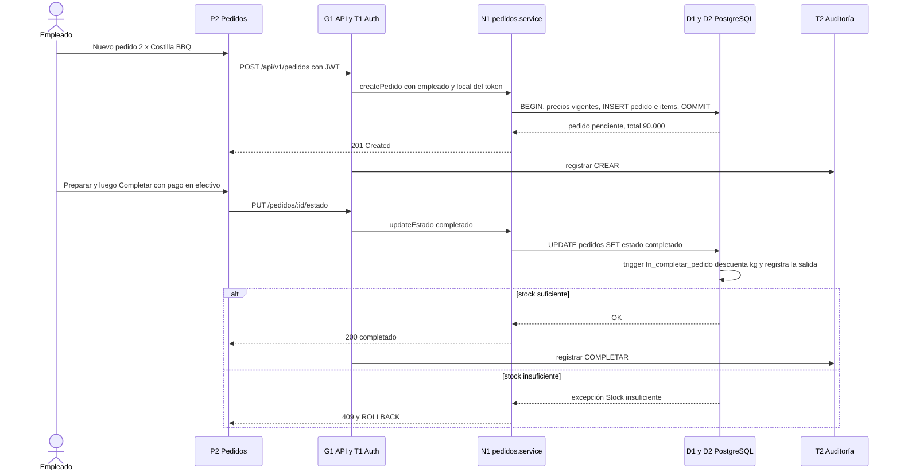

*Nota.* Fuente: elaboración propia.

##### 2.4.2.2.2. Análisis de pruebas

**Tabla 163**

*Tabla de estado – H01*

| Elemento | Estados |
|---|---|
| Sesión (JWT) | Válida (EMPLEADO / JEFE) / Ausente o vencida |
| Pedido | pendiente / preparando / completado / cancelado |
| Stock del insumo de la receta | Suficiente / Insuficiente para la cantidad pedida |
| Transición solicitada | Hacia adelante / Hacia atrás / Desde un estado final |
| Método de pago | efectivo / transferencia / ambos |
| Base de datos (PostgreSQL) | Activa / Con problemas |

*Nota.* Fuente: elaboración propia.

**Tabla 164**

*Tabla de valores – H01*

| Valor de entrada | Descripción |
|---|---|
| 2 × producto activo, stock suficiente y pago en efectivo | Caso exitoso: 201 → 200 → 200; stock − 0,8 kg; historial COMPLETAR; ingresos del día +90.000 |
| Pedido que requiere más stock del disponible | Error de negocio: 409 "Stock insuficiente…"; el pedido sigue pendiente y el stock no cambia |
| preparando → pendiente | Error de validación: 400 (flujo unidireccional, RF-16) |
| Completar un pedido cancelado | Error de validación: 400 |
| Token ausente o vencido | Error de autenticación: 401 |
| Error de conexión a la BD | Error del sistema: 500 controlado |

*Nota.* Fuente: elaboración propia.

##### 2.4.2.2.3. Diseño de casos de prueba

**Tabla 165**

*Casos de prueba de integración del hilo H01*

| Número del Caso de Prueba | Componente | Descripción de lo que se Probará | Prerrequisitos |
|---|---|---|---|
| CI-H01-01 | P2 – G1 – T1 – N1 – D2 – T2 – N4 | Flujo completo: crear → preparar → completar con pago | Local de prueba con insumo "Costilla (H01)" de 10 kg y producto de $45.000 con 0,4 kg |
| CI-H01-02 | G1 – N1 – D2 | Stock insuficiente al completar (atomicidad) | Stock de 9,2 kg después de CI-H01-01 |
| CI-H01-03 | G1 – N1 | Transiciones de estado no permitidas | Producto activo |

*Nota.* Fuente: elaboración propia.

**Tabla 166**

*Diseño del caso de prueba CI-H01-01*

| «CI-H01-01» | | | | | |
|---|---|---|---|---|---|
| **Paso** | **Descripción de pasos a seguir** | **Datos Entrada** | **Salida Esperada** | **¿OK?** | **Observaciones** |
| 1 | EMPLEADO crea el pedido | 2 × "Costilla BBQ (H01)" a $45.000 | 201, estado `pendiente`, total 90.000 | [ ] | Paso 1 |
| 2 | Pasar el pedido a preparación | `estado = preparando` | 200, estado `preparando` | [ ] | Paso 2 |
| 3 | Completar con pago en efectivo | `estado = completado`, `pago.metodo = efectivo` | 200, estado `completado` | [ ] | Paso 3 |
| 4 | Consultar el stock del insumo | GET `/inventario/insumos/:id` | 10 → 9,2 kg (2 × 0,4 kg, RF-13) | [ ] | Paso 4: lo descuenta el trigger, no el servicio |
| 5 | Consultar el historial como JEFE | GET `/historial` | Registro COMPLETAR del pedido (RF-23) | [ ] | Paso 5 |
| 6 | Consultar el resumen diario | GET `/reportes/resumen?periodo=diario` | Ingresos ≥ 90.000 (RF-20, RNF-06) | [ ] | Paso 6 |

*Nota.* Fuente: elaboración propia.

**Tabla 167**

*Diseño del caso de prueba CI-H01-02*

| «CI-H01-02» | | | | | |
|---|---|---|---|---|---|
| **Paso** | **Descripción de pasos a seguir** | **Datos Entrada** | **Salida Esperada** | **¿OK?** | **Observaciones** |
| 1 | Crear un pedido grande | 30 unidades (requiere 12 kg; hay 9,2 kg) | 201 (el stock no se verifica al crear) | [ ] | Paso 1 |
| 2 | Intentar completarlo | `estado = completado` | 409 con el mensaje de stock insuficiente | [ ] | Paso 2 |
| 3 | Consultar el pedido | GET `/pedidos/:id` | Sigue en `pendiente` | [ ] | Paso 3 |
| 4 | Consultar el stock | GET `/inventario/insumos/:id` | Sigue en 9,2 kg | [ ] | Paso 4: atomicidad de la transacción |

*Nota.* Fuente: elaboración propia.

**Tabla 168**

*Diseño del caso de prueba CI-H01-03*

| «CI-H01-03» | | | | | |
|---|---|---|---|---|---|
| **Paso** | **Descripción de pasos a seguir** | **Datos Entrada** | **Salida Esperada** | **¿OK?** | **Observaciones** |
| 1 | Crear un pedido y pasarlo a preparación | 1 unidad | 201 y 200 | [ ] | Paso 1 |
| 2 | Retroceder el estado | preparando → pendiente | 400 | [ ] | Paso 2 |
| 3 | Cancelar el pedido en preparación | DELETE `/pedidos/:id` | 200 | [ ] | Paso 3 |
| 4 | Completar el pedido cancelado | `estado = completado` | 400 | [ ] | Paso 4 |

*Nota.* Fuente: elaboración propia.

##### 2.4.2.2.4. Ejecución y evaluación de las pruebas

Se ejecutan los 3 casos diseñados para el hilo H01 con `tests/integracion/hilos/h01-completar-pedido.bd.test.js`. Cada tabla registra el caso, la imagen de la ejecución, el resultado obtenido, las observaciones técnicas/funcionales y el concepto final.

**Tabla 169**

*Ejecución y evaluación de la prueba CI-H01-01*

| **Prueba CI-H01-01** | | |
|---|---|---|
| **Caso de prueba** | **Imagen de la prueba** | **Resultado** |
| CI-H01-01: Flujo completo: crear → preparar → completar con pago | `[PANTALLAZO: terminal de Jest con los pasos del caso]` | [Completar tras ejecutar: fecha, pasos aprobados / total y resultado obtenido] |
| **Observaciones Técnicas/funcionales** | [Completar] | |
| **Concepto Final** | [Aprobado / Aprobado con observaciones / No aprobado] | |

*Nota.* Fuente: elaboración propia.

**Tabla 170**

*Ejecución y evaluación de la prueba CI-H01-02*

| **Prueba CI-H01-02** | | |
|---|---|---|
| **Caso de prueba** | **Imagen de la prueba** | **Resultado** |
| CI-H01-02: Stock insuficiente al completar (atomicidad) | `[PANTALLAZO: terminal de Jest con los pasos del caso]` | [Completar tras ejecutar: fecha, pasos aprobados / total y resultado obtenido] |
| **Observaciones Técnicas/funcionales** | El stock solo se valida al completar (flujo alterno A1 de CU-PE1 sin implementar): el Empleado puede tomar un pedido que luego no podrá cerrar. [Completar] | |
| **Concepto Final** | [Aprobado / Aprobado con observaciones / No aprobado] | |

*Nota.* Fuente: elaboración propia.

**Tabla 171**

*Ejecución y evaluación de la prueba CI-H01-03*

| **Prueba CI-H01-03** | | |
|---|---|---|
| **Caso de prueba** | **Imagen de la prueba** | **Resultado** |
| CI-H01-03: Transiciones de estado no permitidas | `[PANTALLAZO: terminal de Jest con los pasos del caso]` | [Completar tras ejecutar: fecha, pasos aprobados / total y resultado obtenido] |
| **Observaciones Técnicas/funcionales** | [Completar] | |
| **Concepto Final** | [Aprobado / Aprobado con observaciones / No aprobado] | |

*Nota.* Fuente: elaboración propia.

**Tabla 172**

*Evaluación de las pruebas del hilo H01*

| Caso de prueba | Descripción | Pasos | Conformes | No conformes | Resultado previsto* | Concepto final |
|---|---|---|---|---|---|---|
| CI-H01-01 | Flujo completo con pago | 6 | [ ] | [ ] | 6/6 | [ ] |
| CI-H01-02 | Stock insuficiente (atomicidad) | 4 | [ ] | [ ] | 4/4 | [ ] |
| CI-H01-03 | Transiciones no permitidas | 4 | [ ] | [ ] | 4/4 | [ ] |
| **Total** | 3 casos | 14 | [ ] | [ ] | 14/14 | [ ] |

*Nota.* Fuente: elaboración propia.

*Resultado previsto: validación previa de los scripts contra el esquema reconstruido; no reemplaza la ejecución sobre `brasas-test`.

Evaluación: [Completar. Ejemplo: de los 3 casos del hilo H01, … fueron aprobados (… de 14 pasos conformes). El flujo crítico del negocio —un pedido completado descuenta el inventario, queda auditado y se refleja en los reportes— …]

#### 2.4.2.3. H02. Registrar movimientos de inventario

**Tabla 173**

*Ficha del hilo H02*

| Hilo | H02 |
|---|---|
| Nombre del caso de uso | Registrar movimientos de inventario: compra de carne (entrada) y salida por descarte |
| CU relacionados | CU-I1, CU-I2 |
| Actor | Jefe |
| Componentes que atraviesa | API (Swagger / Supertest) → G1 API Gateway → T1 Autenticación → N2 Inventario → D1/D2 → T2 Auditoría → N5 Historial → N4 Reportes |
| Casos de prueba | CI-H02-01, CI-H02-02, CI-H02-03 |

*Nota.* Fuente: elaboración propia.

##### 2.4.2.3.1. Diagrama de secuencia

**Figura 19**

*Diagrama de secuencia del hilo H02*

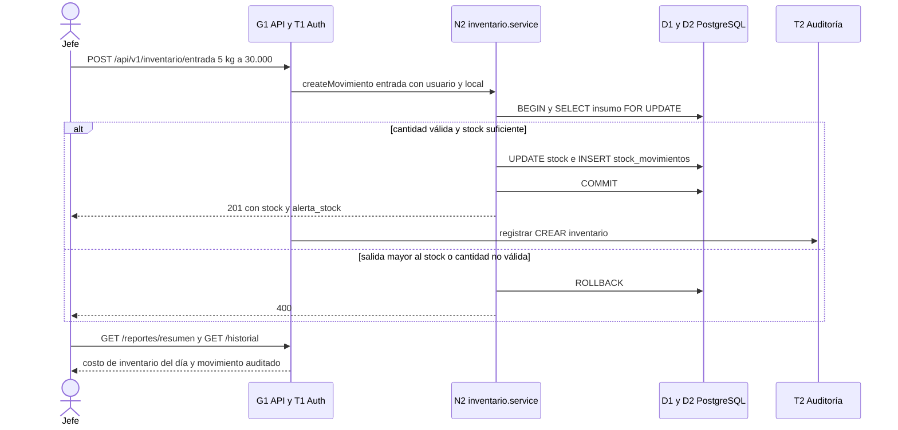

*Nota.* Fuente: elaboración propia.

##### 2.4.2.3.2. Análisis de pruebas

**Tabla 174**

*Tabla de estado – H02*

| Elemento | Estados |
|---|---|
| Sesión (JWT) | JEFE / ADMIN / EMPLEADO (403) |
| Insumo | Del local / De otro local o inexistente |
| Tipo de movimiento | entrada / salida |
| Cantidad | Positiva / Cero o negativa / Mayor que el stock (salida) |
| Stock resultante | Sobre el mínimo / En el mínimo o por debajo (alerta) |
| Base de datos (PostgreSQL) | Activa / Con problemas |

*Nota.* Fuente: elaboración propia.

**Tabla 175**

*Tabla de valores – H02*

| Valor de entrada | Descripción |
|---|---|
| Entrada de 5 kg a $30.000/kg sobre 2 kg | Caso exitoso: 201, stock 7 kg, movimiento con usuario y fecha, costo de inventario 150.000 |
| Salida de 4,5 kg sobre 7 kg con mínimo 3 kg | Caso exitoso con alerta: 201, stock 2,5 kg y `alerta_stock = true` (RF-14) |
| Salida de 10 kg con 2,5 kg disponibles | Error de negocio: 400 y el stock no cambia (RNF-10) |
| Entrada con cantidad −5 | Error de validación: 400 (RNF-10) |
| Error de conexión a la BD | Error del sistema: 500 controlado |

*Nota.* Fuente: elaboración propia.

##### 2.4.2.3.3. Diseño de casos de prueba

**Tabla 176**

*Casos de prueba de integración del hilo H02*

| Número del Caso de Prueba | Componente | Descripción de lo que se Probará | Prerrequisitos |
|---|---|---|---|
| CI-H02-01 | G1 – T1 – N2 – D2 – N4 – T2 – N5 | Compra de carne (entrada) y su efecto en costos e historial | Insumo "Punta de anca (H02)" con 2 kg, mínimo 3 kg y $30.000/kg |
| CI-H02-02 | G1 – N2 – D2 | Salida por descarte que activa la alerta de stock mínimo | Stock de 7 kg después de CI-H02-01 |
| CI-H02-03 | G1 – N2 – D2 | Movimientos que no deben alterar el stock | Stock de 2,5 kg después de CI-H02-02 |

*Nota.* Fuente: elaboración propia.

**Tabla 177**

*Diseño del caso de prueba CI-H02-01*

| «CI-H02-01» | | | | | |
|---|---|---|---|---|---|
| **Paso** | **Descripción de pasos a seguir** | **Datos Entrada** | **Salida Esperada** | **¿OK?** | **Observaciones** |
| 1 | Registrar la entrada | 5 kg a $30.000/kg, motivo "Compra proveedor" | 201, stock 2 → 7 kg, sin alerta | [ ] | Paso 1 |
| 2 | Consultar el movimiento | GET `/inventario/movimientos?insumo_id=…` | Registro con usuario, cantidad, costo y fecha (RNF-11) | [ ] | Paso 2 |
| 3 | Consultar el resumen diario | GET `/reportes/resumen?periodo=diario` | `costo_inventario` = 150.000 (5 × 30.000) | [ ] | Paso 3 |
| 4 | Consultar el historial como JEFE | GET `/historial` | Registro de la entrada con entidad `inventario` (RF-23) | [ ] | Paso 4 |

*Nota.* Fuente: elaboración propia.

**Tabla 178**

*Diseño del caso de prueba CI-H02-02*

| «CI-H02-02» | | | | | |
|---|---|---|---|---|---|
| **Paso** | **Descripción de pasos a seguir** | **Datos Entrada** | **Salida Esperada** | **¿OK?** | **Observaciones** |
| 1 | Registrar una salida por descarte | 4,5 kg (7 → 2,5; mínimo 3) | 201 y `alerta_stock = true` (RF-14) | [ ] | Paso 1 |
| 2 | Consultar el listado de insumos | GET `/inventario/insumos` | El insumo muestra 2,5 kg | [ ] | Paso 2 |

*Nota.* Fuente: elaboración propia.

**Tabla 179**

*Diseño del caso de prueba CI-H02-03*

| «CI-H02-03» | | | | | |
|---|---|---|---|---|---|
| **Paso** | **Descripción de pasos a seguir** | **Datos Entrada** | **Salida Esperada** | **¿OK?** | **Observaciones** |
| 1 | Registrar una salida mayor al stock | 10 kg con 2,5 kg disponibles | 400 | [ ] | Paso 1 |
| 2 | Registrar una entrada negativa | −5 kg | 400 | [ ] | Paso 2 |
| 3 | Consultar el stock | GET `/inventario/insumos/:id` | Sigue en 2,5 kg y nunca es negativo | [ ] | Paso 3 |

*Nota.* Fuente: elaboración propia.

##### 2.4.2.3.4. Ejecución y evaluación de las pruebas

Se ejecutan los 3 casos diseñados para el hilo H02 con `tests/integracion/hilos/h02-movimientos-inventario.bd.test.js`. Cada tabla registra el caso, la imagen de la ejecución, el resultado obtenido, las observaciones técnicas/funcionales y el concepto final.

**Tabla 180**

*Ejecución y evaluación de la prueba CI-H02-01*

| **Prueba CI-H02-01** | | |
|---|---|---|
| **Caso de prueba** | **Imagen de la prueba** | **Resultado** |
| CI-H02-01: Compra de carne (entrada) y su efecto en costos e historial | `[PANTALLAZO: terminal de Jest con los pasos del caso]` | [Completar tras ejecutar: fecha, pasos aprobados / total y resultado obtenido] |
| **Observaciones Técnicas/funcionales** | Resultado previsto: no conforme por DEF-16. `UPDATE insumos SET stock_actual = stock_actual + ($1 * $2)` no se puede preparar en PostgreSQL (`operator is not unique: unknown * unknown`), por lo que toda entrada y salida responde 500. El paso 4 también depende de DEF-13. [Completar] | |
| **Concepto Final** | [Aprobado / Aprobado con observaciones / No aprobado] | |

*Nota.* Fuente: elaboración propia.

**Tabla 181**

*Ejecución y evaluación de la prueba CI-H02-02*

| **Prueba CI-H02-02** | | |
|---|---|---|
| **Caso de prueba** | **Imagen de la prueba** | **Resultado** |
| CI-H02-02: Salida por descarte con alerta de stock mínimo | `[PANTALLAZO: terminal de Jest con los pasos del caso]` | [Completar tras ejecutar: fecha, pasos aprobados / total y resultado obtenido] |
| **Observaciones Técnicas/funcionales** | Resultado previsto: no conforme por DEF-16. [Completar] | |
| **Concepto Final** | [Aprobado / Aprobado con observaciones / No aprobado] | |

*Nota.* Fuente: elaboración propia.

**Tabla 182**

*Ejecución y evaluación de la prueba CI-H02-03*

| **Prueba CI-H02-03** | | |
|---|---|---|
| **Caso de prueba** | **Imagen de la prueba** | **Resultado** |
| CI-H02-03: Movimientos que no deben alterar el stock | `[PANTALLAZO: terminal de Jest con los pasos del caso]` | [Completar tras ejecutar: fecha, pasos aprobados / total y resultado obtenido] |
| **Observaciones Técnicas/funcionales** | Resultado previsto: el paso 1 es conforme porque la validación de stock ocurre antes del UPDATE. El paso 2 es no conforme por DEF-01 (no se valida el signo) y DEF-16. [Completar] | |
| **Concepto Final** | [Aprobado / Aprobado con observaciones / No aprobado] | |

*Nota.* Fuente: elaboración propia.

**Tabla 183**

*Evaluación de las pruebas del hilo H02*

| Caso de prueba | Descripción | Pasos | Conformes | No conformes | Resultado previsto* | Concepto final |
|---|---|---|---|---|---|---|
| CI-H02-01 | Entrada de carne | 4 | [ ] | [ ] | 0/4 | [ ] |
| CI-H02-02 | Salida con alerta | 2 | [ ] | [ ] | 0/2 | [ ] |
| CI-H02-03 | Movimientos inválidos | 3 | [ ] | [ ] | 1/3 | [ ] |
| **Total** | 3 casos | 9 | [ ] | [ ] | 1/9 | [ ] |

*Nota.* Fuente: elaboración propia.

*Resultado previsto: validación previa de los scripts contra el esquema reconstruido; no reemplaza la ejecución sobre `brasas-test`.

Evaluación: [Completar.] El hilo H02 es el que más riesgo concentra: si se confirma DEF-16 en `brasas-test`, los endpoints de entrada y salida no funcionan en ningún caso. La interfaz actual no los usa (Tabla Tabla 2), por lo que el defecto no se nota en el uso diario, pero RF-11 queda sin cumplir.

#### 2.4.2.4. H03. Crear un producto con receta y costeo

**Tabla 184**

*Ficha del hilo H03*

| Hilo | H03 |
|---|---|
| Nombre del caso de uso | Crear un producto con receta, recalcular su costo y desactivarlo |
| CU relacionados | CU-P1, CU-P2, CU-P3 |
| Actor | Jefe |
| Componentes que atraviesa | P4 Menú → G1 API Gateway → T1 Autenticación → N3 Productos → N2 Inventario (costos de insumos) → D1/D2 → N1 Pedidos (venta previa) |
| Casos de prueba | CI-H03-01, CI-H03-02, CI-H03-03 |

*Nota.* Fuente: elaboración propia.

##### 2.4.2.4.1. Diagrama de secuencia

**Figura 20**

*Diagrama de secuencia del hilo H03*

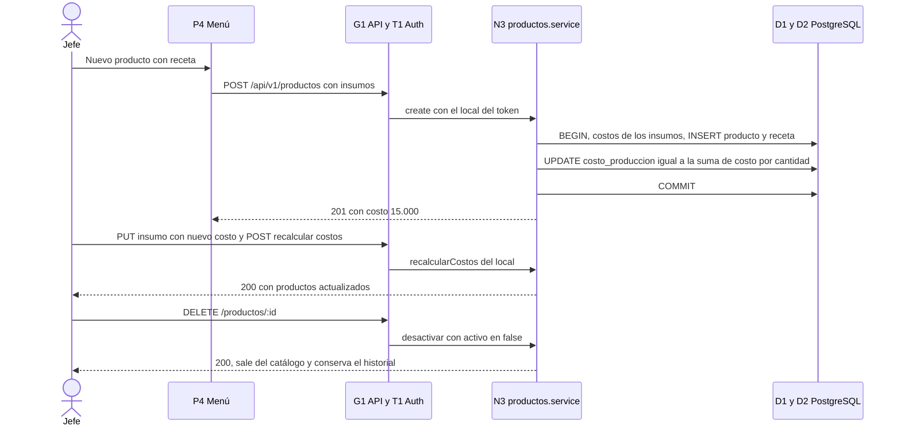

*Nota.* Fuente: elaboración propia.

##### 2.4.2.4.2. Análisis de pruebas

**Tabla 185**

*Tabla de estado – H03*

| Elemento | Estados |
|---|---|
| Sesión (JWT) | JEFE / ADMIN / EMPLEADO (403) |
| Receta | Con insumos del local / Sin insumos / Con insumo inexistente |
| Costo del insumo | Vigente / Actualizado |
| Producto | Activo / Inactivo |
| Relación costo / precio | Costo < precio / Costo ≥ precio (400, RF-10) |

*Nota.* Fuente: elaboración propia.

**Tabla 186**

*Tabla de valores – H03*

| Valor de entrada | Descripción |
|---|---|
| $45.000 con 0,4 kg de res a $30.000 y 2 papas a $1.500 | Caso exitoso: 201 y costo 15.000; margen 30.000 |
| Costo de la res sube a $32.000/kg y se recalcula | Caso exitoso: nuevo costo 15.800 |
| Desactivar un producto ya vendido | Caso exitoso: sale del catálogo, no se puede pedir (404) y el pedido anterior conserva el ítem |
| Token de EMPLEADO en POST `/productos` | Error de autorización: 403 |

*Nota.* Fuente: elaboración propia.

##### 2.4.2.4.3. Diseño de casos de prueba

**Tabla 187**

*Casos de prueba de integración del hilo H03*

| Número del Caso de Prueba | Componente | Descripción de lo que se Probará | Prerrequisitos |
|---|---|---|---|
| CI-H03-01 | P4 – G1 – T1 – N3 – N2 – D2 | Producto con receta y costo calculado | Insumos "Res (H03)" a $30.000/kg y "Papa criolla (H03)" a $1.500/unidad |
| CI-H03-02 | G1 – N2 – N3 – D2 | Cambio de costo del insumo y recálculo | Producto de CI-H03-01 |
| CI-H03-03 | G1 – N3 – N1 – D2 | Desactivar producto sin perder el historial de pedidos (RF-08) | Producto de CI-H03-01 |

*Nota.* Fuente: elaboración propia.

**Tabla 188**

*Diseño del caso de prueba CI-H03-01*

| «CI-H03-01» | | | | | |
|---|---|---|---|---|---|
| **Paso** | **Descripción de pasos a seguir** | **Datos Entrada** | **Salida Esperada** | **¿OK?** | **Observaciones** |
| 1 | JEFE crea el producto | "Churrasco (H03)" a $45.000 con 0,4 kg de res y 2 papas | 201 y costo 15.000 | [ ] | Paso 1 |
| 2 | Consultar costos y márgenes | GET `/productos/costos` | Margen 30.000 (RF-07) | [ ] | Paso 2 |
| 3 | Consultar el detalle | GET `/productos/:id` | Receta con los 2 insumos | [ ] | Paso 3 |

*Nota.* Fuente: elaboración propia.

**Tabla 189**

*Diseño del caso de prueba CI-H03-02*

| «CI-H03-02» | | | | | |
|---|---|---|---|---|---|
| **Paso** | **Descripción de pasos a seguir** | **Datos Entrada** | **Salida Esperada** | **¿OK?** | **Observaciones** |
| 1 | Actualizar el costo de la res | PUT `/inventario/insumos/:id` con $32.000/kg | Costo promedio actualizado | [ ] | Paso 1 |
| 2 | Recalcular costos | POST `/productos/recalcular-costos` | 200 con al menos 1 producto actualizado | [ ] | Paso 2 |
| 3 | Consultar el nuevo costo | GET `/productos/:id` | 0,4 × 32.000 + 2 × 1.500 = 15.800 | [ ] | Paso 3 |

*Nota.* Fuente: elaboración propia.

**Tabla 190**

*Diseño del caso de prueba CI-H03-03*

| «CI-H03-03» | | | | | |
|---|---|---|---|---|---|
| **Paso** | **Descripción de pasos a seguir** | **Datos Entrada** | **Salida Esperada** | **¿OK?** | **Observaciones** |
| 1 | Vender el producto | Pedido de 1 unidad | 201 | [ ] | Paso 1 |
| 2 | Desactivar el producto | DELETE `/productos/:id` | 200 | [ ] | Paso 2 |
| 3 | Buscarlo y pedirlo de nuevo | GET `/productos`; POST `/pedidos` | No aparece; 404 | [ ] | Paso 3 |
| 4 | Consultar el pedido anterior | GET `/pedidos/:id` | Conserva el ítem con el nombre del producto | [ ] | Paso 4 |

*Nota.* Fuente: elaboración propia.

##### 2.4.2.4.4. Ejecución y evaluación de las pruebas

Se ejecutan los 3 casos diseñados para el hilo H03 con `tests/integracion/hilos/h03-producto-costeo.bd.test.js`. Cada tabla registra el caso, la imagen de la ejecución, el resultado obtenido, las observaciones técnicas/funcionales y el concepto final.

**Tabla 191**

*Ejecución y evaluación de la prueba CI-H03-01*

| **Prueba CI-H03-01** | | |
|---|---|---|
| **Caso de prueba** | **Imagen de la prueba** | **Resultado** |
| CI-H03-01: Producto con receta y costo calculado | `[PANTALLAZO: terminal de Jest con los pasos del caso]` | [Completar tras ejecutar: fecha, pasos aprobados / total y resultado obtenido] |
| **Observaciones Técnicas/funcionales** | [Completar] | |
| **Concepto Final** | [Aprobado / Aprobado con observaciones / No aprobado] | |

*Nota.* Fuente: elaboración propia.

**Tabla 192**

*Ejecución y evaluación de la prueba CI-H03-02*

| **Prueba CI-H03-02** | | |
|---|---|---|
| **Caso de prueba** | **Imagen de la prueba** | **Resultado** |
| CI-H03-02: Cambio de costo del insumo y recálculo | `[PANTALLAZO: terminal de Jest con los pasos del caso]` | [Completar tras ejecutar: fecha, pasos aprobados / total y resultado obtenido] |
| **Observaciones Técnicas/funcionales** | El recálculo es manual: si el Jefe no lo ejecuta, los márgenes del menú quedan desactualizados tras una compra a otro precio. [Completar] | |
| **Concepto Final** | [Aprobado / Aprobado con observaciones / No aprobado] | |

*Nota.* Fuente: elaboración propia.

**Tabla 193**

*Ejecución y evaluación de la prueba CI-H03-03*

| **Prueba CI-H03-03** | | |
|---|---|---|
| **Caso de prueba** | **Imagen de la prueba** | **Resultado** |
| CI-H03-03: Desactivar producto sin perder el historial | `[PANTALLAZO: terminal de Jest con los pasos del caso]` | [Completar tras ejecutar: fecha, pasos aprobados / total y resultado obtenido] |
| **Observaciones Técnicas/funcionales** | [Completar] | |
| **Concepto Final** | [Aprobado / Aprobado con observaciones / No aprobado] | |

*Nota.* Fuente: elaboración propia.

**Tabla 194**

*Evaluación de las pruebas del hilo H03*

| Caso de prueba | Descripción | Pasos | Conformes | No conformes | Resultado previsto* | Concepto final |
|---|---|---|---|---|---|---|
| CI-H03-01 | Producto con receta | 3 | [ ] | [ ] | 3/3 | [ ] |
| CI-H03-02 | Recálculo de costos | 3 | [ ] | [ ] | 3/3 | [ ] |
| CI-H03-03 | Desactivación (RF-08) | 4 | [ ] | [ ] | 4/4 | [ ] |
| **Total** | 3 casos | 10 | [ ] | [ ] | 10/10 | [ ] |

*Nota.* Fuente: elaboración propia.

*Resultado previsto: validación previa de los scripts contra el esquema reconstruido; no reemplaza la ejecución sobre `brasas-test`.

Evaluación: [Completar.]

#### 2.4.2.5. H04. Consultar el dashboard de rentabilidad

**Tabla 195**

*Ficha del hilo H04*

| Hilo | H04 |
|---|---|
| Nombre del caso de uso | Consultar el dashboard de rentabilidad |
| CU relacionados | CU-D1 |
| Actor | Jefe / Empleado |
| Componentes que atraviesa | P5 Dashboard → G1 API Gateway → T1 Autenticación → N4 Reportes → D1/D2 (pedidos, ítems, productos y movimientos) · N1 Pedidos (venta) |
| Casos de prueba | CI-H04-01, CI-H04-02, CI-H04-03 |

*Nota.* Fuente: elaboración propia.

##### 2.4.2.5.1. Diagrama de secuencia

**Figura 21**

*Diagrama de secuencia del hilo H04*

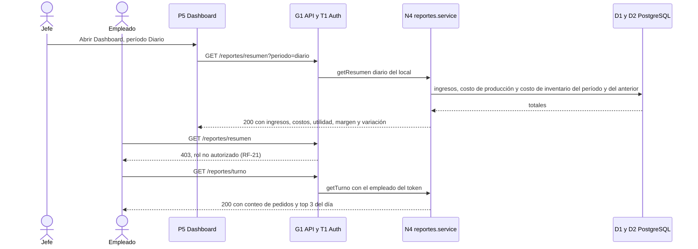

*Nota.* Fuente: elaboración propia.

##### 2.4.2.5.2. Análisis de pruebas

**Tabla 196**

*Tabla de estado – H04*

| Elemento | Estados |
|---|---|
| Sesión (JWT) | JEFE / ADMIN / EMPLEADO |
| Período | diario / semanal / mensual / no reconocido (se normaliza) |
| Ventas del período | Sin ventas / Con pedidos completados |
| Período anterior | Sin datos (variación null) / Con datos |

*Nota.* Fuente: elaboración propia.

**Tabla 197**

*Tabla de valores – H04*

| Valor de entrada | Descripción |
|---|---|
| Día sin ventas | Resumen en cero, margen 0 y `utilidad_positiva = false` (valor límite, sin división por cero) |
| 2 × $45.000 con costo de $15.000 cada uno | Ingresos 90.000; costo 30.000; utilidad 60.000; margen 66,67 % (RF-20) |
| Token de EMPLEADO en `/reportes/resumen` | Error de autorización: 403 (RF-21) |
| Token de EMPLEADO en `/reportes/turno` | 200 solo con conteo y top de productos, sin datos financieros |

*Nota.* Fuente: elaboración propia.

##### 2.4.2.5.3. Diseño de casos de prueba

**Tabla 198**

*Casos de prueba de integración del hilo H04*

| Número del Caso de Prueba | Componente | Descripción de lo que se Probará | Prerrequisitos |
|---|---|---|---|
| CI-H04-01 | P5 – G1 – T1 – N4 – D2 | Día sin ventas | Local de prueba recién creado |
| CI-H04-02 | G1 – N1 – D2 – N4 | Rentabilidad después de una venta | Producto "Churrasco (H04)" de $45.000 con 0,5 kg de res a $30.000/kg |
| CI-H04-03 | G1 – T1 – N4 | Vista del EMPLEADO sin datos financieros (RF-21) | Pedido de CI-H04-02 |

*Nota.* Fuente: elaboración propia.

**Tabla 199**

*Diseño del caso de prueba CI-H04-01*

| «CI-H04-01» | | | | | |
|---|---|---|---|---|---|
| **Paso** | **Descripción de pasos a seguir** | **Datos Entrada** | **Salida Esperada** | **¿OK?** | **Observaciones** |
| 1 | Consultar el resumen diario | GET `/reportes/resumen?periodo=diario` | Todo en 0, margen 0 y utilidad no positiva | [ ] | Paso 1 |

*Nota.* Fuente: elaboración propia.

**Tabla 200**

*Diseño del caso de prueba CI-H04-02*

| «CI-H04-02» | | | | | |
|---|---|---|---|---|---|
| **Paso** | **Descripción de pasos a seguir** | **Datos Entrada** | **Salida Esperada** | **¿OK?** | **Observaciones** |
| 1 | Crear y completar un pedido | 2 × "Churrasco (H04)" ($90.000), efectivo | 201 y 200 | [ ] | Paso 1 |
| 2 | Consultar el resumen diario | GET `/reportes/resumen?periodo=diario` | Ingresos 90.000; costo de producción 30.000; utilidad 60.000; margen 66,67 % | [ ] | Paso 2 |
| 3 | Consultar el top de productos | GET `/reportes/top-productos?periodo=diario` | Churrasco con 2 unidades y ganancia de $60.000 | [ ] | Paso 3 |
| 4 | Consultar el resumen de pagos | GET `/reportes/pagos?periodo=diario` | $90.000 en efectivo | [ ] | Paso 4 |

*Nota.* Fuente: elaboración propia.

**Tabla 201**

*Diseño del caso de prueba CI-H04-03*

| «CI-H04-03» | | | | | |
|---|---|---|---|---|---|
| **Paso** | **Descripción de pasos a seguir** | **Datos Entrada** | **Salida Esperada** | **¿OK?** | **Observaciones** |
| 1 | EMPLEADO pide el resumen financiero | GET `/reportes/resumen` | 403 | [ ] | Paso 1 |
| 2 | EMPLEADO pide su turno | GET `/reportes/turno` | 200 con el conteo de sus pedidos y el top del día | [ ] | Paso 2 |

*Nota.* Fuente: elaboración propia.

##### 2.4.2.5.4. Ejecución y evaluación de las pruebas

Se ejecutan los 3 casos diseñados para el hilo H04 con `tests/integracion/hilos/h04-dashboard-rentabilidad.bd.test.js`. Cada tabla registra el caso, la imagen de la ejecución, el resultado obtenido, las observaciones técnicas/funcionales y el concepto final.

**Tabla 202**

*Ejecución y evaluación de la prueba CI-H04-01*

| **Prueba CI-H04-01** | | |
|---|---|---|
| **Caso de prueba** | **Imagen de la prueba** | **Resultado** |
| CI-H04-01: Día sin ventas | `[PANTALLAZO: terminal de Jest con los pasos del caso]` | [Completar tras ejecutar: fecha, pasos aprobados / total y resultado obtenido] |
| **Observaciones Técnicas/funcionales** | [Completar] | |
| **Concepto Final** | [Aprobado / Aprobado con observaciones / No aprobado] | |

*Nota.* Fuente: elaboración propia.

**Tabla 203**

*Ejecución y evaluación de la prueba CI-H04-02*

| **Prueba CI-H04-02** | | |
|---|---|---|
| **Caso de prueba** | **Imagen de la prueba** | **Resultado** |
| CI-H04-02: Rentabilidad después de una venta | `[PANTALLAZO: terminal de Jest con los pasos del caso]` | [Completar tras ejecutar: fecha, pasos aprobados / total y resultado obtenido] |
| **Observaciones Técnicas/funcionales** | La API calcula bien la rentabilidad, pero en la interfaz las secciones "Productos más rentables" e "Historial de Acciones" no terminan de cargar (DEF-17, P5-03). [Completar] | |
| **Concepto Final** | [Aprobado / Aprobado con observaciones / No aprobado] | |

*Nota.* Fuente: elaboración propia.

**Tabla 204**

*Ejecución y evaluación de la prueba CI-H04-03*

| **Prueba CI-H04-03** | | |
|---|---|---|
| **Caso de prueba** | **Imagen de la prueba** | **Resultado** |
| CI-H04-03: Vista del EMPLEADO sin datos financieros | `[PANTALLAZO: terminal de Jest con los pasos del caso]` | [Completar tras ejecutar: fecha, pasos aprobados / total y resultado obtenido] |
| **Observaciones Técnicas/funcionales** | [Completar] | |
| **Concepto Final** | [Aprobado / Aprobado con observaciones / No aprobado] | |

*Nota.* Fuente: elaboración propia.

**Tabla 205**

*Evaluación de las pruebas del hilo H04*

| Caso de prueba | Descripción | Pasos | Conformes | No conformes | Resultado previsto* | Concepto final |
|---|---|---|---|---|---|---|
| CI-H04-01 | Día sin ventas | 1 | [ ] | [ ] | 1/1 | [ ] |
| CI-H04-02 | Rentabilidad tras una venta | 4 | [ ] | [ ] | 4/4 | [ ] |
| CI-H04-03 | Vista del EMPLEADO | 2 | [ ] | [ ] | 2/2 | [ ] |
| **Total** | 3 casos | 7 | [ ] | [ ] | 7/7 | [ ] |

*Nota.* Fuente: elaboración propia.

*Resultado previsto: validación previa de los scripts contra el esquema reconstruido; no reemplaza la ejecución sobre `brasas-test`.

Evaluación: [Completar.]

#### 2.4.2.6. H05. Consultar el historial de auditoría según el rol

**Tabla 206**

*Ficha del hilo H05*

| Hilo | H05 |
|---|---|
| Nombre del caso de uso | Consultar el historial de auditoría según el rol |
| CU relacionados | RF-23 |
| Actor | Jefe / Empleado |
| Componentes que atraviesa | P6 Historial → G1 API Gateway → T1 Autenticación → N5 Historial → D1/D2 · registros producidos por T2 Auditoría desde N1 y N2 |
| Casos de prueba | CI-H05-01, CI-H05-02, CI-H05-03 |

*Nota.* Fuente: elaboración propia.

##### 2.4.2.6.1. Diagrama de secuencia

**Figura 22**

*Diagrama de secuencia del hilo H05*

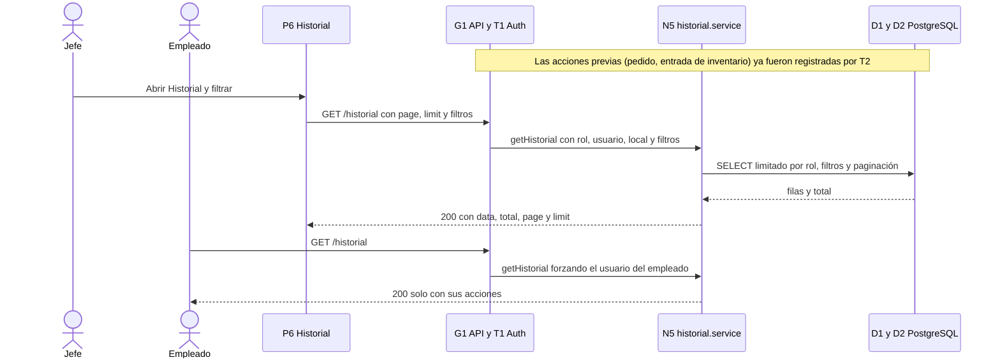

*Nota.* Fuente: elaboración propia.

##### 2.4.2.6.2. Análisis de pruebas

**Tabla 207**

*Tabla de estado – H05*

| Elemento | Estados |
|---|---|
| Sesión (JWT) | ADMIN / JEFE / EMPLEADO |
| Alcance por rol | Global / Entidades de negocio del local / Acciones propias |
| Filtro de acción | Ninguno / Válido / Inexistente |
| Rango de fechas | Sin rango / Un día (inicio = fin) / Varios días |
| Página | Primera / Intermedia / Fuera de rango |

*Nota.* Fuente: elaboración propia.

**Tabla 208**

*Tabla de valores – H05*

| Valor de entrada | Descripción |
|---|---|
| JEFE sin filtros | 200 con acciones de negocio de su local (pedidos, inventario, productos) |
| EMPLEADO sin filtros | 200 solo con sus propias acciones |
| `tipo_accion=COMPLETAR` | 200 solo con filas COMPLETAR |
| `fecha_inicio = fecha_fin = hoy` | 200 con las acciones de hoy (valor límite) |
| `tipo_accion` inexistente | Error de validación: 400 con los valores permitidos |

*Nota.* Fuente: elaboración propia.

##### 2.4.2.6.3. Diseño de casos de prueba

**Tabla 209**

*Casos de prueba de integración del hilo H05*

| Número del Caso de Prueba | Componente | Descripción de lo que se Probará | Prerrequisitos |
|---|---|---|---|
| CI-H05-01 | P6 – G1 – T1 – N5 – D2 | Vista del JEFE: acciones de negocio de su local | Entrada de inventario del JEFE y pedido completado por el EMPLEADO |
| CI-H05-02 | G1 – T1 – N5 – D2 | Vista del EMPLEADO: solo sus acciones | Pedido creado por el EMPLEADO |
| CI-H05-03 | G1 – N5 – D2 | Filtros del historial | Registros del día |

*Nota.* Fuente: elaboración propia.

**Tabla 210**

*Diseño del caso de prueba CI-H05-01*

| «CI-H05-01» | | | | | |
|---|---|---|---|---|---|
| **Paso** | **Descripción de pasos a seguir** | **Datos Entrada** | **Salida Esperada** | **¿OK?** | **Observaciones** |
| 1 | JEFE consulta el historial | GET `/historial` | 200 con registros | [ ] | Paso 1 |
| 2 | Revisar las entidades | Columna `entidad` | Solo entidades de negocio (sin `auth` ni `usuarios`) | [ ] | Paso 2 |
| 3 | Buscar el pedido del empleado | Acción COMPLETAR | Aparece el registro | [ ] | Paso 3 |
| 4 | Buscar la entrada de inventario | Entidad `inventario` | Aparece la entrada registrada por el JEFE | [ ] | Paso 4 |

*Nota.* Fuente: elaboración propia.

**Tabla 211**

*Diseño del caso de prueba CI-H05-02*

| «CI-H05-02» | | | | | |
|---|---|---|---|---|---|
| **Paso** | **Descripción de pasos a seguir** | **Datos Entrada** | **Salida Esperada** | **¿OK?** | **Observaciones** |
| 1 | EMPLEADO consulta el historial | GET `/historial` | Todos los registros son del empleado | [ ] | Paso 1 |
| 2 | Buscar su pedido | Acción CREAR | Aparece la creación de su pedido | [ ] | Paso 2 |

*Nota.* Fuente: elaboración propia.

**Tabla 212**

*Diseño del caso de prueba CI-H05-03*

| «CI-H05-03» | | | | | |
|---|---|---|---|---|---|
| **Paso** | **Descripción de pasos a seguir** | **Datos Entrada** | **Salida Esperada** | **¿OK?** | **Observaciones** |
| 1 | Filtrar por acción | `tipo_accion=COMPLETAR` | Todas las filas son COMPLETAR | [ ] | Paso 1 |
| 2 | Filtrar un solo día | `fecha_inicio = fecha_fin = hoy` | Incluye las acciones de hoy | [ ] | Paso 2 |
| 3 | Usar una acción inexistente | `tipo_accion=BORRAR` | 400 | [ ] | Paso 3 |

*Nota.* Fuente: elaboración propia.

##### 2.4.2.6.4. Ejecución y evaluación de las pruebas

Se ejecutan los 3 casos diseñados para el hilo H05 con `tests/integracion/hilos/h05-historial-por-rol.bd.test.js`. Cada tabla registra el caso, la imagen de la ejecución, el resultado obtenido, las observaciones técnicas/funcionales y el concepto final.

**Tabla 213**

*Ejecución y evaluación de la prueba CI-H05-01*

| **Prueba CI-H05-01** | | |
|---|---|---|
| **Caso de prueba** | **Imagen de la prueba** | **Resultado** |
| CI-H05-01: Vista del JEFE | `[PANTALLAZO: terminal de Jest con los pasos del caso]` | [Completar tras ejecutar: fecha, pasos aprobados / total y resultado obtenido] |
| **Observaciones Técnicas/funcionales** | Resultado previsto: el paso 4 es no conforme. La entrada de inventario falla por DEF-16 y, aunque funcionara, la auditoría la guardaría con la entidad `insumos`, que queda fuera del alcance del JEFE (DEF-13). [Completar] | |
| **Concepto Final** | [Aprobado / Aprobado con observaciones / No aprobado] | |

*Nota.* Fuente: elaboración propia.

**Tabla 214**

*Ejecución y evaluación de la prueba CI-H05-02*

| **Prueba CI-H05-02** | | |
|---|---|---|
| **Caso de prueba** | **Imagen de la prueba** | **Resultado** |
| CI-H05-02: Vista del EMPLEADO | `[PANTALLAZO: terminal de Jest con los pasos del caso]` | [Completar tras ejecutar: fecha, pasos aprobados / total y resultado obtenido] |
| **Observaciones Técnicas/funcionales** | [Completar] | |
| **Concepto Final** | [Aprobado / Aprobado con observaciones / No aprobado] | |

*Nota.* Fuente: elaboración propia.

**Tabla 215**

*Ejecución y evaluación de la prueba CI-H05-03*

| **Prueba CI-H05-03** | | |
|---|---|---|
| **Caso de prueba** | **Imagen de la prueba** | **Resultado** |
| CI-H05-03: Filtros del historial | `[PANTALLAZO: terminal de Jest con los pasos del caso]` | [Completar tras ejecutar: fecha, pasos aprobados / total y resultado obtenido] |
| **Observaciones Técnicas/funcionales** | Resultado previsto: el paso 1 es no conforme por DEF-02 (el filtro llega al controlador pero no a la consulta). El paso 2 es no conforme por DEF-11 (`created_at <= 'AAAA-MM-DD'` corta en las 00:00). [Completar] | |
| **Concepto Final** | [Aprobado / Aprobado con observaciones / No aprobado] | |

*Nota.* Fuente: elaboración propia.

**Tabla 216**

*Evaluación de las pruebas del hilo H05*

| Caso de prueba | Descripción | Pasos | Conformes | No conformes | Resultado previsto* | Concepto final |
|---|---|---|---|---|---|---|
| CI-H05-01 | Vista del JEFE | 4 | [ ] | [ ] | 3/4 | [ ] |
| CI-H05-02 | Vista del EMPLEADO | 2 | [ ] | [ ] | 2/2 | [ ] |
| CI-H05-03 | Filtros | 3 | [ ] | [ ] | 1/3 | [ ] |
| **Total** | 3 casos | 9 | [ ] | [ ] | 6/9 | [ ] |

*Nota.* Fuente: elaboración propia.

*Resultado previsto: validación previa de los scripts contra el esquema reconstruido; no reemplaza la ejecución sobre `brasas-test`.

Evaluación: [Completar.]

### 2.4.3. Evaluación general de las pruebas de integración

La tabla siguiente consolida los resultados de las dos estrategias. El detalle de cada caso está en el apartado 2.4.1.3 para la integración incremental y en el subapartado «Ejecución y evaluación de las pruebas» de cada hilo en el apartado 2.4.2. Las estrategias reutilizan las mismas suites automatizadas en distinto orden, por lo que las pruebas automatizadas no se suman entre filas.

**Tabla 217**

*Consolidado de la ejecución y evaluación de las pruebas de integración*

| Estrategia | Casos | Aprobados | Aprobados con observaciones | No aprobados | Por ejecutar | Pruebas automatizadas aprobadas (ejecución de referencia) |
|---|---|---|---|---|---|---|
| Incremental ascendente | 12 | 2 + [ ] | 1 + [ ] | 2 + [ ] | 7 | 67/76 |
| Incremental descendente por profundidad | 7 | 1 + [ ] | 1 + [ ] | 2 + [ ] | 3 | 54/61 |
| Incremental descendente por anchura | 4 | [ ] | [ ] | 1 + [ ] | 3 | 86/95 |
| Basadas en hilos (H01–H05) | 15 | [ ] | [ ] | [ ] | 15 | Validación previa: 38/49 pasos |
| **Total** | **38** | [ ] | [ ] | [ ] | [ ] | Suite de componentes: **83/92** |

*Nota.* Fuente: elaboración propia.

Con lo ejecutado hasta ahora, la integración entre capas funciona: el gateway, la autenticación, la validación de entradas y la traducción de errores no presentaron fallas. Los defectos se concentran en dos fronteras:

- **Contratos entre frontend, controlador y servicio.** El filtro de acción del historial (DEF-02) se pierde por un nombre de parámetro distinto, y el EMPLEADO recibe costos y márgenes (DEF-03).
- **Efectos que solo existen con la base de datos real.** Las entradas y salidas de inventario fallan al preparar la consulta (DEF-16), la auditoría guarda una entidad equivocada y duplica registros (DEF-13 y DEF-14), y el filtro de un solo día excluye ese día (DEF-11).

Los casos no aprobados deben repetirse como pruebas de regresión después de corregir estos defectos. [Completar con los resultados de los casos con Cypress y con la base de datos de pruebas.]

## 2.5. PRUEBAS DE SISTEMAS

Las pruebas de sistemas evalúan Brasas OS v2 completo (frontend, API y base de datos de pruebas) frente a las características de calidad de la norma **ISO/IEC 25010** y los requisitos no funcionales RNF-01 a RNF-12. Para cada característica se presentan:

- su concepto, sus características (subcaracterísticas de la norma) y los criterios de validación;
- la tabla de la plantilla, con el tipo, el nombre, la descripción, el ambiente, las herramientas y la metodología, el detalle de la ejecución con pantallazos y el resultado;
- el procedimiento para aplicar la herramienta en Brasas OS.

**Ambiente común.** La API corre en `http://localhost:3000` conectada a `brasas-test` y el frontend se compila para producción y se sirve **en el puerto 5173**. Los datos de prueba se crean con `npm run seed` (Anexo A.3).

```bash
cd apps/web
npm run build
npx vite preview --port 5173 --strictPort
```

> El puerto importa. En desarrollo, `app.js` solo admite CORS desde `http://localhost:5173`; con el puerto por defecto de `vite preview` (4173), el navegador bloquea todas las llamadas a la API.

### 2.5.1. Pruebas de seguridad

**Concepto.** La seguridad es el grado en que el sistema protege la información y los datos, de modo que personas o sistemas tengan el grado de acceso adecuado a su tipo y nivel de autorización, y se defiende de ataques de actores malintencionados (ISO/IEC 25010). En Brasas OS se evalúa con pruebas dinámicas (DAST): se ataca la aplicación en ejecución, igual que lo haría un atacante, y se complementa con verificaciones dirigidas a los requisitos RNF-01 a RNF-04.

**Características.**

- Confidencialidad: el Empleado no accede a datos financieros (costos, márgenes, utilidad).
- Integridad: los datos no se alteran sin autorización; las consultas son parametrizadas.
- Autenticidad: cada petición se identifica con un JWT válido.
- Responsabilidad (*accountability*): las acciones quedan en el historial con su usuario.
- No repudio: el historial es de solo lectura.
- Resistencia: el sistema mantiene el servicio ante ataques como la fuerza bruta.

**Criterios de validación.**

| Criterio | Métrica | Umbral de aceptación | Requisito |
|---|---|---|---|
| Vulnerabilidades altas | Alertas rojas de ZAP | 0 | RNF-04 |
| Vulnerabilidades medias | Alertas naranjas de ZAP | Corregidas o justificadas | RNF-04 |
| Acceso sin autenticación | Endpoints que responden sin token | 0 (todas 401) | RNF-01 |
| Escalamiento de privilegios | Rutas de Jefe accesibles con token de Empleado | 0 (todas 403) | RF-03, RF-09 |
| Expiración de la sesión | Tiempo de vida del token | ≤ 30 min de inactividad | RNF-02 |
| Almacenamiento de contraseñas | Contraseñas en texto plano | 0 (bcrypt) | RNF-03 |

#### 2.5.1.1. Diseño, ejecución y evaluación de las pruebas

La Tabla Tabla 218 presenta el diseño, la ejecución y la evaluación de la prueba de seguridad.

**Tabla 218**

*Diseño, ejecución y evaluación de la prueba de seguridad*

| **Tipo de Prueba** | **SEGURIDAD** |
|---|---|
| **Nombre de la Prueba** | SG-01 Escaneo del frontend (SPA) · SG-02 Escaneo activo de la API REST autenticada · SG-03 a SG-10 Verificaciones dirigidas |
| **Descripción de la Prueba** | Identificar vulnerabilidades del OWASP Top 10 en el frontend compilado y en los endpoints de los 5 módulos mediante escaneo pasivo, *spider* tradicional, *spider* AJAX y escaneo activo con un JWT válido, y verificar los criterios RNF-01 a RNF-04. |
| **Ambiente o condiciones previas y necesarias para su ejecución** | Frontend en `http://localhost:5173` y API en `http://localhost:3000` conectada **solo** a `brasas-test`, porque el escaneo activo envía cargas maliciosas y crea registros. Chrome o Firefox instalado; Java 17; JWT del Jefe obtenido en `/api-docs` con `POST /auth/login`. |
| **Herramientas y metodología utilizada** | **OWASP ZAP 2.17** (ZAP by Checkmarx). Metodología DAST: 1) configurar Selenium (navegador y *drivers*); 2) definir el contexto y el alcance; 3) autenticar con el JWT (*Replacer*); 4) *spider* tradicional y AJAX; 5) escaneo activo; 6) clasificar las alertas por riesgo y confianza; 7) generar el informe; 8) verificar a mano lo que ZAP no cubre. |
| **Detalle de la ejecución de la prueba (Pantallazos)** | Figuras Figura 23 a Figura 27 |
| **Resultado de la Prueba** | [Completar con la Tabla Tabla 219 y la Tabla Tabla 220: número de alertas por riesgo, alertas corregidas o justificadas y cumplimiento de los criterios.] |

*Nota.* Fuente: elaboración propia.

**Figura 23**

*OWASP ZAP: Herramientas → Opciones → Selenium con el navegador seleccionado*

`[PANTALLAZO]`

**Figura 24**

*OWASP ZAP: complemento de WebDrivers actualizado en Gestionar complementos*

`[PANTALLAZO]`

**Figura 25**

*OWASP ZAP: árbol de Sitios después del spider AJAX*

`[PANTALLAZO]`

**Figura 26**

*OWASP ZAP: pestaña Alertas con las banderas por nivel de riesgo*

`[PANTALLAZO]`

**Figura 27**

*OWASP ZAP: resumen del informe HTML generado*

`[PANTALLAZO]`

**Procedimiento con OWASP ZAP**

1. **Instalar.** Descargar ZAP desde zaproxy.org (instalador de Windows); requiere Java 17 o superior, el mismo que usa JMeter. Al iniciar, no persistir la sesión (o guardarla como `brasas-zap`) y activar el **Modo protegido** (*Protected mode*) en la barra superior, para que ZAP solo ataque lo que está dentro del contexto.
2. **Configurar Selenium y actualizar los *drivers*.** ZAP usa Selenium para abrir el navegador en la exploración manual y en el *spider* AJAX.
   - Ir a **Herramientas → Opciones → Selenium**.
   - Revisar **qué navegador se va a utilizar** (Chrome o Firefox) y que estén diligenciadas las rutas de **ChromeDriver** / **geckodriver** y, si hace falta, la del ejecutable del navegador. Clic en **Aplicar**.
   - **Actualizar los *drivers*:** **Archivo → Buscar actualizaciones** (o el ícono *Gestionar complementos*) → pestaña **Instalados** → actualizar **"Windows WebDrivers"** (incluye ChromeDriver y geckodriver) → reiniciar ZAP. Esto se repite cada vez que el navegador se actualiza; si no, aparece el error *"session not created: This version of ChromeDriver only supports Chrome version …"*.
   - En **Herramientas → Opciones → AJAX Spider**, seleccionar *Chrome Headless* o *Firefox Headless*.
   - Comprobar con **Explorar manualmente** → URL `http://localhost:5173` → **Lanzar navegador**: debe abrirse el navegador elegido con la barra de ZAP.
3. **Definir el contexto.** En *Sitios*, clic derecho sobre `http://localhost:5173` → *Incluir en el contexto* → *Nuevo contexto* "Brasas"; agregar también `http://localhost:3000/api/v1.*`.
4. **Autenticar con JWT.** **Herramientas → Opciones → Replacer → Añadir**:
   - Descripción: "JWT Jefe".
   - Tipo de coincidencia: *Request Header (will add if not present)*.
   - Cadena de coincidencia: `Authorization`; reemplazo: `Bearer <token>`; Habilitado ✓.

   El token dura 8 h. Para probar escalamiento de privilegios se repite con el token del Empleado.
5. **SG-01 Frontend.** *Inicio rápido → Escaneo automatizado* → URL `http://localhost:5173` → marcar *Usar araña tradicional* y *Usar araña AJAX* con el navegador headless → *Atacar*. La araña AJAX es necesaria porque React genera las rutas en el cliente.
6. **SG-02 API.** Exponer la especificación OpenAPI solo fuera de producción, agregando en `apps/api/src/app.js`, después de configurar Swagger:
   ```js
   if (process.env.NODE_ENV !== "production") {
     app.get("/api-docs.json", (_req, res) => res.json(swaggerSpec));
   }
   ```
   En ZAP: **Importar → Importar una definición OpenAPI desde una URL** → `http://localhost:3000/api-docs.json`. Luego, clic derecho sobre `http://localhost:3000` → **Atacar → Escaneo activo** → contexto "Brasas", política *Default Policy* → *Iniciar escaneo*.
7. **Clasificar las alertas** en la pestaña *Alertas*. El color de cada bandera indica el nivel de riesgo:

   | Bandera | Riesgo | Interpretación | Acción |
   |---|---|---|---|
   | 🔴 Roja | Alto | Vulnerabilidad explotable (p. ej. inyección SQL, XSS) | Corregir antes de liberar |
   | 🟠 Naranja | Medio | Riesgos medios, casi siempre de configuración del servidor; los atiende el administrador (cabeceras CSP, anti-*clickjacking*, CORS) | Corregir o justificar |
   | 🟡 Amarilla | Bajo | Sugerencias de bajo nivel para mejorar (cabeceras de caché, `X-Content-Type-Options`, divulgación de versión) | Planificar la mejora |
   | 🔵 Azul | Informativo | Información que no es una vulnerabilidad (p. ej. "aplicación web moderna", comentarios en el código) | Revisar y documentar |

   Revisar también la **confianza** de cada alerta (Confirmada, Alta, Media o Baja). Las alertas que no aplican se marcan como *Falso positivo*, con su justificación.
8. **Generar el informe:** **Informe → Generar informe** → plantilla *Traditional HTML Report* → `zap-brasas.html`.

**Tabla 219**

*Resultados del escaneo de OWASP ZAP por nivel de riesgo*

| Riesgo | Cantidad | Alertas encontradas (nombre, URL, CWE) | Acción / justificación |
|---|---|---|---|
| 🔴 Alto | | | |
| 🟠 Medio | | | |
| 🟡 Bajo | | | |
| 🔵 Informativo | | | |

*Nota.* Fuente: elaboración propia. Alertas probables según la configuración actual (confirmar con el escaneo): el servidor de `vite preview` no envía *Content-Security-Policy* ni cabecera anti-*clickjacking* (riesgo medio); en producción se configuran en Vercel con `vercel.json`. La API usa `helmet()`, que agrega la mayoría de cabeceras de seguridad, por lo que se esperan menos alertas en el puerto 3000.

**Tabla 220**

*Verificaciones de seguridad dirigidas a los requisitos*

| ID | Verificación | Cómo | Resultado esperado | Resultado obtenido |
|---|---|---|---|---|
| SG-03 | Endpoints sin token (RNF-01) | Prueba T1-06 de integración; `GET /api/v1/pedidos/todos` sin cabecera | 401 | 401 en las 5 rutas (ejecución de referencia de T1-06) |
| SG-04 | Escalamiento de rol | T1-07 y N4-09; Replacer con el token del Empleado sobre `/reportes/resumen` e `/inventario/insumos` | 403 | 403 en las 4 rutas (T1-07); [completar con ZAP] |
| SG-05 | Expiración de sesión (RNF-02) | Revisar `auth/service.js` y decodificar el JWT en jwt.io | Expira a los 30 min | `expiresIn: '8h'` (DEF-09) |
| SG-06 | Contraseñas con hash (RNF-03) | Revisar `auth/service.js` y la tabla `usuarios` | `bcrypt.hash(password, 10)`; sin texto plano | [completar] |
| SG-07 | Inyección SQL (RNF-04) | `GET /pedidos/todos?estado=' OR '1'='1` (codificado en la URL) | Ningún registro adicional, porque las consultas usan parámetros (`$1`) | [completar] |
| SG-08 | XSS almacenado (RNF-04) | Crear un producto con nombre `` | Se muestra como texto y no se ejecuta | [completar] |
| SG-09 | Fuerza bruta en el login | 20 intentos fallidos seguidos (JMeter, 1 hilo) | Bloqueo temporal o límite de intentos | Sin `express-rate-limit` (DEF-10) |
| SG-10 | Configuración sensible | Revisar `app.js`, `db.js` y `services/api.js` | Sin valores de ejemplo ni validaciones desactivadas | CORS de producción con dominio de ejemplo (`https://tudominio.com`); `ssl.rejectUnauthorized: false`; JWT en `localStorage` |
| SG-11 | Confidencialidad de costos (RF-09) | N3-07 y CA008 | El Empleado no recibe costo ni margen | Lo recibe (DEF-03) |

*Nota.* Fuente: elaboración propia.

### 2.5.2. Pruebas de rendimiento

**Concepto.** La eficiencia de desempeño es el grado en que el sistema realiza sus funciones dentro de los parámetros de tiempo y rendimiento especificados y usa eficientemente los recursos en las condiciones establecidas (ISO/IEC 25010). Se evalúa con pruebas de carga, para comprobar el comportamiento con el número esperado de usuarios, y con pruebas de estrés, para encontrar el punto de quiebre.

**Características.**

- Comportamiento temporal: tiempos de respuesta promedio, p90 y p95.
- Utilización de recursos: conexiones del *pool*, CPU y memoria de la API.
- Capacidad: número máximo de usuarios concurrentes que cumplen los umbrales.

**Criterios de validación.**

| Criterio | Métrica | Umbral de aceptación | Requisito |
|---|---|---|---|
| Tiempo de respuesta | Percentil 95 por endpoint | < 3.000 ms | RNF-05 |
| Errores bajo carga | Porcentaje de peticiones fallidas | < 1 % | RNF-05 |
| Actualización del dashboard | Tiempo entre completar un pedido y verlo en el dashboard | < 5 s (CA005) | RNF-06 |
| Satisfacción (APDEX) | Índice APDEX con T = 1 s y F = 3 s | ≥ 0,85 | RNF-05 |

#### 2.5.2.1. Diseño, ejecución y evaluación de las pruebas

La Tabla Tabla 221 presenta el diseño, la ejecución y la evaluación de la prueba de rendimiento.

**Tabla 221**

*Diseño, ejecución y evaluación de la prueba de rendimiento*

| **Tipo de Prueba** | **RENDIMIENTO** |
|---|---|
| **Nombre de la Prueba** | RP-01 Carga de consultas de los 5 módulos · RP-02 Creación concurrente de pedidos · RP-03 Estrés escalonado |
| **Descripción de la Prueba** | Medir el tiempo de respuesta (promedio, p90 y p95), el rendimiento (peticiones/s) y el porcentaje de error de los endpoints de Pedidos, Inventario, Menú, Reportes e Historial con usuarios concurrentes, y localizar el punto de quiebre de la API. |
| **Ambiente o condiciones previas y necesarias para su ejecución** | Java 17; API apuntando a `brasas-test`, nunca a producción: el plan gratuito de Supabase limita las conexiones y la prueba crea pedidos. Cuentas de Jefe y Empleado y el producto semilla; `PRODUCTO_ID` obtenido con `GET /productos` en Swagger; otras aplicaciones pesadas cerradas. |
| **Herramientas y metodología utilizada** | **Apache JMeter 5.6.3**. Plan con *setUp Thread Group* (inicio de sesión y extracción del JWT), un *Thread Group* por escenario, *HTTP Request Defaults*, *HTTP Header Manager*, *JSON Extractor* y aserciones de código y de duración. Se diseña y depura en la GUI con 1 usuario, se ejecuta en modo **CLI (no GUI)** y se genera el reporte HTML. Escalamiento: línea base (1 usuario) → carga (20) → estrés (50, 100 y 150). |
| **Detalle de la ejecución de la prueba (Pantallazos)** | Figuras Figura 28 a Figura 31 |
| **Resultado de la Prueba** | [Completar con la Tabla Tabla 222: p95 y porcentaje de error por escenario, punto de quiebre y cumplimiento de RNF-05.] |

*Nota.* Fuente: elaboración propia.

**Figura 28**

*Apache JMeter: árbol del plan de pruebas Brasas-Rendimiento*

`[PANTALLAZO]`

**Figura 29**

*Apache JMeter: View Results Tree con 1 usuario (depuración)*

`[PANTALLAZO]`

**Figura 30**

*Apache JMeter: reporte HTML, APDEX y tabla Statistics*

`[PANTALLAZO]`

**Figura 31**

*Apache JMeter: Response Times Percentiles y Transactions per Second*

`[PANTALLAZO]`

**Procedimiento con Apache JMeter**

1. **Instalar** Java 17 (Eclipse Temurin) y verificar con `java -version`. Descargar `apache-jmeter-5.6.3.zip` de jmeter.apache.org, descomprimir y abrir `bin\jmeter.bat`.
2. **Construir el plan** (*Test Plan* → clic derecho → *Add*):
   ```text
   Brasas-Rendimiento (Test Plan)  · marcar "Run Thread Groups consecutively"
   ├── User Defined Variables: HOST=localhost · PORT=3000 · JEFE_EMAIL · JEFE_PASS · EMP_EMAIL · EMP_PASS · PRODUCTO_ID
   ├── HTTP Request Defaults: Protocol=http · Server=${HOST} · Port=${PORT}
   ├── HTTP Header Manager: Content-Type = application/json
   ├── setUp Thread Group (1 hilo, 1 iteración)
   │   ├── POST /api/v1/auth/login  Body: {"email":"${JEFE_EMAIL}","password":"${JEFE_PASS}"}
   │   │   └── JSON Extractor: Names=TOKEN_JEFE · JSON Path=$.token · Default=NO_TOKEN
   │   └── POST /api/v1/auth/login  Body: {"email":"${EMP_EMAIL}","password":"${EMP_PASS}"}
   │       ├── JSON Extractor: Names=TOKEN_EMP · JSON Path=$.token · Default=NO_TOKEN
   │       └── JSR223 PostProcessor (Groovy):
   │             props.put("TOKEN_JEFE", vars.get("TOKEN_JEFE")); props.put("TOKEN_EMP", vars.get("TOKEN_EMP"))
   ├── Thread Group "RP-01 Consultas Jefe"
   │   │   Threads=${__P(usuarios,20)} · Ramp-up=${__P(rampa,20)} · Loop=${__P(iteraciones,10)}
   │   ├── HTTP Header Manager: Authorization = Bearer ${__P(TOKEN_JEFE)}
   │   ├── GET /api/v1/pedidos/todos                     (Módulo 1)
   │   ├── GET /api/v1/inventario/insumos                (Módulo 2)
   │   ├── GET /api/v1/productos                         (Módulo 3)
   │   ├── GET /api/v1/reportes/resumen?periodo=mensual  (Módulo 4)
   │   ├── GET /api/v1/historial?page=1&limit=20         (Módulo 5)
   │   ├── Uniform Random Timer: 500 ms constante + 1000 ms aleatorio (tiempo de pensamiento)
   │   ├── Response Assertion: Response Code equals 200
   │   └── Duration Assertion: 3000 ms
   ├── Thread Group "RP-02 Pedidos Empleado"   Threads=10 · Ramp-up=10 · Loop=5
   │   ├── HTTP Header Manager: Authorization = Bearer ${__P(TOKEN_EMP)}
   │   ├── POST /api/v1/pedidos  Body: {"items":[{"producto_id":"${PRODUCTO_ID}","cantidad":1}]}
   │   └── Response Assertion: Response Code equals 201
   ├── Summary Report · Aggregate Report
   └── View Results Tree   (solo para depurar; deshabilitar durante la carga)
   ```
   El *setUp Thread Group* se ejecuta antes que los demás, y las propiedades (`__P`) comparten el token entre grupos.
3. **Depurar** en la GUI con `usuarios=1` y revisar *View Results Tree*: todo debe estar en verde. Guardar como `apps/api/tests/performance/Brasas-Rendimiento.jmx`.
4. **Ejecutar en modo CLI.** Es una buena práctica porque la GUI consume recursos y distorsiona la medición. Los umbrales APDEX se alinean con RNF-05:
   ```bash
   jmeter -n -t Brasas-Rendimiento.jmx -l resultados/rp01.jtl -e -o resultados/rp01-html ^
     -Jusuarios=20 -Jrampa=20 -Jiteraciones=10 ^
     -Jjmeter.reportgenerator.apdex_satisfied_threshold=1000 ^
     -Jjmeter.reportgenerator.apdex_tolerated_threshold=3000
   ```
   En PowerShell, `^` se reemplaza por `` ` ``. La carpeta de salida `-o` no debe existir.
5. **RP-03 Estrés.** Repetir con `-Jusuarios=50`, `100` y `150`, usando otra carpeta `-o` en cada corrida. El punto de quiebre es el primer escalón que incumple el criterio.
6. **Analizar** `resultados/rp01-html/index.html`: APDEX, tabla *Statistics* por endpoint, *Response Times Percentiles* y *Transactions per Second*.

**Tabla 222**

*Resultados de la prueba de rendimiento por escenario*

| Escenario | Usuarios | Muestras | Promedio (ms) | p90 (ms) | p95 (ms) | Máx. (ms) | % Error | Peticiones/s | ¿Cumple? |
|---|---|---|---|---|---|---|---|---|---|
| Línea base | 1 | | | | | | | | |
| RP-01 Consultas | 20 | | | | | | | | |
| RP-02 Pedidos | 10 | | | | | | | | |
| RP-03 Estrés | 50 | | | | | | | | |
| RP-03 Estrés | 100 | | | | | | | | |
| RP-03 Estrés | 150 | | | | | | | | |

*Nota.* Fuente: elaboración propia.

**Análisis previo para interpretar los resultados.** `db.js` limita el *pool* a **3 conexiones** y espera hasta 15 s por una conexión libre (`connectionTimeoutMillis: 15000`); la prueba D1-03 lo confirma. Con muchos usuarios concurrentes, el tiempo de respuesta debería crecer por la cola del *pool*, y al superar 15 s deberían aparecer errores 500 (*timeout exceeded when trying to connect*). Si RP-03 lo confirma, las mejoras son:

- usar el *pooler* de Supabase (puerto 6543, modo transacción) y aumentar `max`;
- crear índices en `pedidos(local_id, estado, created_at)`;
- cachear el resumen financiero por algunos segundos, porque cada petición ejecuta 7 consultas.

### 2.5.3. Pruebas de usabilidad

**Concepto.** La usabilidad es el grado en que usuarios específicos pueden usar el producto para lograr objetivos con efectividad, eficiencia y satisfacción en un contexto de uso determinado. La versión 2023 de ISO/IEC 25010 la denomina *capacidad de interacción*. En Brasas OS se evalúa con una auditoría automatizada de las pantallas, que cubre accesibilidad, buenas prácticas y desempeño percibido, y se puede complementar con un cuestionario a usuarios.

**Características.**

- Reconocimiento de la adecuación y facilidad de aprendizaje.
- Operabilidad: controles con nombre y foco visibles.
- Protección contra errores del usuario: mensajes claros ante datos inválidos (RNF-08).
- Estética de la interfaz.
- Accesibilidad / inclusividad: contraste, etiquetas y navegación por teclado.

**Criterios de validación.**

| Criterio | Métrica | Umbral de aceptación | Requisito |
|---|---|---|---|
| Accesibilidad | Puntuación de Lighthouse | ≥ 90 | RNF-08 |
| Prácticas recomendadas | Puntuación de Lighthouse | ≥ 90 | — |
| Rendimiento percibido | Puntuación de Lighthouse en escritorio · LCP | ≥ 80 · LCP < 2,5 s | RNF-05 |
| Uso en tablet | Desbordamiento horizontal a 768 px | 0 px (ver 2.5.4) | RNF-09 |
| Satisfacción (opcional) | Puntaje SUS con 5 usuarios | ≥ 68 | — |

#### 2.5.3.1. Diseño, ejecución y evaluación de las pruebas

La Tabla Tabla 223 presenta el diseño, la ejecución y la evaluación de la prueba de usabilidad.

**Tabla 223**

*Diseño, ejecución y evaluación de la prueba de usabilidad*

| **Tipo de Prueba** | **USABILIDAD** |
|---|---|
| **Nombre de la Prueba** | US-01 Dashboard · US-02 Pedidos (página y modal "Nuevo Pedido") · US-03 Inventario · US-04 Menú · US-05 Historial · US-06 Mis pedidos (Empleado) |
| **Descripción de la Prueba** | Auditar con Lighthouse la accesibilidad, las buenas prácticas, el rendimiento percibido y el SEO de las pantallas de los 5 módulos, en escritorio y en móvil, para verificar RNF-08 y RNF-09 y detectar barreras de uso. |
| **Ambiente o condiciones previas y necesarias para su ejecución** | *Build* de producción servido con `vite preview` en el puerto 5173 y API activa. Google Chrome actualizado en **ventana de incógnito**, porque las extensiones alteran los resultados. Sesión iniciada como Jefe, y como Empleado para US-06. |
| **Herramientas y metodología utilizada** | **Google Lighthouse 13** (Chrome DevTools). Modo *Navegación* para cada página y modo *Instantánea* para estados internos (modal abierto), en escritorio y en móvil. Se registran las puntuaciones, las métricas (LCP, TBT y CLS) y las auditorías fallidas, priorizadas por impacto. |
| **Detalle de la ejecución de la prueba (Pantallazos)** | Figuras Figura 32 a Figura 34 |
| **Resultado de la Prueba** | [Completar con la Tabla Tabla 224 y los hallazgos confirmados.] |

*Nota.* Fuente: elaboración propia.

**Figura 32**

*Lighthouse: configuración con "Borrar almacenamiento" desmarcado*

`[PANTALLAZO]`

**Figura 33**

*Lighthouse: puntuaciones de la página Dashboard*

`[PANTALLAZO]`

**Figura 34**

*Lighthouse: auditorías de accesibilidad con oportunidades de mejora*

`[PANTALLAZO]`

**Procedimiento con Lighthouse**

1. Compilar y servir el frontend en el puerto 5173 (ver *Ambiente común*), abrir `http://localhost:5173/login` en una ventana de incógnito e iniciar sesión como Jefe.
2. Navegar a la página que se va a auditar → **F12 → pestaña Lighthouse**.
3. Configurar: modo **Navegación**, dispositivo **Escritorio**, categorías Rendimiento, Accesibilidad, Prácticas recomendadas y SEO. En el engranaje ⚙️, **desmarcar "Borrar almacenamiento"** (*Clear storage*): si queda marcado, Lighthouse borra el JWT de `localStorage` y audita la pantalla de login en lugar de la página protegida.
4. Clic en **Analizar la carga de la página** y guardar el informe (menú ⋮ → *Guardar como HTML*).
5. Repetir con dispositivo **Móvil** y en cada página (US-01 a US-05). Para US-06, iniciar sesión como Empleado (`/empleado/pedidos`).
6. Para el modal "Nuevo Pedido", abrirlo y ejecutar Lighthouse en modo **Instantánea** (*Snapshot*), que audita el estado actual del DOM.
7. Escala de lectura: **90–100 verde** (bueno) · **50–89 naranja** (requiere mejora) · **0–49 rojo** (deficiente).
8. Las páginas públicas (landing y login) también se pueden auditar por línea de comandos:
   ```bash
   npx lighthouse http://localhost:5173/ --preset=desktop --output=html --output-path=./lighthouse/landing.html
   ```

**Tabla 224**

*Resultados de Lighthouse por página y dispositivo*

| ID | Página | Dispositivo | Rendimiento | Accesibilidad | Prácticas recomendadas | SEO | LCP | TBT | CLS | ¿Cumple? |
|---|---|---|---|---|---|---|---|---|---|---|
| US-01 | /dashboard | Escritorio / Móvil | | | | | | | | |
| US-02 | /pedidos + modal | Escritorio / Móvil | | | | | | | | |
| US-03 | /inventory | Escritorio / Móvil | | | | | | | | |
| US-04 | /menu | Escritorio / Móvil | | | | | | | | |
| US-05 | /historial | Escritorio / Móvil | | | | | | | | |
| US-06 | /empleado/pedidos | Escritorio / Móvil | | | | | | | | |

*Nota.* Fuente: elaboración propia.

**Tabla 225**

*Hallazgos probables de usabilidad según la revisión del código (confirmar con el informe)*

| Auditoría de Lighthouse | Causa en el código | Corrección sugerida |
|---|---|---|
| *Buttons do not have an accessible name* | Botones con solo ícono (×, +, −, papelera, editar) sin texto ni `aria-label` | Agregar `aria-label="Cerrar"`, `"Aumentar cantidad"`, etc. |
| *Background and foreground colors do not have a sufficient contrast ratio* | Textos `text-white/20`, `/25` y `/30` sobre fondo `#0f0f0e` | Subir la opacidad a ≥ 60 % en los textos informativos |
| *Form elements do not have associated labels* | Los `<label>` de `InventoryModal` y `MenuFormModal` no usan `htmlFor` / `id` | Asociar cada etiqueta con su campo |
| *Eliminate render-blocking resources* | Hoja de estilos de Google Fonts cargada en `index.html` | *Self-hosting* de la fuente o `preload` |

*Nota.* Fuente: elaboración propia. Se suman observaciones de las pruebas funcionales: el formulario de producto no muestra mensajes para los campos obligatorios (DEF-04, RNF-08), el margen nulo se pinta en verde (DEF-05) y el menú muestra precios como "$45000.00" porque formatea un texto en lugar de un número.

### 2.5.4. Pruebas de portabilidad

**Concepto.** La portabilidad es el grado de efectividad y eficiencia con el que un sistema puede transferirse de un entorno de hardware, software u operación a otro. La versión 2023 de ISO/IEC 25010 la denomina *flexibilidad*. En esta prueba se incluye la **compatibilidad**: el grado en que el producto funciona con otros productos o en su mismo entorno, en este caso con distintos navegadores (RNF-07).

**Características.**

- Adaptabilidad: la interfaz se ajusta a distintos tamaños de pantalla (tablet de 768 px, RNF-09).
- Instalabilidad: el sistema se instala y compila en otro equipo siguiendo el README.
- Reemplazabilidad: un navegador puede reemplazarse por otro sin perder funciones.
- Compatibilidad (interoperabilidad y coexistencia): funciona igual en Chrome, Firefox y Edge actualizados.

**Criterios de validación.**

| Criterio | Métrica | Umbral de aceptación | Requisito |
|---|---|---|---|
| Compatibilidad entre navegadores | % de casos de aceptación aprobados por navegador | 100 % en Chrome, Firefox y Edge | RNF-07 |
| Adaptabilidad | Desbordamiento horizontal (`scrollWidth − clientWidth`) a 768 × 1024 | 0 px en las 5 pantallas | RNF-09 |
| Instalabilidad | Pasos manuales y errores al instalar en otro equipo | Sin errores, siguiendo solo el README | — |

#### 2.5.4.1. Diseño, ejecución y evaluación de las pruebas

La Tabla Tabla 226 presenta el diseño, la ejecución y la evaluación de la prueba de portabilidad.

**Tabla 226**

*Diseño, ejecución y evaluación de la prueba de portabilidad*

| **Tipo de Prueba** | **PORTABILIDAD (incluye COMPATIBILIDAD)** |
|---|---|
| **Nombre de la Prueba** | PT-01 Compatibilidad entre navegadores (RNF-07) · PT-02 Adaptabilidad a tablet de 768 px (RNF-09) · PT-03 Instalabilidad en un segundo equipo |
| **Descripción de la Prueba** | Verificar que los escenarios de aceptación se ejecutan igual en Chrome, Firefox y Edge, que las 5 pantallas de los módulos no se desbordan a 768 × 1024 y que el sistema se instala y compila en otro equipo siguiendo el README. |
| **Ambiente o condiciones previas y necesarias para su ejecución** | Suite de Selenium instalada (`e2e/`, Anexo A.3); Chrome, Firefox y Edge actualizados; datos semilla; equipo 2 con Node 22+ y Git. |
| **Herramientas y metodología utilizada** | **Selenium WebDriver 4** con **Selenium Manager**, que detecta la versión instalada de cada navegador y descarga el *driver* correspondiente (chromedriver, geckodriver o msedgedriver). La misma suite se ejecuta por navegador con la variable `BROWSER`. El *spec* `responsive.test.js` fija la ventana en 768 × 1024 y mide `scrollWidth − clientWidth`. La instalación se mide con cronómetro y lista de chequeo. |
| **Detalle de la ejecución de la prueba (Pantallazos)** | Figuras Figura 35 a Figura 37 |
| **Resultado de la Prueba** | [Completar con la Tabla Tabla 227: % de casos aprobados por navegador, desbordamiento por página e instalación en el equipo 2.] |

*Nota.* Fuente: elaboración propia.

**Figura 35**

*Selenium: resultado de la suite de aceptación en Chrome, Firefox y Edge*

`[PANTALLAZO]`

**Figura 36**

*Selenium: capturas de las 5 pantallas a 768 × 1024 (evidencias/PT-768)*

`[PANTALLAZO]`

**Figura 37**

*Instalación en el equipo 2: `npm ci` y `npm run build` sin errores*

`[PANTALLAZO]`

**Procedimiento con Selenium WebDriver**

1. **PT-01:** desde la carpeta `e2e/` (Anexo A.3):
   ```bash
   npm run test:chrome
   npm run test:firefox
   npm run test:edge
   ```
   No hace falta instalar *drivers* a mano: Selenium Manager (incluido desde Selenium 4.6) los descarga y actualiza en `~/.cache/selenium`.
2. **PT-02:**
   ```bash
   npx cross-env BROWSER=chrome npm run test:responsive
   npx cross-env BROWSER=firefox npm run test:responsive
   ```
   Las capturas quedan en `evidencias/<navegador>/PT-768/`. El *spec* navega dentro de la aplicación (`history.pushState`) para no perder la sesión al cambiar de ruta (DEF-18).
3. **PT-03:** en el equipo 2, clonar el repositorio, ejecutar `npm ci` en `apps/api` y `apps/web`, crear `.env` según el README, ejecutar `npm run build` en `apps/web` y `npm start` en `apps/api`, e ingresar al sistema. Registrar el tiempo, los pasos manuales y los errores.

**Tabla 227**

*Resultados de la prueba de portabilidad y compatibilidad*

| Caso de aceptación | Chrome | Firefox | Edge |
|---|---|---|---|
| CA001 a CA008 (una fila por caso) | | | |
| **% de casos aprobados** | | | |

| Página (768 × 1024) | Desbordamiento (px) | ¿Cumple RNF-09? | Captura |
|---|---|---|---|
| /dashboard · /pedidos · /inventory · /menu · /historial | | | |

| Equipo / SO | Node | Tiempo de instalación | Pasos manuales | ¿Compila y arranca? | Observaciones |
|---|---|---|---|---|---|
| Equipo 1 · Windows 11 | | | | | |
| Equipo 2 · [SO] | | | | | |

*Nota.* Fuente: elaboración propia. En la revisión previa del *build* con Chromium a 768 px, las 5 pantallas mostraron 0 px de desbordamiento; falta confirmarlo en Firefox y Edge. Observación de compatibilidad: `FinancialHighlightCards` formatea con `toLocaleString()` sin configuración regional, por lo que un navegador en inglés muestra `$1,234,567` y uno en español `$1.234.567`.

### 2.5.5. Pruebas de fiabilidad

**Concepto.** La fiabilidad es el grado en que el sistema desempeña funciones especificadas bajo condiciones y durante un período determinados (ISO/IEC 25010). Incluye la **disponibilidad**: el grado en que el sistema está operativo y accesible cuando se necesita.

**Características.**

- Madurez (ausencia de fallos): la funcionalidad se mantiene estable en cada versión; se mide con la regresión automatizada.
- Disponibilidad: el sistema desplegado está accesible (RNF-12: SSL y ambiente de *staging*).
- Tolerancia a fallos: los errores se controlan sin detener el servicio.
- Recuperabilidad: el sistema vuelve a operar solo tras perder la conexión con la base de datos.

**Criterios de validación.**

| Criterio | Métrica | Umbral de aceptación | Requisito |
|---|---|---|---|
| Regresión funcional | Pruebas automatizadas aprobadas / total | 100 % de las suites sin defectos abiertos | — |
| Resistencia | % de error en 30 min de carga sostenida · degradación del p95 | < 1 % · < 20 % | RNF-05 |
| Recuperabilidad | ¿La API sigue en ejecución tras un corte de red? · MTTR | Sí · < 30 s | — |
| Disponibilidad | Tiempo activo / tiempo total (7 días) | ≥ 99 % | RNF-12 |
| Despliegue seguro | Certificado SSL válido y ambiente de *staging* | Ambos presentes | RNF-12 |

#### 2.5.5.1. Diseño, ejecución y evaluación de las pruebas

La Tabla Tabla 228 presenta el diseño, la ejecución y la evaluación de la prueba de fiabilidad.

**Tabla 228**

*Diseño, ejecución y evaluación de la prueba de fiabilidad*

| **Tipo de Prueba** | **FIABILIDAD (incluye DISPONIBILIDAD)** |
|---|---|
| **Nombre de la Prueba** | FI-01 Regresión automatizada del backend · FI-02 Resistencia (30 min de carga) · FI-03 Recuperabilidad ante la pérdida de la BD · FI-04 Disponibilidad del despliegue |
| **Descripción de la Prueba** | Comprobar que las suites automatizadas se ejecutan con el resultado esperado, medir la estabilidad de la API bajo carga sostenida, su capacidad de recuperarse sin reinicio cuando se pierde la conexión con Supabase (MTTR) y la disponibilidad del sistema desplegado durante 7 días. |
| **Ambiente o condiciones previas y necesarias para su ejecución** | `apps/api` con `.env.test` y `brasas-test`; plan de JMeter de 2.5.2; API y JMeter en el mismo equipo (tráfico por `localhost`); para FI-04, el sistema desplegado (Vercel + Railway/Render) y una cuenta gratuita de UptimeRobot. |
| **Herramientas y metodología utilizada** | **Jest + Supertest** (regresión), **Apache JMeter** (resistencia), corte controlado de red (recuperabilidad) y **UptimeRobot** (disponibilidad). Métricas: tasa de fallos = errores / peticiones; MTTR = tiempo desde que vuelve la red hasta la primera respuesta 200; disponibilidad = tiempo activo / tiempo total. |
| **Detalle de la ejecución de la prueba (Pantallazos)** | Figuras Figura 38 a Figura 41 |
| **Resultado de la Prueba** | FI-01, ejecución de referencia del 19/10/2026: suite de componentes con **83/92 pruebas aprobadas (90,2 %)**; los 9 fallos corresponden a DEF-01, DEF-02, DEF-03, DEF-08, DEF-13, DEF-14 y DEF-15. [Completar con las suites con BD, FI-02 a FI-04 y la Tabla Tabla 229.] |

*Nota.* Fuente: elaboración propia.

**Figura 38**

*Jest: resumen de la regresión automatizada del backend*

`[PANTALLAZO]`

**Figura 39**

*Apache JMeter: Response Times Over Time durante 30 minutos*

`[PANTALLAZO]`

**Figura 40**

*Consola de la API durante el corte de red y la recuperación*

`[PANTALLAZO]`

**Figura 41**

*UptimeRobot: disponibilidad del frontend y de la API a los 7 días*

`[PANTALLAZO]`

**Procedimiento**

1. **FI-01 Regresión:** desde `apps/api`, `npm run test:int` (sin BD) y `npm run test:int:bd` (con `brasas-test`). Se repite después de cada corrección de defectos.
2. **FI-02 Resistencia:** duplicar el plan de 2.5.2 con el *Thread Group* "RP-01" en 15 hilos, *Loop Count: Infinite* y *Specify Thread lifetime → Duration = 1800* s. Ejecutar:
   ```bash
   jmeter -n -t Brasas-Fiabilidad.jmx -l resultados/fi02.jtl -e -o resultados/fi02-html
   ```
   En *Response Times Over Time*, comparar los primeros 5 minutos con los últimos 5.
3. **FI-03 Recuperabilidad:** con FI-02 en curso, **desactivar la red del equipo durante 60 s**. La API pierde la conexión con Supabase y JMeter sigue llegando por `localhost`. Observar si los errores 500 son controlados, si el proceso de Node **sigue en ejecución** y, al reactivar la red, el tiempo hasta la primera respuesta 200 (MTTR).
   > Riesgo anticipado (DEF-12): `db.js` no registra `pool.on('error', …)`. Según la documentación de *node-postgres*, si un cliente inactivo del *pool* pierde la conexión, el *pool* emite un evento `error` que, sin manejador, termina el proceso. Si la API se cae en FI-03, esa es la causa.
4. **FI-04 Disponibilidad:** en UptimeRobot, crear dos monitores HTTP(s) cada 5 min: la URL del frontend en Vercel y la de la API (por ejemplo `/api-docs`; se recomienda agregar un endpoint `/health`). Dejarlos 7 días y registrar el porcentaje de disponibilidad. Verificar además el certificado SSL (candado del navegador) y la existencia del ambiente de *staging* (RNF-12). En los planes gratuitos de Render el servicio se suspende por inactividad: el primer acceso tarda más (*cold start*) y debe anotarse.

**Tabla 229**

*Resultados de la prueba de fiabilidad*

| ID | Métrica | Valor obtenido | Criterio | ¿Cumple? |
|---|---|---|---|---|
| FI-01 | Suite de componentes (sin BD) | 83/92 (90,2 %) en la ejecución de referencia | 100 % sin defectos abiertos | No (9 fallos por defectos) |
| FI-01 | Suites con BD (`bd/` e `hilos/`) | [completar] | 100 % sin defectos abiertos | |
| FI-02 | Peticiones totales / con error / % de error | | < 1 % | |
| FI-02 | p95 de los primeros 5 min frente a los últimos 5 min | | Degradación < 20 % | |
| FI-03 | ¿La API siguió en ejecución? | | Sí | |
| FI-03 | MTTR (s) | | < 30 s | |
| FI-04 | Disponibilidad del frontend / API (7 días) | | ≥ 99 % | |
| FI-04 | SSL y ambiente de *staging* (RNF-12) | | Ambos presentes | |

*Nota.* Fuente: elaboración propia.

### 2.5.6. Pruebas de mantenibilidad

**Concepto.** La mantenibilidad es el grado de efectividad y eficiencia con el que el producto puede ser modificado por los encargados de mantenerlo, para corregirlo, mejorarlo o adaptarlo (ISO/IEC 25010). Se evalúa con análisis estático del código fuente, sin ejecutarlo.

**Características.**

- Modularidad y reusabilidad: organización del proyecto por *features* y componentes desacoplados.
- Analizabilidad: complejidad ciclomática y cognitiva, y *code smells*.
- Modificabilidad: deuda técnica y duplicaciones.
- Capacidad de prueba: cobertura de las pruebas automatizadas.

**Criterios de validación.**

| Criterio | Métrica | Umbral de aceptación |
|---|---|---|
| *Quality Gate* | Resultado de "Sonar way" | Passed |
| Mantenibilidad | Calificación (A–E) | A (deuda ≤ 5 % del costo de desarrollo) |
| Duplicación | % de líneas duplicadas | < 3 % |
| Fiabilidad y seguridad estáticas | *Bugs*, vulnerabilidades y *security hotspots* revisados | 0 *bugs* críticos; *hotspots* revisados |
| Complejidad | Complejidad cognitiva por función | ≤ 15 |

#### 2.5.6.1. Diseño, ejecución y evaluación de las pruebas

La Tabla Tabla 230 presenta el diseño, la ejecución y la evaluación de la prueba de mantenibilidad.

**Tabla 230**

*Diseño, ejecución y evaluación de la prueba de mantenibilidad*

| **Tipo de Prueba** | **MANTENIBILIDAD** |
|---|---|
| **Nombre de la Prueba** | MT-01 Análisis estático del monorepo (API + Web) con *Quality Gate* |
| **Descripción de la Prueba** | Medir la calidad interna del código fuente de los 5 módulos: calificación de mantenibilidad, deuda técnica, *code smells*, complejidad ciclomática y cognitiva, duplicaciones, cobertura, *bugs* y *security hotspots*, y verificar si se supera el *Quality Gate* "Sonar way". |
| **Ambiente o condiciones previas y necesarias para su ejecución** | Docker Desktop; 4 GB de RAM libres para SonarQube; reporte de cobertura de Jest (`apps/api/coverage/lcov.info`). |
| **Herramientas y metodología utilizada** | **SonarQube Community Build** (contenedor Docker) + **SonarScanner para npm** (`@sonar/scan`). Se levanta el servidor, se crea el proyecto local y su token, se genera la cobertura, se analiza y se revisan el *Overview*, la pestaña *Issues* por severidad y los *Security Hotspots*. |
| **Detalle de la ejecución de la prueba (Pantallazos)** | Figuras Figura 42 a Figura 44 |
| **Resultado de la Prueba** | [Completar con la Tabla Tabla 231.] |

*Nota.* Fuente: elaboración propia.

**Figura 42**

*SonarQube: análisis terminado ("ANALYSIS SUCCESSFUL")*

`[PANTALLAZO]`

**Figura 43**

*SonarQube: Overview con el Quality Gate y las calificaciones*

`[PANTALLAZO]`

**Figura 44**

*SonarQube: Issues filtrados por mantenibilidad*

`[PANTALLAZO]`

**Procedimiento con SonarQube**

1. Levantar el servidor:
   ```bash
   docker run -d --name sonarqube -p 9000:9000 sonarqube:community
   ```
   Abrir `http://localhost:9000`, entrar con `admin` / `admin` y cambiar la clave.
2. **Create Project → Local project**: clave `brasas-os`, nombre "Brasas OS v2", rama `main` → *Analyze locally* → generar un **token**.
3. Generar la cobertura de la API con la suite que no requiere BD:
   ```bash
   cd apps/api
   npx jest tests/integracion/componentes --coverage
   ```
4. Crear `sonar-project.properties` en la raíz del repositorio:
   ```properties
   sonar.projectKey=brasas-os
   sonar.projectName=Brasas OS v2
   sonar.sourceEncoding=UTF-8
   sonar.sources=apps/api/src,apps/web/src
   sonar.tests=apps/api/tests,apps/web/src
   sonar.test.inclusions=apps/api/tests/**/*.js,apps/web/src/**/*.cy.js,apps/web/src/**/*.cy.jsx
   sonar.exclusions=**/node_modules/**,**/dist/**,**/coverage/**,**/*.cy.js,**/*.cy.jsx
   sonar.javascript.lcov.reportPaths=apps/api/coverage/lcov.info
   ```
   `sonar.sources` y `sonar.tests` comparten `apps/web/src`; las inclusiones y exclusiones evitan que un archivo cuente como fuente y como prueba a la vez.
5. Ejecutar el análisis desde la raíz:
   ```bash
   npx @sonar/scan -Dsonar.host.url=http://localhost:9000 -Dsonar.token=<TOKEN>
   ```
6. Revisar el *Overview* (Quality Gate, Reliability, Security, Maintainability, Coverage, Duplications), la pestaña *Issues* (filtrar por *Software quality: Maintainability* y severidad) y *Measures → Complexity / Size*. Estos datos alimentan también la tercera parte de la plantilla (Medición del software).

**Tabla 231**

*Resultados del análisis estático con SonarQube*

| Métrica | API (`apps/api`) | Web (`apps/web`) | Total | Interpretación |
|---|---|---|---|---|
| Quality Gate | | | | Passed / Failed |
| Calificación de mantenibilidad (A–E) | | | | |
| Deuda técnica (min) y ratio (%) | | | | |
| *Code smells* | | | | |
| Complejidad ciclomática / cognitiva | | | | |
| Duplicaciones (%) | | | | |
| Líneas de código | | | | |
| Cobertura (%) | | | | |
| *Bugs* / vulnerabilidades / *security hotspots* | | | | |

*Nota.* Fuente: elaboración propia. Puntos que probablemente señalará el análisis (verificar):

- componentes extensos con alta complejidad cognitiva (`MenuFormModal.jsx`, `OrderCreateModal.jsx`, `reportes.service.js`);
- listas de estados y roles repetidas entre archivos;
- `Math.random()` para el código de invitación (*security hotspot*);
- `rejectUnauthorized: false` en `db.js`.

## 2.6. PRUEBAS DE ACEPTACIÓN

Las pruebas de aceptación validan que Brasas OS v2 satisface las necesidades del usuario final en escenarios reales de negocio, con técnicas de caja negra. Cada caso se asocia a un requisito funcional y se ejecuta con **Selenium WebDriver 4** (JavaScript, *runner* `node:test`) sobre el frontend conectado a la API de pruebas. Se aplican estas buenas prácticas:

- patrón *Page Object Model*: una clase por pantalla en `e2e/pages`;
- datos semilla creados por API (`npm run seed`) y nombres con sufijo de hora, para poder repetir la suite;
- captura automática de un pantallazo por paso en `evidencias/<navegador>/<caso>/`.

La navegación entre módulos se hace con el menú lateral, como lo haría el usuario. Abrir una URL directa recarga la aplicación y, por DEF-18, pierde la ruta. Los scripts están en el Anexo B.3.

### 2.6.1. Diseño de casos de pruebas


**Tabla 232**

*Diseño del caso de prueba de aceptación CA001: Crear pedido con total automático (RF-16, RF-17)*

| **ID Caso:** CA001 | **Requisito Asociado:** Crear pedido con total automático (RF-16, RF-17) | **Escenario de Negocio:** Durante el servicio, el Empleado registra un pedido de 2 churrascos y el sistema calcula el total sin intervención manual |
|---|---|---|
| **Datos de entrada:** empleado.e2e@brasas.test / Clave123* · Producto "Churrasco 400 g (prueba)" ($45.000) · Cantidad 2 | **Pasos de Ejecución:** 1. Iniciar sesión como Empleado. 2. Clic en "Nuevo Pedido". 3. Seleccionar el plato. 4. Aumentar la cantidad a 2. 5. Verificar el total estimado. 6. Clic en "Crear pedido". | |
| **Resultado Esperado:** Total estimado "$90.000"; el pedido aparece en "Mis Pedidos" con estado **Pendiente** | **Resultado Obtenido:** [Completar; ver 2.6.2] | |

*Nota.* Fuente: elaboración propia.

**Tabla 233**

*Diseño del caso de prueba de aceptación CA002: Completar pedido registrando el pago (RF-13, RF-16)*

| **ID Caso:** CA002 | **Requisito Asociado:** Completar pedido registrando el pago (RF-13, RF-16) | **Escenario de Negocio:** El cliente paga en efectivo y el Empleado cierra el pedido |
|---|---|---|
| **Datos de entrada:** Pedido pendiente de CA001 · Método de pago "Efectivo" | **Pasos de Ejecución:** 1. En "Mis Pedidos", clic en "Completar". 2. Elegir "Efectivo". 3. Clic en "Confirmar". | |
| **Resultado Esperado:** El pedido pasa a **Completado**; el stock del insumo baja 0,8 kg (verificable por el Jefe en Inventario) | **Resultado Obtenido:** [Completar; ver 2.6.2] | |

*Nota.* Fuente: elaboración propia.

**Tabla 234**

*Diseño del caso de prueba de aceptación CA003: Alerta y semáforo de stock mínimo (RF-14, RF-15)*

| **ID Caso:** CA003 | **Requisito Asociado:** Alerta y semáforo de stock mínimo (RF-14, RF-15) | **Escenario de Negocio:** El Jefe registra un insumo que llega por debajo de su stock mínimo |
|---|---|---|
| **Datos de entrada:** jefe.e2e@brasas.test · Insumo "Sal marina NNNNNN", Insumo general, kg, stock 1, mínimo 5, costo 2000 | **Pasos de Ejecución:** 1. Iniciar sesión como Jefe. 2. Ir a Inventario → "Agregar Insumo". 3. Diligenciar el formulario y clic en "Crear insumo". 4. Buscar el insumo. | |
| **Resultado Esperado:** La tarjeta del insumo muestra el estado **Crítico** en rojo | **Resultado Obtenido:** [Completar; ver 2.6.2] | |

*Nota.* Fuente: elaboración propia.

**Tabla 235**

*Diseño del caso de prueba de aceptación CA004: Producto con costo calculado desde la receta (RF-06, RF-07)*

| **ID Caso:** CA004 | **Requisito Asociado:** Producto con costo calculado desde la receta (RF-06, RF-07) | **Escenario de Negocio:** El Jefe agrega al menú un plato nuevo que usa 0,4 kg de carne |
|---|---|---|
| **Datos de entrada:** Producto "Punta 400 g NNNNNN" · Precio 48000 · Insumo "Punta de anca (prueba)" ($30.000/kg) · Cantidad 0,4 | **Pasos de Ejecución:** 1. Ir a Menú → "Nuevo Producto". 2. Diligenciar nombre y precio. 3. "+ Agregar insumo" → elegir el insumo → cantidad 0,4. 4. Clic en "Crear producto". | |
| **Resultado Esperado:** El producto aparece en la tabla con costo de producción **$12.000** (0,4 × 30.000) | **Resultado Obtenido:** [Completar; ver 2.6.2] | |

*Nota.* Fuente: elaboración propia.

**Tabla 236**

*Diseño del caso de prueba de aceptación CA005: Rentabilidad en tiempo real (RF-20, RNF-06)*

| **ID Caso:** CA005 | **Requisito Asociado:** Rentabilidad en tiempo real (RF-20, RNF-06) | **Escenario de Negocio:** El Jefe vende un plato y revisa de inmediato el dashboard del día |
|---|---|---|
| **Datos de entrada:** Período "Diario" · Pedido de 1 × "Churrasco 400 g (prueba)" pagado en efectivo | **Pasos de Ejecución:** 1. Dashboard → "Diario" → leer Ingresos. 2. Pedidos → crear y completar el pedido. 3. Volver al Dashboard → "Diario". | |
| **Resultado Esperado:** Los ingresos aumentan al menos $45.000 en **menos de 5 s** | **Resultado Obtenido:** [Completar; ver 2.6.2] | |

*Nota.* Fuente: elaboración propia.

**Tabla 237**

*Diseño del caso de prueba de aceptación CA006: Historial filtrable (RF-23)*

| **ID Caso:** CA006 | **Requisito Asociado:** Historial filtrable (RF-23) | **Escenario de Negocio:** El Jefe audita solo las creaciones del día |
|---|---|---|
| **Datos de entrada:** Filtro Acción = "CREAR" | **Pasos de Ejecución:** 1. Ir a Historial. 2. Elegir "CREAR" en el filtro de acciones. 3. Revisar la columna Acción. | |
| **Resultado Esperado:** Todas las filas muestran **CREAR** | **Resultado Obtenido:** [Completar; ver 2.6.2] | |

*Nota.* Fuente: elaboración propia.

**Tabla 238**

*Diseño del caso de prueba de aceptación CA007: Redirección y aislamiento por rol (RF-03)*

| **ID Caso:** CA007 | **Requisito Asociado:** Redirección y aislamiento por rol (RF-03) | **Escenario de Negocio:** Un Empleado intenta abrir el dashboard financiero escribiendo la URL |
|---|---|---|
| **Datos de entrada:** Sesión de Empleado · URL `/dashboard` | **Pasos de Ejecución:** 1. Con sesión de Empleado, navegar a `/dashboard`. | |
| **Resultado Esperado:** El sistema lo redirige a `/empleado/pedidos` sin mostrar datos financieros | **Resultado Obtenido:** [Completar; ver 2.6.2] | |

*Nota.* Fuente: elaboración propia.

**Tabla 239**

*Diseño del caso de prueba de aceptación CA008: El Empleado no ve costos ni márgenes (RF-09)*

| **ID Caso:** CA008 | **Requisito Asociado:** El Empleado no ve costos ni márgenes (RF-09) | **Escenario de Negocio:** El Empleado consulta el menú para atender a un cliente |
|---|---|---|
| **Datos de entrada:** Sesión de Empleado · opción "Menú" del menú lateral (`/empleado/menu`) | **Pasos de Ejecución:** 1. Abrir "Menú" desde el menú lateral. 2. Revisar las columnas de la tabla. | |
| **Resultado Esperado:** Solo nombre, categoría, precio y disponibilidad; **sin** columnas "Costo Prod." ni "Margen" | **Resultado Obtenido:** [Completar; ver 2.6.2] | |

*Nota.* Fuente: elaboración propia.

### 2.6.2. Ejecución y evaluación de las pruebas

Los casos se ejecutan desde la carpeta `e2e/` con la API apuntando a `brasas-test`:

```bash
cd e2e
npm install
npm run seed          # una sola vez
npm test              # Chrome; también npm run test:firefox / test:edge
```

En cada tabla se inserta el pantallazo de cada paso (archivos de `evidencias/chrome/<caso>/`), se describe el resultado obtenido y se emite el concepto final (Aprobado / Aprobado con observaciones / No aprobado).


**Tabla 240**

*Ejecución y evaluación de la prueba CA001: Durante el servicio, el Empleado registra un pedido de 2 churrascos y el sistema calcula el total sin intervención manual*

| **Prueba CA001** | | |
|---|---|---|
| **Caso de prueba** | **Imagen de la prueba** | **Resultado** |
| CA001: Crear pedido con total automático (RF-16, RF-17) | Paso 1. Mis pedidos antes de crear: `[PANTALLAZO: evidencias/chrome/CA001/01]`<br>Paso 2. Pedido armado con total $90.000: `[PANTALLAZO: evidencias/chrome/CA001/02]`<br>Paso 3. Pedido creado en estado Pendiente: `[PANTALLAZO: evidencias/chrome/CA001/03]` | [Exitoso / Fallido]. Ejecución automatizada con Selenium (`specs/empleado.test.js`). Fecha: [dd/mm/aaaa]. Resultado obtenido: [completar] |
| **Observaciones Técnicas/funcionales** | [Completar tras ejecutar] | |
| **Concepto Final** | [Aprobado / Aprobado con observaciones / No aprobado] | |

*Nota.* Fuente: elaboración propia.

**Tabla 241**

*Ejecución y evaluación de la prueba CA002: El cliente paga en efectivo y el Empleado cierra el pedido*

| **Prueba CA002** | | |
|---|---|---|
| **Caso de prueba** | **Imagen de la prueba** | **Resultado** |
| CA002: Completar pedido registrando el pago (RF-13, RF-16) | Paso 1. Pedido completado: `[PANTALLAZO: evidencias/chrome/CA002/01]` | [Exitoso / Fallido]. Ejecución automatizada con Selenium (`specs/empleado.test.js`). Fecha: [dd/mm/aaaa]. Resultado obtenido: [completar] |
| **Observaciones Técnicas/funcionales** | [Completar tras ejecutar] | |
| **Concepto Final** | [Aprobado / Aprobado con observaciones / No aprobado] | |

*Nota.* Fuente: elaboración propia.

**Tabla 242**

*Ejecución y evaluación de la prueba CA003: El Jefe registra un insumo que llega por debajo de su stock mínimo*

| **Prueba CA003** | | |
|---|---|---|
| **Caso de prueba** | **Imagen de la prueba** | **Resultado** |
| CA003: Alerta y semáforo de stock mínimo (RF-14, RF-15) | Paso 1. Insumo en estado Crítico: `[PANTALLAZO: evidencias/chrome/CA003/01]` | [Exitoso / Fallido]. Ejecución automatizada con Selenium (`specs/jefe.test.js`). Fecha: [dd/mm/aaaa]. Resultado obtenido: [completar] |
| **Observaciones Técnicas/funcionales** | [Completar tras ejecutar] | |
| **Concepto Final** | [Aprobado / Aprobado con observaciones / No aprobado] | |

*Nota.* Fuente: elaboración propia.

**Tabla 243**

*Ejecución y evaluación de la prueba CA004: El Jefe agrega al menú un plato nuevo que usa 0,4 kg de carne*

| **Prueba CA004** | | |
|---|---|---|
| **Caso de prueba** | **Imagen de la prueba** | **Resultado** |
| CA004: Producto con costo calculado desde la receta (RF-06, RF-07) | Paso 1. Producto creado con su costo: `[PANTALLAZO: evidencias/chrome/CA004/01]` | [Exitoso / Fallido]. Ejecución automatizada con Selenium (`specs/jefe.test.js`). Fecha: [dd/mm/aaaa]. Resultado obtenido: [completar] |
| **Observaciones Técnicas/funcionales** | La tabla muestra los valores sin formato de miles ("$12000.00"); la aserción lo admite, pero es una observación de usabilidad. [Completar] | |
| **Concepto Final** | [Aprobado / Aprobado con observaciones / No aprobado] | |

*Nota.* Fuente: elaboración propia.

**Tabla 244**

*Ejecución y evaluación de la prueba CA005: El Jefe vende un plato y revisa de inmediato el dashboard del día*

| **Prueba CA005** | | |
|---|---|---|
| **Caso de prueba** | **Imagen de la prueba** | **Resultado** |
| CA005: Rentabilidad en tiempo real (RF-20, RNF-06) | Paso 1. Dashboard antes de la venta: `[PANTALLAZO: evidencias/chrome/CA005/01]`<br>Paso 2. Dashboard después de la venta: `[PANTALLAZO: evidencias/chrome/CA005/02]` | [Exitoso / Fallido]. Ejecución automatizada con Selenium (`specs/jefe.test.js`). Fecha: [dd/mm/aaaa]. Resultado obtenido: [completar] |
| **Observaciones Técnicas/funcionales** | [Completar tras ejecutar] | |
| **Concepto Final** | [Aprobado / Aprobado con observaciones / No aprobado] | |

*Nota.* Fuente: elaboración propia.

**Tabla 245**

*Ejecución y evaluación de la prueba CA006: El Jefe audita solo las creaciones del día*

| **Prueba CA006** | | |
|---|---|---|
| **Caso de prueba** | **Imagen de la prueba** | **Resultado** |
| CA006: Historial filtrable (RF-23) | Paso 1. Historial filtrado por CREAR: `[PANTALLAZO: evidencias/chrome/CA006/01]` | [Exitoso / Fallido]. Ejecución automatizada con Selenium (`specs/jefe.test.js`). Fecha: [dd/mm/aaaa]. Resultado obtenido: [completar] |
| **Observaciones Técnicas/funcionales** | Se prevé **No aprobado** por DEF-02: el frontend envía `accion` y el backend espera `tipo_accion`, por lo que la tabla muestra todas las acciones. [Completar] | |
| **Concepto Final** | [Aprobado / Aprobado con observaciones / No aprobado] | |

*Nota.* Fuente: elaboración propia.

**Tabla 246**

*Ejecución y evaluación de la prueba CA007: Un Empleado intenta abrir el dashboard financiero escribiendo la URL*

| **Prueba CA007** | | |
|---|---|---|
| **Caso de prueba** | **Imagen de la prueba** | **Resultado** |
| CA007: Redirección y aislamiento por rol (RF-03) | Paso 1. Empleado redirigido a sus pedidos: `[PANTALLAZO: evidencias/chrome/CA007/01]` | [Exitoso / Fallido]. Ejecución automatizada con Selenium (`specs/empleado.test.js`). Fecha: [dd/mm/aaaa]. Resultado obtenido: [completar] |
| **Observaciones Técnicas/funcionales** | [Completar tras ejecutar] | |
| **Concepto Final** | [Aprobado / Aprobado con observaciones / No aprobado] | |

*Nota.* Fuente: elaboración propia.

**Tabla 247**

*Ejecución y evaluación de la prueba CA008: El Empleado consulta el menú para atender a un cliente*

| **Prueba CA008** | | |
|---|---|---|
| **Caso de prueba** | **Imagen de la prueba** | **Resultado** |
| CA008: El Empleado no ve costos ni márgenes (RF-09) | Paso 1. Menú visto por el Empleado: `[PANTALLAZO: evidencias/chrome/CA008/01]` | [Exitoso / Fallido]. Ejecución automatizada con Selenium (`specs/empleado.test.js`). Fecha: [dd/mm/aaaa]. Resultado obtenido: [completar] |
| **Observaciones Técnicas/funcionales** | Se prevé **No aprobado** por DEF-03: en la revisión del *build*, la tabla del Empleado mostró las columnas COSTO PROD. y MARGEN. [Completar] | |
| **Concepto Final** | [Aprobado / Aprobado con observaciones / No aprobado] | |

*Nota.* Fuente: elaboración propia.

**Tabla 248**

*Evaluación de las pruebas de aceptación*

| Caso | Requisito | Rol | Resultado previsto por la revisión | Resultado obtenido | Concepto final |
|---|---|---|---|---|---|
| CA001 | RF-16, RF-17 | Empleado | Aprobado | [ ] | [ ] |
| CA002 | RF-13, RF-16 | Empleado | Aprobado | [ ] | [ ] |
| CA003 | RF-14, RF-15 | Jefe | Aprobado | [ ] | [ ] |
| CA004 | RF-06, RF-07 | Jefe | Aprobado con observaciones (formato de valores) | [ ] | [ ] |
| CA005 | RF-20, RNF-06 | Jefe | Aprobado | [ ] | [ ] |
| CA006 | RF-23 | Jefe | No aprobado (DEF-02) | [ ] | [ ] |
| CA007 | RF-03 | Empleado | Aprobado | [ ] | [ ] |
| CA008 | RF-09 | Empleado | No aprobado (DEF-03) | [ ] | [ ] |

*Nota.* Fuente: elaboración propia. El resultado previsto sale de la revisión del código y del *build*; no reemplaza la ejecución.

## 2.7. CONCLUSIONES

Las conclusiones se presentan por cada nivel de pruebas aplicado a Brasas OS v2, a partir de los resultados registrados en las secciones 2.3 a 2.6, y cierran con una conclusión general sobre el proceso. Están redactadas con el diseño, la revisión del código y la ejecución de referencia del 19/10/2026; las cifras marcadas con [ ] se ajustan con los resultados de la ejecución del equipo.

### 2.7.1. Conclusiones de las pruebas unitarias

Las pruebas unitarias se aplicaron a los cinco módulos definidos en el alcance, combinando técnicas de caja negra (clases de equivalencia y valores límite) con caja blanca (camino básico). Se diseñaron 53 casos: 12 de Pedidos, 12 de Inventario, 9 de Menú y costeo, 7 de Dashboard y 13 de Historial. Los métodos analizados suman una complejidad ciclomática de 26 (5 + 5 + 4 + 7 + 5), y cada camino independiente quedó cubierto por al menos un caso. [Completar: de los 53 casos, … se aprobaron y … fallaron.]

Cypress *Component Testing* permitió aislar cada componente con *stubs*, intercepciones HTTP y reloj simulado. Así fue posible probar comportamientos difíciles de reproducir a mano, como el *debounce* de 400 ms del historial o el cruce de mes en la fecha de inicio del dashboard. El aporte principal de este nivel fue mostrar que la validación de formularios no es uniforme:

- Inventario delega correctamente en la validación del navegador, aunque no admite costos con decimales (DEF-06).
- Menú omite la validación de los campos obligatorios porque el botón está fuera del formulario (DEF-04).
- Menú pinta en verde un margen nulo, contra lo que pide RF-10 (DEF-05).

Se concluye que el nivel unitario cumple su objetivo y que los casos CP-03, CP-04 y CP-08 del Módulo 3 deben conservarse como pruebas de regresión una vez se corrijan esos defectos.

### 2.7.2. Conclusiones de las pruebas de integración

En el nivel de integración se diseñaron 38 casos: 23 de la estrategia incremental (12 ascendentes, 7 descendentes por profundidad y 4 por anchura) y 15 basados en los hilos H01 a H05. La suite de componentes del backend, que sostiene la mayor parte de la estrategia incremental, aprobó 83 de 92 pruebas en la ejecución de referencia.

La integración entre capas no presentó fallas: el gateway, la autenticación, el control de roles, la validación de entradas y la traducción de errores a códigos HTTP funcionaron en todos los casos ejecutados. Los drivers y stubs permitieron ubicar cada defecto en la frontera exacta donde aparece. Mientras los servicios eran stubs, las capas superiores cumplieron su contrato; los fallos surgieron al integrar los servicios reales:

- el Empleado recibe costos y márgenes (DEF-03);
- el filtro por acción del historial se pierde porque frontend y backend usan nombres distintos (DEF-02);
- el inventario acepta entradas negativas (DEF-01);
- la auditoría guarda una entidad equivocada y duplica registros (DEF-13 y DEF-14);
- la edición de pedidos del Administrador falla siempre (DEF-08).

Ninguno de estos defectos podía detectarse con las pruebas unitarias de cada lado por separado.

En los hilos, la validación previa de los scripts anticipa que el flujo más crítico del negocio —completar un pedido descuenta el inventario de forma atómica, queda auditado y se refleja en los reportes (H01)— funciona de extremo a extremo, igual que el costeo de productos (H03) y el dashboard de rentabilidad (H04). En cambio, anticipa que las entradas y salidas de inventario por API no se pueden preparar en PostgreSQL (DEF-16, hilo H02). [Completar con los resultados sobre `brasas-test`: … casos aprobados, … con observaciones y … no aprobados.] Se concluye que la arquitectura en capas está bien conectada y que las correcciones deben priorizar la lógica de los servicios y de la auditoría.

### 2.7.3. Conclusiones de las pruebas de sistemas

Las pruebas de sistemas evaluaron seis características de calidad de ISO/IEC 25010 con la herramienta asignada a cada una: OWASP ZAP (seguridad), JMeter (rendimiento y fiabilidad), Lighthouse (usabilidad), Selenium (portabilidad y compatibilidad) y SonarQube (mantenibilidad). En fiabilidad, la regresión automatizada de componentes alcanzó 90,2 % de pruebas aprobadas; los fallos corresponden a defectos registrados, no a inestabilidad de las pruebas. En portabilidad, la revisión previa a 768 px no mostró desbordamiento en las cinco pantallas. [Completar con: alertas de ZAP por color, p95 y punto de quiebre de JMeter, puntuaciones de Lighthouse, % de casos por navegador, MTTR y disponibilidad, y el Quality Gate de SonarQube.]

El análisis previo señala los riesgos que estas pruebas deben confirmar o descartar:

- la capacidad del *pool* de 3 conexiones bajo carga;
- la ausencia de un límite de intentos en el inicio de sesión (DEF-10);
- una sesión de 8 h frente a los 30 min que exige RNF-02 (DEF-09);
- la falta de un manejador de errores del *pool*, que podría detener la API ante una caída de la red (DEF-12).

Se concluye que [completar: el sistema cumple / no cumple los umbrales definidos en los criterios de validación y qué debe repetirse antes de producción].

### 2.7.4. Conclusiones de las pruebas de aceptación

Las pruebas de aceptación cubren ocho escenarios de negocio de los cinco módulos, desde la perspectiva del Jefe y del Empleado, ejecutados con Selenium. [Completar: … se aprobaron, … con observaciones y … no se aprobaron.] Se anticipa que dos escenarios no serán aceptados hasta corregir sus defectos:

- **CA006:** el filtro del historial no filtra (DEF-02).
- **CA008:** el Empleado ve las columnas de costo y margen (DEF-03), contra lo que exige RF-09. Es de severidad alta porque expone información financiera sensible al rol operativo.

Se concluye que la aceptación formal de Brasas OS v2 queda condicionada a corregir esos dos defectos y volver a ejecutar los casos.

### 2.7.5. Conclusión general del proceso de pruebas

El proceso de pruebas cumplió el objetivo planteado en la planificación: verificar y validar Brasas OS v2 frente a sus requisitos funcionales y no funcionales en los cinco módulos de mayor valor para el negocio. Para ello se aplicaron cuatro niveles de forma progresiva, desde el componente aislado hasta el escenario del usuario final:

- 53 casos unitarios;
- 38 casos de integración;
- 6 tipos de pruebas de sistemas;
- 8 casos de aceptación.

Cada nivel siguió la misma secuencia de análisis, diseño, ejecución y evaluación, y cada caso quedó trazado hasta su requisito y su defecto, si lo tiene (Anexo C).

La principal lección es que los niveles se complementan y ninguno reemplaza a los demás:

- Las pruebas unitarias encontraron validaciones incompletas en los formularios.
- Las de integración mostraron problemas que solo aparecen cuando los componentes trabajan juntos: contratos con nombres distintos, campos que no se filtran por rol y una auditoría que calcula mal su entidad.
- Las de sistemas apuntan a riesgos que no dependen de una función concreta, como la capacidad del *pool* o la duración de la sesión.
- Las de aceptación muestran el impacto de esos defectos en la pantalla del usuario.

El caso de DEF-03 lo resume: el componente de Menú funciona bien de forma aislada, pero el Empleado termina viendo información que el requisito le prohíbe.

El trabajo pendiente está identificado y priorizado en el registro de defectos:

1. Corregir los defectos que incumplen requisitos críticos: costos visibles para el Empleado (DEF-03), filtro del historial (DEF-02), entradas y salidas de inventario (DEF-16 y DEF-01) y auditoría (DEF-13 y DEF-14).
2. Atender la seguridad: sesión de 30 min y límite de intentos (DEF-09 y DEF-10).
3. Mejorar la experiencia: la recarga que pierde la ruta (DEF-18) y las secciones del dashboard que no cargan (DEF-17).

Como todas las pruebas son automatizadas con Cypress, Jest, Supertest y Selenium, pueden repetirse como regresión cada vez que se corrija un defecto. Se recomienda incorporarlas a un proceso de integración continua para que se ejecuten en cada cambio del código.

# ANEXOS

## ANEXO A. Preparación del ambiente y de las herramientas

### A.1. Cypress (pruebas unitarias e integración de la capa de presentación)

1. Instalar Cypress en el frontend (requiere Node 22 o 24):
   ```bash
   cd apps/web
   npm install -D cypress@16
   npx cypress open
   ```
   En el asistente, elegir **Component Testing → React.js → Vite**. Cypress detecta `vite.config.js` y crea los archivos base. Luego, reemplazar `cypress.config.js` y `cypress/support/component.js` por los del Anexo B.1, y agregar `cypress/support/e2e.js`, `cypress/e2e/` y `cypress/fixtures/` del Anexo B.2.
2. Agregar los scripts en `apps/web/package.json`:
   ```json
   "test:unit": "cypress run --component",
   "test:int:web": "cypress run --e2e --spec cypress/e2e/interfaz-web.cy.js",
   "test:sis:web": "cypress run --e2e --spec cypress/e2e/sistema.cy.js",
   "cy:open": "cypress open"
   ```
3. Las pruebas unitarias se guardan **junto al componente** con extensión `.cy.jsx` / `.cy.js`. Vitest, que ya está instalado, no las toma porque solo busca `*.test.*` y `*.spec.*`.
4. Para las pruebas E2E, el frontend debe estar corriendo en `http://localhost:5173` (`npm run dev`, o `npm run build` y `npx vite preview --port 5173 --strictPort`).

### A.2. Jest + Supertest (pruebas de integración del backend)

1. Instalar en la API:
   ```bash
   cd apps/api
   npm install -D jest@30 supertest@7
   ```
2. Copiar `jest.config.js`, `tests/setup/` y `tests/helpers/` del Anexo B.2. `tests/setup/env.js` carga `.env.test` **antes** de que `app.js` ejecute `dotenv.config()`, porque dotenv no sobrescribe variables ya definidas.
3. Agregar los scripts en `apps/api/package.json`:
   ```json
   "test:int": "jest tests/integracion/componentes",
   "test:int:bd": "jest --runInBand tests/integracion/bd tests/integracion/hilos",
   "test:cov": "jest tests/integracion/componentes --coverage"
   ```
4. `npm run test:int` no necesita base de datos: usa el stub `fakeDb`. `npm run test:int:bd` necesita `.env.test` con `DB_ENTORNO=pruebas` (A.4); sin él, los guardas detienen la suite con un mensaje claro.
5. Evidencias: `npx jest tests/integracion --verbose` muestra cada prueba con ✓ / ✕, y `npm run test:cov` genera `coverage/lcov-report/index.html`.

### A.3. Selenium WebDriver (aceptación y portabilidad)

1. Crear la carpeta `e2e/` en la raíz del repositorio con los archivos del Anexo B.3 e instalar:
   ```bash
   cd e2e
   npm install          # selenium-webdriver + cross-env
   ```
2. **Selenium Manager**, incluido desde Selenium 4.6, detecta la versión de cada navegador instalado y descarga o actualiza el *driver* correspondiente (chromedriver, geckodriver o msedgedriver) en `~/.cache/selenium`. No hay que instalar *drivers* a mano.
3. Con la API apuntando a `brasas-test`, crear las cuentas y los datos de prueba una sola vez:
   ```bash
   npm run seed
   ```
4. Variables útiles: `BASE_URL` (por defecto `http://localhost:5173`), `API_URL`, `BROWSER` (chrome, firefox o edge), `HEADLESS=1` para ejecutar sin ventana, y `JEFE_EMAIL` / `EMP_EMAIL` para usar otras cuentas.

### A.4. Base de datos de pruebas `brasas-test`

1. Crear en Supabase un segundo proyecto llamado `brasas-test`.
2. Copiar la cadena de conexión desde Supabase → **Connect** (si la red no tiene IPv6, usar la del *Session pooler*). Exportar el **esquema** de producción, con tablas, funciones y triggers, y los **datos de la tabla `roles`**:
   ```bash
   pg_dump "postgresql://postgres:<CLAVE>@db.<ref-produccion>.supabase.co:5432/postgres" --schema=public --schema-only -f esquema.sql
   pg_dump "postgresql://postgres:<CLAVE>@db.<ref-produccion>.supabase.co:5432/postgres" --data-only -t public.roles -f roles.sql
   ```
3. Restaurar ambos archivos en `brasas-test`:
   ```bash
   psql "postgresql://postgres:<CLAVE>@db.<ref-test>.supabase.co:5432/postgres" -f esquema.sql -f roles.sql
   ```
4. Crear `apps/api/.env.test`:
   ```ini
   DB_ENTORNO=pruebas
   DB_HOST=db.<ref-test>.supabase.co
   DB_PORT=5432
   DB_NAME=postgres
   DB_USER=postgres
   DB_PASSWORD=<clave-del-proyecto-de-pruebas>
   JWT_SECRET=secreto-solo-para-pruebas
   ```
5. Para levantar la API contra la BD de pruebas (necesario en 2.5 y 2.6), copiar temporalmente esos valores en `apps/api/.env` o ejecutar `npx dotenv -e .env.test -- node src/server.js` (`npm i -D dotenv-cli`).

> **Advertencia.** El `.gitignore` actual ignora `.env` pero no `.env.test`. Agregue la línea `.env.*` **antes** de crear el archivo para no publicar credenciales en el repositorio.

### A.5. Archivos de prueba agregados al repositorio

```text
Brasas-Os-v2/
├── apps/
│   ├── api/
│   │   ├── jest.config.js
│   │   ├── .env.test                              (no versionar)
│   │   └── tests/
│   │       ├── setup/env.js
│   │       ├── helpers/  auth.js · fakeDb.js · fixturesBD.js · hilos.js
│   │       ├── integracion/
│   │       │   ├── componentes/  g1 · t1 · t2 · n1 (stub y real) · sn (stub) · n2 · n3 · n4 · n5
│   │       │   ├── bd/           d-persistencia.bd.test.js · sis-sistema.bd.test.js
│   │       │   └── hilos/        h01 … h05 (*.bd.test.js)
│   │       └── performance/  Brasas-Rendimiento.jmx · Brasas-Fiabilidad.jmx
│   └── web/
│       ├── cypress.config.js
│       ├── cypress/
│       │   ├── support/  component.js · e2e.js
│       │   ├── e2e/      interfaz-web.cy.js · sistema.cy.js
│       │   └── fixtures/ pedidos · insumos · productos · resumen · historial (.json)
│       └── src/
│           ├── integracion/modulos-presentacion.cy.jsx
│           └── features/ … 9 specs unitarios *.cy.js / *.cy.jsx junto a cada componente
├── e2e/                                           (Selenium: pages/ · specs/ · support/)
└── sonar-project.properties
```

## ANEXO B. Scripts de las pruebas

Código completo de cada prueba, con la ruta donde se guarda en el repositorio.

### B.1. Pruebas unitarias (Cypress Component Testing)

`apps/web/cypress.config.js`

```js
import { defineConfig } from "cypress";

export default defineConfig({
  video: false,
  screenshotOnRunFailure: true,
  // Pruebas unitarias (sección 2.3) e integración de módulos de la capa de presentación (CI-A01)
  component: {
    devServer: { framework: "react", bundler: "vite" },
    specPattern: "src/**/*.cy.{js,jsx}",
    viewportWidth: 1280,
    viewportHeight: 800,
  },
  // Integración de la Interfaz Web P1 con los módulos (CI-A05, CI-A09, CI-DP1, CI-DP2) y del sistema completo (CI-A12)
  e2e: {
    baseUrl: "http://localhost:5173",
    specPattern: "cypress/e2e/**/*.cy.js",
    supportFile: "cypress/support/e2e.js",
    viewportWidth: 1366,
    viewportHeight: 900,
  },
});
```

`apps/web/cypress/support/component.js`

```js
import { mount } from "cypress/react";
import "../../src/index.css"; // estilos Tailwind reales del proyecto

Cypress.Commands.add("mount", mount);
```

`apps/web/src/features/orders/components/PaymentModal.cy.jsx`

```jsx
import { PaymentModal } from "./PaymentModal";

const TOTAL = 90000;
const confirmar = () => cy.contains("button", "Confirmar");
const metodo    = (nombre) => cy.contains("button", nombre);
const monto     = (etiqueta) => cy.contains("label", etiqueta).parent().find("input");

describe("Módulo 1 · Gestión de pedidos – Método de pago (PaymentModal)", () => {
  beforeEach(() => {
    cy.mount(
      <PaymentModal isOpen total={TOTAL}
        onConfirm={cy.stub().as("onConfirm")} onClose={cy.stub().as("onClose")} />,
    );
  });

  it("CP-01 · Sin método seleccionado el botón Confirmar está deshabilitado", () => {
    confirmar().should("be.disabled");
  });

  it("CP-02 · Efectivo confirma con { metodo: 'efectivo' }", () => {
    metodo("Efectivo").click();
    confirmar().should("be.enabled").click();
    cy.get("@onConfirm").should("have.been.calledOnce")
      .and("have.been.calledWith", { metodo: "efectivo" });
  });

  it("CP-03 · Ambos con suma exacta (50.000 + 40.000) envía el pago dividido", () => {
    metodo("Ambos").click();
    monto("Efectivo").type("50000");
    monto("Transferencia").type("40000");
    confirmar().should("be.enabled").click();
    cy.get("@onConfirm").should("have.been.calledWith",
      { metodo: "ambos", efectivo: 50000, transferencia: 40000 });
  });

  it("CP-04 · Ambos con faltante muestra 'Faltan $10.000' y bloquea", () => {
    metodo("Ambos").click();
    monto("Efectivo").type("50000");
    monto("Transferencia").type("30000");
    cy.contains("Faltan $10.000").should("be.visible");
    confirmar().should("be.disabled");
  });

  it("CP-05 · Ambos con excedente muestra 'Excede $10.000' y bloquea", () => {
    metodo("Ambos").click();
    monto("Efectivo").type("60000");
    monto("Transferencia").type("40000");
    cy.contains("Excede $10.000").should("be.visible");
    confirmar().should("be.disabled");
  });

  it("CP-06 · Valor límite: diferencia de $1 bloquea y diferencia de $0,5 permite", () => {
    metodo("Ambos").click();
    monto("Efectivo").type("89999");
    monto("Transferencia").type("0");
    confirmar().should("be.disabled");          // |90.000 − 89.999| = 1  → no < 1
    monto("Efectivo").clear().type("89999.5");
    confirmar().should("be.enabled");           // |90.000 − 89.999,5| = 0,5 → < 1
  });

  it("CP-07 · Valor límite: Ambos con montos en cero no permite confirmar", () => {
    metodo("Ambos").click();
    monto("Efectivo").type("0");
    monto("Transferencia").type("0");
    confirmar().should("be.disabled");
  });

  it("CP-12 · Transferencia confirma con { metodo: 'transferencia' }", () => {
    metodo("Transferencia").click();
    confirmar().click();
    cy.get("@onConfirm").should("have.been.calledWith", { metodo: "transferencia" });
  });
});
```

`apps/web/src/features/orders/components/OrderCreateModal.cy.jsx`

```jsx
import { OrderCreateModal } from "./OrderCreateModal";
import { useMenuStore } from "../../menu/stores/useMenuStore";

const MENU = [
  { id: "p-churrasco", nombre: "Churrasco 400 g",  precio_venta: 45000, categoria: "Carnes",  categoria_id: "c-1" },
  { id: "p-limonada",  nombre: "Limonada de coco", precio_venta: 9000,  categoria: "Bebidas", categoria_id: "c-2" },
];

const crear     = () => cy.contains("button", "Crear pedido");
const cantidad  = () => cy.get("form span.w-8").first();          // contador de la línea 1
const elegir    = (plato) => {
  cy.contains("button", "Seleccionar plato...").click();
  cy.contains("button", plato).click();
};

describe("Módulo 1 · Gestión de pedidos – Nuevo pedido (OrderCreateModal)", () => {
  beforeEach(() => {
    useMenuStore.setState({ items: MENU });                        // stub del store del menú
    cy.mount(<OrderCreateModal isOpen isLoading={false}
      onSubmit={cy.stub().as("onSubmit")} onClose={cy.stub()} />);
  });

  it("CP-08 · Sin plato seleccionado no permite crear el pedido", () => {
    crear().should("be.disabled");
  });

  it("CP-09 · Valor límite: la cantidad nunca baja de 1", () => {
    cantidad().should("have.text", "1");
    cantidad().prev("button").click();
    cantidad().should("have.text", "1");
  });

  it("CP-10 · Calcula el total (2 × $45.000) y envía los ítems", () => {
    elegir("Churrasco 400 g");
    cantidad().next("button").click();
    cantidad().should("have.text", "2");
    cy.contains("Total estimado").next().should("have.text", "$90.000");
    crear().click();
    cy.get("@onSubmit").should("have.been.calledWith", [{ producto_id: "p-churrasco", cantidad: 2 }]);
  });

  it("CP-11 · Un plato ya elegido no se ofrece en otra línea", () => {
    elegir("Churrasco 400 g");
    cy.contains("button", "Agregar otro plato").click();
    cy.contains("button", "Seleccionar plato...").click();
    cy.contains("button", "Limonada de coco").should("exist");
    cy.contains("button", "Churrasco 400 g").should("not.exist");
  });
});
```

`apps/web/src/features/inventory/components/InventoryModal.cy.jsx`

```jsx
import InventoryModal from "./InventoryModal";

const campo   = (etiqueta) => cy.contains("label", etiqueta).parent().find("input, select");
const nombre  = () => cy.get('input[placeholder^="Ej: Carne de res"]');
const crear   = () => cy.contains("button", "Crear insumo");
const esValido = (etiqueta, esperado) =>
  campo(etiqueta).then(($el) => expect($el[0].checkValidity(), etiqueta).to.eq(esperado));

const montar = (props = {}) => cy.mount(
  <InventoryModal isOpen editing={null}
    onAdd={cy.stub().as("onAdd").resolves()} onEdit={cy.stub().as("onEdit").resolves()}
    onClose={cy.stub().as("onClose")} {...props} />,
);

describe("Módulo 2 · Inventario – Nuevo / editar insumo (InventoryModal)", () => {
  it("CP-01 · Nombre vacío (solo espacios) muestra 'El nombre es requerido'", () => {
    montar();
    nombre().type("   ");
    crear().click();
    cy.contains("El nombre es requerido").should("be.visible");
    cy.get("@onAdd").should("not.have.been.called");
  });

  it("CP-02 · Insumo válido de tipo carne en kg se crea con valores numéricos", () => {
    montar();
    nombre().type("Punta de anca");
    campo("Tipo").select("carne");
    campo("Unidad").select("kg");
    campo("Stock actual").type("10");
    campo("Stock mínimo").type("2");
    campo("Costo unit.").type("30000");
    crear().click();
    cy.get("@onAdd").should("have.been.calledWith", {
      nombre: "Punta de anca", tipo: "carne", unidad_medida: "kg",
      stock_actual: 10, stock_minimo: 2, costo_unitario_prom: 30000,
    });
    cy.get("@onClose").should("have.been.calledOnce");
  });

  it("CP-03 · Campos numéricos vacíos se envían como 0", () => {
    montar();
    nombre().type("Sal gruesa");
    crear().click();
    cy.get("@onAdd").should("have.been.calledWithMatch",
      { stock_actual: 0, stock_minimo: 0, costo_unitario_prom: 0 });
  });

  it("CP-04 · Stock negativo es inválido y bloquea el envío (validación HTML5)", () => {
    montar();
    nombre().type("Carbón");
    campo("Stock actual").type("-1");
    esValido("Stock actual", false);
    crear().click();
    cy.get("@onAdd").should("not.have.been.called");
  });

  it("CP-05 · Valores límite del paso 0,01: 0,01 válido y 0,001 inválido", () => {
    montar();
    campo("Stock mínimo").type("0.01");
    esValido("Stock mínimo", true);
    campo("Stock mínimo").clear().type("0.001");
    esValido("Stock mínimo", false);
  });

  it("CP-06 · Costo unitario con decimales (1500,5) queda inválido (step = 1)", () => {
    montar();
    campo("Costo unit.").type("1500.5");
    esValido("Costo unit.", false);   // hallazgo de usabilidad: no admite centavos
  });

  it("CP-07 · Edición: limpia ceros ('2.0000' → 2) y llama a onEdit con el id", () => {
    montar({ editing: { id: "ins-1", nombre: "Sal", tipo: "insumo", unidad_medida: "kg",
      stock_actual: "2.0000", stock_minimo: "1.0000", costo_unitario_prom: "800.00" } });
    campo("Stock actual").should("have.value", "2");
    cy.contains("button", "Guardar cambios").click();
    cy.get("@onEdit").should("have.been.calledWith", "ins-1",
      { nombre: "Sal", tipo: "insumo", unidad_medida: "kg", stock_actual: 2, stock_minimo: 1, costo_unitario_prom: 800 });
  });

  it("CP-08 · Error del servidor se muestra y el modal no se cierra", () => {
    montar({ onAdd: cy.stub().as("onAdd").rejects({ response: { data: { message: "Ya existe un insumo con ese nombre" } } }) });
    nombre().type("Sal");
    crear().click();
    cy.contains("Ya existe un insumo con ese nombre").should("be.visible");
    cy.get("@onClose").should("not.have.been.called");
  });

  it("CP-09 · Edición que falla sin mensaje del servidor usa 'Error al editar el insumo'", () => {
    montar({
      editing: { id: "ins-1", nombre: "Sal", tipo: "insumo", unidad_medida: "kg" },
      onEdit: cy.stub().as("onEdit").rejects(new Error("Network Error")),
    });
    cy.contains("button", "Guardar cambios").click();
    cy.contains("Error al editar el insumo").should("be.visible");
  });
});
```

`apps/web/src/features/inventory/utils/inventoryUtils.cy.js`

```js
import { getStockStatus, getStockPercentage } from "./inventoryUtils";

const semaforo = (actual, minimo) => getStockStatus({ stock_actual: actual, stock_minimo: minimo }).label;

describe("Módulo 2 · Inventario – Semáforo de stock (inventoryUtils)", () => {
  it("CP-10 · Valores límite con stock mínimo 4", () => {
    expect(semaforo(4, 4)).to.eq("Crítico");     // actual = mínimo
    expect(semaforo(4.01, 4)).to.eq("Bajo");     // justo por encima del mínimo
    expect(semaforo(6, 4)).to.eq("Bajo");        // actual = 1,5 × mínimo
    expect(semaforo(6.01, 4)).to.eq("OK");       // justo por encima de 1,5 × mínimo
  });

  it("CP-11 · Acepta los NUMERIC que devuelve PostgreSQL como texto", () => {
    expect(semaforo("2.000", "4.000")).to.eq("Crítico");
  });

  it("CP-12 · Porcentaje de la barra nunca supera 100 % ni es negativo", () => {
    expect(getStockPercentage({ stock_actual: 50, stock_minimo: 4 })).to.eq(100);
    expect(getStockPercentage({ stock_actual: 0, stock_minimo: 0 })).to.eq(0);
  });
});
```

`apps/web/src/features/menu/components/MenuFormModal.cy.jsx`

```jsx
import { MenuFormModal } from "./MenuFormModal";

const INSUMOS = [
  { id: "i-carne", nombre: "Punta de anca", unidad_medida: "kg",     tipo: "carne"  },
  { id: "i-papa",  nombre: "Papa criolla",  unidad_medida: "unidad", tipo: "insumo" },
];
const CATEGORIAS = [{ id: "c-carnes", nombre: "Carnes" }];

const nombre    = () => cy.get('input[placeholder^="Ej: Chuleta"]');
const precio    = () => cy.contains("label", "Precio de venta").parent().find("input");
const categoria = () => cy.contains("label", "Categoría").parent().find("select");
const guardar   = () => cy.contains("button", "Crear producto");
const cantidad  = (i = 0) => cy.contains("span", "Cantidad:").parent().find("input").eq(i);
const agregarInsumo = (insumo) => {
  cy.contains("button", "+ Agregar insumo").click();
  cy.contains("button", "Seleccionar insumo...").click();
  cy.contains("button", insumo).click();
};

const montar = (props = {}) => cy.mount(
  <MenuFormModal isOpen isLoading={false} editing={null}
    allInsumos={INSUMOS} categorias={CATEGORIAS}
    onSubmit={cy.stub().as("onSubmit")} onClose={cy.stub()} {...props} />,
);

describe("Módulo 3 · Menú y costeo – Nuevo / editar producto (MenuFormModal)", () => {
  it("CP-01 · Sin insumos muestra el error y no envía", () => {
    montar();
    nombre().type("Churrasco 400 g");
    precio().type("45000");
    guardar().click();
    cy.contains("Debés agregar al menos un insumo").should("be.visible");
    cy.get("@onSubmit").should("not.have.been.called");
  });

  it("CP-02 · Producto válido (0,4 kg de carne, categoría Carnes) se envía normalizado", () => {
    montar();
    nombre().type("Churrasco 400 g");
    precio().type("45000");
    categoria().select("Carnes");
    agregarInsumo("Punta de anca");
    cantidad().should("have.value", "0.1");          // valor inicial para insumos en kg
    cantidad().clear().type("0.4");
    guardar().click();
    cy.get("@onSubmit").should("have.been.calledWith", {
      nombre: "Churrasco 400 g", precio_venta: 45000, costo_produccion: 0,
      categoria_id: "c-carnes", insumos: [{ insumo_id: "i-carne", cantidad_requerida: 0.4 }],
    });
  });

  it("CP-03 · Nombre vacío NO debe enviarse (RNF-08)", () => {
    montar();
    precio().type("45000");
    agregarInsumo("Punta de anca");
    guardar().click();
    cy.get("@onSubmit").should("not.have.been.called");
  });

  it("CP-04 · Precio de venta vacío NO debe enviarse (RNF-08)", () => {
    montar();
    nombre().type("Churrasco 400 g");
    agregarInsumo("Punta de anca");
    guardar().click();
    cy.get("@onSubmit").should("not.have.been.called");
  });

  it("CP-05 · Valores límite de cantidad en 'unidad': 0 y 1,5 inválidos; 1 y 2 válidos", () => {
    montar();
    agregarInsumo("Papa criolla");
    cantidad().should("have.value", "1");
    cantidad().clear().type("1.5").then(($i) => expect($i[0].checkValidity()).to.eq(false));
    cantidad().clear().type("0").then(($i) => expect($i[0].checkValidity()).to.eq(false));
    cantidad().clear().type("2").then(($i) => expect($i[0].checkValidity()).to.eq(true));
  });

  it("CP-06 · Edición: muestra margen positivo en verde (45.000 − 15.000)", () => {
    montar({ editing: { id: "p-1", nombre: "Churrasco", precio_venta: 45000, costo_produccion: 15000,
      categoria_id: "c-carnes", insumos: [{ insumo_id: "i-carne", cantidad_requerida: 0.5 }] } });
    cy.contains("Margen: +$30.000 (66.7%)").should("have.class", "text-emerald-400");
  });

  it("CP-07 · Edición: costo > precio muestra margen negativo en rojo (RF-10)", () => {
    montar({ editing: { id: "p-2", nombre: "Plato caro", precio_venta: 45000, costo_produccion: 50000,
      categoria_id: "", insumos: [{ insumo_id: "i-carne", cantidad_requerida: 1 }] } });
    cy.contains("Margen: $-5.000").should("have.class", "text-red-400");
    cy.contains("button", "Guardar cambios").click();          // camino C3: costo > 0, sin categoría
    cy.get("@onSubmit").should("have.been.calledWithMatch", { costo_produccion: 50000, categoria_id: null });
  });

  it("CP-08 · Valor límite RF-10: costo = precio debe mostrarse como alerta (rojo)", () => {
    montar({ editing: { id: "p-3", nombre: "Plato justo", precio_venta: 45000, costo_produccion: 45000,
      categoria_id: "", insumos: [{ insumo_id: "i-carne", cantidad_requerida: 1 }] } });
    cy.contains("Margen:").should("have.class", "text-red-400");   // RF-10: "supere o iguale"
  });

  it("CP-09 · Producto sin categoría se envía con categoria_id = null y costo 0", () => {
    montar();
    nombre().type("Limonada de coco");
    precio().type("9000");
    agregarInsumo("Papa criolla");
    guardar().click();
    cy.get("@onSubmit").should("have.been.calledWithMatch", { categoria_id: null, costo_produccion: 0 });
  });
});
```

`apps/web/src/features/dashboard/services/dashboardService.cy.js`

```js
import { fetchFinancialSummary } from "./dashboardService";

// "**/" hace que el intercept funcione aunque VITE_API_URL apunte a otro host
const RESUMEN_URL = "**/api/v1/reportes/resumen*";
const PEDIDOS_URL = "**/api/v1/pedidos/todos*";
const RESUMEN = {
  ingresos: 100000, costo_total: 50000, utilidad: 50000, margen: 50,
  utilidad_positiva: true, periodo_anterior: { variacion_utilidad: 25 },
};
const PEDIDOS = [
  { estado: "completado", total: "45000" },
  { estado: "completado", total: "30000.50" },
  { estado: "pendiente",  total: "99999" },     // no suma
  { estado: "cancelado",  total: "10000" },     // no suma
];

describe("Módulo 4 · Dashboard financiero – Resumen por período (fetchFinancialSummary)", () => {
  it("CP-01 · 'mes' consulta periodo=mensual y mapea la respuesta", () => {
    cy.intercept("GET", RESUMEN_URL, { body: RESUMEN }).as("resumen");
    cy.then(() => fetchFinancialSummary("mes")).should("deep.equal", {
      ingresos: 100000, costos: 50000, ganancia: 50000, margen: 50,
      utilidad_positiva: true, variacion_utilidad: 25,
    });
    cy.wait("@resumen").its("request.query.periodo").should("eq", "mensual");
  });

  ["dia:diario", "semana:semanal", "anio:mensual", ":mensual"].forEach((par) => {
    const [entrada, esperado] = par.split(":");
    it(`CP-02 · periodo '${entrada}' se traduce a '${esperado}'`, () => {
      cy.intercept("GET", RESUMEN_URL, { body: RESUMEN }).as("resumen");
      cy.then(() => fetchFinancialSummary(entrada));
      cy.wait("@resumen").its("request.query.periodo").should("eq", esperado);
    });
  });

  it("CP-03 · Sin periodo_anterior la variación es null", () => {
    cy.intercept("GET", RESUMEN_URL, { body: { ...RESUMEN, periodo_anterior: undefined } });
    cy.then(() => fetchFinancialSummary("mes")).its("variacion_utilidad").should("be.null");
  });

  it("CP-04 · Si /reportes/resumen falla, calcula ingresos solo con pedidos completados", () => {
    cy.intercept("GET", RESUMEN_URL, { statusCode: 500, body: {} });
    cy.intercept("GET", PEDIDOS_URL, { body: PEDIDOS }).as("pedidos");
    cy.then(() => fetchFinancialSummary("dia")).should("deep.equal", {
      ingresos: 75000.5, costos: 0, ganancia: 75000.5, margen: 0,
      utilidad_positiva: true, variacion_utilidad: null,
    });
  });

  it("CP-05 · Valores límite de fecha_inicio en el respaldo (1 de noviembre de 2026)", () => {
    cy.clock(new Date(2026, 10, 1, 10, 30, 0).getTime(), ["Date"]);   // solo se congela Date
    cy.intercept("GET", RESUMEN_URL, { statusCode: 500, body: {} });
    cy.intercept("GET", PEDIDOS_URL, { body: [] }).as("pedidos");

    const casos = [
      ["dia",    new Date(2026, 10, 1)],   // inicio del día actual
      ["semana", new Date(2026, 9, 26)],   // hoy − 6 días → cruza al mes anterior
      ["mes",    new Date(2026, 10, 1)],   // primer día del mes
    ];
    casos.forEach(([periodo, inicio]) => {
      cy.then(() => fetchFinancialSummary(periodo));
      cy.wait("@pedidos").its("request.query.fecha_inicio").should("eq", inicio.toISOString());
    });
  });

  it("CP-06 · Si ambas peticiones fallan devuelve todo en cero", () => {
    cy.intercept("GET", RESUMEN_URL, { statusCode: 500, body: {} });
    cy.intercept("GET", PEDIDOS_URL, { statusCode: 500, body: {} });
    cy.then(() => fetchFinancialSummary("mes")).should("deep.equal", {
      ingresos: 0, costos: 0, ganancia: 0, margen: 0, utilidad_positiva: false, variacion_utilidad: null,
    });
  });
});
```

`apps/web/src/features/dashboard/components/PeriodFilter.cy.jsx`

```jsx
import PeriodFilter from "./PeriodFilter";

describe("Módulo 4 · Dashboard financiero – Selector de período (PeriodFilter)", () => {
  it("CP-07 · Marca el período activo y notifica el cambio", () => {
    cy.mount(<PeriodFilter periodo="mes" onPeriodoChange={cy.stub().as("cambio")} />);
    cy.contains("button", "Mensual").should("have.class", "text-orange-400");
    cy.contains("button", "Semanal").click();
    cy.get("@cambio").should("have.been.calledWith", "semana");
  });
});
```

`apps/web/src/features/history/stores/useHistoryStore.cy.js`

```js
import { useHistoryStore } from "./useHistoryStore";

const HISTORIAL_URL = "**/api/v1/historial*";
const estado = () => useHistoryStore.getState();

describe("Módulo 5 · Historial de auditoría – Consulta y filtros (useHistoryStore)", () => {
  beforeEach(() => estado().reset());

  it("CP-01 · Respuesta con datos → items, total y fin de carga", () => {
    cy.intercept("GET", HISTORIAL_URL, { body: { data: [{ id: 1, accion: "CREAR" }], total: 1 } });
    cy.then(() => estado().fetchHistorial()).then(() => {
      expect(estado().items).to.have.length(1);
      expect(estado().total).to.eq(1);
      expect(estado().isLoading).to.eq(false);
    });
  });

  it("CP-02 · Respuesta vacía ({}) → items [] y total 0", () => {
    cy.intercept("GET", HISTORIAL_URL, { body: {} });
    cy.then(() => estado().fetchHistorial()).then(() => {
      expect(estado().items).to.deep.eq([]);
      expect(estado().total).to.eq(0);
    });
  });

  it("CP-03 · Respuesta con data pero sin total → total 0", () => {
    cy.intercept("GET", HISTORIAL_URL, { body: { data: [{ id: 7, accion: "EDITAR" }] } });
    cy.then(() => estado().fetchHistorial()).then(() => {
      expect(estado().items).to.have.length(1);
      expect(estado().total).to.eq(0);
    });
  });

  it("CP-04 · Error con mensaje del servidor lo expone en 'error'", () => {
    cy.intercept("GET", HISTORIAL_URL, { statusCode: 400, body: { message: "tipo_accion inválido" } });
    cy.then(() => estado().fetchHistorial()).then(() => {
      expect(estado().error).to.eq("tipo_accion inválido");
      expect(estado().isLoading).to.eq(false);
    });
  });

  it("CP-05 · Error sin mensaje usa el texto por defecto", () => {
    cy.intercept("GET", HISTORIAL_URL, { statusCode: 500, body: "" });
    cy.then(() => estado().fetchHistorial()).then(() => {
      expect(estado().error).to.eq("Error al cargar historial");
    });
  });

  it("CP-06 · Valor límite del debounce: a los 399 ms no consulta, a los 400 ms sí (página 1)", () => {
    cy.clock();
    cy.intercept("GET", HISTORIAL_URL, { body: { data: [], total: 0 } }).as("historial");
    cy.then(() => {
      useHistoryStore.setState({ page: 3 });
      estado().setFiltros({ accion: "CREAR" });
      expect(estado().page).to.eq(1);
    });
    cy.tick(399);
    cy.get("@historial.all").should("have.length", 0);
    cy.tick(1);
    cy.wait("@historial").its("request.query")
      .should("deep.include", { accion: "CREAR", page: "1", limit: "20" });
  });

  it("CP-07 · Varios cambios seguidos generan UNA sola petición con los filtros acumulados", () => {
    cy.clock();
    cy.intercept("GET", HISTORIAL_URL, { body: { data: [], total: 0 } }).as("historial");
    cy.then(() => estado().setFiltros({ accion: "CREAR" }));
    cy.tick(200);
    cy.then(() => estado().setFiltros({ fecha_inicio: "2026-10-01" }));
    cy.tick(400);
    cy.wait("@historial").its("request.query")
      .should("deep.include", { accion: "CREAR", fecha_inicio: "2026-10-01" });
    cy.get("@historial.all").should("have.length", 1);
  });

  it("CP-08 · Los filtros vacíos no se envían al backend", () => {
    cy.intercept("GET", HISTORIAL_URL, { body: { data: [], total: 0 } }).as("historial");
    cy.then(() => {
      useHistoryStore.setState({ filtros: { accion: "", entidad: null, fecha_fin: "2026-10-17" } });
      return estado().fetchHistorial();
    });
    cy.wait("@historial").its("request.query").then((q) => {
      expect(q).to.have.property("fecha_fin", "2026-10-17");
      expect(q).not.to.have.property("accion");
      expect(q).not.to.have.property("entidad");
    });
  });
});
```

`apps/web/src/features/history/components/HistoryFilters.cy.jsx`

```jsx
import { HistoryFilters } from "./HistoryFilters";
import { historyViewConfig } from "../config/historyViewConfig";

const montar = (rol, usuarios = []) => cy.mount(
  <HistoryFilters config={historyViewConfig[rol]} filtros={{}} usuarios={usuarios}
    onChange={cy.stub().as("onChange")} />,
);

describe("Módulo 5 · Historial de auditoría – Filtros por rol (HistoryFilters)", () => {
  it("CP-09 · ADMIN sin lista de usuarios ve el campo 'ID de usuario'", () => {
    montar("ADMIN");
    cy.get('input[placeholder="ID de usuario"]').should("be.visible");
  });

  it("CP-10 · ADMIN con usuarios ve el selector 'Todos los usuarios'", () => {
    montar("ADMIN", [{ id: "u-1", nombre: "Ana" }]);
    cy.contains("option", "Todos los usuarios").should("exist");
  });

  it("CP-11 · JEFE: sin filtro de usuario y solo 5 entidades de negocio", () => {
    montar("JEFE");
    cy.get('input[placeholder="ID de usuario"]').should("not.exist");
    cy.contains("option", "Todas las entidades").parent("select")
      .find("option").should("have.length", 6);            // "Todas" + 5 entidades
  });

  it("CP-12 · EMPLEADO: sin selector de entidad; acción y 2 fechas", () => {
    montar("EMPLEADO");
    cy.contains("option", "Todas las entidades").should("not.exist");
    cy.get("select").should("have.length", 1);
    cy.get('input[type="date"]').should("have.length", 2);
  });

  it("CP-13 · Cambiar la acción notifica { accion: 'COMPLETAR' }", () => {
    montar("JEFE");
    cy.contains("option", "Todas las acciones").parent("select").select("COMPLETAR");
    cy.get("@onChange").should("have.been.calledWith", { accion: "COMPLETAR" });
  });
});
```

### B.2. Pruebas de integración (Jest + Supertest y Cypress)

`apps/web/src/integracion/modulos-presentacion.cy.jsx`

```jsx
/**
 * P2–P6 · Módulos de la capa de presentación montados SOLOS (hojas de la integración ascendente, CI-A01).
 * Cada página se integra con su store (Zustand), su servicio y services/api.js (Axios);
 * el backend se reemplaza con cy.intercept (stub) y la sesión se precarga en useAuthStore (driver).
 */
import { OrdersPage } from "../features/orders/components/OrdersPage";
import { InventoryPage } from "../features/inventory/components/InventoryPage";
import { MenuPage } from "../features/menu/components/MenuPage";
import DashboardPage from "../features/dashboard/components/DashboardPage";
import { HistoryPage } from "../features/history/components/HistoryPage";
import { useAuthStore } from "../features/auth/stores/useAuthStore";
import { useOrdersStore } from "../features/orders/stores/useOrdersStore";
import { useMenuStore } from "../features/menu/stores/useMenuStore";
import useInventoryStore from "../features/inventory/stores/useInventoryStore";
import { useHistoryStore } from "../features/history/stores/useHistoryStore";
import useDashboardStore from "../features/dashboard/stores/useDashboardStore";

const API = "**/api/v1";
const PEDIDO = { id: "9f1c2a7e-0000-4000-8000-000000000001", estado: "pendiente", total: "90000.00", empleado_nombre: "Ana", items: [] };
const PRODUCTO = { id: "p-churrasco", nombre: "Churrasco 400 g", precio_venta: 45000, costo_produccion: 15000, categoria: "Carnes", categoria_id: "c-1" };
const INSUMOS = [
  { id: "i-1", nombre: "Punta de anca", tipo: "carne", unidad_medida: "kg", stock_actual: "1.500", stock_minimo: "3.000", costo_unitario_prom: "30000" },
  { id: "i-2", nombre: "Sal marina", tipo: "insumo", unidad_medida: "kg", stock_actual: "20.000", stock_minimo: "2.000", costo_unitario_prom: "2000" },
];

/** Driver: sesión de JEFE en el store y estado limpio de los stores de cada módulo. */
const sesionJefe = () => {
  useAuthStore.setState({ user: { id: "u-jefe", nombre: "Jefe Prueba", rol: "JEFE" }, isAuthenticated: true });
  useOrdersStore.setState({ orders: [], error: null });
  useMenuStore.setState({ items: [], error: null });
  useInventoryStore.setState({ insumos: [], movimientos: [], error: null });
  useHistoryStore.getState().reset();
  useDashboardStore.setState({ periodo: "dia" });
};

beforeEach(() => {
  cy.intercept("GET", `${API}/**`, { body: [] });             // cualquier otra consulta: lista vacía
  sesionJefe();
});

describe("P2 · Pedidos (OrdersPage + useOrdersStore + ordersService)", () => {
  it("P2-01 · Como JEFE consulta /pedidos/todos y pinta la tarjeta del pedido", () => {
    cy.intercept("GET", `${API}/pedidos/todos*`, { body: [PEDIDO] }).as("todos");
    cy.mount(<OrdersPage />);
    cy.wait("@todos");
    cy.contains("#9f1c2a7e").should("exist");
    cy.contains("button", "Completar").should("exist");          // acción disponible para un pedido pendiente
  });

  it("P2-02 · Crear pedido envía POST /pedidos con los ítems y agrega la tarjeta", () => {
    cy.intercept("GET", `${API}/productos`, { body: [PRODUCTO] });
    cy.intercept("POST", `${API}/pedidos`, { statusCode: 201, body: { ...PEDIDO, id: "9f1c2a7e-0000-4000-8000-000000000002" } }).as("crear");
    cy.mount(<OrdersPage />);
    cy.contains("button", "Nuevo Pedido").click();
    cy.contains("button", "Seleccionar plato...").click();
    cy.contains("button", "Churrasco 400 g").click();
    cy.contains("button", "Crear pedido").click();
    cy.wait("@crear").its("request.body").should("deep.equal", { items: [{ producto_id: "p-churrasco", cantidad: 1 }] });
    cy.contains("#9f1c2a7e").should("exist");
  });

  it("P2-03 · Completar con pago en efectivo envía PUT /pedidos/:id/estado con el pago normalizado", () => {
    cy.intercept("GET", `${API}/pedidos/todos*`, { body: [PEDIDO] });
    cy.intercept("PUT", `${API}/pedidos/*/estado`, { body: { ...PEDIDO, estado: "completado", metodo_pago: "efectivo" } }).as("estado");
    cy.mount(<OrdersPage />);
    cy.contains("button", "Completar").click();
    cy.contains("button", "Efectivo").click();
    cy.contains("button", "Confirmar").click();
    cy.wait("@estado").its("request.body").should("deep.equal", {
      estado: "completado", pago: { metodo: "efectivo", efectivo: "90000.00", transferencia: 0 },
    });
    cy.contains("button", "Completar").should("not.exist");     // la tarjeta pasó a estado final
  });
});

describe("P3 · Inventario (InventoryPage + useInventoryStore + inventoryService)", () => {
  it("P3-01 · Lista los insumos y marca en Crítico el que está bajo el mínimo", () => {
    cy.intercept("GET", `${API}/inventario/insumos`, { body: INSUMOS }).as("insumos");
    cy.mount(<InventoryPage />);
    cy.wait("@insumos");
    cy.contains("h3", "Punta de anca").should("exist");
    cy.contains("h3", "Sal marina").should("exist");
    cy.contains("Crítico").should("exist");                         // 1,5 kg con mínimo 3 kg
  });

  it("P3-02 · Agregar insumo envía POST /inventario/insumos y la tarjeta aparece", () => {
    cy.intercept("GET", `${API}/inventario/insumos`, { body: [] });
    cy.intercept("POST", `${API}/inventario/insumos`, (req) => req.reply(201, { id: "i-3", ...req.body })).as("crear");
    cy.mount(<InventoryPage />);
    cy.contains("button", "Agregar Insumo").click();
    cy.get('input[placeholder^="Ej: Carne de res"]').type("Carbón vegetal");
    cy.contains("button", "Crear insumo").click();
    cy.wait("@crear").its("request.body").should("include", { nombre: "Carbón vegetal", tipo: "insumo" });
    cy.contains("h3", "Carbón vegetal").should("exist");
  });
});

describe("P4 · Menú y costeo (MenuPage + useMenuStore + menuService)", () => {
  it("P4-01 · Lista los productos con precio, costo y margen para el JEFE", () => {
    cy.intercept("GET", `${API}/productos`, { body: [PRODUCTO] }).as("productos");
    cy.mount(<MenuPage />);
    cy.wait("@productos");
    cy.contains("tr", "Churrasco 400 g").should("contain", "45").and("contain", "30");
  });

  it("P4-02 · Crear producto pide los insumos, envía POST /productos con la receta y agrega la fila", () => {
    cy.intercept("GET", `${API}/productos`, { body: [] });
    cy.intercept("GET", `${API}/inventario/insumos`, { body: INSUMOS }).as("insumos");
    cy.intercept("POST", `${API}/productos`, (req) => req.reply(201, { id: "p-nuevo", ...req.body })).as("crear");
    cy.mount(<MenuPage />);
    cy.contains("button", "Nuevo Producto").click();
    cy.wait("@insumos");
    cy.get('input[placeholder^="Ej: Chuleta"]').type("Punta 400 g");
    cy.contains("label", "Precio de venta").parent().find("input").type("48000");
    cy.contains("button", "+ Agregar insumo").click();
    cy.contains("button", "Seleccionar insumo...").click();
    cy.contains("button", "Punta de anca").click();
    cy.contains("button", "Crear producto").click();
    cy.wait("@crear").its("request.body.insumos").should("deep.equal", [{ insumo_id: "i-1", cantidad_requerida: 0.1 }]);
    cy.contains("tr", "Punta 400 g").should("exist");
  });
});

describe("P5 · Dashboard (DashboardPage + useDashboardStore + dashboardService)", () => {
  const RESUMEN = { ingresos: 100000, costo_total: 50000, utilidad: 50000, margen: 50, utilidad_positiva: true, periodo_anterior: { variacion_utilidad: 10 } };

  it("P5-01 · Carga el período Diario y muestra Ingresos y Costos del resumen", () => {
    cy.intercept("GET", `${API}/reportes/resumen*`, { body: RESUMEN }).as("resumen");
    cy.mount(<DashboardPage />);
    cy.wait("@resumen").its("request.query.periodo").should("eq", "diario");
    cy.contains("p", "Ingresos").next().invoke("text").should("match", /100[.,]000/);
  });

  it("P5-02 · Cambiar a Semanal vuelve a consultar con periodo=semanal", () => {
    cy.intercept("GET", `${API}/reportes/resumen*`, { body: RESUMEN }).as("resumen");
    cy.mount(<DashboardPage />);
    cy.wait("@resumen");
    cy.contains("button", "Semanal").click();
    cy.wait("@resumen").its("request.query.periodo").should("eq", "semanal");
  });

  it("P5-03 · Las secciones de productos e historial terminan de cargar y muestran los datos", () => {
    cy.intercept("GET", `${API}/reportes/resumen*`, { body: RESUMEN });
    cy.intercept("GET", `${API}/reportes/turno`, { body: { top_productos: [{ nombre: "Churrasco 400 g", total_vendido: "5" }] } }).as("turno");
    cy.intercept("GET", `${API}/pedidos`, { body: [PEDIDO] }).as("pedidos");
    cy.mount(<DashboardPage />);
    cy.wait(["@turno", "@pedidos"]);
    cy.contains("Productos más rentables", { timeout: 6000 }).should("exist");
    cy.contains("Historial de Acciones").should("exist");
  });
});

describe("P6 · Historial (HistoryPage + useHistoryStore + historyService)", () => {
  const FILA = { id: "h-1", accion: "CREAR", entidad: "pedidos", entidad_id: PEDIDO.id, usuario_nombre: "Ana", detalle: { descripcion: "Pedido creado" }, created_at: new Date().toISOString() };

  it("P6-01 · Consulta /historial (página 1, límite 20) y pinta la tabla del JEFE", () => {
    cy.intercept("GET", `${API}/historial*`, { body: { data: [FILA], total: 1 } }).as("historial");
    cy.mount(<HistoryPage />);
    cy.wait("@historial").its("request.query").should("deep.include", { page: "1", limit: "20" });
    cy.contains("Historial operativo del negocio").should("exist");
    cy.contains("td", "Pedido creado").should("exist");
  });

  it("P6-02 · Elegir la acción CREAR vuelve a consultar con el filtro de acción", () => {
    cy.intercept("GET", `${API}/historial*`, { body: { data: [FILA], total: 1 } }).as("historial");
    cy.mount(<HistoryPage />);
    cy.wait("@historial");
    cy.contains("option", "Todas las acciones").parent("select").select("CREAR");
    cy.wait("@historial").its("request.query").should("have.property", "accion", "CREAR");
  });
});
```

`apps/web/cypress/support/e2e.js`

```js
// Comandos de apoyo para las pruebas e2e (integración de la capa de presentación)

/** Token con la misma forma que el JWT real: el frontend solo decodifica el payload (exp). */
const tokenFalso = (rol, segundos = 3600) => {
  const payload = { id: `u-${rol.toLowerCase()}`, rol, exp: Math.floor(Date.now() / 1000) + segundos };
  return `cabecera.${btoa(JSON.stringify(payload)).replace(/=+$/, "")}.firma`;
};

/** Abre la app con una sesión guardada en localStorage (driver de la sesión). */
Cypress.Commands.add("visitarConSesion", (ruta, rol = "JEFE", { segundos = 3600 } = {}) => {
  cy.visit(ruta, {
    onBeforeLoad(win) {
      win.localStorage.setItem("brasas_token", tokenFalso(rol, segundos));
      win.localStorage.setItem("brasas_user", JSON.stringify({ id: `u-${rol.toLowerCase()}`, nombre: `${rol} Prueba`, email: `${rol.toLowerCase()}@brasas.test`, rol }));
    },
  });
});

/** Stub de la capa de servicios (CS): todas las rutas /api/v1 responden datos controlados. */
Cypress.Commands.add("stubApi", () => {
  cy.intercept("GET", "**/api/v1/**", { body: [] }).as("cualquiera");
  cy.intercept("GET", "**/api/v1/pedidos/todos*", { fixture: "pedidos.json" }).as("pedidosTodos");
  cy.intercept("GET", "**/api/v1/pedidos", { fixture: "pedidos.json" }).as("pedidos");
  cy.intercept("GET", "**/api/v1/inventario/insumos", { fixture: "insumos.json" }).as("insumos");
  cy.intercept("GET", "**/api/v1/productos", { fixture: "productos.json" }).as("productos");
  cy.intercept("GET", "**/api/v1/reportes/resumen*", { fixture: "resumen.json" }).as("resumen");
  cy.intercept("GET", "**/api/v1/historial*", { fixture: "historial.json" }).as("historial");
});

/** Clic en una opción del menú lateral (navegación dentro de la SPA). */
Cypress.Commands.add("menuLateral", (opcion) => {
  cy.get("nav").contains("button", opcion).click();
});
```

`apps/web/cypress/e2e/interfaz-web.cy.js`

```js
/**
 * P1 · Interfaz Web (router.jsx + DashboardLayout/Sidebar + services/api.js) integrada con P2–P6.
 * La capa de servicios se reemplaza con stubs (cy.stubApi); la sesión la prepara el driver (cy.visitarConSesion).
 * Se usa en CI-A05 (P1-P2…P6), CI-A09 (CP-P1, sobre el build de producción) y CI-DP1/CI-DP2.
 * Ejecutar con el frontend corriendo: npm run dev (o vite preview --port 5173).
 */
describe("P1 · Interfaz Web con la API simulada", () => {
  beforeEach(() => cy.stubApi());

  it("P1-01 · Sin sesión, una ruta protegida redirige a /login", () => {
    cy.visit("/dashboard");
    cy.location("pathname").should("eq", "/login");
  });

  it("P1-02 · El JEFE ve su menú (sin 'Usuarios') y aterriza en /dashboard", () => {
    cy.visitarConSesion("/dashboard", "JEFE");
    cy.location("pathname").should("eq", "/dashboard");
    ["Dashboard", "Menú", "Inventario", "Pedidos", "Historial", "Mi Equipo"].forEach((op) => cy.get("nav").contains("button", op));
    cy.get("nav").contains("button", "Usuarios").should("not.exist");
  });

  it("P1-03 · El EMPLEADO que abre /dashboard termina en /empleado/pedidos (RF-03)", () => {
    cy.visitarConSesion("/dashboard", "EMPLEADO");
    cy.location("pathname").should("eq", "/empleado/pedidos");
  });

  it("P1-04 · El menú lateral integra los 5 módulos: cada uno carga su ruta y consulta su API", () => {
    cy.visitarConSesion("/dashboard", "JEFE");
    cy.wait("@resumen");
    [["Pedidos", "/pedidos", "@pedidosTodos"], ["Inventario", "/inventory", "@insumos"],
     ["Menú", "/menu", "@productos"], ["Historial", "/historial", "@historial"], ["Dashboard", "/dashboard", "@resumen"],
    ].forEach(([opcion, ruta, alias]) => {
      cy.menuLateral(opcion);
      cy.location("pathname").should("eq", ruta);
      cy.wait(alias);
    });
  });

  it("P1-05 · services/api.js agrega Authorization: Bearer <token> a cada petición", () => {
    cy.visitarConSesion("/dashboard", "JEFE");
    cy.wait("@resumen").its("request.headers.authorization").should("match", /^Bearer cabecera\./);
  });

  it("P1-06 · Recargar un módulo con sesión válida conserva la ruta (/inventory)", () => {
    cy.visitarConSesion("/inventory", "JEFE");
    cy.wait(1000);
    cy.location("pathname").should("eq", "/inventory");
  });

  it("P1-07 · Una respuesta 401 de la API cierra la sesión y lleva a /login", () => {
    cy.intercept("GET", "**/api/v1/reportes/resumen*", { statusCode: 401, body: { message: "Token inválido" } });
    cy.visitarConSesion("/dashboard", "JEFE");
    cy.location("pathname").should("eq", "/login");
    cy.window().its("localStorage.brasas_token").should("be.undefined");
  });

  it("P1-08 · Un token vencido en el navegador no abre sesión", () => {
    cy.visitarConSesion("/dashboard", "JEFE", { segundos: -60 });
    cy.location("pathname").should("eq", "/login");
  });
});
```

`apps/web/cypress/e2e/sistema.cy.js`

```js
/**
 * SIS · Sistema completo SIN stubs: navegador → React → Express → PostgreSQL de PRUEBAS.
 * Cierra la integración (CI-A12, CI-DP7, CI-DA4) desde la interfaz.
 * Requisitos: API en :3000 con apps/api/.env.test, frontend en :5173 y cuentas creadas con e2e/support/seed.js.
 * Ejecutar: npx cypress run --e2e --spec cypress/e2e/sistema.cy.js
 */
const JEFE = { email: Cypress.env("JEFE_EMAIL") ?? "jefe.e2e@brasas.test", password: Cypress.env("JEFE_PASS") ?? "Clave123*" };

const iniciarSesion = ({ email, password }) => {
  cy.visit("/login");
  cy.get('input[type="email"]').type(email);
  cy.get('input[type="password"]').type(password, { log: false });
  cy.get('button[type="submit"]').click();
};

describe("SIS · Interfaz integrada con la API y la base de datos reales", () => {
  it("SIS-UI-01 · El JEFE inicia sesión con la API real y recibe un JWT", () => {
    cy.intercept("POST", "**/api/v1/auth/login").as("login");
    iniciarSesion(JEFE);
    cy.wait("@login").its("response.statusCode").should("eq", 200);
    cy.location("pathname").should("eq", "/dashboard");
    cy.window().its("localStorage.brasas_token").should("match", /^[\w-]+\.[\w-]+\.[\w-]+$/);
  });

  it("SIS-UI-02 · Los 5 módulos responden 200 desde PostgreSQL al navegar por el menú", () => {
    cy.intercept("GET", "**/api/v1/pedidos/todos*").as("pedidos");
    cy.intercept("GET", "**/api/v1/inventario/insumos").as("insumos");
    cy.intercept("GET", "**/api/v1/productos").as("productos");
    cy.intercept("GET", "**/api/v1/historial*").as("historial");
    cy.intercept("GET", "**/api/v1/reportes/resumen*").as("resumen");
    iniciarSesion(JEFE);
    cy.wait("@resumen").its("response.statusCode").should("eq", 200);
    [["Pedidos", "@pedidos"], ["Inventario", "@insumos"], ["Menú", "@productos"], ["Historial", "@historial"]].forEach(([opcion, alias]) => {
      cy.menuLateral(opcion);
      cy.wait(alias).its("response.statusCode").should("eq", 200);
    });
  });

  it("SIS-UI-03 · El producto sembrado (seed) llega de la BD a la tabla del Menú", () => {
    iniciarSesion(JEFE);
    cy.location("pathname").should("eq", "/dashboard");
    cy.menuLateral("Menú");
    cy.contains("tr", "Churrasco 400 g (prueba)").should("exist");
  });
});
```

`apps/web/cypress/fixtures/pedidos.json`

```json
[{ "id": "9f1c2a7e-0000-4000-8000-000000000001", "estado": "pendiente", "total": "90000.00", "empleado_nombre": "Ana", "items": [] }]
```

`apps/web/cypress/fixtures/insumos.json`

```json
[{ "id": "i-1", "nombre": "Punta de anca", "tipo": "carne", "unidad_medida": "kg", "stock_actual": "1.500", "stock_minimo": "3.000", "costo_unitario_prom": "30000" }]
```

`apps/web/cypress/fixtures/productos.json`

```json
[{ "id": "p-1", "nombre": "Churrasco 400 g", "precio_venta": 45000, "costo_produccion": 15000, "categoria": "Carnes", "categoria_id": "c-1" }]
```

`apps/web/cypress/fixtures/resumen.json`

```json
{ "periodo": "diario", "ingresos": 100000, "costo_total": 50000, "utilidad": 50000, "margen": 50, "utilidad_positiva": true, "periodo_anterior": { "variacion_utilidad": 10 } }
```

`apps/web/cypress/fixtures/historial.json`

```json
{ "data": [{ "id": "h-1", "accion": "CREAR", "entidad": "pedidos", "detalle": { "descripcion": "Pedido creado" }, "created_at": "2026-10-19T15:00:00.000Z" }], "total": 1 }
```

`apps/api/jest.config.js`

```js
/** @type {import('jest').Config} */
module.exports = {
  testEnvironment: 'node',
  roots: ['<rootDir>/tests'],
  setupFiles: ['<rootDir>/tests/setup/env.js'],
  testTimeout: 20000,
  clearMocks: true,
  collectCoverageFrom: ['src/**/*.js', '!src/server.js', '!src/shared/swagger/**'],
  coverageReporters: ['text-summary', 'lcov', 'html'],
};
```

`apps/api/tests/setup/env.js`

```js
// Silencia los mensajes de dotenv 17 y carga .env.test ANTES de que app.js
// ejecute dotenv.config(); dotenv no sobreescribe variables ya definidas.
process.env.DOTENV_CONFIG_QUIET = 'true';
require('dotenv').config({ path: '.env.test' });
process.env.NODE_ENV = 'test';
process.env.JWT_SECRET = process.env.JWT_SECRET || 'secreto-solo-para-pruebas';
```

`apps/api/tests/helpers/fakeDb.js`

```js
/**
 * Stub de shared/database/db.js (capa de persistencia D1/D2).
 * - Responde según el texto SQL con reglas configurables por cada prueba.
 * - Imita a `pg`: los NUMERIC llegan como string y, si la cantidad de parámetros
 *   no coincide con los marcadores $n, rechaza la consulta con el mismo mensaje de PostgreSQL.
 * Uso: jest.mock('<ruta>/db', () => require('<ruta>/fakeDb').crearFakeDb());
 */
function validarParametros(sql, params) {
  const indices = [...String(sql).matchAll(/\$(\d+)/g)].map((m) => Number(m[1]));
  const requeridos = indices.length ? Math.max(...indices) : 0;
  if (requeridos !== params.length) {
    throw new Error(`bind message supplies ${params.length} parameters, but prepared statement "" requires ${requeridos}`);
  }
}

function crearFakeDb() {
  const reglas = []; // [{ patron: RegExp, responder: (params, sql) => resultado }]

  const ejecutar = async (sql, params = []) => {
    validarParametros(sql, params);
    const regla = reglas.find((r) => r.patron.test(sql));
    if (!regla) return { rows: [] };
    return regla.responder(params, sql);
  };

  const query = jest.fn(ejecutar);
  const client = { query: jest.fn(ejecutar), release: jest.fn() };

  return {
    query,
    connect: jest.fn(async () => client),
    pool: { connect: jest.fn(async () => client), end: jest.fn() },
    // API de configuración para las pruebas
    __client: client,
    __cuando(patron, responder) { reglas.unshift({ patron, responder }); },
    __reset() { reglas.length = 0; query.mockClear(); client.query.mockClear(); },
    /** Todas las sentencias ejecutadas (pool + cliente de transacción), en orden. */
    __sentencias() {
      return [...query.mock.calls, ...client.query.mock.calls].map(([sql, params]) => ({ sql, params: params || [] }));
    },
  };
}

module.exports = { crearFakeDb };
```

`apps/api/tests/helpers/auth.js`

```js
const jwt = require('jsonwebtoken');

// IDs fijos (UUID) para que las comparaciones estrictas de los controladores funcionen
const IDS = {
  LOCAL:    '11111111-1111-4111-8111-111111111111',
  ADMIN:    'aaaaaaaa-aaaa-4aaa-8aaa-aaaaaaaaaaaa',
  JEFE:     'bbbbbbbb-bbbb-4bbb-8bbb-bbbbbbbbbbbb',
  EMPLEADO: 'cccccccc-cccc-4ccc-8ccc-cccccccccccc',
  OTRO_EMP: 'dddddddd-dddd-4ddd-8ddd-dddddddddddd',
};

/** Payload igual al que firma auth/service.js (id, rol, rol_id, local_id, email). */
function payloadPara(rol, extra = {}) {
  return {
    id: IDS[rol], rol, rol_id: { ADMIN: 1, JEFE: 2, EMPLEADO: 3 }[rol],
    local_id: IDS.LOCAL, email: `${rol.toLowerCase()}@brasas.test`, ...extra,
  };
}

/** Cabecera Authorization con un JWT válido por 10 minutos. */
function tokenPara(rol, extra = {}, opciones = { expiresIn: '10m' }) {
  return `Bearer ${jwt.sign(payloadPara(rol, extra), process.env.JWT_SECRET, opciones)}`;
}

/** Espera a que terminen las tareas asíncronas disparadas en res.on('finish'). */
const esperarAsync = (ms = 25) => new Promise((r) => setTimeout(r, ms));

module.exports = { IDS, payloadPara, tokenPara, esperarAsync };
```

`apps/api/tests/helpers/fixturesBD.js`

```js
/**
 * Fixtures sobre la BD de PRUEBAS (nunca producción).
 * Usa los servicios de auth/users, ya validados en la entrega 1, para crear
 * un local aislado por ejecución y poder borrarlo al final.
 */
// Salvaguarda: si .env.test no se cargó, app.js tomaría .env (producción). Se aborta antes de conectar.
if (process.env.DB_ENTORNO !== 'pruebas') {
  throw new Error('Falta apps/api/.env.test con DB_ENTORNO=pruebas: las pruebas con BD nunca usan la base de producción.');
}

const db = require('../../src/shared/database/db');
const authService = require('../../src/features/auth/service');
const usersService = require('../../src/features/users/users.service');

async function crearLocalDePrueba() {
  const sufijo = Date.now();
  const jefe = await authService.register({
    nombre: 'Jefe Test', email: `jefe.${sufijo}@brasas.test`, password: 'Clave123*', tipo_registro: 'jefe',
  });
  const { codigo_invitacion } = await usersService.generarCodigoInvitacion(jefe.user.id);
  const empleado = await authService.register({
    nombre: 'Empleado Test', email: `emp.${sufijo}@brasas.test`, password: 'Clave123*',
    tipo_registro: 'empleado', codigo_invitacion,
  });
  return {
    localId: jefe.user.local_id,
    jefe: { id: jefe.user.id, auth: `Bearer ${jefe.token}` },
    empleado: { id: empleado.user.id, auth: `Bearer ${empleado.token}` },
  };
}

/** Borra todo lo creado para el local, respetando el orden de las llaves foráneas. */
async function limpiarLocal(localId) {
  const sentencias = [
    'DELETE FROM historial WHERE local_id = $1',
    'DELETE FROM pedido_items WHERE pedido_id IN (SELECT id FROM pedidos WHERE local_id = $1)',
    'DELETE FROM pedidos WHERE local_id = $1',
    'DELETE FROM stock_movimientos WHERE insumo_id IN (SELECT id FROM insumos WHERE local_id = $1)',
    'DELETE FROM producto_insumos WHERE producto_id IN (SELECT id FROM productos WHERE local_id = $1)',
    'DELETE FROM productos WHERE local_id = $1',
    'DELETE FROM insumos WHERE local_id = $1',
    'DELETE FROM usuarios WHERE local_id = $1',
    'DELETE FROM locales WHERE id = $1',
  ];
  for (const sql of sentencias) {
    try { await db.query(sql, [localId]); } catch (e) { console.warn('[limpieza]', e.message); }
  }
}

module.exports = { db, crearLocalDePrueba, limpiarLocal };
```

`apps/api/tests/helpers/hilos.js`

```js
/**
 * Utilidades de los hilos H01–H05 (todo pasa por la API real, como lo haría el frontend).
 * Requiere la BD de pruebas: se importa después de fixturesBD.
 */
const request = require('supertest');
const app = require('../../src/app');

const api = () => request(app);
const hoy = () => new Date().toLocaleDateString('en-CA');   // AAAA-MM-DD, igual que <input type="date">

async function crearInsumo(auth, datos) {
  const res = await api().post('/api/v1/inventario/insumos').set('Authorization', auth)
    .send({ tipo: 'insumo', unidad_medida: 'kg', stock_minimo: 0, ...datos });
  if (res.status !== 201) throw new Error(`No se creó el insumo: ${res.status} ${JSON.stringify(res.body)}`);
  return res.body;
}

async function crearProducto(auth, datos) {
  const res = await api().post('/api/v1/productos').set('Authorization', auth).send(datos);
  if (res.status !== 201) throw new Error(`No se creó el producto: ${res.status} ${JSON.stringify(res.body)}`);
  return res.body;
}

async function crearPedido(auth, items) {
  return api().post('/api/v1/pedidos').set('Authorization', auth).send({ items });
}

async function cambiarEstado(auth, pedidoId, estado, pago) {
  return api().put(`/api/v1/pedidos/${pedidoId}/estado`).set('Authorization', auth).send({ estado, ...(pago && { pago }) });
}

module.exports = { api, hoy, crearInsumo, crearProducto, crearPedido, cambiarEstado };
```

`apps/api/tests/integracion/componentes/g1-gateway.test.js`

```js
/**
 * G1 · API Gateway (src/app.js: helmet, express.json, CORS, Swagger y montaje de routers)
 * Integración (CI-A10, CI-DA1, CI-DA2): se ejecuta la app real; la BD es un stub.
 */
jest.mock('../../../src/shared/database/db', () => require('../../helpers/fakeDb').crearFakeDb());

const request = require('supertest');
const app = require('../../../src/app');
const { tokenPara } = require('../../helpers/auth');

describe('G1 · API Gateway', () => {
  test('G1-01 · helmet agrega cabeceras de seguridad', async () => {
    const res = await request(app).get('/api/v1/pedidos');
    expect(res.headers['x-content-type-options']).toBe('nosniff');
    expect(res.headers['x-frame-options']).toBe('SAMEORIGIN');
    expect(res.headers['x-powered-by']).toBeUndefined();
  });

  test('G1-02 · CORS permite el origen del frontend (http://localhost:5173)', async () => {
    const res = await request(app).options('/api/v1/pedidos')
      .set('Origin', 'http://localhost:5173').set('Access-Control-Request-Method', 'POST');
    expect(res.headers['access-control-allow-origin']).toBe('http://localhost:5173');
  });

  test('G1-03 · CORS no autoriza un origen externo', async () => {
    const res = await request(app).get('/api/v1/pedidos').set('Origin', 'https://sitio-externo.com');
    expect(res.headers['access-control-allow-origin']).not.toBe('https://sitio-externo.com');
  });

  test('G1-04 · JSON mal formado → 400 sin llegar al controlador', async () => {
    const res = await request(app).post('/api/v1/pedidos').set('Authorization', tokenPara('EMPLEADO'))
      .set('Content-Type', 'application/json').send('{"items": [');
    expect(res.status).toBe(400);
  });

  test('G1-05 · Ruta inexistente → 404', async () => {
    const res = await request(app).get('/api/v1/no-existe');
    expect(res.status).toBe(404);
  });

  test('G1-06 · Documentación Swagger disponible en /api-docs/', async () => {
    const res = await request(app).get('/api-docs/');
    expect(res.status).toBe(200);
    expect(res.text).toMatch(/swagger/i);
  });

  test('G1-07 · Los 5 routers de los módulos están montados (responden 401 y no 404 sin token)', async () => {
    const rutas = ['/api/v1/pedidos', '/api/v1/inventario/insumos', '/api/v1/productos', '/api/v1/reportes/resumen', '/api/v1/historial'];
    const estados = await Promise.all(rutas.map((r) => request(app).get(r).then((res) => res.status)));
    expect(estados).toEqual([401, 401, 401, 401, 401]);
  });
});
```

`apps/api/tests/integracion/componentes/t1-autenticacion.test.js`

```js
/**
 * T1 · Autenticación y roles (shared/middlewares/auth.middleware.js)
 * - Hoja (CI-A03): el driver invoca verifyToken / requireRole / requireAnyRole con req/res simulados.
 * - Integrado (CI-A07, CI-DP5, CI-DA4): el middleware real protege los routers de los 5 módulos;
 *   la BD se reemplaza por un stub, de modo que solo se observa la decisión de acceso.
 */
jest.mock('../../../src/shared/database/db', () => require('../../helpers/fakeDb').crearFakeDb());

const jwt = require('jsonwebtoken');
const request = require('supertest');
const app = require('../../../src/app');
const db = require('../../../src/shared/database/db');
const { verifyToken, requireRole, requireAnyRole } = require('../../../src/shared/middlewares/auth.middleware');
const { payloadPara, tokenPara } = require('../../helpers/auth');

/** Respuesta simulada que registra status y cuerpo. */
const resSimulada = () => {
  const res = { statusCode: 200, body: null };
  res.status = jest.fn((c) => { res.statusCode = c; return res; });
  res.json = jest.fn((b) => { res.body = b; return res; });
  return res;
};

describe('T1 · hoja con driver', () => {
  test('T1-01 · Sin cabecera Authorization → 401 y no continúa', () => {
    const req = { headers: {} }; const res = resSimulada(); const next = jest.fn();
    verifyToken(req, res, next);
    expect(res.statusCode).toBe(401);
    expect(next).not.toHaveBeenCalled();
  });

  test('T1-02 · Token vencido → 401 con code TOKEN_EXPIRED', () => {
    const vencido = jwt.sign({ ...payloadPara('JEFE'), exp: Math.floor(Date.now() / 1000) - 60 }, process.env.JWT_SECRET);
    const req = { headers: { authorization: `Bearer ${vencido}` } }; const res = resSimulada();
    verifyToken(req, res, jest.fn());
    expect(res.statusCode).toBe(401);
    expect(res.body.code).toBe('TOKEN_EXPIRED');
  });

  test('T1-03 · Token firmado con otro secreto → 401', () => {
    const falso = jwt.sign(payloadPara('ADMIN'), 'otro-secreto');
    const req = { headers: { authorization: `Bearer ${falso}` } }; const res = resSimulada();
    verifyToken(req, res, jest.fn());
    expect(res.statusCode).toBe(401);
  });

  test('T1-04 · Token válido con rol en minúscula → req.user.rol en MAYÚSCULA y next()', () => {
    const req = { headers: { authorization: tokenPara('JEFE', { rol: 'jefe' }) } };
    const next = jest.fn();
    verifyToken(req, resSimulada(), next);
    expect(next).toHaveBeenCalled();
    expect(req.user.rol).toBe('JEFE');
  });

  test('T1-05 · requireRole("ADMIN") con JEFE → 403; requireAnyRole("JEFE","ADMIN") con JEFE → next()', () => {
    const req = { user: { rol: 'JEFE' } };
    const res = resSimulada(); const next = jest.fn();
    requireRole('ADMIN')(req, res, next);
    expect(res.statusCode).toBe(403);
    requireAnyRole('JEFE', 'ADMIN')(req, resSimulada(), next);
    expect(next).toHaveBeenCalledTimes(1);
  });
});

describe('T1 · integrado en los routers de los 5 módulos', () => {
  const rutasProtegidas = [
    ['GET', '/api/v1/pedidos/todos'],
    ['GET', '/api/v1/inventario/insumos'],
    ['GET', '/api/v1/productos/costos'],
    ['GET', '/api/v1/reportes/resumen'],
    ['GET', '/api/v1/historial'],
  ];

  test.each(rutasProtegidas)('T1-06 · %s %s sin token → 401 (RNF-01)', async (metodo, ruta) => {
    const res = await request(app)[metodo.toLowerCase()](ruta);
    expect(res.status).toBe(401);
  });

  test.each(rutasProtegidas.slice(0, 4))('T1-07 · %s %s con token de EMPLEADO → 403', async (metodo, ruta) => {
    const res = await request(app)[metodo.toLowerCase()](ruta).set('Authorization', tokenPara('EMPLEADO'));
    expect(res.status).toBe(403);
  });

  test('T1-08 · GET /historial con token de EMPLEADO → 200 (alcance restringido en el servicio)', async () => {
    db.__cuando(/COUNT\(\*\) AS total/, () => ({ rows: [{ total: '0' }] }));
    const res = await request(app).get('/api/v1/historial').set('Authorization', tokenPara('EMPLEADO'));
    expect(res.status).toBe(200);
  });
});
```

`apps/api/tests/integracion/componentes/t2-auditoria.test.js`

```js
/**
 * T2 · Auditoría automática (audit.middleware → historial.service → historial.repository)
 * - Hoja (CI-A03): el driver invoca auditMiddleware con req/res simulados y un stub de historial.service.
 * - Integrado (CI-A07, CI-DP6, CI-DA4): middleware + servicio + repositorio reales dentro de app.js;
 *   la BD es un stub que registra cada INSERT INTO historial.
 */
const { EventEmitter } = require('events');

jest.mock('../../../src/shared/database/db', () => require('../../helpers/fakeDb').crearFakeDb());

const request = require('supertest');
const db = require('../../../src/shared/database/db');
const { IDS, tokenPara, esperarAsync } = require('../../helpers/auth');

const PEDIDO_ID = '99999999-9999-4999-8999-999999999999';
const PRODUCTO_ID = '22222222-2222-4222-8222-222222222222';
const insertsHistorial = () => db.__sentencias().filter(({ sql }) => /INSERT INTO historial/.test(sql));

describe('T2 · hoja con driver (historial.service simulado)', () => {
  let auditMiddleware; let registrar;

  beforeAll(() => {
    jest.isolateModules(() => {
      jest.doMock('../../../src/features/historial/historial.service', () => ({ registrar: jest.fn().mockResolvedValue({}) }));
      ({ auditMiddleware } = require('../../../src/shared/middlewares/audit.middleware'));
      ({ registrar } = require('../../../src/features/historial/historial.service'));
    });
    jest.dontMock('../../../src/features/historial/historial.service');   // el bloque integrado usa el real
  });
  beforeEach(() => registrar.mockClear());

  /** Ejecuta el middleware y simula el fin de la respuesta con el código indicado. */
  const ejecutar = (method, path, statusCode) => {
    const req = { method, path, user: { id: IDS.JEFE, local_id: IDS.LOCAL } };
    const res = Object.assign(new EventEmitter(), { statusCode });
    const next = jest.fn();
    auditMiddleware(req, res, next);
    res.emit('finish');
    return next;
  };

  test('T2-01 · POST 201 → registrar(CREAR, entidad del path, usuario y local del token)', () => {
    const next = ejecutar('POST', '/api/v1/pedidos', 201);
    expect(next).toHaveBeenCalled();
    expect(registrar).toHaveBeenCalledWith(expect.objectContaining({
      tipo_accion: 'CREAR', entidad: 'pedidos', entidad_id: null, usuario_id: IDS.JEFE, local_id: IDS.LOCAL,
    }));
  });

  test('T2-02 · PUT 200 sobre /pedidos/:id/estado → EDITAR con entidad_id = id', () => {
    ejecutar('PUT', `/api/v1/pedidos/${PEDIDO_ID}/estado`, 200);
    expect(registrar).toHaveBeenCalledWith(expect.objectContaining({ tipo_accion: 'EDITAR', entidad_id: PEDIDO_ID }));
  });

  test('T2-03 · POST con 400 (operación rechazada) → no se registra', () => {
    ejecutar('POST', '/api/v1/inventario/salida', 400);
    expect(registrar).not.toHaveBeenCalled();
  });

  test('T2-04 · GET → no se registra (solo mutaciones)', () => {
    ejecutar('GET', '/api/v1/pedidos', 200);
    expect(registrar).not.toHaveBeenCalled();
  });

  test('T2-05 · POST /auth/login 200 → excluido del historial automático', () => {
    ejecutar('POST', '/api/v1/auth/login', 200);
    expect(registrar).not.toHaveBeenCalled();
  });
});

describe('T2 · integrado (middleware + servicio + repositorio reales)', () => {
  let app;
  beforeAll(() => { app = require('../../../src/app'); });
  beforeEach(() => db.__reset());

  // En app.js el middleware lee req.path cuando la respuesta termina; para entonces Express dejó la ruta
  // relativa al router (/insumos, /, /:id/estado). Se espera la entidad del módulo, no el segmento interno.
  test('T2-06 · Crear un insumo inserta en historial (CREAR · inventario · usuario JEFE)', async () => {
    db.__cuando(/INSERT INTO insumos/, (p) => ({ rows: [{ id: 'ins-1', nombre: p[1] }] }));
    const res = await request(app).post('/api/v1/inventario/insumos').set('Authorization', tokenPara('JEFE'))
      .send({ nombre: 'Sal marina', unidad_medida: 'kg' });
    await esperarAsync();
    expect(res.status).toBe(201);
    const [insert] = insertsHistorial();
    expect(insert.params).toEqual([IDS.JEFE, IDS.LOCAL, 'inventario', null, 'CREAR', expect.any(String)]);
  });

  test('T2-07 · Crear un pedido debe dejar UN solo registro CREAR en el historial', async () => {
    db.__cuando(/SELECT precio_venta FROM productos/, () => ({ rows: [{ precio_venta: '45000' }] }));
    db.__cuando(/INSERT INTO pedidos/, () => ({ rows: [{ id: PEDIDO_ID, estado: 'pendiente', total: '45000' }] }));
    db.__cuando(/FROM pedidos p LEFT JOIN usuarios/, () => ({ rows: [{ id: PEDIDO_ID, estado: 'pendiente', total: '45000' }] }));
    const res = await request(app).post('/api/v1/pedidos').set('Authorization', tokenPara('EMPLEADO'))
      .send({ items: [{ producto_id: PRODUCTO_ID, cantidad: 1 }] });
    await esperarAsync();
    expect(res.status).toBe(201);
    const creaciones = insertsHistorial().filter(({ params }) => params[4] === 'CREAR');
    expect(creaciones.map(({ params }) => params[2])).toEqual(['pedidos']);   // servicio y middleware registran la misma acción
  });

  test('T2-08 · Si falla el INSERT en historial, la operación principal responde igual (201)', async () => {
    db.__cuando(/INSERT INTO insumos/, (p) => ({ rows: [{ id: 'ins-2', nombre: p[1] }] }));
    db.__cuando(/INSERT INTO historial/, () => { throw new Error('conexión perdida'); });
    const errorLog = jest.spyOn(console, 'error').mockImplementation(() => {});
    const res = await request(app).post('/api/v1/inventario/insumos').set('Authorization', tokenPara('JEFE'))
      .send({ nombre: 'Carbón', unidad_medida: 'kg' });
    await esperarAsync();
    expect(res.status).toBe(201);
    expect(errorLog).toHaveBeenCalledWith('[Historial] fallo al registrar:', 'conexión perdida');
    errorLog.mockRestore();
  });
});
```

`apps/api/tests/integracion/componentes/n1-pedidos.stub.test.js`

```js
/**
 * N1 · Pedidos con el servicio SIMULADO (stub)
 * Reales: app.js (G1) → pedidos.routes → auth.middleware (T1) → pedidos.controller
 * Stubs: pedidos.service (N1) y db (D1). Se usa en la integración descendente (CI-DP3, CI-DA3).
 */
jest.mock('../../../src/shared/database/db', () => ({
  query: jest.fn().mockResolvedValue({ rows: [] }),
  connect: jest.fn(),
  pool: { connect: jest.fn() },
}));
jest.mock('../../../src/features/pedidos/pedidos.service', () => ({
  createPedido: jest.fn(),
  getPedidoById: jest.fn(),
  getPedidosByEmpleado: jest.fn(),
  getAllPedidos: jest.fn(),
  getAllWithFilters: jest.fn(),
  updateEstado: jest.fn(),
  completarPedido: jest.fn(),
  updatePedido: jest.fn(),
  cancelPedido: jest.fn(),
}));

const request = require('supertest');
const app = require('../../../src/app');
const pedidosService = require('../../../src/features/pedidos/pedidos.service');
const { IDS, tokenPara } = require('../../helpers/auth');

const URL = '/api/v1/pedidos';
const PEDIDO_ID = '99999999-9999-4999-8999-999999999999';
const PRODUCTO_ID = '22222222-2222-4222-8222-222222222222';

describe('N1 · Pedidos con servicio simulado', () => {
  test('N1-01 · POST /pedidos sin token responde 401 y no llega al service', async () => {
    const res = await request(app).post(URL).send({ items: [] });
    expect(res.status).toBe(401);
    expect(pedidosService.createPedido).not.toHaveBeenCalled();
  });

  test('N1-02 · POST /pedidos con items vacío responde 400', async () => {
    const res = await request(app).post(URL)
      .set('Authorization', tokenPara('EMPLEADO'))
      .send({ items: [] });
    expect(res.status).toBe(400);
    expect(res.body.message).toMatch(/al menos un producto/i);
  });

  test('N1-03 · POST /pedidos con cantidad 0 responde 400', async () => {
    const res = await request(app).post(URL)
      .set('Authorization', tokenPara('EMPLEADO'))
      .send({ items: [{ producto_id: PRODUCTO_ID, cantidad: 0 }] });
    expect(res.status).toBe(400);
  });

  test('N1-04 · POST /pedidos válido delega al service con empleado y local del token', async () => {
    pedidosService.createPedido.mockResolvedValue({ id: PEDIDO_ID, estado: 'pendiente', total: '90000' });
    const items = [{ producto_id: PRODUCTO_ID, cantidad: 2 }];

    const res = await request(app).post(URL)
      .set('Authorization', tokenPara('EMPLEADO'))
      .send({ items });

    expect(res.status).toBe(201);
    expect(res.body.estado).toBe('pendiente');
    expect(pedidosService.createPedido)
      .toHaveBeenCalledWith(IDS.EMPLEADO, IDS.LOCAL, items, IDS.EMPLEADO);
  });

  test('N1-05 · PUT /:id/estado no permite retroceder (preparando → pendiente) → 400', async () => {
    pedidosService.getPedidoById.mockResolvedValue({ id: PEDIDO_ID, estado: 'preparando', empleado_id: IDS.EMPLEADO });
    const res = await request(app).put(`${URL}/${PEDIDO_ID}/estado`)
      .set('Authorization', tokenPara('EMPLEADO'))
      .send({ estado: 'pendiente' });
    expect(res.status).toBe(400);
    expect(res.body.message).toMatch(/retroceder/i);
    expect(pedidosService.updateEstado).not.toHaveBeenCalled();
  });

  test('N1-06 · EMPLEADO no puede completar el pedido de otro empleado → 403', async () => {
    pedidosService.getPedidoById.mockResolvedValue({ id: PEDIDO_ID, estado: 'pendiente', empleado_id: IDS.OTRO_EMP });
    const res = await request(app).put(`${URL}/${PEDIDO_ID}/estado`)
      .set('Authorization', tokenPara('EMPLEADO'))
      .send({ estado: 'completado', pago: { metodo: 'efectivo' } });
    expect(res.status).toBe(403);
    expect(pedidosService.completarPedido).not.toHaveBeenCalled();
  });

  test('N1-07 · Completar con stock insuficiente (error del trigger) → 409 y mensaje claro', async () => {
    pedidosService.getPedidoById.mockResolvedValue({ id: PEDIDO_ID, estado: 'pendiente', empleado_id: IDS.EMPLEADO });
    pedidosService.completarPedido.mockRejectedValue(
      new Error('Stock insuficiente para el insumo 33333333-3333-4333-8333-333333333333: disponible 0.5, solicitado 0.8'),
    );
    const res = await request(app).put(`${URL}/${PEDIDO_ID}/estado`)
      .set('Authorization', tokenPara('EMPLEADO'))
      .send({ estado: 'completado', pago: { metodo: 'efectivo' } });
    expect(res.status).toBe(409);
    expect(res.body.message).toMatch(/stock insuficiente/i);
  });

  test('N1-08 · PUT /pedidos/:id (edición completa) es exclusivo de ADMIN → 403 para JEFE', async () => {
    const res = await request(app).put(`${URL}/${PEDIDO_ID}`)
      .set('Authorization', tokenPara('JEFE'))
      .send({ items: [{ producto_id: PRODUCTO_ID, cantidad: 1 }] });
    expect(res.status).toBe(403);
    expect(pedidosService.updatePedido).not.toHaveBeenCalled();
  });
});
```

`apps/api/tests/integracion/componentes/n1-pedidos.test.js`

```js
/**
 * N1 · Pedidos con el servicio REAL (pedidos.service) y la BD simulada (stub de D1)
 * - Hoja (CI-A02): el driver invoca los métodos del servicio.
 * - Integrado (CI-A06, CI-A10, CI-DP3, CI-DA4): petición HTTP → controller → service.
 */
jest.mock('../../../src/shared/database/db', () => require('../../helpers/fakeDb').crearFakeDb());

const request = require('supertest');
const app = require('../../../src/app');
const db = require('../../../src/shared/database/db');
const pedidosService = require('../../../src/features/pedidos/pedidos.service');
const { IDS, tokenPara } = require('../../helpers/auth');

const PEDIDO_ID = '99999999-9999-4999-8999-999999999999';
const CHURRASCO = '22222222-2222-4222-8222-222222222222';   // $45.000
const LIMONADA  = '33333333-3333-4333-8333-333333333333';   // $9.000
const INACTIVO  = '44444444-4444-4444-8444-444444444444';   // desactivado / de otro local

/** Catálogo y tabla de pedidos en memoria, con valores como los devuelve pg (texto). */
function prepararBd({ estado = 'pendiente' } = {}) {
  db.__reset();
  const precios = { [CHURRASCO]: '45000.00', [LIMONADA]: '9000.00' };
  let pedido = { id: PEDIDO_ID, estado, total: '0', empleado_id: IDS.EMPLEADO, local_id: IDS.LOCAL };
  db.__cuando(/SELECT precio_venta FROM productos/, ([id]) => ({ rows: precios[id] ? [{ precio_venta: precios[id] }] : [] }));
  db.__cuando(/INSERT INTO pedidos/, ([, , total]) => { pedido = { ...pedido, total: String(total) }; return { rows: [pedido] }; });
  db.__cuando(/FROM pedidos p LEFT JOIN usuarios/, () => ({ rows: [{ ...pedido, empleado_nombre: 'Empleado Test' }] }));
  db.__cuando(/FROM pedido_items pi JOIN productos/, () => ({ rows: [] }));
  db.__cuando(/UPDATE pedidos\s+SET estado = 'completado'/, (p) => (
    pedido.estado === 'completado' ? { rows: [] }
      : { rows: [(pedido = { ...pedido, estado: 'completado', metodo_pago: p[2], monto_efectivo: p[3], monto_transferencia: p[4] })] }
  ));
  db.__cuando(/UPDATE pedidos SET estado = \$1/, ([nuevo]) => ({ rows: [(pedido = { ...pedido, estado: nuevo })] }));
}

const insertsItems = () => db.__sentencias().filter(({ sql }) => /INSERT INTO pedido_items/.test(sql));

describe('N1 · hoja con driver (servicio + stub de BD)', () => {
  test('N1-09 · createPedido calcula el total con los precios de la BD (2 × 45.000 + 1 × 9.000)', async () => {
    prepararBd();
    const pedido = await pedidosService.createPedido(IDS.EMPLEADO, IDS.LOCAL,
      [{ producto_id: CHURRASCO, cantidad: 2 }, { producto_id: LIMONADA, cantidad: 1 }], IDS.EMPLEADO);
    expect(parseFloat(pedido.total)).toBe(99000);
    expect(insertsItems().map(({ params }) => params.slice(1))).toEqual([[CHURRASCO, 2, 45000], [LIMONADA, 1, 9000]]);
    expect(db.__client.query).toHaveBeenCalledWith('COMMIT');
  });

  test('N1-10 · Producto inactivo o de otro local → error "no encontrado" y ROLLBACK', async () => {
    prepararBd();
    await expect(pedidosService.createPedido(IDS.EMPLEADO, IDS.LOCAL, [{ producto_id: INACTIVO, cantidad: 1 }], IDS.EMPLEADO))
      .rejects.toThrow(/no encontrado/);
    expect(db.__client.query).toHaveBeenCalledWith('ROLLBACK');
  });

  test('N1-11 · Completar un pedido ya completado → PEDIDO_YA_COMPLETADO y ROLLBACK', async () => {
    prepararBd({ estado: 'completado' });
    await expect(pedidosService.completarPedido(PEDIDO_ID, IDS.EMPLEADO, IDS.LOCAL, { metodo: 'efectivo' }))
      .rejects.toThrow('PEDIDO_YA_COMPLETADO');
    expect(db.__client.query).toHaveBeenCalledWith('ROLLBACK');
  });

  test('N1-12 · Completar con pago "ambos" persiste método y montos', async () => {
    prepararBd();
    const r = await pedidosService.completarPedido(PEDIDO_ID, IDS.EMPLEADO, IDS.LOCAL, { metodo: 'ambos', efectivo: 50000, transferencia: 40000 });
    expect(r).toMatchObject({ estado: 'completado', metodo_pago: 'ambos', monto_efectivo: 50000, monto_transferencia: 40000 });
  });

  test('N1-13 · updatePedido (edición ADMIN) envía a la BD tantos parámetros como marcadores', async () => {
    prepararBd();
    await expect(pedidosService.updatePedido(PEDIDO_ID, IDS.LOCAL, [{ producto_id: CHURRASCO, cantidad: 3 }]))
      .resolves.toBeTruthy();
  });
});

describe('N1 · integrado (HTTP → controller → servicio real)', () => {
  test('N1-14 · POST /pedidos → 201, estado "pendiente" y total 99.000', async () => {
    prepararBd();
    const res = await request(app).post('/api/v1/pedidos').set('Authorization', tokenPara('EMPLEADO'))
      .send({ items: [{ producto_id: CHURRASCO, cantidad: 2 }, { producto_id: LIMONADA, cantidad: 1 }] });
    expect(res.status).toBe(201);
    expect(res.body).toMatchObject({ estado: 'pendiente', total: '99000' });
  });

  test('N1-15 · POST /pedidos con producto inactivo → 404', async () => {
    prepararBd();
    const res = await request(app).post('/api/v1/pedidos').set('Authorization', tokenPara('EMPLEADO'))
      .send({ items: [{ producto_id: INACTIVO, cantidad: 1 }] });
    expect(res.status).toBe(404);
  });

  test('N1-16 · PUT /pedidos/:id/estado → completado con pago en transferencia (200)', async () => {
    prepararBd();
    const res = await request(app).put(`/api/v1/pedidos/${PEDIDO_ID}/estado`).set('Authorization', tokenPara('EMPLEADO'))
      .send({ estado: 'completado', pago: { metodo: 'transferencia' } });
    expect(res.status).toBe(200);
    expect(res.body).toMatchObject({ estado: 'completado', metodo_pago: 'transferencia' });
  });

  test('N1-17 · PUT /pedidos/:id (ADMIN edita ítems) → 200 con el pedido actualizado (RF-19)', async () => {
    prepararBd();
    const errorLog = jest.spyOn(console, 'error').mockImplementation(() => {});
    const res = await request(app).put(`/api/v1/pedidos/${PEDIDO_ID}`).set('Authorization', tokenPara('ADMIN'))
      .send({ items: [{ producto_id: CHURRASCO, cantidad: 3 }] });
    errorLog.mockRestore();
    expect(res.status).toBe(200);
  });
});
```

`apps/api/tests/integracion/componentes/sn-servicios.stub.test.js`

```js
/**
 * SN · Servicios de negocio N2–N5 SIMULADOS (stubs) bajo el API Gateway real
 * Reales: app.js (G1) → routers → auth.middleware (T1) → controllers de inventario, productos, reportes e historial
 * Stubs: inventario.service, productos.service, reportes.service, historial.service y db.
 * Se usa en la integración descendente (CI-DP4 antes de reemplazar los stubs, CI-DA3).
 */
jest.mock('../../../src/shared/database/db', () => require('../../helpers/fakeDb').crearFakeDb());
jest.mock('../../../src/features/inventario/inventario.service', () => ({ createMovimiento: jest.fn(), getInsumos: jest.fn() }));
jest.mock('../../../src/features/productos/productos.service', () => ({ create: jest.fn(), createCategoria: jest.fn(), getAll: jest.fn() }));
jest.mock('../../../src/features/reportes/reportes.service', () => ({ getResumen: jest.fn() }));
jest.mock('../../../src/features/historial/historial.service', () => ({
  getHistorial: jest.fn(), registrar: jest.fn().mockResolvedValue({}),
  VALID_TIPOS: ['CREAR', 'EDITAR', 'ELIMINAR', 'LOGIN', 'LOGOUT', 'COMPLETAR', 'CANCELAR'],
  VALID_ENTIDADES: ['productos', 'pedidos', 'carnes', 'insumos', 'inventario', 'usuarios', 'auth'],
}));

const request = require('supertest');
const app = require('../../../src/app');
const inventarioService = require('../../../src/features/inventario/inventario.service');
const productosService = require('../../../src/features/productos/productos.service');
const reportesService = require('../../../src/features/reportes/reportes.service');
const historialService = require('../../../src/features/historial/historial.service');
const { IDS, tokenPara } = require('../../helpers/auth');

const INSUMO_ID = '33333333-3333-4333-8333-333333333333';

describe('SN · controllers de N2–N5 con servicios simulados', () => {
  test('SN-01 · POST /inventario/entrada delega con usuario y local del token → 201', async () => {
    inventarioService.createMovimiento.mockResolvedValue({ stock_actual: '15', alerta_stock: false });
    const res = await request(app).post('/api/v1/inventario/entrada').set('Authorization', tokenPara('JEFE'))
      .send({ insumo_id: INSUMO_ID, cantidad: 5, costo_unitario: 30000 });
    expect(res.status).toBe(201);
    expect(inventarioService.createMovimiento).toHaveBeenCalledWith(expect.objectContaining({
      tipo: 'entrada', usuario_id: IDS.JEFE, local_id: IDS.LOCAL, cantidad: 5,
    }));
  });

  test('SN-02 · INSUMO_NO_ENCONTRADO del servicio → 404', async () => {
    inventarioService.createMovimiento.mockRejectedValue(new Error('INSUMO_NO_ENCONTRADO'));
    const res = await request(app).post('/api/v1/inventario/entrada').set('Authorization', tokenPara('JEFE'))
      .send({ insumo_id: INSUMO_ID, cantidad: 5 });
    expect(res.status).toBe(404);
  });

  test('SN-03 · STOCK_INSUFICIENTE del servicio en una salida → 400', async () => {
    inventarioService.createMovimiento.mockRejectedValue(new Error('STOCK_INSUFICIENTE'));
    const res = await request(app).post('/api/v1/inventario/salida').set('Authorization', tokenPara('JEFE'))
      .send({ insumo_id: INSUMO_ID, cantidad: 50 });
    expect(res.status).toBe(400);
  });

  test('SN-04 · POST /productos delega con el local del token → 201', async () => {
    productosService.create.mockResolvedValue({ id: 'prod-1', nombre: 'Churrasco' });
    const res = await request(app).post('/api/v1/productos').set('Authorization', tokenPara('JEFE'))
      .send({ nombre: 'Churrasco', precio_venta: 45000 });
    expect(res.status).toBe(201);
    expect(productosService.create).toHaveBeenCalledWith(expect.objectContaining({ local_id: IDS.LOCAL, precio_venta: 45000 }));
  });

  test('SN-05 · CATEGORIA_DUPLICADA del servicio → 409', async () => {
    productosService.createCategoria.mockRejectedValue(new Error('CATEGORIA_DUPLICADA'));
    const res = await request(app).post('/api/v1/productos/categorias').set('Authorization', tokenPara('JEFE'))
      .send({ nombre: 'Carnes' });
    expect(res.status).toBe(409);
  });

  test('SN-06 · GET /reportes/resumen?periodo=diario → getResumen("diario", local del token)', async () => {
    reportesService.getResumen.mockResolvedValue({ periodo: 'diario' });
    const res = await request(app).get('/api/v1/reportes/resumen?periodo=diario').set('Authorization', tokenPara('JEFE'));
    expect(res.status).toBe(200);
    expect(reportesService.getResumen).toHaveBeenCalledWith('diario', IDS.LOCAL);
  });

  test('SN-07 · GET /historial → getHistorial(rol, usuario, local, filtros) con los filtros recibidos', async () => {
    historialService.getHistorial.mockResolvedValue({ data: [], total: 0, page: 1, limit: 20 });
    const res = await request(app).get('/api/v1/historial?tipo_accion=CREAR&fecha_inicio=2026-10-01').set('Authorization', tokenPara('JEFE'));
    expect(res.status).toBe(200);
    expect(historialService.getHistorial).toHaveBeenCalledWith('JEFE', IDS.JEFE, IDS.LOCAL,
      expect.objectContaining({ tipo_accion: 'CREAR', fecha_inicio: '2026-10-01' }));
  });

  test('SN-08 · Error inesperado del servicio → 500 genérico, sin exponer el detalle técnico', async () => {
    reportesService.getResumen.mockRejectedValue(new Error('relation "pedidos" does not exist'));
    const errorLog = jest.spyOn(console, 'error').mockImplementation(() => {});
    const res = await request(app).get('/api/v1/reportes/resumen').set('Authorization', tokenPara('JEFE'));
    errorLog.mockRestore();
    expect(res.status).toBe(500);
    expect(JSON.stringify(res.body)).not.toMatch(/relation/);
  });
});
```

`apps/api/tests/integracion/componentes/n2-inventario.test.js`

```js
/**
 * N2 · Inventario con el servicio REAL (inventario.service) y la BD simulada (stub de D1)
 * - Hoja (CI-A02): el driver invoca createMovimiento / createInsumo.
 * - Integrado (CI-A06, CI-A10, CI-DP4, CI-DA4): petición HTTP → controller → service.
 */
jest.mock('../../../src/shared/database/db', () => require('../../helpers/fakeDb').crearFakeDb());

const request = require('supertest');
const app = require('../../../src/app');
const db = require('../../../src/shared/database/db');
const inventarioService = require('../../../src/features/inventario/inventario.service');
const { IDS, tokenPara } = require('../../helpers/auth');

const INSUMO_ID = '33333333-3333-4333-8333-333333333333';

/** Insumo con stock 10 kg y mínimo 3 kg; el UPDATE aplica el signo igual que la BD. */
function prepararInsumo({ stock = '10.000', minimo = '3.000', existe = true } = {}) {
  db.__reset();
  db.__cuando(/SELECT stock_actual, stock_minimo FROM insumos/, () => ({ rows: existe ? [{ stock_actual: stock, stock_minimo: minimo }] : [] }));
  db.__cuando(/INSERT INTO stock_movimientos/, (p) => ({ rows: [{ id: 'mov-1', insumo_id: p[0], usuario_id: p[1], tipo: p[2], cantidad: p[3] }] }));
  db.__cuando(/UPDATE insumos SET stock_actual/, ([cantidad, signo]) => ({
    rows: [{ stock_actual: String(parseFloat(stock) + cantidad * signo), stock_minimo: minimo }],
  }));
  db.__cuando(/INSERT INTO insumos/, (p) => ({ rows: [{ id: 'ins-nuevo', local_id: p[0], nombre: p[1], tipo: p[2], stock_actual: p[4], stock_minimo: p[5] }] }));
}

const movimiento = (tipo, cantidad, extra = {}) => ({
  insumo_id: INSUMO_ID, usuario_id: IDS.JEFE, local_id: IDS.LOCAL, tipo, cantidad, ...extra,
});

describe('N2 · hoja con driver (servicio + stub de BD)', () => {
  test('N2-01 · Entrada de 5 kg → stock 15, movimiento con usuario y COMMIT', async () => {
    prepararInsumo();
    const r = await inventarioService.createMovimiento(movimiento('entrada', 5, { costo_unitario: 30000 }));
    expect(parseFloat(r.stock_actual)).toBe(15);
    expect(r.movimiento.usuario_id).toBe(IDS.JEFE);
    expect(db.__client.query).toHaveBeenCalledWith('COMMIT');
  });

  test('N2-02 · Salida igual al stock (10 de 10) → permitida, stock 0 y alerta_stock (valor límite)', async () => {
    prepararInsumo();
    const r = await inventarioService.createMovimiento(movimiento('salida', 10));
    expect(parseFloat(r.stock_actual)).toBe(0);
    expect(r.alerta_stock).toBe(true);
  });

  test('N2-03 · Salida de 10,01 sobre 10 → STOCK_INSUFICIENTE y ROLLBACK (valor límite)', async () => {
    prepararInsumo();
    await expect(inventarioService.createMovimiento(movimiento('salida', 10.01))).rejects.toThrow('STOCK_INSUFICIENTE');
    expect(db.__client.query).toHaveBeenCalledWith('ROLLBACK');
  });

  test('N2-04 · Insumo de otro local → INSUMO_NO_ENCONTRADO', async () => {
    prepararInsumo({ existe: false });
    await expect(inventarioService.createMovimiento(movimiento('entrada', 1))).rejects.toThrow('INSUMO_NO_ENCONTRADO');
  });

  test('N2-05 · createInsumo sin tipo ni stock → tipo "insumo" y stock 0 por defecto', async () => {
    prepararInsumo();
    const r = await inventarioService.createInsumo({ local_id: IDS.LOCAL, nombre: 'Sal', unidad_medida: 'kg' });
    expect(r).toMatchObject({ tipo: 'insumo', stock_actual: 0, stock_minimo: 0 });
  });
});

describe('N2 · integrado (HTTP → controller → servicio real)', () => {
  test('N2-06 · POST /inventario/salida válida (4 de 10) → 201, stock 6 y sin alerta', async () => {
    prepararInsumo();
    const res = await request(app).post('/api/v1/inventario/salida').set('Authorization', tokenPara('JEFE'))
      .send({ insumo_id: INSUMO_ID, cantidad: 4, motivo: 'Descarte' });
    expect(res.status).toBe(201);
    expect(parseFloat(res.body.stock_actual)).toBe(6);
    expect(res.body.alerta_stock).toBe(false);
  });

  test('N2-07 · POST /inventario/salida mayor al stock (15 de 10) → 400', async () => {
    prepararInsumo();
    const res = await request(app).post('/api/v1/inventario/salida').set('Authorization', tokenPara('JEFE'))
      .send({ insumo_id: INSUMO_ID, cantidad: 15 });
    expect(res.status).toBe(400);
  });

  test('N2-08 · Salida que deja el stock en el mínimo (7 de 10, mínimo 3) → alerta_stock = true (RF-14)', async () => {
    prepararInsumo();
    const res = await request(app).post('/api/v1/inventario/salida').set('Authorization', tokenPara('JEFE'))
      .send({ insumo_id: INSUMO_ID, cantidad: 7 });
    expect(res.body.alerta_stock).toBe(true);
  });

  test('N2-09 · POST /inventario/entrada con cantidad negativa → 400 (RNF-10)', async () => {
    prepararInsumo();
    const res = await request(app).post('/api/v1/inventario/entrada').set('Authorization', tokenPara('JEFE'))
      .send({ insumo_id: INSUMO_ID, cantidad: -5, costo_unitario: 30000 });
    expect(res.status).toBe(400);
  });

  test('N2-10 · PATCH /insumos/:id/stock-minimo con JEFE → 403 (solo ADMIN)', async () => {
    prepararInsumo();
    const res = await request(app).patch(`/api/v1/inventario/insumos/${INSUMO_ID}/stock-minimo`)
      .set('Authorization', tokenPara('JEFE')).send({ stock_minimo: 2 });
    expect(res.status).toBe(403);
  });
});
```

`apps/api/tests/integracion/componentes/n3-productos.test.js`

```js
/**
 * N3 · Menú y costeo con el servicio REAL (productos.service) y la BD simulada (stub de D1)
 * - Hoja (CI-A02): el driver invoca create / getAllWithCostos.
 * - Integrado (CI-A06, CI-A10, CI-DP4, CI-DA4): petición HTTP → controller → service.
 */
jest.mock('../../../src/shared/database/db', () => require('../../helpers/fakeDb').crearFakeDb());

const request = require('supertest');
const app = require('../../../src/app');
const db = require('../../../src/shared/database/db');
const productosService = require('../../../src/features/productos/productos.service');
const { IDS, tokenPara } = require('../../helpers/auth');

const CARNE = '44444444-4444-4444-8444-444444444444';   // costo promedio 30.000 / kg
const PAPA  = '55555555-5555-4555-8555-555555555555';   // costo promedio 1.500 / unidad

function prepararCatalogo() {
  db.__reset();
  db.__cuando(/SELECT costo_unitario_prom FROM insumos/, ([id]) => ({ rows: [{ costo_unitario_prom: id === CARNE ? '30000.00' : '1500.00' }] }));
  let producto = null;   // fila guardada; pg devuelve NUMERIC como texto
  db.__cuando(/INSERT INTO productos/, (p) => {
    producto = { id: 'prod-1', nombre: p[2], precio_venta: String(p[3]), costo_produccion: String(p[4]) };
    return { rows: [producto] };
  });
  db.__cuando(/FROM productos p LEFT JOIN categorias c ON p.categoria_id = c.id WHERE p.id = \$1/, () => ({ rows: producto ? [producto] : [] }));
}

const sentencias = (patron) => db.__sentencias().filter(({ sql }) => patron.test(sql));

describe('N3 · hoja con driver (servicio + stub de BD)', () => {
  test('N3-01 · create deduplica insumos y calcula costo = Σ(costo_unit × cantidad) = 18.000', async () => {
    prepararCatalogo();
    await productosService.create({
      local_id: IDS.LOCAL, nombre: 'Churrasco 400 g', precio_venta: 45000,
      insumos: [
        { insumo_id: CARNE, cantidad_requerida: 0.25 },
        { insumo_id: CARNE, cantidad_requerida: 0.25 },   // duplicado → se suma
        { insumo_id: PAPA,  cantidad_requerida: 2 },
      ],
    });
    const [insert] = sentencias(/INSERT INTO productos/);
    expect(insert.params[4]).toBe(18000);                          // 0,5 × 30.000 + 2 × 1.500
    expect(sentencias(/INSERT INTO producto_insumos/)).toHaveLength(2);
  });

  test('N3-02 · create sin receta → costo de producción 0', async () => {
    prepararCatalogo();
    await productosService.create({ local_id: IDS.LOCAL, nombre: 'Limonada', precio_venta: 9000, insumos: [] });
    const [insert] = sentencias(/INSERT INTO productos/);
    expect(insert.params[4]).toBe(0);
  });

  test('N3-03 · Si falla un INSERT de la receta → ROLLBACK (el producto no queda a medias)', async () => {
    prepararCatalogo();
    db.__cuando(/INSERT INTO producto_insumos/, () => { throw new Error('violates foreign key constraint'); });
    await expect(productosService.create({
      local_id: IDS.LOCAL, nombre: 'X', precio_venta: 1000, insumos: [{ insumo_id: CARNE, cantidad_requerida: 1 }],
    })).rejects.toThrow(/foreign key/);
    expect(db.__client.query).toHaveBeenCalledWith('ROLLBACK');
  });
});

describe('N3 · integrado (HTTP → controller → servicio real)', () => {
  test('N3-04 · POST /productos con costo = precio → 400 (RF-10, valor límite)', async () => {
    prepararCatalogo();
    const res = await request(app).post('/api/v1/productos').set('Authorization', tokenPara('JEFE'))
      .send({ nombre: 'Plato sin margen', precio_venta: 10000, costo_produccion: 10000 });
    expect(res.status).toBe(400);
  });

  test('N3-05 · POST /productos con receta → 201 y costo calculado por el servidor', async () => {
    prepararCatalogo();
    const res = await request(app).post('/api/v1/productos').set('Authorization', tokenPara('JEFE'))
      .send({ nombre: 'Churrasco 400 g', precio_venta: 45000, insumos: [{ insumo_id: CARNE, cantidad_requerida: 0.5 }, { insumo_id: PAPA, cantidad_requerida: 2 }] });
    expect(res.status).toBe(201);
    expect(res.body.costo_produccion).toBe('18000');
  });

  test('N3-06 · POST /productos con token de EMPLEADO → 403 (RF-06)', async () => {
    const res = await request(app).post('/api/v1/productos').set('Authorization', tokenPara('EMPLEADO'))
      .send({ nombre: 'X', precio_venta: 1000 });
    expect(res.status).toBe(403);
  });

  test('N3-07 · GET /productos con token de EMPLEADO no expone costo ni margen (RF-09)', async () => {
    db.__reset();
    db.__cuando(/FROM productos p LEFT JOIN categorias c ON p.categoria_id = c.id WHERE p.activo = true/, () => ({
      rows: [{ id: 'prod-1', nombre: 'Churrasco 400 g', precio_venta: '45000', costo_produccion: '18000', margen: '27000' }],
    }));
    const res = await request(app).get('/api/v1/productos').set('Authorization', tokenPara('EMPLEADO'));
    expect(res.status).toBe(200);
    expect(res.body[0]).not.toHaveProperty('costo_produccion');
    expect(res.body[0]).not.toHaveProperty('margen');
  });

  test('N3-08 · DELETE /productos/:id desactiva (UPDATE activo = false), no borra (RF-08)', async () => {
    db.__reset();
    db.__cuando(/UPDATE productos SET activo = false/, () => ({ rows: [{ id: 'prod-1' }] }));
    const res = await request(app).delete('/api/v1/productos/prod-1').set('Authorization', tokenPara('JEFE'));
    expect(res.status).toBe(200);
    expect(sentencias(/DELETE FROM productos/)).toHaveLength(0);
  });
});
```

`apps/api/tests/integracion/componentes/n4-reportes.test.js`

```js
/**
 * N4 · Reportes financieros con el servicio REAL (reportes.service) y la BD simulada (stub de D1)
 * - Hoja (CI-A02): el driver invoca getResumen / getProyecciones.
 * - Integrado (CI-A06, CI-A10, CI-DP4, CI-DA4): petición HTTP → controller → service.
 */
jest.mock('../../../src/shared/database/db', () => require('../../helpers/fakeDb').crearFakeDb());

const request = require('supertest');
const app = require('../../../src/app');
const db = require('../../../src/shared/database/db');
const reportesService = require('../../../src/features/reportes/reportes.service');
const { IDS, tokenPara } = require('../../helpers/auth');

const inicioMesActual = () => { const h = new Date(); return new Date(h.getFullYear(), h.getMonth(), 1).getTime(); };

/** Métricas por período: { actual: {...}, anterior: {...} } con valores como texto (pg). */
function prepararMetricas({ actual, anterior = actual, pedidos = '4' }) {
  db.__reset();
  const periodo = (inicio) => (inicio.getTime() === inicioMesActual() ? actual : anterior);
  db.__cuando(/AS ingresos\s+FROM pedidos/, ([inicio]) => ({ rows: [{ ingresos: periodo(inicio).ingresos }] }));
  db.__cuando(/AS costo_produccion/, ([inicio]) => ({ rows: [{ costo_produccion: periodo(inicio).produccion }] }));
  db.__cuando(/AS costo_inventario/, ([inicio]) => ({ rows: [{ costo_inventario: periodo(inicio).inventario }] }));
  db.__cuando(/COUNT\(\*\) AS cantidad/, () => ({ rows: [{ cantidad: pedidos }] }));
}

/** Ventas por mes del año en curso para las proyecciones. */
function prepararVentas(meses) {
  db.__reset();
  db.__cuando(/AS ingresos\s+FROM pedidos\s+WHERE estado::text = 'completado'\s+AND local_id = \$1\s+AND EXTRACT/, () => ({
    rows: Object.entries(meses).map(([mes, ingresos]) => ({ mes: Number(mes), ingresos })),
  }));
  db.__cuando(/AS costos\s+FROM pedido_items/, () => ({ rows: Object.entries(meses).map(([mes, i]) => ({ mes: Number(mes), costos: i * 0.4 })) }));
}

describe('N4 · hoja con driver (servicio + stub de BD)', () => {
  test('N4-01 · Utilidad = Ingresos − (costo producción + costo inventario) y margen % (RF-20)', async () => {
    prepararMetricas({ actual: { ingresos: '100000', produccion: '40000', inventario: '10000' } });
    const r = await reportesService.getResumen('mensual', IDS.LOCAL);
    expect(r).toMatchObject({ ingresos: 100000, costo_total: 50000, utilidad: 50000, margen: 50, ticket_promedio: 25000, utilidad_positiva: true });
  });

  test('N4-02 · Período sin ventas → todo en 0, margen 0 y variación null (valor límite, sin división por cero)', async () => {
    prepararMetricas({ actual: { ingresos: '0', produccion: '0', inventario: '0' }, pedidos: '0' });
    const r = await reportesService.getResumen('mensual', IDS.LOCAL);
    expect(r).toMatchObject({ ingresos: 0, margen: 0, ticket_promedio: 0, utilidad_positiva: false });
    expect(r.periodo_anterior.variacion_utilidad).toBeNull();
  });

  test('N4-03 · Variación frente al período anterior: 50.000 vs 40.000 → +25 %', async () => {
    prepararMetricas({
      actual:   { ingresos: '100000', produccion: '40000', inventario: '10000' },
      anterior: { ingresos: '80000',  produccion: '30000', inventario: '10000' },
    });
    const r = await reportesService.getResumen('mensual', IDS.LOCAL);
    expect(r.periodo_anterior.variacion_utilidad).toBe(25);
  });

  test('N4-04 · Proyecciones: crecimiento del 100 % se acota al 30 % mensual (valor límite superior)', async () => {
    prepararVentas({ 9: 100000, 10: 200000 });
    const r = await reportesService.getProyecciones(IDS.LOCAL);
    expect(r.tasa_crecimiento_mensual).toBe(30);
    expect(r.meses.find((m) => m.mes === 11)).toMatchObject({ tipo: 'proyectado', ingresos: 260000 });
  });

  test('N4-05 · Proyecciones con menos de 2 meses de ventas → tasa por defecto 7 %', async () => {
    prepararVentas({ 10: 150000 });
    const r = await reportesService.getProyecciones(IDS.LOCAL);
    expect(r.tasa_crecimiento_mensual).toBe(7);
  });

  test('N4-06 · Los meses anteriores al primer mes con ventas no se proyectan (ingresos 0)', async () => {
    prepararVentas({ 9: 100000, 10: 121000 });
    const r = await reportesService.getProyecciones(IDS.LOCAL);
    const pasados = r.meses.filter((m) => m.mes < 9);
    expect(pasados.every((m) => m.ingresos === 0)).toBe(true);
  });
});

describe('N4 · integrado (HTTP → controller → servicio real)', () => {
  test('N4-07 · GET /reportes/resumen?periodo=semanal con JEFE → 200 y período semanal', async () => {
    prepararMetricas({ actual: { ingresos: '100000', produccion: '40000', inventario: '10000' } });
    const res = await request(app).get('/api/v1/reportes/resumen?periodo=semanal').set('Authorization', tokenPara('JEFE'));
    expect(res.status).toBe(200);
    expect(res.body.periodo).toBe('semanal');
  });

  test('N4-08 · Período no reconocido (anual) se normaliza a "mensual"', async () => {
    prepararMetricas({ actual: { ingresos: '0', produccion: '0', inventario: '0' } });
    const res = await request(app).get('/api/v1/reportes/resumen?periodo=anual').set('Authorization', tokenPara('JEFE'));
    expect(res.body.periodo).toBe('mensual');
  });

  test('N4-09 · EMPLEADO no accede a resumen ni proyecciones (RF-21) → 403', async () => {
    const auth = tokenPara('EMPLEADO');
    const [a, b] = await Promise.all([
      request(app).get('/api/v1/reportes/resumen').set('Authorization', auth),
      request(app).get('/api/v1/reportes/proyecciones').set('Authorization', auth),
    ]);
    expect([a.status, b.status]).toEqual([403, 403]);
  });

  test('N4-10 · GET /reportes/turno: el EMPLEADO siempre ve su propio turno aunque envíe otro empleado_id', async () => {
    db.__reset();
    db.__cuando(/AS total_pedidos/, () => ({ rows: [{ total_pedidos: '3', completados: '2', en_proceso: '0', pendientes: '1' }] }));
    const res = await request(app).get(`/api/v1/reportes/turno?empleado_id=${IDS.OTRO_EMP}`).set('Authorization', tokenPara('EMPLEADO'));
    expect(res.status).toBe(200);
    expect(res.body).toMatchObject({ total_pedidos: 3, completados: 2, pendientes: 1 });
    const consulta = db.__sentencias().find(({ sql }) => /AS total_pedidos/.test(sql));
    expect(consulta.params[0]).toBe(IDS.EMPLEADO);
  });
});
```

`apps/api/tests/integracion/componentes/n5-historial.test.js`

```js
/**
 * N5 · Historial de auditoría con servicio y repositorio REALES y la BD simulada (stub de D1)
 * - Hoja (CI-A02): el driver invoca historial.service (getHistorial / registrar).
 * - Integrado (CI-A06, CI-A10, CI-DP4, CI-DA4): petición HTTP → controller → service → repository.
 */
jest.mock('../../../src/shared/database/db', () => require('../../helpers/fakeDb').crearFakeDb());

const request = require('supertest');
const app = require('../../../src/app');
const db = require('../../../src/shared/database/db');
const historialService = require('../../../src/features/historial/historial.service');
const { IDS, tokenPara } = require('../../helpers/auth');

function prepararHistorial(total = '0') {
  db.__reset();
  db.__cuando(/SELECT COUNT\(\*\) AS total/, () => ({ rows: [{ total }] }));
}
const consultaConteo = () => db.__sentencias().find(({ sql }) => /COUNT\(\*\) AS total/.test(sql));
const consultaDatos  = () => db.__sentencias().find(({ sql }) => /ORDER BY h.created_at DESC/.test(sql));

describe('N5 · hoja con driver (servicio + repositorio + stub de BD)', () => {
  test('N5-01 · ADMIN: consulta global, sin filtro de local', async () => {
    prepararHistorial();
    await historialService.getHistorial('ADMIN', IDS.ADMIN, IDS.LOCAL, {});
    expect(consultaConteo().sql).not.toMatch(/h\.local_id/);
  });

  test('N5-02 · EMPLEADO: se fuerza el filtro por su propio usuario_id', async () => {
    prepararHistorial();
    await historialService.getHistorial('EMPLEADO', IDS.EMPLEADO, IDS.LOCAL, {});
    const { sql, params } = consultaConteo();
    expect(sql).toMatch(/h\.usuario_id = \$/);
    expect(params).toContain(IDS.EMPLEADO);
  });

  test('N5-03 · JEFE que pide entidad "usuarios" queda limitado a las 5 entidades de negocio', async () => {
    prepararHistorial();
    await historialService.getHistorial('JEFE', IDS.JEFE, IDS.LOCAL, { entidad: 'usuarios' });
    const { params } = consultaConteo();
    expect(params).not.toContain('usuarios');
    expect(params).toEqual(expect.arrayContaining(['pedidos', 'inventario', 'carnes', 'insumos', 'productos']));
  });

  test('N5-04 · Paginación: página 1 → OFFSET 0 y página 3 (límite 20) → OFFSET 40', async () => {
    prepararHistorial();
    await historialService.getHistorial('JEFE', IDS.JEFE, IDS.LOCAL, { page: 1, limit: 20 });
    expect(consultaDatos().params.slice(-2)).toEqual([20, 0]);
    prepararHistorial();
    await historialService.getHistorial('JEFE', IDS.JEFE, IDS.LOCAL, { page: 3, limit: 20 });
    expect(consultaDatos().params.slice(-2)).toEqual([20, 40]);
  });

  test('N5-05 · registrar guarda entidad_id solo si es UUID y la descripción como JSON', async () => {
    prepararHistorial();
    await historialService.registrar({ usuario_id: IDS.JEFE, local_id: IDS.LOCAL, tipo_accion: 'CREAR', entidad: 'inventario', entidad_id: 'entrada', descripcion: 'Entrada' });
    const insert = db.__sentencias().find(({ sql }) => /INSERT INTO historial/.test(sql));
    expect(insert.params).toEqual([IDS.JEFE, IDS.LOCAL, 'inventario', null, 'CREAR', JSON.stringify({ descripcion: 'Entrada' })]);
  });
});

describe('N5 · integrado (HTTP → controller → servicio → repositorio)', () => {
  test('N5-06 · tipo_accion inexistente → 400 con la lista de valores permitidos', async () => {
    prepararHistorial();
    const res = await request(app).get('/api/v1/historial?tipo_accion=BORRAR_TODO').set('Authorization', tokenPara('JEFE'));
    expect(res.status).toBe(400);
    expect(res.body.message).toMatch(/CREAR/);
  });

  test('N5-07 · Filtro tipo_accion=CREAR se aplica en la consulta (h.accion = CREAR) (RF-23)', async () => {
    prepararHistorial();
    await request(app).get('/api/v1/historial?tipo_accion=CREAR').set('Authorization', tokenPara('JEFE'));
    const { sql, params } = consultaConteo();
    expect(sql).toMatch(/h\.accion = \$/);
    expect(params).toContain('CREAR');
  });

  test('N5-08 · El parámetro que envía el frontend (accion=COMPLETAR) también filtra', async () => {
    prepararHistorial();
    await request(app).get('/api/v1/historial?accion=COMPLETAR').set('Authorization', tokenPara('JEFE'));
    expect(consultaConteo().params).toContain('COMPLETAR');
  });

  test('N5-09 · Respuesta paginada { data, total, page, limit } con total numérico', async () => {
    prepararHistorial('35');
    const res = await request(app).get('/api/v1/historial?page=2&limit=20').set('Authorization', tokenPara('JEFE'));
    expect(res.status).toBe(200);
    expect(res.body).toMatchObject({ total: 35, page: 2, limit: 20 });
  });
});
```

`apps/api/tests/integracion/bd/d-persistencia.bd.test.js`

```js
/**
 * D1 · Acceso a datos (shared/database/db.js)  ·  D2 · PostgreSQL de pruebas (Supabase brasas-test)
 * Requiere apps/api/.env.test (DB_ENTORNO=pruebas).
 * - D2 hoja (CI-A04): el driver consulta el catálogo de PostgreSQL directamente con `pg`.
 * - (D1-D2) (CI-A08, CI-DP7, CI-DA3): el pool real de db.js contra la BD de pruebas.
 */
const { db } = require('../../helpers/fixturesBD');   // valida .env.test antes de abrir conexiones
const { Client } = require('pg');

const TABLAS = ['locales', 'roles', 'usuarios', 'categorias', 'productos', 'producto_insumos',
  'insumos', 'stock_movimientos', 'pedidos', 'pedido_items', 'historial'];

describe('D2 · hoja con driver (cliente pg independiente)', () => {
  let cliente;
  beforeAll(async () => {
    cliente = new Client({
      host: process.env.DB_HOST, port: process.env.DB_PORT, database: process.env.DB_NAME,
      user: process.env.DB_USER, password: process.env.DB_PASSWORD, ssl: { rejectUnauthorized: false },
    });
    await cliente.connect();
  });
  afterAll(() => cliente.end());

  test('D2-01 · Existen las 11 tablas del modelo', async () => {
    const r = await cliente.query(
      "SELECT table_name FROM information_schema.tables WHERE table_schema = 'public' AND table_name::text = ANY($1::text[])", [TABLAS]);
    expect(r.rows.map((x) => x.table_name).sort()).toEqual([...TABLAS].sort());
  });

  test('D2-02 · Existen las funciones de los triggers de inventario', async () => {
    const r = await cliente.query(
      "SELECT proname FROM pg_proc WHERE proname IN ('fn_completar_pedido', 'fn_aplicar_movimiento')");
    expect(r.rows.map((x) => x.proname)).toEqual(expect.arrayContaining(['fn_completar_pedido']));
  });

  test('D2-03 · La tabla pedidos tiene un trigger asociado (descuento automático, RF-13)', async () => {
    const r = await cliente.query(
      "SELECT tgname FROM pg_trigger WHERE tgrelid = 'public.pedidos'::regclass AND NOT tgisinternal");
    expect(r.rows.length).toBeGreaterThan(0);
  });

  test('D2-04 · Los roles admin, jefe y empleado están cargados (los usa el registro)', async () => {
    const r = await cliente.query('SELECT LOWER(nombre) AS nombre FROM roles');
    expect(r.rows.map((x) => x.nombre)).toEqual(expect.arrayContaining(['admin', 'jefe', 'empleado']));
  });
});

describe('D1-D2 · pool de db.js contra la BD de pruebas', () => {
  afterAll(() => db.pool.end());

  test('D1-01 · db.query ejecuta una consulta parametrizada', async () => {
    const r = await db.query('SELECT $1::int + $2::int AS suma', [2, 3]);
    expect(r.rows[0].suma).toBe(5);
  });

  test('D1-02 · Transacción: lo insertado antes de ROLLBACK no persiste', async () => {
    const cliente = await db.pool.connect();
    const nombre = `Local rollback ${Date.now()}`;
    try {
      await cliente.query('BEGIN');
      await cliente.query('INSERT INTO locales (nombre, activo, created_at, updated_at) VALUES ($1, true, NOW(), NOW())', [nombre]);
      await cliente.query('ROLLBACK');
    } finally { cliente.release(); }
    const r = await db.query('SELECT id FROM locales WHERE nombre = $1', [nombre]);
    expect(r.rows).toHaveLength(0);
  });

  test('D1-03 · El pool nunca abre más de 3 conexiones (límite del plan gratuito)', async () => {
    const inicio = Date.now();
    await Promise.all(Array.from({ length: 6 }, () => db.query('SELECT pg_sleep(0.5)')));
    expect(db.pool.totalCount).toBeLessThanOrEqual(3);
    expect(Date.now() - inicio).toBeGreaterThanOrEqual(900);   // 6 consultas / 3 conexiones ≈ 2 tandas
  });

  test('D1-04 · Parámetros de más → PostgreSQL rechaza la consulta (base de DEF-08)', async () => {
    await expect(db.query('SELECT $1::int AS x', [1, 2])).rejects.toThrow(/bind message supplies 2 parameters/);
  });
});
```

`apps/api/tests/integracion/bd/sis-sistema.bd.test.js`

```js
/**
 * SIS · Capa de servicios (CS) unida a la capa de persistencia real (CD) — requiere .env.test
 * - (SIS-CS)(SIS-CD) en la integración ascendente (CI-A12) y último paso de la descendente (CI-DP7).
 * Primero el driver Jest invoca los servicios con la BD real; luego Supertest recorre la API completa.
 */
// fixturesBD primero: valida que .env.test esté cargado antes de que app.js abra conexiones
const { db, crearLocalDePrueba, limpiarLocal } = require('../../helpers/fixturesBD');
const request = require('supertest');
const app = require('../../../src/app');
const inventarioService = require('../../../src/features/inventario/inventario.service');
const productosService = require('../../../src/features/productos/productos.service');
const pedidosService = require('../../../src/features/pedidos/pedidos.service');

let ctx;          // { localId, jefe, empleado }
let carne, papa;  // insumos
let producto;

beforeAll(async () => {
  ctx = await crearLocalDePrueba();
  carne = await inventarioService.createInsumo({
    local_id: ctx.localId, nombre: 'Punta de anca (test)', tipo: 'carne',
    unidad_medida: 'kg', stock_actual: 10, stock_minimo: 2, costo_unitario_prom: 30000,
  });
  papa = await inventarioService.createInsumo({
    local_id: ctx.localId, nombre: 'Papa criolla (test)', tipo: 'insumo',
    unidad_medida: 'unidad', stock_actual: 50, stock_minimo: 10, costo_unitario_prom: 1500,
  });
});

afterAll(async () => {
  await limpiarLocal(ctx.localId);
  await db.pool.end();
});

describe('SIS · servicios con la BD real (driver Jest)', () => {
  test('SIS-01 · createMovimiento(salida) descuenta stock y registra usuario y fecha (RNF-11)', async () => {
    const r = await inventarioService.createMovimiento({
      insumo_id: carne.id, usuario_id: ctx.jefe.id, local_id: ctx.localId,
      tipo: 'salida', cantidad: 1.5, motivo: 'Descarte por corte',
    });
    expect(parseFloat(r.stock_actual)).toBeCloseTo(8.5);
    const mov = await db.query('SELECT usuario_id, created_at FROM stock_movimientos WHERE id = $1', [r.movimiento.id]);
    expect(mov.rows[0].usuario_id).toBe(ctx.jefe.id);
    expect(mov.rows[0].created_at).toBeInstanceOf(Date);
  });

  test('SIS-02 · productosService.create calcula el costo desde los insumos de la BD', async () => {
    producto = await productosService.create({
      local_id: ctx.localId, nombre: 'Churrasco 400 g (test)', precio_venta: 45000,
      insumos: [{ insumo_id: carne.id, cantidad_requerida: 0.4 }, { insumo_id: papa.id, cantidad_requerida: 2 }],
    });
    expect(parseFloat(producto.costo_produccion)).toBe(15000); // 0,4×30.000 + 2×1.500
    expect(producto.insumos).toHaveLength(2);
  });

  test('SIS-03 · updatePedido (edición ADMIN) recalcula total y reemplaza ítems', async () => {
    const pedido = await pedidosService.createPedido(ctx.empleado.id, ctx.localId,
      [{ producto_id: producto.id, cantidad: 1 }], ctx.empleado.id);
    const editado = await pedidosService.updatePedido(pedido.id, ctx.localId,
      [{ producto_id: producto.id, cantidad: 3 }]);
    expect(parseFloat(editado.total)).toBe(135000);
    expect(Number(editado.items[0].cantidad)).toBe(3);
  });
});

describe('SIS · API completa con la BD real (Supertest)', () => {
  test('SIS-04 · EMPLEADO consulta el menú SIN costo ni margen (RF-09)', async () => {
    const res = await request(app).get('/api/v1/productos').set('Authorization', ctx.empleado.auth);
    expect(res.status).toBe(200);
    expect(res.body.length).toBeGreaterThan(0);
    res.body.forEach((p) => {
      expect(p).not.toHaveProperty('costo_produccion');
      expect(p).not.toHaveProperty('margen');
    });
  });

  test('SIS-05 · Salida mayor al stock real se rechaza y el stock no cambia (RNF-10)', async () => {
    const antes = await inventarioService.getInsumoById(carne.id, ctx.localId);
    const res = await request(app).post('/api/v1/inventario/salida')
      .set('Authorization', ctx.jefe.auth)
      .send({ insumo_id: carne.id, cantidad: 999 });
    const despues = await inventarioService.getInsumoById(carne.id, ctx.localId);
    expect(res.status).toBe(400);
    expect(despues.stock_actual).toBe(antes.stock_actual);
  });

  test('SIS-06 · Historial con fecha_inicio = fecha_fin = hoy incluye las acciones de hoy (valor límite)', async () => {
    const hoy = new Date().toLocaleDateString('en-CA');          // AAAA-MM-DD, como lo envía <input type="date">
    const res = await request(app).get(`/api/v1/historial?fecha_inicio=${hoy}&fecha_fin=${hoy}`)
      .set('Authorization', ctx.jefe.auth);
    expect(res.status).toBe(200);
    expect(res.body.total).toBeGreaterThan(0);                  // SIS-03 registró "Pedido creado" hoy
  });
});
```

`apps/api/tests/integracion/hilos/h01-completar-pedido.bd.test.js`

```js
/**
 * H01 · Crear y completar pedido con descuento automático de inventario (CU-PE1, CU-PE2, CU-03)
 * Recorrido: P2 Pedidos → G1 API → T1 Auth → N1 Pedidos → D1/D2 (trigger fn_completar_pedido) → T2 Auditoría → N4 Reportes
 * Requiere apps/api/.env.test (BD de pruebas con los triggers).
 */
const { db, crearLocalDePrueba, limpiarLocal } = require('../../helpers/fixturesBD');
const { api, crearInsumo, crearProducto, crearPedido, cambiarEstado } = require('../../helpers/hilos');

let ctx, costilla, producto;

beforeAll(async () => {
  ctx = await crearLocalDePrueba();
  costilla = await crearInsumo(ctx.jefe.auth, { nombre: 'Costilla (H01)', tipo: 'carne', stock_actual: 10, stock_minimo: 2, costo_unitario_prom: 28000 });
  producto = await crearProducto(ctx.jefe.auth, { nombre: 'Costilla BBQ (H01)', precio_venta: 45000, insumos: [{ insumo_id: costilla.id, cantidad_requerida: 0.4 }] });
});

afterAll(async () => {
  await limpiarLocal(ctx.localId);
  await db.pool.end();
});

const stockCostilla = async () =>
  parseFloat((await api().get(`/api/v1/inventario/insumos/${costilla.id}`).set('Authorization', ctx.jefe.auth)).body.stock_actual);

describe('CI-H01-01 · Flujo completo: crear → preparar → completar con pago', () => {
  let pedidoId;

  test('Paso 1 · EMPLEADO crea el pedido (2 × $45.000) → 201, pendiente, total 90.000', async () => {
    const res = await crearPedido(ctx.empleado.auth, [{ producto_id: producto.id, cantidad: 2 }]);
    expect(res.status).toBe(201);
    expect(res.body.estado).toBe('pendiente');
    expect(parseFloat(res.body.total)).toBe(90000);
    pedidoId = res.body.id;
  });

  test('Paso 2 · pendiente → preparando → 200', async () => {
    const res = await cambiarEstado(ctx.empleado.auth, pedidoId, 'preparando');
    expect(res.status).toBe(200);
    expect(res.body.estado).toBe('preparando');
  });

  test('Paso 3 · preparando → completado con pago en efectivo → 200', async () => {
    const res = await cambiarEstado(ctx.empleado.auth, pedidoId, 'completado', { metodo: 'efectivo' });
    expect(res.status).toBe(200);
    expect(res.body).toMatchObject({ estado: 'completado', metodo_pago: 'efectivo' });
  });

  test('Paso 4 · El trigger descontó 2 × 0,4 kg: stock 10 → 9,2 kg (RF-13)', async () => {
    expect(await stockCostilla()).toBeCloseTo(9.2);
  });

  test('Paso 5 · El historial registra COMPLETAR para el pedido (RF-23)', async () => {
    const r = await db.query("SELECT accion FROM historial WHERE local_id = $1 AND entidad = 'pedidos' AND entidad_id = $2", [ctx.localId, pedidoId]);
    expect(r.rows.map((x) => x.accion)).toContain('COMPLETAR');
  });

  test('Paso 6 · El resumen diario del JEFE refleja el ingreso de $90.000 (RF-20, RNF-06)', async () => {
    const res = await api().get('/api/v1/reportes/resumen?periodo=diario').set('Authorization', ctx.jefe.auth);
    expect(res.body.ingresos).toBe(90000);
  });
});

describe('CI-H01-02 · Stock insuficiente al completar (atomicidad)', () => {
  let pedidoId; let stockAntes;

  test('Paso 1 · Crear pedido de 30 unidades (requiere 12 kg; hay 9,2) → 201', async () => {
    stockAntes = await stockCostilla();
    const res = await crearPedido(ctx.empleado.auth, [{ producto_id: producto.id, cantidad: 30 }]);
    expect(res.status).toBe(201);
    pedidoId = res.body.id;
  });

  test('Paso 2 · Completar → 409 con mensaje de stock insuficiente', async () => {
    const res = await cambiarEstado(ctx.empleado.auth, pedidoId, 'completado', { metodo: 'efectivo' });
    expect(res.status).toBe(409);
    expect(res.body.message).toMatch(/stock insuficiente/i);
  });

  test('Paso 3 · El pedido NO queda completado (sigue pendiente)', async () => {
    const res = await api().get(`/api/v1/pedidos/${pedidoId}`).set('Authorization', ctx.empleado.auth);
    expect(res.body.estado).toBe('pendiente');
  });

  test('Paso 4 · El stock no cambió', async () => {
    expect(await stockCostilla()).toBeCloseTo(stockAntes);
  });
});

describe('CI-H01-03 · Transiciones no permitidas', () => {
  let pedidoId;

  test('Paso 1 · Crear pedido y pasarlo a preparando', async () => {
    pedidoId = (await crearPedido(ctx.empleado.auth, [{ producto_id: producto.id, cantidad: 1 }])).body.id;
    expect((await cambiarEstado(ctx.empleado.auth, pedidoId, 'preparando')).status).toBe(200);
  });

  test('Paso 2 · Retroceder preparando → pendiente → 400', async () => {
    expect((await cambiarEstado(ctx.empleado.auth, pedidoId, 'pendiente')).status).toBe(400);
  });

  test('Paso 3 · Cancelar el pedido en preparación → 200', async () => {
    const res = await api().delete(`/api/v1/pedidos/${pedidoId}`).set('Authorization', ctx.empleado.auth);
    expect(res.status).toBe(200);
  });

  test('Paso 4 · Completar un pedido cancelado → 400', async () => {
    expect((await cambiarEstado(ctx.empleado.auth, pedidoId, 'completado', { metodo: 'efectivo' })).status).toBe(400);
  });
});
```

`apps/api/tests/integracion/hilos/h02-movimientos-inventario.bd.test.js`

```js
/**
 * H02 · Registrar entradas y salidas de inventario con alerta de stock mínimo (CU-I1, CU-I2)
 * Recorrido: P3 Inventario → G1 API → T1 Auth → N2 Inventario → D1/D2 → T2 Auditoría → N4 Reportes / N5 Historial
 * Requiere apps/api/.env.test.
 */
const { db, crearLocalDePrueba, limpiarLocal } = require('../../helpers/fixturesBD');
const { api, crearInsumo } = require('../../helpers/hilos');

let ctx, punta;

beforeAll(async () => {
  ctx = await crearLocalDePrueba();
  punta = await crearInsumo(ctx.jefe.auth, { nombre: 'Punta de anca (H02)', tipo: 'carne', stock_actual: 2, stock_minimo: 3, costo_unitario_prom: 30000 });
});

afterAll(async () => {
  await limpiarLocal(ctx.localId);
  await db.pool.end();
});

const movimiento = (tipo, cuerpo) =>
  api().post(`/api/v1/inventario/${tipo}`).set('Authorization', ctx.jefe.auth).send({ insumo_id: punta.id, ...cuerpo });
const stock = async () =>
  parseFloat((await api().get(`/api/v1/inventario/insumos/${punta.id}`).set('Authorization', ctx.jefe.auth)).body.stock_actual);

describe('CI-H02-01 · Compra de carne (entrada) y su efecto en costos e historial', () => {
  test('Paso 1 · Entrada de 5 kg a $30.000/kg → 201, stock 2 → 7 y sin alerta', async () => {
    const res = await movimiento('entrada', { cantidad: 5, costo_unitario: 30000, motivo: 'Compra proveedor' });
    expect(res.status).toBe(201);
    expect(parseFloat(res.body.stock_actual)).toBe(7);
    expect(res.body.alerta_stock).toBe(false);
  });

  test('Paso 2 · El movimiento queda con usuario, cantidad, costo y fecha (RNF-11)', async () => {
    const res = await api().get(`/api/v1/inventario/movimientos?insumo_id=${punta.id}`).set('Authorization', ctx.jefe.auth);
    expect(res.body[0]).toMatchObject({ tipo: 'entrada', usuario_id: ctx.jefe.id });
    expect(parseFloat(res.body[0].cantidad)).toBe(5);
    expect(res.body[0].created_at).toBeTruthy();
  });

  test('Paso 3 · El resumen diario suma $150.000 de costo de inventario (5 × 30.000)', async () => {
    const res = await api().get('/api/v1/reportes/resumen?periodo=diario').set('Authorization', ctx.jefe.auth);
    expect(res.body.costo_inventario).toBe(150000);
  });

  test('Paso 4 · El JEFE ve la entrada en su historial (entidad inventario) (RF-23)', async () => {
    const res = await api().get('/api/v1/historial?limit=50').set('Authorization', ctx.jefe.auth);
    expect(res.body.data.some((h) => h.entidad === 'inventario')).toBe(true);
  });
});

describe('CI-H02-02 · Salida por descarte que activa la alerta de stock mínimo', () => {
  test('Paso 1 · Salida de 4,5 kg (7 → 2,5; mínimo 3) → 201 y alerta_stock = true (RF-14)', async () => {
    const res = await movimiento('salida', { cantidad: 4.5, motivo: 'Descarte' });
    expect(res.status).toBe(201);
    expect(res.body.alerta_stock).toBe(true);
  });

  test('Paso 2 · El listado de insumos muestra 2,5 kg', async () => {
    expect(await stock()).toBeCloseTo(2.5);
  });
});

describe('CI-H02-03 · Movimientos que no deben alterar el stock (RNF-10)', () => {
  test('Paso 1 · Salida de 10 kg con 2,5 disponibles → 400', async () => {
    expect((await movimiento('salida', { cantidad: 10 })).status).toBe(400);
  });

  test('Paso 2 · Entrada con cantidad negativa (−5) → 400', async () => {
    expect((await movimiento('entrada', { cantidad: -5, costo_unitario: 30000 })).status).toBe(400);
  });

  test('Paso 3 · El stock sigue en 2,5 kg y nunca queda negativo', async () => {
    const actual = await stock();
    expect(actual).toBeCloseTo(2.5);
    expect(actual).toBeGreaterThanOrEqual(0);
  });
});
```

`apps/api/tests/integracion/hilos/h03-producto-costeo.bd.test.js`

```js
/**
 * H03 · Crear producto con receta, costeo automático y desactivación (CU-P1, CU-P2, CU-P3)
 * Recorrido: P4 Menú → G1 API → T1 Auth → N3 Productos → N2 Inventario (costos) → D1/D2 → N1 Pedidos
 * Requiere apps/api/.env.test.
 */
const { db, crearLocalDePrueba, limpiarLocal } = require('../../helpers/fixturesBD');
const { api, crearInsumo, crearProducto, crearPedido } = require('../../helpers/hilos');

let ctx, res, papa, producto;

beforeAll(async () => {
  ctx = await crearLocalDePrueba();
  res = await crearInsumo(ctx.jefe.auth, { nombre: 'Res (H03)', tipo: 'carne', stock_actual: 20, costo_unitario_prom: 30000 });
  papa = await crearInsumo(ctx.jefe.auth, { nombre: 'Papa criolla (H03)', unidad_medida: 'unidad', stock_actual: 100, costo_unitario_prom: 1500 });
});

afterAll(async () => {
  await limpiarLocal(ctx.localId);
  await db.pool.end();
});

const verProducto = async () =>
  (await api().get(`/api/v1/productos/${producto.id}`).set('Authorization', ctx.jefe.auth));

describe('CI-H03-01 · Producto con receta y costo calculado', () => {
  test('Paso 1 · JEFE crea "Churrasco (H03)" a $45.000 con 0,4 kg de res y 2 papas → costo $15.000', async () => {
    producto = await crearProducto(ctx.jefe.auth, {
      nombre: 'Churrasco (H03)', precio_venta: 45000,
      insumos: [{ insumo_id: res.id, cantidad_requerida: 0.4 }, { insumo_id: papa.id, cantidad_requerida: 2 }],
    });
    expect(parseFloat(producto.costo_produccion)).toBe(15000);
  });

  test('Paso 2 · /productos/costos muestra margen $30.000 (RF-07)', async () => {
    const r = await api().get('/api/v1/productos/costos').set('Authorization', ctx.jefe.auth);
    const fila = r.body.find((p) => p.id === producto.id);
    expect(parseFloat(fila.margen)).toBe(30000);
  });

  test('Paso 3 · El detalle trae la receta con sus 2 insumos', async () => {
    const r = await verProducto();
    expect(r.body.insumos.map((i) => i.insumo_id).sort()).toEqual([res.id, papa.id].sort());
  });
});

describe('CI-H03-02 · Cambio de costo del insumo y recálculo', () => {
  test('Paso 1 · El costo promedio de la res sube a $32.000/kg', async () => {
    const r = await api().put(`/api/v1/inventario/insumos/${res.id}`).set('Authorization', ctx.jefe.auth)
      .send({ costo_unitario_prom: 32000 });
    expect(r.status).toBe(200);
  });

  test('Paso 2 · Recalcular costos → 200 con al menos 1 producto actualizado', async () => {
    const r = await api().post('/api/v1/productos/recalcular-costos').set('Authorization', ctx.jefe.auth);
    expect(r.status).toBe(200);
    expect(r.body.actualizados).toBeGreaterThanOrEqual(1);
  });

  test('Paso 3 · Nuevo costo = 0,4 × 32.000 + 2 × 1.500 = $15.800', async () => {
    expect(parseFloat((await verProducto()).body.costo_produccion)).toBe(15800);
  });
});

describe('CI-H03-03 · Desactivar producto sin perder el historial de pedidos (RF-08)', () => {
  let pedidoId;

  test('Paso 1 · Se vende el producto (pedido previo) → 201', async () => {
    const r = await crearPedido(ctx.empleado.auth, [{ producto_id: producto.id, cantidad: 1 }]);
    expect(r.status).toBe(201);
    pedidoId = r.body.id;
  });

  test('Paso 2 · JEFE desactiva el producto → 200', async () => {
    const r = await api().delete(`/api/v1/productos/${producto.id}`).set('Authorization', ctx.jefe.auth);
    expect(r.status).toBe(200);
  });

  test('Paso 3 · Ya no aparece en el catálogo ni se puede pedir (404)', async () => {
    const lista = await api().get('/api/v1/productos').set('Authorization', ctx.empleado.auth);
    expect(lista.body.some((p) => p.id === producto.id)).toBe(false);
    expect((await crearPedido(ctx.empleado.auth, [{ producto_id: producto.id, cantidad: 1 }])).status).toBe(404);
  });

  test('Paso 4 · El pedido anterior conserva el ítem con el nombre del producto', async () => {
    const r = await api().get(`/api/v1/pedidos/${pedidoId}`).set('Authorization', ctx.empleado.auth);
    expect(r.body.items[0].producto_nombre).toBe('Churrasco (H03)');
  });
});
```

`apps/api/tests/integracion/hilos/h04-dashboard-rentabilidad.bd.test.js`

```js
/**
 * H04 · Consultar el dashboard de rentabilidad por período (CU-D1, CU-D2)
 * Recorrido: P5 Dashboard → G1 API → T1 Auth → N4 Reportes → D1/D2 (pedidos, pedido_items, stock_movimientos)
 * Requiere apps/api/.env.test. Cada ejecución crea un local nuevo, así que el día empieza sin ventas.
 */
const { db, crearLocalDePrueba, limpiarLocal } = require('../../helpers/fixturesBD');
const { api, crearInsumo, crearProducto, crearPedido, cambiarEstado } = require('../../helpers/hilos');

let ctx, producto;

beforeAll(async () => {
  ctx = await crearLocalDePrueba();
  const res = await crearInsumo(ctx.jefe.auth, { nombre: 'Res (H04)', tipo: 'carne', stock_actual: 20, costo_unitario_prom: 30000 });
  producto = await crearProducto(ctx.jefe.auth, { nombre: 'Churrasco (H04)', precio_venta: 45000, insumos: [{ insumo_id: res.id, cantidad_requerida: 0.5 }] });
});

afterAll(async () => {
  await limpiarLocal(ctx.localId);
  await db.pool.end();
});

const resumen = (auth, periodo = 'diario') => api().get(`/api/v1/reportes/resumen?periodo=${periodo}`).set('Authorization', auth);

describe('CI-H04-01 · Día sin ventas', () => {
  test('Paso 1 · Resumen diario en cero, margen 0 y utilidad no positiva (valor límite)', async () => {
    const r = await resumen(ctx.jefe.auth);
    expect(r.status).toBe(200);
    expect(r.body).toMatchObject({ ingresos: 0, costo_produccion: 0, margen: 0, cantidad_pedidos: 0, utilidad_positiva: false });
  });
});

describe('CI-H04-02 · Rentabilidad después de una venta', () => {
  test('Paso 1 · Se crea y completa un pedido de 2 churrascos ($90.000)', async () => {
    const pedido = (await crearPedido(ctx.empleado.auth, [{ producto_id: producto.id, cantidad: 2 }])).body;
    expect((await cambiarEstado(ctx.empleado.auth, pedido.id, 'completado', { metodo: 'efectivo' })).status).toBe(200);
  });

  test('Paso 2 · Ingresos 90.000; costo de producción 2 × 15.000; utilidad 60.000; margen 66,67 % (RF-20)', async () => {
    const r = await resumen(ctx.jefe.auth);
    expect(r.body).toMatchObject({ ingresos: 90000, costo_produccion: 30000, utilidad: 60000, margen: 66.67, cantidad_pedidos: 1, ticket_promedio: 90000 });
  });

  test('Paso 3 · Top de productos del día: Churrasco con 2 unidades y ganancia de $60.000', async () => {
    const r = await api().get('/api/v1/reportes/top-productos?periodo=diario').set('Authorization', ctx.jefe.auth);
    expect(r.body[0]).toMatchObject({ nombre: 'Churrasco (H04)', cantidad_vendida: 2, ganancia_generada: 60000 });
  });

  test('Paso 4 · Resumen de pagos: $90.000 en efectivo', async () => {
    const r = await api().get('/api/v1/reportes/pagos?periodo=diario').set('Authorization', ctx.jefe.auth);
    expect(r.body).toMatchObject({ total_general: 90000, total_efectivo: 90000, total_transferencia: 0 });
  });
});

describe('CI-H04-03 · Vista del EMPLEADO sin datos financieros (RF-21)', () => {
  test('Paso 1 · /reportes/resumen con token de EMPLEADO → 403', async () => {
    expect((await resumen(ctx.empleado.auth)).status).toBe(403);
  });

  test('Paso 2 · /reportes/turno → 200 con el conteo de sus pedidos y el top del día', async () => {
    const r = await api().get('/api/v1/reportes/turno').set('Authorization', ctx.empleado.auth);
    expect(r.status).toBe(200);
    expect(r.body).toMatchObject({ total_pedidos: 1, completados: 1 });
    expect(r.body.top_productos[0].nombre).toBe('Churrasco (H04)');
  });
});
```

`apps/api/tests/integracion/hilos/h05-historial-por-rol.bd.test.js`

```js
/**
 * H05 · Consultar el historial de auditoría con alcance por rol y filtros (RF-23)
 * Recorrido: acciones en P3/P4/P2 → T2 Auditoría + N1/N3 → D1/D2 → P6 Historial → G1 → T1 → N5 Historial
 * Requiere apps/api/.env.test.
 */
const { db, crearLocalDePrueba, limpiarLocal } = require('../../helpers/fixturesBD');
const { api, hoy, crearInsumo, crearProducto, crearPedido, cambiarEstado } = require('../../helpers/hilos');

const ENTIDADES_NEGOCIO = ['pedidos', 'inventario', 'carnes', 'insumos', 'productos'];
let ctx, insumo, pedidoId;

beforeAll(async () => {
  ctx = await crearLocalDePrueba();
  insumo = await crearInsumo(ctx.jefe.auth, { nombre: 'Carbón (H05)', stock_actual: 50, costo_unitario_prom: 4000 });
  await api().post('/api/v1/inventario/entrada').set('Authorization', ctx.jefe.auth).send({ insumo_id: insumo.id, cantidad: 10, costo_unitario: 4000 });
  const producto = await crearProducto(ctx.jefe.auth, { nombre: 'Picada (H05)', precio_venta: 30000, insumos: [{ insumo_id: insumo.id, cantidad_requerida: 1 }] });
  pedidoId = (await crearPedido(ctx.empleado.auth, [{ producto_id: producto.id, cantidad: 1 }])).body.id;
  await cambiarEstado(ctx.empleado.auth, pedidoId, 'completado', { metodo: 'efectivo' });
});

afterAll(async () => {
  await limpiarLocal(ctx.localId);
  await db.pool.end();
});

const historial = (auth, query = '') => api().get(`/api/v1/historial?limit=100${query}`).set('Authorization', auth);

describe('CI-H05-01 · Vista del JEFE: acciones de negocio de su local', () => {
  test('Paso 1 · GET /historial → 200 con registros', async () => {
    const r = await historial(ctx.jefe.auth);
    expect(r.status).toBe(200);
    expect(r.body.total).toBeGreaterThan(0);
  });

  test('Paso 2 · Solo entidades de negocio (sin auth ni usuarios)', async () => {
    const r = await historial(ctx.jefe.auth);
    expect(r.body.data.every((h) => ENTIDADES_NEGOCIO.includes(h.entidad))).toBe(true);
  });

  test('Paso 3 · Incluye la acción COMPLETAR del pedido del empleado', async () => {
    const r = await historial(ctx.jefe.auth);
    expect(r.body.data.some((h) => h.accion === 'COMPLETAR' && h.entidad_id === pedidoId)).toBe(true);
  });

  test('Paso 4 · Incluye la entrada de inventario registrada por el JEFE (entidad inventario)', async () => {
    const r = await historial(ctx.jefe.auth);
    expect(r.body.data.some((h) => h.entidad === 'inventario')).toBe(true);
  });
});

describe('CI-H05-02 · Vista del EMPLEADO: solo sus acciones', () => {
  test('Paso 1 · Todos los registros pertenecen al empleado', async () => {
    const r = await historial(ctx.empleado.auth);
    expect(r.status).toBe(200);
    expect(r.body.data.every((h) => h.usuario_id === ctx.empleado.id)).toBe(true);
  });

  test('Paso 2 · Aparece la creación de su pedido', async () => {
    const r = await historial(ctx.empleado.auth);
    expect(r.body.data.some((h) => h.accion === 'CREAR' && h.entidad === 'pedidos')).toBe(true);
  });
});

describe('CI-H05-03 · Filtros del historial', () => {
  test('Paso 1 · tipo_accion=COMPLETAR → todas las filas son COMPLETAR', async () => {
    const r = await historial(ctx.jefe.auth, '&tipo_accion=COMPLETAR');
    expect(r.body.data.length).toBeGreaterThan(0);
    expect(r.body.data.every((h) => h.accion === 'COMPLETAR')).toBe(true);
  });

  test('Paso 2 · fecha_inicio = fecha_fin = hoy → incluye las acciones de hoy (valor límite)', async () => {
    const r = await historial(ctx.jefe.auth, `&fecha_inicio=${hoy()}&fecha_fin=${hoy()}`);
    expect(r.body.total).toBeGreaterThan(0);
  });

  test('Paso 3 · tipo_accion inexistente → 400', async () => {
    expect((await historial(ctx.jefe.auth, '&tipo_accion=BORRAR')).status).toBe(400);
  });
});
```

### B.3. Pruebas de aceptación y portabilidad (Selenium WebDriver)

`e2e/package.json`

```json
{
  "name": "brasas-e2e",
  "private": true,
  "type": "module",
  "scripts": {
    "seed": "node support/seed.js",
    "test": "node --test --test-concurrency=1 specs/empleado.test.js specs/jefe.test.js",
    "test:chrome": "cross-env BROWSER=chrome npm test",
    "test:firefox": "cross-env BROWSER=firefox npm test",
    "test:edge": "cross-env BROWSER=edge npm test",
    "test:responsive": "node --test specs/responsive.test.js"
  },
  "devDependencies": {
    "cross-env": "^10.1.0",
    "selenium-webdriver": "^4.51.0"
  }
}
```

`e2e/config.js`

```js
// Valores por defecto para el ambiente local; se pueden sobreescribir con variables de entorno.
export const BASE_URL = process.env.BASE_URL ?? "http://localhost:5173";
export const API_URL  = process.env.API_URL  ?? "http://localhost:3000/api/v1";
export const TIMEOUT  = Number(process.env.TIMEOUT ?? 10000);

export const USUARIOS = {
  jefe:     { email: process.env.JEFE_EMAIL ?? "jefe.e2e@brasas.test",     password: process.env.JEFE_PASS ?? "Clave123*" },
  empleado: { email: process.env.EMP_EMAIL  ?? "empleado.e2e@brasas.test", password: process.env.EMP_PASS  ?? "Clave123*" },
};

// Datos semilla que crea support/seed.js
export const DATOS = {
  insumo:   { nombre: "Punta de anca (prueba)", costo: 30000 },
  producto: { nombre: "Churrasco 400 g (prueba)", precio: 45000, kg: 0.4 },
};
```

`e2e/support/driver.js`

```js
import fs from "node:fs/promises";
import { Builder, Browser } from "selenium-webdriver";
import chrome from "selenium-webdriver/chrome.js";
import firefox from "selenium-webdriver/firefox.js";
import edge from "selenium-webdriver/edge.js";

export const NAVEGADOR = (process.env.BROWSER ?? "chrome").toLowerCase();
const HEADLESS = process.env.HEADLESS === "1";

/** Crea el WebDriver. Selenium Manager (incluido desde Selenium 4.6) descarga
 *  y actualiza automáticamente chromedriver / geckodriver / msedgedriver. */
export async function crearDriver({ ancho = 1366, alto = 900 } = {}) {
  const builder = new Builder();
  if (NAVEGADOR === "firefox") {
    const o = new firefox.Options(); if (HEADLESS) o.addArguments("-headless");
    builder.forBrowser(Browser.FIREFOX).setFirefoxOptions(o);
  } else if (NAVEGADOR === "edge") {
    const o = new edge.Options(); if (HEADLESS) o.addArguments("--headless=new");
    builder.forBrowser(Browser.EDGE).setEdgeOptions(o);
  } else {
    const o = new chrome.Options(); if (HEADLESS) o.addArguments("--headless=new");
    builder.forBrowser(Browser.CHROME).setChromeOptions(o);
  }
  const driver = await builder.build();
  await driver.manage().window().setRect({ width: ancho, height: alto });
  return driver;
}

/** Guarda un pantallazo numerado: evidencias/<navegador>/<caso>/<paso>.png */
export async function evidencia(driver, caso, paso, descripcion = "") {
  const dir = `evidencias/${NAVEGADOR}/${caso}`;
  await fs.mkdir(dir, { recursive: true });
  const nombre = `${String(paso).padStart(2, "0")}${descripcion ? "-" + descripcion : ""}.png`;
  await fs.writeFile(`${dir}/${nombre}`, await driver.takeScreenshot(), "base64");
}
```

`e2e/support/seed.js`

```js
// Crea (una sola vez) las cuentas y datos que usan las pruebas de aceptación.
// Ejecutar con la API corriendo contra la BD de PRUEBAS:  npm run seed
import { API_URL, USUARIOS, DATOS } from "../config.js";

async function llamar(metodo, ruta, cuerpo, token) {
  const res = await fetch(`${API_URL}${ruta}`, {
    method: metodo,
    headers: { "Content-Type": "application/json", ...(token && { Authorization: `Bearer ${token}` }) },
    body: cuerpo ? JSON.stringify(cuerpo) : undefined,
  });
  const json = await res.json().catch(() => ({}));
  if (!res.ok && res.status !== 409) throw new Error(`${metodo} ${ruta} → ${res.status} ${json.message ?? ""}`);
  return { status: res.status, json };
}

async function sesion({ email, password }) {
  return (await llamar("POST", "/auth/login", { email, password })).json.token;
}

const jefeReg = await llamar("POST", "/auth/register", { nombre: "Jefe E2E", ...USUARIOS.jefe, tipo_registro: "jefe" });
const tJefe = jefeReg.status === 409 ? await sesion(USUARIOS.jefe) : jefeReg.json.token;

const { json: { codigo_invitacion } } = await llamar("POST", "/usuarios/codigo-invitacion", null, tJefe);
await llamar("POST", "/auth/register", { nombre: "Empleado E2E", ...USUARIOS.empleado, tipo_registro: "empleado", codigo_invitacion });

const insumos = (await llamar("GET", "/inventario/insumos", null, tJefe)).json;
let insumo = insumos.find((i) => i.nombre === DATOS.insumo.nombre);
if (!insumo) {
  insumo = (await llamar("POST", "/inventario/insumos", {
    nombre: DATOS.insumo.nombre, tipo: "carne", unidad_medida: "kg",
    stock_actual: 50, stock_minimo: 5, costo_unitario_prom: DATOS.insumo.costo,
  }, tJefe)).json;
}

const productos = (await llamar("GET", "/productos", null, tJefe)).json;
if (!productos.some((p) => p.nombre === DATOS.producto.nombre)) {
  await llamar("POST", "/productos", {
    nombre: DATOS.producto.nombre, precio_venta: DATOS.producto.precio,
    insumos: [{ insumo_id: insumo.id, cantidad_requerida: DATOS.producto.kg }],
  }, tJefe);
}
console.log("✔ Datos de prueba listos:", USUARIOS.jefe.email, "/", USUARIOS.empleado.email);
```

`e2e/pages/BasePage.js`

```js
import { By, Key, until } from "selenium-webdriver";
import { BASE_URL, TIMEOUT } from "../config.js";

// Ctrl+A + Retroceso dispara los eventos "input" que React escucha (el clear() de WebDriver no siempre lo hace)
const MOD = process.platform === "darwin" ? Key.COMMAND : Key.CONTROL;

export class BasePage {
  constructor(driver) { this.driver = driver; }

  abrir(ruta) { return this.driver.get(`${BASE_URL}${ruta}`); }

  async visible(locator) {
    const el = await this.driver.wait(until.elementLocated(locator), TIMEOUT);
    await this.driver.wait(until.elementIsVisible(el), TIMEOUT);
    return el;
  }

  async click(locator) {
    const el = await this.visible(locator);
    await this.driver.wait(until.elementIsEnabled(el), TIMEOUT);
    await el.click();
  }

  async escribir(locator, texto) {
    const el = await this.visible(locator);
    await el.sendKeys(Key.chord(MOD, "a"), Key.BACK_SPACE);
    await el.sendKeys(String(texto));
  }

  async contar(locator) { return (await this.driver.findElements(locator)).length; }

  esperarUrl(fragmento) { return this.driver.wait(until.urlContains(fragmento), TIMEOUT); }

  /** Navega con el menú lateral, sin recargar la SPA (un driver.get directo pierde la ruta: ver DEF-18). */
  async irA(modulo, fragmentoUrl) {
    await this.click(By.xpath(`//nav//button[.//span[normalize-space(.)='${modulo}']]`));
    if (fragmentoUrl) await this.esperarUrl(fragmentoUrl);
  }

  /** Cambia de ruta dentro de la SPA (útil cuando el menú lateral está colapsado, p. ej. a 768 px). */
  async navegarSpa(ruta) {
    await this.driver.executeScript(
      "window.history.pushState({}, '', arguments[0]); window.dispatchEvent(new PopStateEvent('popstate'));", ruta);
    await this.esperarUrl(ruta);
  }

  // Localizadores por texto visible (la UI no tiene data-testid todavía)
  boton(texto)          { return By.xpath(`//button[normalize-space(.)='${texto}']`); }
  botonConTexto(texto)  { return By.xpath(`//button[contains(normalize-space(.), '${texto}')]`); }
  campoPorEtiqueta(etq) { return By.xpath(`//label[starts-with(normalize-space(.), '${etq}')]/following-sibling::*[self::input or self::select][1]`); }
  badge(texto)          { return By.xpath(`//span[contains(@class,'rounded-full') and normalize-space(.)='${texto}']`); }
}
```

`e2e/pages/LoginPage.js`

```js
import { By } from "selenium-webdriver";
import { BasePage } from "./BasePage.js";

export class LoginPage extends BasePage {
  async ingresar({ email, password }) {
    await this.abrir("/login");
    await this.escribir(By.css('input[type="email"]'), email);
    await this.escribir(By.css('input[type="password"]'), password);
    await this.click(By.css('button[type="submit"]'));
  }
}
```

`e2e/pages/PedidosPage.js`

```js
import { By } from "selenium-webdriver";
import { BasePage } from "./BasePage.js";

export class PedidosPage extends BasePage {
  contadorCantidad = By.xpath("//form//span[contains(@class,'w-8')]");
  totalEstimado    = By.xpath("//span[normalize-space(.)='Total estimado']/following-sibling::span");

  async abrirModalNuevo() { await this.click(this.botonConTexto("Nuevo Pedido")); }

  async elegirPlato(nombre) {
    await this.click(this.botonConTexto("Seleccionar plato"));
    await this.click(By.xpath(`//button[.//p[normalize-space(.)='${nombre}']]`));
  }

  async aumentarCantidad(veces) {
    for (let i = 0; i < veces; i++) {
      await this.click(By.xpath("(//form//span[contains(@class,'w-8')])[1]/following-sibling::button[1]"));
    }
  }

  async total() { return (await this.visible(this.totalEstimado)).getText(); }
  async confirmarPedido() { await this.click(this.boton("Crear pedido")); }

  async completarPrimerPendiente(metodo = "Efectivo") {
    await this.click(By.xpath("(//button[normalize-space(.)='Completar'])[1]"));
    await this.click(By.xpath(`//button[.//p[normalize-space(.)='${metodo}']]`));
    await this.click(this.boton("Confirmar"));
  }
}
```

`e2e/pages/InventarioPage.js`

```js
import { By } from "selenium-webdriver";
import { BasePage } from "./BasePage.js";

export class InventarioPage extends BasePage {
  async crearInsumo({ nombre, tipo, unidad, stock, minimo, costo }) {
    await this.click(this.botonConTexto("Agregar Insumo"));
    await this.escribir(By.css('input[placeholder^="Ej: Carne de res"]'), nombre);
    await (await this.visible(this.campoPorEtiqueta("Tipo"))).sendKeys(tipo);       // texto visible de la opción
    await (await this.visible(this.campoPorEtiqueta("Unidad"))).sendKeys(unidad);
    await this.escribir(this.campoPorEtiqueta("Stock actual"), stock);
    await this.escribir(this.campoPorEtiqueta("Stock mínimo"), minimo);
    await this.escribir(this.campoPorEtiqueta("Costo unit."), costo);
    await this.click(this.boton("Crear insumo"));
  }

  async buscar(texto) { await this.escribir(By.css('input[placeholder="Buscar insumo..."]'), texto); }
  estadoVisible(estado) { return this.visible(By.xpath(`//*[normalize-space(.)='${estado}']`)); }
}
```

`e2e/pages/MenuPage.js`

```js
import { By } from "selenium-webdriver";
import { BasePage } from "./BasePage.js";

export class MenuPage extends BasePage {
  async crearProducto({ nombre, precio, insumo, cantidad }) {
    await this.click(this.botonConTexto("Nuevo Producto"));
    await this.escribir(By.css('input[placeholder^="Ej: Chuleta"]'), nombre);
    await this.escribir(this.campoPorEtiqueta("Precio de venta"), precio);
    await this.click(this.boton("+ Agregar insumo"));
    await this.click(this.botonConTexto("Seleccionar insumo"));
    await this.click(By.xpath(`//button[.//span[normalize-space(.)='${insumo}']]`));
    await this.escribir(By.xpath("//span[normalize-space(.)='Cantidad:']/following-sibling::input"), cantidad);
    await this.click(this.boton("Crear producto"));
  }

  filaDe(nombre) { return this.visible(By.xpath(`//table//tr[.//*[normalize-space(.)='${nombre}']]`)); }
  columnaCosto() { return By.xpath("//table//th[normalize-space(.)='Costo Prod.']"); }
}
```

`e2e/pages/DashboardPage.js`

```js
import { By } from "selenium-webdriver";
import { BasePage } from "./BasePage.js";

export class DashboardPage extends BasePage {
  tarjeta(etiqueta) {
    return By.xpath(`//p[normalize-space(.)='${etiqueta}']/following-sibling::*[1]`);
  }
  async valor(etiqueta) {                          // "$1,234,000" → 1234000
    const txt = await (await this.visible(this.tarjeta(etiqueta))).getText();
    return Number(txt.replace(/[^\d-]/g, ""));
  }
  async periodo(nombre) {
    await this.click(this.botonConTexto(nombre));
    await this.driver.sleep(1500);                // deja que el store recargue las métricas del período
  }
}
```

`e2e/pages/HistorialPage.js`

```js
import { By } from "selenium-webdriver";
import { BasePage } from "./BasePage.js";

export class HistorialPage extends BasePage {
  async filtrarAccion(accion) {
    const select = await this.visible(By.xpath("//select[option[normalize-space(.)='Todas las acciones']]"));
    await select.sendKeys(accion);
    await this.driver.sleep(800);                 // debounce de 400 ms + respuesta
  }
  async accionesEnTabla() {
    // celdas de la columna "Acción" (posición calculada desde el encabezado)
    const col = "count(//table//thead//th[normalize-space(.)='Acción']/preceding-sibling::th)+1";
    const badges = await this.driver.findElements(By.xpath(`//table//tbody/tr/td[${col}]`));
    return Promise.all(badges.map((b) => b.getText()));
  }
}
```

`e2e/specs/empleado.test.js`

```js
import { describe, it, before, after } from "node:test";
import assert from "node:assert/strict";
import { By } from "selenium-webdriver";
import { crearDriver, evidencia } from "../support/driver.js";
import { USUARIOS, DATOS } from "../config.js";
import { LoginPage } from "../pages/LoginPage.js";
import { PedidosPage } from "../pages/PedidosPage.js";
import { MenuPage } from "../pages/MenuPage.js";

describe("Aceptación · rol EMPLEADO", { timeout: 120_000 }, () => {
  let driver, login, pedidos, menu;

  before(async () => {
    driver  = await crearDriver();
    login   = new LoginPage(driver);
    pedidos = new PedidosPage(driver);
    menu    = new MenuPage(driver);
    await login.ingresar(USUARIOS.empleado);
    await login.esperarUrl("/empleado/pedidos");
  });

  after(async () => { await driver?.quit(); });

  it("CA001 · Crear pedido con total automático (RF-16, RF-17)", async () => {
    await evidencia(driver, "CA001", 1, "mis-pedidos");
    const pendientesAntes = await pedidos.contar(pedidos.badge("Pendiente"));
    await pedidos.abrirModalNuevo();
    await pedidos.elegirPlato(DATOS.producto.nombre);
    await pedidos.aumentarCantidad(1);
    await evidencia(driver, "CA001", 2, "pedido-armado");
    assert.equal(await pedidos.total(), "$90.000");
    await pedidos.confirmarPedido();
    await driver.wait(async () => (await pedidos.contar(pedidos.badge("Pendiente"))) === pendientesAntes + 1, 10_000);
    await evidencia(driver, "CA001", 3, "pedido-creado");
  });

  it("CA002 · Completar pedido registrando el pago (RF-13, RF-16)", async () => {
    const completadosAntes = await pedidos.contar(pedidos.badge("Completado"));
    await pedidos.completarPrimerPendiente("Efectivo");
    await driver.wait(async () => (await pedidos.contar(pedidos.badge("Completado"))) === completadosAntes + 1, 10_000);
    await evidencia(driver, "CA002", 1, "pedido-completado");
  });

  it("CA007 · El empleado no puede abrir el dashboard financiero (RF-03)", async () => {
    await pedidos.abrir("/dashboard");
    await pedidos.esperarUrl("/empleado/pedidos");
    await evidencia(driver, "CA007", 1, "redirigido");
  });

  it("CA008 · El menú del empleado no muestra costo ni margen (RF-09)", async () => {
    await menu.irA("Menú", "/empleado/menu");
    await menu.filaDe(DATOS.producto.nombre);
    await evidencia(driver, "CA008", 1, "menu-empleado");
    assert.equal(await menu.contar(menu.columnaCosto()), 0, "La columna 'Costo Prod.' es visible para el EMPLEADO");
    assert.equal(await menu.contar(By.xpath("//table//th[normalize-space(.)='Margen']")), 0, "La columna 'Margen' es visible para el EMPLEADO");
  });
});
```

`e2e/specs/jefe.test.js`

```js
import { describe, it, before, after } from "node:test";
import assert from "node:assert/strict";
import { crearDriver, evidencia } from "../support/driver.js";
import { USUARIOS, DATOS } from "../config.js";
import { LoginPage } from "../pages/LoginPage.js";
import { InventarioPage } from "../pages/InventarioPage.js";
import { MenuPage } from "../pages/MenuPage.js";
import { DashboardPage } from "../pages/DashboardPage.js";
import { PedidosPage } from "../pages/PedidosPage.js";
import { HistorialPage } from "../pages/HistorialPage.js";

const sufijo = Date.now().toString().slice(-6);

describe("Aceptación · rol JEFE", { timeout: 180_000 }, () => {
  let driver;

  before(async () => {
    driver = await crearDriver();
    const login = new LoginPage(driver);
    await login.ingresar(USUARIOS.jefe);
    await login.esperarUrl("/dashboard");
  });

  after(async () => { await driver?.quit(); });

  it("CA003 · Insumo bajo el mínimo aparece en estado Crítico (RF-14, RF-15)", async () => {
    const inv = new InventarioPage(driver);
    const nombre = `Sal marina ${sufijo}`;
    await inv.irA("Inventario", "/inventory");
    await inv.crearInsumo({ nombre, tipo: "Insumo general", unidad: "kg", stock: 1, minimo: 5, costo: 2000 });
    await inv.buscar(nombre);
    await inv.estadoVisible("Crítico");
    await evidencia(driver, "CA003", 1, "insumo-critico");
  });

  it("CA004 · Producto con receta calcula su costo (RF-06, RF-07)", async () => {
    const menu = new MenuPage(driver);
    const nombre = `Punta 400 g ${sufijo}`;
    await menu.irA("Menú", "/menu");
    await menu.crearProducto({ nombre, precio: 48000, insumo: DATOS.insumo.nombre, cantidad: 0.4 });
    const fila = await menu.filaDe(nombre);
    await evidencia(driver, "CA004", 1, "producto-creado");
    assert.match(await fila.getText(), /\$12[.,]?000/);   // 0,4 kg × $30.000
  });

  it("CA005 · El dashboard refleja un pedido completado en < 5 s (RF-20, RNF-06)", async () => {
    const dash = new DashboardPage(driver);
    const ped  = new PedidosPage(driver);
    await dash.irA("Dashboard", "/dashboard");
    await dash.periodo("Diario");
    const ingresosAntes = await dash.valor("Ingresos");
    await evidencia(driver, "CA005", 1, "dashboard-antes");

    await ped.irA("Pedidos", "/pedidos");
    await ped.abrirModalNuevo();
    await ped.elegirPlato(DATOS.producto.nombre);
    await ped.confirmarPedido();
    await ped.completarPrimerPendiente("Efectivo");

    await dash.irA("Dashboard", "/dashboard");
    await dash.periodo("Diario");
    const inicio = Date.now();
    await driver.wait(async () => (await dash.valor("Ingresos")) >= ingresosAntes + DATOS.producto.precio, 5_000);
    await evidencia(driver, "CA005", 2, "dashboard-despues");
    assert.ok(Date.now() - inicio < 5_000);
  });

  it("CA006 · Filtrar el historial por acción muestra solo esa acción (RF-23)", async () => {
    const hist = new HistorialPage(driver);
    await hist.irA("Historial", "/historial");
    await hist.filtrarAccion("CREAR");
    await evidencia(driver, "CA006", 1, "filtro-crear");
    const acciones = await hist.accionesEnTabla();
    assert.ok(acciones.length > 0, "No hay registros para evaluar");
    assert.ok(acciones.every((a) => a.trim() === "CREAR"), `Acciones encontradas: ${[...new Set(acciones)].join(", ")}`);
  });
});
```

`e2e/specs/responsive.test.js`

```js
// Portabilidad / adaptabilidad (RNF-09): pantallas a 768 px sin desbordamiento horizontal
import { describe, it, before, after } from "node:test";
import assert from "node:assert/strict";
import { crearDriver, evidencia } from "../support/driver.js";
import { USUARIOS } from "../config.js";
import { LoginPage } from "../pages/LoginPage.js";

const RUTAS = ["/dashboard", "/pedidos", "/inventory", "/menu", "/historial"];

describe("Portabilidad · tablet 768 × 1024", { timeout: 120_000 }, () => {
  let driver, login;
  before(async () => {
    driver = await crearDriver({ ancho: 768, alto: 1024 });
    login = new LoginPage(driver);
    await login.ingresar(USUARIOS.jefe);
    await login.esperarUrl("/dashboard");
  });
  after(async () => { await driver?.quit(); });

  for (const ruta of RUTAS) {
    it(`PT-768 · ${ruta} sin scroll horizontal`, async () => {
      await login.navegarSpa(ruta);           // a 768 px el menú lateral está colapsado
      await driver.sleep(1500);
      await evidencia(driver, "PT-768", RUTAS.indexOf(ruta) + 1, ruta.slice(1));
      const desborde = await driver.executeScript(
        "return document.documentElement.scrollWidth - document.documentElement.clientWidth;");
      assert.ok(desborde <= 0, `${ruta} desborda ${desborde}px`);
    });
  }
});
```

## ANEXO C. Registro de defectos

| ID | Severidad | Módulo | Descripción | Detectado por | Estado | Corrección sugerida |
|---|---|---|---|---|---|---|
| DEF-01 | Alta | 2 Inventario | `/inventario/entrada` y `/salida` aceptan cantidades negativas: `!cantidad` no valida el signo, y una entrada de −5 reduce el stock (RNF-10) | N2-09, CI-H02-03 | Confirmado (ejecución de referencia) | Validar `Number(cantidad) > 0` en el controlador y agregar `CHECK (cantidad > 0)` en `stock_movimientos` |
| DEF-02 | Media | 5 Historial | El filtro por acción no se aplica: el frontend envía `accion`, el controlador valida `tipo_accion` y la consulta usa `filtros.accion`, que nunca se llena (RF-23) | N5-07, N5-08, CI-H05-03, CA006 | Confirmado (ejecución de referencia) | Unificar el nombre del parámetro en controlador, servicio y repositorio |
| DEF-03 | Alta | 3 Menú | `GET /productos` devuelve `costo_produccion` y `margen` a cualquier rol, y `/empleado/menu` muestra las columnas "Costo Prod." y "Margen" (RF-09) | N3-07, SIS-04, CA008 | Confirmado en API (ejecución de referencia) y en la interfaz (revisión del *build*) | Proyectar los campos según el rol en el controlador y ocultar las columnas cuando la vista es de solo lectura |
| DEF-04 | Media | 3 Menú | "Crear producto" está fuera del `<form>`, por lo que no se aplican los `required` de Nombre y Precio (RNF-08) | CP-03, CP-04 (Módulo 3) | Anticipado por revisión de código | `<form id="form-producto">` + `<button type="submit" form="form-producto">`, o validar en `handleSubmit` |
| DEF-05 | Baja | 3 Menú | Con costo = precio, el margen se muestra en verde "+$0" (RF-10 exige alertar cuando el costo "supere o iguale") | CP-08 (Módulo 3) | Anticipado | Usar `margen > 0` para el estilo verde |
| DEF-06 | Baja | 2 Inventario | "Costo unit." no admite decimales (`step` por defecto = 1) | CP-06 (Módulo 2) | Anticipado | `step="0.01"` |
| DEF-07 | Media | 1 Pedidos | El backend no valida el pago: acepta cualquier `metodo` y montos que no suman el total | Revisión de código (CP-02, Módulo 1) | Anticipado | Validar `metodo` ∈ {efectivo, transferencia, ambos} y la suma en `updateEstado` |
| DEF-08 | Alta | 1 Pedidos | `PUT /pedidos/:id` (edición ADMIN, RF-19) falla siempre: el `INSERT INTO pedido_items` recibe 5 parámetros para 4 marcadores | N1-13, N1-17, SIS-03 | Confirmado (ejecución de referencia) | Quitar `precio * item.cantidad` del arreglo de parámetros |
| DEF-09 | Media | Seguridad | El JWT expira a las 8 h; RNF-02 exige el cierre a los 30 min de inactividad | SG-05 | Confirmado en el código | `expiresIn: '30m'` con renovación por actividad |
| DEF-10 | Media | Seguridad | `/auth/login` no limita los intentos fallidos (fuerza bruta) | SG-09 | Confirmado en el código | `express-rate-limit` en `/auth` |
| DEF-11 | Baja | 5 Historial | `fecha_fin = hoy` excluye los registros del mismo día (`created_at <= 'AAAA-MM-DD'` corta a las 00:00) | SIS-06, CI-H05-03 | Anticipado (validación previa) | Filtrar con `created_at < fecha_fin + INTERVAL '1 day'` |
| DEF-12 | Alta (potencial) | Fiabilidad | `db.js` no registra `pool.on('error')`; un error de un cliente inactivo puede terminar el proceso | FI-03 | Anticipado | `pool.on('error', (e) => console.error('[pg]', e.message))` |
| DEF-13 | Alta | 5 Historial | La auditoría automática calcula la entidad con `req.path`, que es relativo al router: guarda `insumos` (o `null`) en lugar de `inventario`, y el JEFE nunca ve los movimientos de inventario (RF-23) | T2-06, CI-H05-01 | Confirmado (ejecución de referencia) | Usar `req.baseUrl` o un mapa explícito de rutas a entidades |
| DEF-14 | Media | 5 Historial | Pedidos y productos quedan auditados dos veces: los registra el servicio y también el middleware | T2-07 | Confirmado (ejecución de referencia) | Registrar en un solo lugar (preferiblemente el middleware) |
| DEF-15 | Baja | 4 Dashboard | Las proyecciones rellenan meses anteriores al primer mes con ventas | N4-06 | Confirmado (ejecución de referencia) | Proyectar solo desde el primer mes con datos |
| DEF-16 | Crítica | 2 Inventario | `UPDATE insumos SET stock_actual = stock_actual + ($1 * $2)` no se puede preparar en PostgreSQL (`operator is not unique: unknown * unknown`): toda entrada o salida por API responde 500 (RF-11) | SIS-01, CI-H02-01, CI-H02-02 | Reproducido con `PREPARE` en PostgreSQL 16; confirmar en `brasas-test` | Tipar los parámetros: `($1::numeric * $2::numeric)`, o calcular el producto en JavaScript |
| DEF-17 | Media | 4 Dashboard | "Productos más rentables" e "Historial de Acciones" nunca terminan de cargar: las claves de carga del store (`actionHistory`, `topProducts`) no coinciden con las que lee el componente (`history`, `products`), y los campos que entrega el servicio no son los que espera el componente (por ejemplo, el componente ejecuta `fecha.split`, que fallaría con los datos actuales) | P5-03 | Confirmado en la revisión del *build* | Unificar las claves y adaptar los datos en el servicio |
| DEF-18 | Media | Interfaz Web | Al recargar o abrir una URL directa con sesión válida, la aplicación redirige a `/dashboard` (o a la página por defecto del rol): `checkAuth` restaura la sesión después de que `ProtectedRoute` decide | P1-06 | Confirmado en la revisión del *build* | Restaurar la sesión de forma síncrona antes de montar el router, o mostrar un estado "cargando" en `ProtectedRoute` |
| OBS-01 | Baja | 3 Menú | La tabla del menú muestra "$45000.00": `toLocaleString()` se aplica a un texto (NUMERIC) y no a un número | CA004 | Observado en el *build* | `Number(valor).toLocaleString("es-CO")` |
| OBS-02 | Baja | 1 Pedidos | No se verifica el stock al elegir el plato (flujo alterno A1 de CU-PE1): la falta de insumos solo aparece al completar | CP-11, CI-H01-02 | Observado | Consultar la disponibilidad al agregar el plato |

## ANEXO D. Lista de chequeo de evidencias

| Sección | Evidencia mínima |
|---|---|
| 2.3.1 – 2.3.5 | Pantallazo de la interfaz de cada módulo; Cypress runner por *spec*; resumen de `npm run test:unit` |
| 2.4.1 | Salida `--verbose` de `npm run test:int` y `npm run test:int:bd`; Cypress runner de `modulos-presentacion`, `interfaz-web` y `sistema`; reporte de cobertura |
| 2.4.2 | Salida de cada archivo `h0x-….bd.test.js` con sus pasos |
| 2.5.1 | Opciones de Selenium en ZAP; complemento WebDrivers actualizado; alertas por bandera; informe HTML |
| 2.5.2 | Árbol del plan de JMeter; reporte HTML (Statistics, percentiles y TPS) por escenario |
| 2.5.3 | Puntuaciones de Lighthouse por página y dispositivo; auditorías de accesibilidad fallidas |
| 2.5.4 | Resultado de la suite en Chrome, Firefox y Edge; capturas a 768 px; instalación en el equipo 2 |
| 2.5.5 | Resumen de Jest; gráficas de la prueba de 30 min; consola de la API durante el corte de red; panel de UptimeRobot |
| 2.5.6 | *Overview* de SonarQube; *Issues*; métricas de complejidad |
| 2.6.2 | Terminal de `node --test`; carpeta `evidencias/` por navegador |

## REFERENCIAS

- Apache Software Foundation. (2024). *Apache JMeter user's manual*. https://jmeter.apache.org/usermanual/index.html
- Cypress.io. (2026). *Component testing* y *End-to-end testing*. https://docs.cypress.io/
- Google. (2026). *Lighthouse overview*. https://developer.chrome.com/docs/lighthouse/overview
- ISO/IEC. (2023). *ISO/IEC 25010:2023 Systems and software engineering — Systems and software Quality Requirements and Evaluation (SQuaRE) — Product quality model*. ISO.
- Jorgensen, P. C. (2013). *Software testing: A craftsman's approach* (4.ª ed.). CRC Press.
- McCabe, T. J. (1976). A complexity measure. *IEEE Transactions on Software Engineering, SE-2*(4), 308–320.
- Myers, G. J., Sandler, C., y Badgett, T. (2011). *The art of software testing* (3.ª ed.). Wiley.
- node-postgres. (2026). *pg.Pool*. https://node-postgres.com/apis/pool
- OpenJS Foundation. (2026). *Jest documentation*. https://jestjs.io/docs/getting-started
- OWASP Foundation. (2021). *OWASP Top 10*. https://owasp.org/Top10/
- Pressman, R. S., y Maxim, B. R. (2021). *Ingeniería del software: Un enfoque práctico* (9.ª ed.). McGraw-Hill.
- Selenium Project. (2026). *Selenium Manager*. https://www.selenium.dev/documentation/selenium_manager/
- SonarSource. (2026). *SonarQube Community Build documentation*. https://docs.sonarsource.com/sonarqube-community-build/
- Sommerville, I. (2016). *Ingeniería de software* (10.ª ed.). Pearson Educación.
- ZAP by Checkmarx. (2026). *Options Selenium screen*. https://www.zaproxy.org/docs/desktop/addons/selenium/options/
